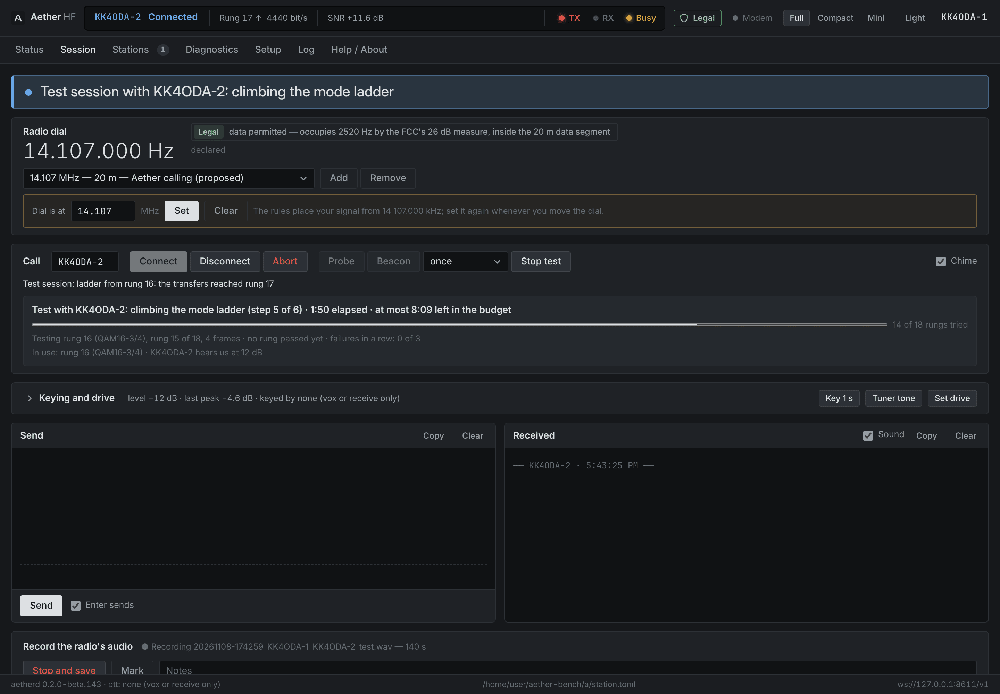
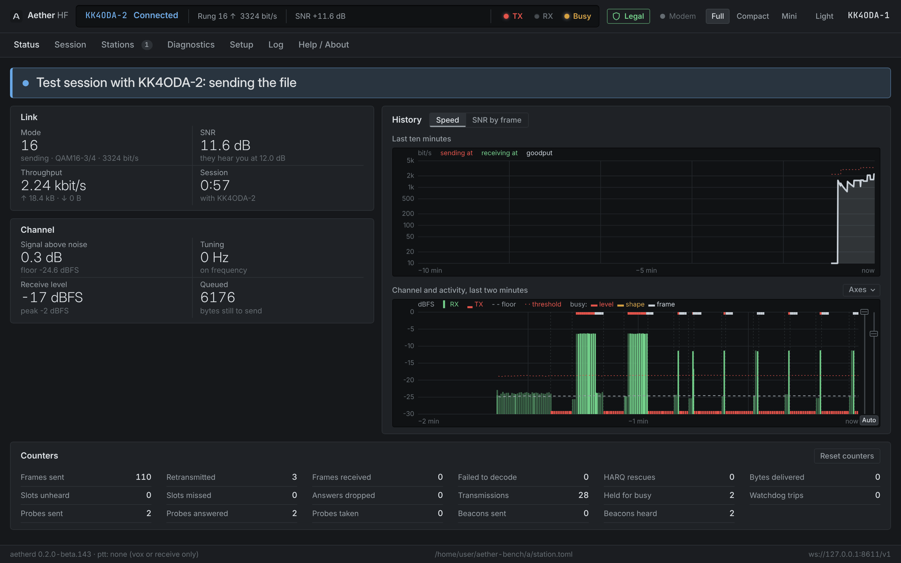
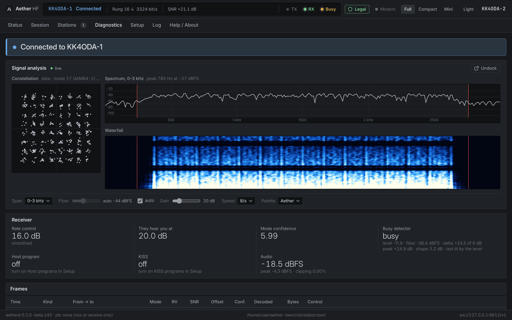
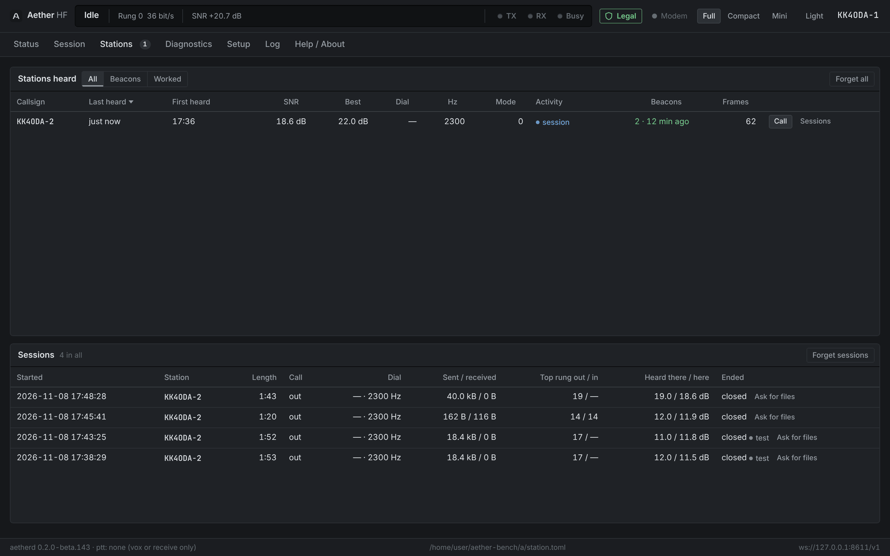
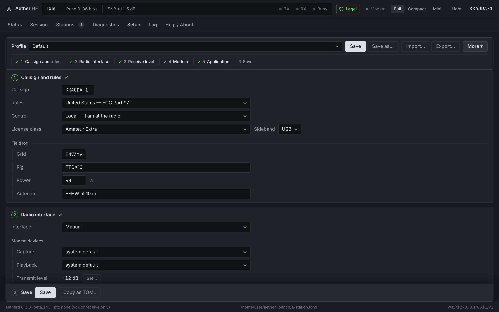
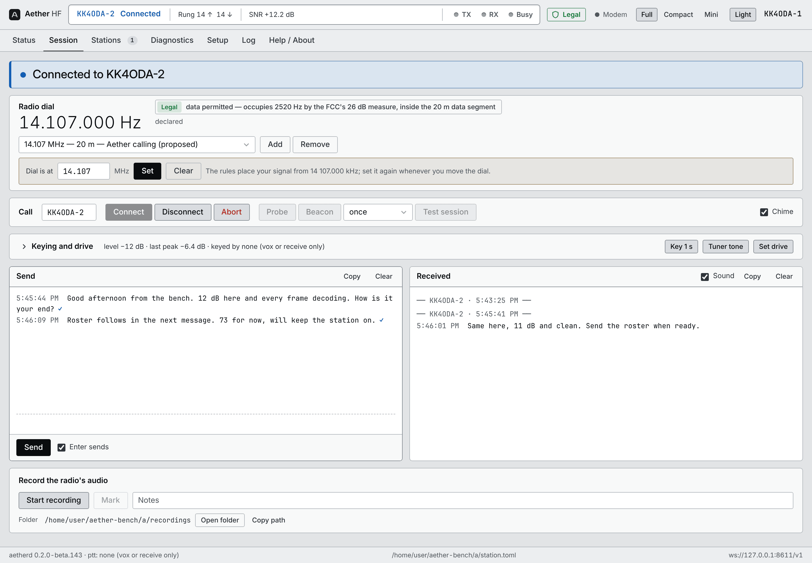
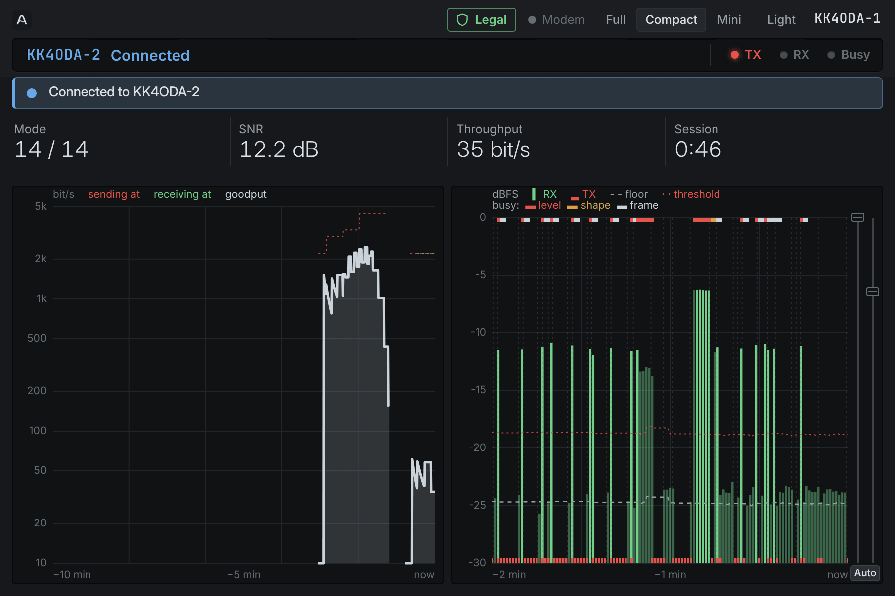
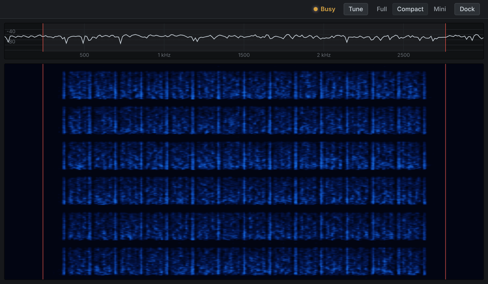
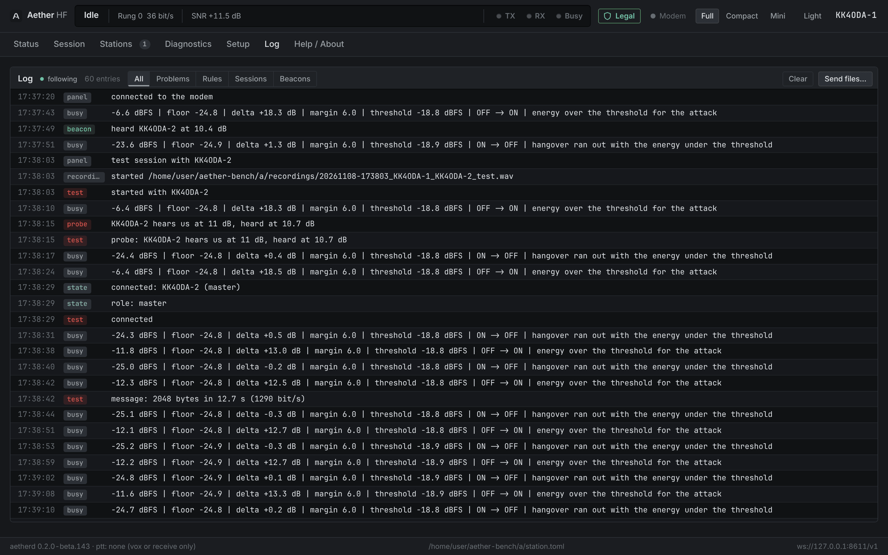

# Aether HF

[](https://github.com/KK4ODA/aether-hf/actions/workflows/ci.yml)
[](https://github.com/KK4ODA/aether-hf/releases)
[](#license)

An open-source HF data modem for amateur radio: error-free ARQ links for Winlink, peer-to-peer
messaging and file transfer over real, noisy, fading HF paths. Winlink Express, Pat, VarAC and
RMS Trimode work with it unchanged, and it is the first modem of
[RadioPost](https://github.com/KK4ODA/RadioPost), email by amateur radio with no central
server. Its air interface is published, every transmission is checked against the licence's
rules before the radio keys, and the same modem runs as a desktop application on Windows,
Linux and macOS or headless on a Raspberry Pi gateway.

> **Status: beta, on the air.** Signed builds ship from
> [Releases](https://github.com/KK4ODA/aether-hf/releases) (`0.2.0-beta.146` at the time of
> writing): a Windows installer, Linux `.deb` and AppImage packages, an unsigned macOS build for
> Apple Silicon, and the standalone `aetherd` daemon for gateways, with in-place updates on a
> beta channel. Aether has been on the air with other stations on 80 m and 40 m since
> 2026-09-23 — conversations, Test sessions and, since November, Winlink through an Aether
> gateway — and each problem the air turns up becomes a scenario in the test harness before it
> becomes a fix ([`field/LOG.md`](field/LOG.md),
> [`docs/research/link-architecture/`](docs/research/link-architecture/README.md)).
>
> **Both stations of a contact need Aether, with the same link protocol** (protocol 12 at the
> time of writing). When a release changes the protocol, the update window says *Update
> required*, and the panel warns when a station calls in another one.

## Screenshots

Two stations on one machine, joined by the simulated channel at 12 dB SNR. The calling
station's Session tab during a Test session, as the Test measures the top of the ladder: the
dial and the rules' verdict, the call and the Test's progress, keying and drive, the
conversation and the recorder. The display well across the top shows the same on every tab:
what the station is doing, the rung and its rate, the SNR, and the TX, RX and Busy lamps.



<table>
<tr>
<td width="50%"></td>
<td width="50%"></td>
</tr>
<tr>
<td><sub><b>Status</b> while the Test sends its file: the link and the channel at a glance, the
speed against the rate of the rung in use, the channel's bursts and acknowledgements, and the
counters.</sub></td>
<td><sub><b>Diagnostics</b> at the receiving station, on a 24 dB path: a 64-QAM frame's
constellation, the spectrum and waterfall with red lines at this station's occupied bandwidth,
and every number behind the receiver and the busy detector.</sub></td>
</tr>
<tr>
<td></td>
<td></td>
</tr>
<tr>
<td><sub><b>Stations</b>: everyone heard, with the bandwidth each runs and its beacons, and every
session: what crossed each way, the fastest rung each way, how each station heard the
other.</sub></td>
<td><sub><b>Setup</b>: one numbered flow from the callsign and the rules to the radio, the levels
and the modem, every setting kept in named profiles.</sub></td>
</tr>
<tr>
<td></td>
<td></td>
</tr>
<tr>
<td><sub><b>Light</b>, for a screen in daylight, during a conversation: what was sent stays in the
Send box and gets a ✓ once the other station has all of it.</sub></td>
<td><sub><b>Compact</b>: the state, the four readings that matter and both plots, small enough
to sit beside a host program.</sub></td>
</tr>
<tr>
<td></td>
<td></td>
</tr>
<tr>
<td><sub>The <b>undocked signal window</b> (Compact view): spectrum and waterfall in a window of
their own, with a Busy lamp and Tune, here during a transfer.</sub></td>
<td><sub><b>Log</b>: one line an entry, tagged and filtered, with <b>Send files…</b> for logs and
recordings.</sub></td>
</tr>
</table>

## Features

★ marks the features that set Aether apart; the first list sums them up, and the lists after it
cover everything else it does.

### What sets Aether apart

* **★ Open from end to end.** The air interface is a public specification
  ([`docs/spec/air-interface.md`](docs/spec/air-interface.md)) whose tables are generated from
  the reference model, so anyone can build a compatible station or check what is on the air.
  The source is MIT or Apache-2.0. Every rung, the fastest included, is open to every station:
  no licence key, no registration, no speed tier.
* **★ It checks the rules before it keys.** Every transmission, of every kind, is judged
  against the licence's rules at the dial the radio is on, before the key goes down: band,
  licence class, data segment, the signal's measured occupied bandwidth against the segment's
  edges, and local, remote or automatic control. FCC Part 97 is built in, 160 m to 6 m with
  the 60 m channels. Until Setup says which rules apply, nothing transmits.
  ([ADR-0018](docs/adr/0018-the-regulatory-gate.md),
  [`docs/user/fcc-regulatory-controls.md`](docs/user/fcc-regulatory-controls.md))
* **★ Collision-free by design.** The calling station grants every transmission slot; the
  other station keys only in a slot it decoded in time to start, and its keying gate refuses a
  late start rather than key into the caller. There is no turn to lose and no guess about who
  holds it. The rules were checked on a formal (TLA+) model and in 5 040 randomised and 224
  adversarial simulated sessions without an overlap, and the scenario harness counts every
  overlap on the air in every run ([ADR-0069](docs/adr/0069-granted-slots.md),
  [`04-formal-spec.md`](docs/research/link-architecture/04-formal-spec.md)).
* **★ It gets through deep below the noise.** The slowest rungs are a constant-envelope tone
  floor that sends at the transmitter's full peak power: 36 bit/s at 10 % frame error from
  −19 dB SNR on a steady channel and −11.7 to −14.5 dB on the ITU fading channels. Calls,
  probes and beacons go there first, and a 2300 Hz session completes on the simulated fading
  channels down to −14 dB on ITU Moderate and Poor and −10 dB on Good
  ([`bench/README.md`](bench/README.md#the-tone-floor-tone_floorcsv-link_tone_floorcsv-p9-8--adr-0013)).
* **★ It chooses its speed by what actually arrives.** Each station picks the rung for its own
  data by how much each rung has delivered per second of airtime, with a frame the other
  station never heard counted as lost, and now and then tries the next rung up with a single
  frame ([ADR-0099](docs/adr/0099-one-rate-controller-at-the-sender-and-link-protocol-12.md)).
  A frame the path will not carry at any slower rung is cut into pieces that it will, so a
  transfer does not stall ([ADR-0086](docs/adr/0086-a-stuck-frame-goes-in-pieces.md)).
* **★ It learns the radio it drives.** Aether times its own radio's keying and its own
  rendering, and starts each answer that much early so it reaches the air on time. It tells the
  other station how long its radio takes to hear again (a VOX interface's hold), learns the
  same of stations that do not say, follows a station whose rig is off frequency or drifting,
  and keeps its busy detector's noise floor right while the radio's AGC turns the gain down and
  up ([ADR-0071](docs/adr/0071-the-keying-latency-counts-the-radio-and-the-render.md),
  [ADR-0079](docs/adr/0079-the-receiver-follows-a-session-station-off-frequency.md),
  [ADR-0078](docs/adr/0078-the-busy-detectors-floor-follows-the-radios-gain.md)).
* **★ It says when the radio is in the way.** While it listens, Aether reads the radio's receive
  filter from the band's noise. A banner on every view says when the filter cuts an edge of
  Aether's signal 12 dB or more, and names the knob: the IF shift, the high or low cut, or the
  width. Another says when the receive audio clips. Both receivers also read the noise across
  the band, so a filter that does cut in costs far less: with a receiver's IF shift turned fully
  left, 23 dB down across the top of a 2300 Hz signal, OFDM rungs 13 and 16 went from no frame
  decoded to 30 of 30
  ([ADR-0105](docs/adr/0105-the-receive-filter-is-read-at-the-signals-edges.md),
  [ADR-0104](docs/adr/0104-the-receivers-read-the-noise-across-the-band.md),
  [`noise_shape_cuts.csv`](bench/baselines/noise_shape_cuts.csv)).
* **★ Every contact can become a measurement.** A two-way probe says how each station hears
  the other without starting a session. A Test session measures a path end to end and records
  it. Recordings keep what the modem made of every frame beside the audio, replay through the
  receiver, and line up with the other station's; one button sends them to the project or asks
  the other station for its side.
* **★ Two bandwidths that find each other.** 2300 Hz for Winlink and the most data, 500 Hz for
  peer-to-peer contacts. A 2300 Hz station answers a 500 Hz call at 500 Hz, calls a station it
  knows runs 500 Hz at 500 Hz, falls back to 500 Hz after unanswered calls, and goes back to its
  own afterwards. Probes and beacons are heard across bandwidths.
* **★ Native everywhere, headless too.** One modem for Windows, Linux (x86-64 and ARM64) and
  macOS, with no emulation layer; the daemon alone runs a Raspberry Pi 4 gateway under systemd,
  and its panel can be watched from a browser over an SSH tunnel. A documented JSON control API
  drives everything the panel does.
* **★ One radio, several programs.** A Winlink gateway program on the host port and a RadioPost
  gateway on the control API can run on the same radio at once. Each program claims its own
  callsigns; a call is answered only while the program holding its callsign listens, and the
  session is that program's alone
  ([ADR-0106](docs/adr/0106-each-program-answers-for-its-own-callsigns.md)).
* **★ Every number can be reproduced.** The Python reference model is the specification and
  the shipped Rust core is held bit-exact to it in CI. Every performance figure comes from a
  benchmark curve committed in [`bench/baselines/`](bench/baselines/). A scenario harness runs
  two real daemons through simulated band conditions every night, and more than a hundred
  short decision records ([`docs/adr/`](docs/adr/)) say why each choice was made.

### The modem

* Two waveforms, **2300 Hz** and **500 Hz**, changed live with no restart.
* A **twenty-rung ladder at 2300 Hz**, from 36 bit/s to about 5.5 kbit/s: the tone floor
  (rungs 0–1), four fast tone kinds at 50 and 100 baud (76–228 bit/s, rungs 2–5) and OFDM from
  BPSK 1/5 to 64-QAM 5/6 (rungs 6–19).
* A **fifteen-rung ladder at 500 Hz**, from 36 bit/s to about 1 kbit/s: the tone floor, three
  four-tone kinds (76, 112 and 139 bit/s) and OFDM to 64-QAM 5/6.
* ★ The **tone floor**: 16-FSK, one tone at a time with continuous phase, so the envelope is
  constant and the transmitter's whole peak power goes into it; three Costas sync blocks name
  each frame's kind. The same frames on both bandwidths, so a 500 Hz and a 2300 Hz station hear
  each other's calls, probes and beacons.
* **3GPP TS 38.212 LDPC** with CRC and rate matching, and **HARQ incremental redundancy**:
  retransmissions carry fresh parity that the receiver soft-combines with what it already has.
* Each frame states **exactly how many frames of its transmission follow**, outside the
  codeword, so a receiver knows when a burst ends without waiting on silence and copies still
  combine.
* **Peak reduction** (clip and filter) on the OFDM frames, and an **impulse blanker** against
  static crashes.
* A **matched-filter-bank preamble detector**, so at the bottom of the OFDM ladder the code,
  not acquisition, sets the limit; every curve is measured with up to ±100 Hz of tuning error
  and ±50 ppm of sound-card clock offset.
* A receiver that **weighs each OFDM carrier by its own noise**, so a narrowband interferer
  inside the passband costs the carriers it sits on, not the frame
  ([ADR-0043](docs/adr/0043-per-carrier-noise-and-the-rv-order.md)).
* Receivers that read **the shape of the noise across the band**, from the pilots and the
  tones, so a radio filter that cuts into the signal, noise and all, no longer reads as a bad
  channel ([ADR-0104](docs/adr/0104-the-receivers-read-the-noise-across-the-band.md)).
* **Pilot tracking that follows fast flutter** (polar and auroral paths) and **per-tone level
  tracking** on fading, each measured on the flutter channel too
  ([ADR-0082](docs/adr/0082-the-ofdm-receiver-follows-a-channel-that-moves-within-the-frame.md),
  [ADR-0080](docs/adr/0080-the-four-tone-receiver-reads-each-tones-level-from-the-data.md)).
* An **echo reading** on the tone floor's frames that keeps a long-delay NVIS path off the
  rungs its echo would break ([ADR-0087](docs/adr/0087-the-tone-floor-reads-the-paths-echo.md)).
* A **streaming receiver** that runs in a fraction of real time on a modest mini PC, and puts
  back the gaps a sound card drops so the station's clock stays true
  ([ADR-0089](docs/adr/0089-a-capture-skip-is-put-back-as-silence.md)).

### The link

* **Selective-repeat ARQ** with HARQ, sessions of any length, and bursts sized to fit the key
  watchdog.
* ★ **Granted slots** (above): the caller grants every slot, and the station that was called
  keys only in a slot it has read.
* ★ **Rate selection by measured delivery** at each sender, starting from what the call
  measured and trying the next rung up with one frame at a time.
* **Stuck frames re-encoded or split** into pieces a slower rung can carry.
* **Compression** (deflate over the session), negotiated at connect, off by default.
* **Calls** start on the tone floor, so a weak station is heard on the first try, and
  alternate with the OFDM family.
* A **link probe**: one frame and one answer, no session, giving the SNR each way; answered
  across bandwidths, and tried once more if the first goes unanswered.
* **Beacons**: the station's callsign on the tone floor, once or every 10–60 minutes while
  someone is at the station; never under automatic control.
* **Datagrams** outside sessions, for KISS programs, at a rung both bandwidths hear.
* An orderly **disconnect** that delivers what is queued for a minute at most, then closes;
  **Abort** to leave at once, with the other station told.
* **Closing Morse identification** handled for you: each station's identifier is the last
  thing it sends for a session, after the other's goodbye, never over it; a US callsign always
  identifies (§97.119), without its SSID and within the 20 wpm cap on an automatic identifier.
* **Several callsigns**: a station answers to its own, and each program attached answers for
  the callsigns it claims (a host program's `MYCALL`), with SSIDs and `/` suffixes.

### Working with the radio

* **Keying** by a serial port's RTS or DTR line, by the radio's own **CAT** command (Yaesu,
  Kenwood, Icom CI-V), through **rigctld** (Hamlib) or **FLRig**, by a **CM108-class** codec's
  GPIO pin (DRA, URI), by **VOX**, or by the **host program** on `PTT ON`/`PTT OFF`.
* Over CAT, rigctld or FLRig, Aether **reads the dial** once a second when idle and **tunes the
  radio** when a dial memory is picked; with FLRig or rigctld a host program can tune through the
  same radio at the same time.
* **Dial memories** seeded from the project's calling-frequency plan for 80 m to 6 m
  ([`docs/user/frequency-plan.md`](docs/user/frequency-plan.md)), and *Dial is at* for a radio
  that cannot report its dial.
* **Key 1 s** checks the PTT and says whether the radio's receive audio changed while keyed;
  **Tuner tone** for an antenna tuner; **Set drive** sends real bursts to set the level against
  the ALC; the last transmit peak shows the modem's headroom.
* A **receive level** meter (Setup step 3) that says *Good*, too quiet, or clipping.
* ★ A **receive filter** reading: how far each edge of Aether's signal lies under the radio's
  passband, read from the band's noise in seconds even on a busy band, with a banner that names
  the knob when an edge is cut and another when the receive audio clips
  ([ADR-0105](docs/adr/0105-the-receive-filter-is-read-at-the-signals-edges.md)).
* A **key watchdog** (30 s by default), whole bursts handed to the sound card at once, and the
  key released by the sound card's own clock, not a guess.
* ★ **Turnaround** declared in the call, so the other station waits for this radio to hear
  again; an **answer gap** for a VOX station that does not declare one, also **learned per
  station** from its calling again.
* ★ **Keying latency learned**: Aether measures its radio's keying command and its own
  rendering and places each answer to start on time.
* A **busy detector** on level, a narrowband signal's shape and decoded frames: calls, probes
  and beacons wait for a clear channel (and through the pauses of another session heard on the
  frequency); answers inside a session never wait.
* The receiver **follows a station off frequency** during a session and returns to the dial
  after.
* The first transmission after a host program attaches is checked: if the receive audio does
  not change while keyed, the log says the radio may not be transmitting.

### The rules, built in

* ★ **FCC Part 97** as data: the bands from 160 m to 6 m in ITU Region 2, the data segments,
  privileges by licence class, the 60 m channels, the automatic-control sub-bands, power limits
  and the voluntary band plan, read from the e-CFR.
* ★ **What each rung occupies** is measured, both ways the rule can be read, and the wider
  decides; it is judged against the segment's edges with a margin, and near an edge the link is
  held to the rungs that fit.
* ★ **Local, remote or automatic control**, which Aether never guesses; under automatic control
  every transmission stays inside the §97.221(b) sub-bands (or on 6 m), and an **answer-only**
  mode takes calls and makes none.
* A **rules badge** in the header (*Legal*, *Warning*, *TX blocked*) with its reasoning, a
  Rules card in Diagnostics, and band-plan guidance where a legal transmission sits outside
  the band plan's digital areas.
* *None* for operators under another administration's rules, who check every transmission
  themselves.

### Host programs and other software

* The **published TNC host interface** (command port 8300, data port 8301) that Winlink Express,
  Pat, VarAC and RMS Trimode already use: Winlink P2P and gateway sessions, VarAC chat, pings,
  files and CQs, and Trimode gateways that scan.
* Either side can own the radio: **Aether keys** (CAT, rigctld, FLRig, serial, CM108, VOX), or
  the **host program keys** and tunes it on Aether's `PTT ON`/`PTT OFF`.
* **One place for each setting**: while a program is attached, its callsign and its `BW500`
  / `BW2300` / `BW2750` set the station's (Setup shows *Host* there), and the station's own come
  back when it leaves; the program sees only its own sessions.
* ★ **Several programs on one station**: a program on the host port and programs on the control
  API each claim their own callsigns, with answering off until they say. A call is answered only
  while the program holding its callsign listens, the session is that program's alone, and the
  others see the channel busy until it ends. A program that crashes stops being answered for.
  While a host program is attached it speaks for the station: the station's own callsigns it
  does not hold are not answered
  ([ADR-0106](docs/adr/0106-each-program-answers-for-its-own-callsigns.md)).
* A **KISS-over-TCP port** (127.0.0.1:8100) for APRS and packet programs and VarAC's broadcasts,
  several clients at once, with ACKMODE; each frame goes on the air as a datagram that any
  Aether station hears ([`docs/user/kiss.md`](docs/user/kiss.md)).
* A **control API**, JSON over WebSocket or `POST /v1/<method>`, with events for everything the
  station does; a program on it claims its callsigns and is told which sessions are its own.
  Loopback by default, and a token required on any other address
  ([`docs/spec/control-api.md`](docs/spec/control-api.md)).
* **One instance**: a host program launching Aether while it runs brings up its window.

### The station panel

* A **display well** across the top of every tab: the state and the other station, the dial,
  the rung and its rate each way, the SNR, and the TX, RX and Busy lamps, plus the rules badge
  and a Modem lamp.
* **Full**, **Compact** and **Mini** views, and a **Light** theme for daylight and sunlight
  (lit lamps become filled blocks in glare).
* **Banners** across every tab: the session (and whose it is, when a program's), setup still
  needed, unsaved changes, a station in another bandwidth, protocol or SSID (with buttons that
  fix it), the radio's receive filter cutting the signal and clipped receive audio (these two in
  Compact too), and faults; a **chime** when a session comes up and when it ends.
* A chip naming the **programs using the station** and whether each is answering, with the
  callsigns each answers for in its tooltip.
* **Session**: the dial and its legality, call, probe, beacon and Test, keying and drive, the
  conversation, and the recorder.
* A **Send box that tracks delivery**: what was sent stays with its time and turns ✓ only when
  the other station has all of it, in order, or ✗ if the session ended first.
* **Status**: link and channel readings, the speed over ten minutes on a log scale against the
  rate of the rung each way, the SNR of every frame against the rung's threshold, the
  channel's level and busy periods with adjustable axes, the receive filter's reading, and
  counters.
* **Stations**: the 200 stations heard most recently, with bandwidth, beacons and filters, and
  the last 500 sessions with what crossed each way, the fastest rung each way, how each station
  heard the other and how the session ended.
* **Diagnostics**: constellation, spectrum and waterfall (span, floor, gain, speed, palette,
  and red lines at this station's occupied bandwidth), undockable into a window of its own with
  its own Full, Compact and Mini views, a Busy lamp, Tune and *Keep on top*; the receiver's
  readings; every frame found, decoded or not; the rules' decisions.
* **Setup**: one numbered flow (callsign and rules, radio interface, receive level, modem,
  application, save), interface presets, and **profiles** saved, switched, exported and imported
  (what belongs to the computer stays out of them); unsaved changes are marked on every tab.
* **Log** with filters, and **Help / About** with the version, the paths and the updates.
* A tooltip on every control, reading and box, and screen-reader roles on the live readings.

### Measuring, recording and reporting

* ★ A **Test session** against any listening station: probe, call, message, file, a short
  measurement at each rung, disconnect, recorded as one report the project can replay
  ([`docs/user/field-test.md`](docs/user/field-test.md)).
* **Recordings** of the radio's audio at 48 kHz with a JSON record of every frame, the busy
  detector's readings, each rate decision and the keying; every session automatically if
  wanted, and on until the closing identifiers have gone.
* ★ With CAT, rigctld or FLRig a listening recording also keeps the radio's **S-meter** and dial,
  and on a Yaesu its AGC, mode, filter, RF gain, attenuator and preamp; **Mark** numbers the
  moments you change something on purpose.
* `aetherd --replay` runs a recording back through the receiver; `--busy-trace` and
  `--passband-trace` re-run the busy detector and the receive-filter estimate over one.
* ★ **Send files…**: one zip of logs, the diagnostic bundle and chosen sessions, uploaded to the
  project with a progress bar, emailed, or **requested from the other station** by a link that
  opens its form filled in; or a Test reported as a GitHub issue.
* **Debug mode** during the field trials: sessions a program runs (Winlink Express, Pat, VarAC,
  RadioPost) are sent to the project after they end, said once on the panel, with one switch to
  turn it off.
* Logs of every run kept for 30 days, and a **diagnostic bundle** of the station's state.

### Installing, updating and running unattended

* A **Windows installer**, Linux **`.deb`** and **AppImage**, a macOS **Apple Silicon** build,
  and the **daemon alone** for Linux x86-64 and ARM64, Windows and macOS, with an SBOM and
  `SHA256SUMS` beside every release.
* **Signed in-place updates** on stable, beta or nightly channels; a protocol change is offered as
  *Update required*; **Restore the previous version** puts back the settings that version reads.
* Settings carried forward across versions by migration, with backups to go back to.
* Updates and uninstalls ask the modem to stop rather than kill it, so a CAT-keyed radio is not
  left keyed; the window asks before closing over a session, a call or a Test, and a stopping
  modem ends its session with a goodbye and its identifier.
* A **gateway kit**: headless install, a systemd unit, cross-compiling for ARM64, automatic
  control inside the §97.221(b) sub-bands, and step-by-step RMS Trimode and Winlink Express
  setups ([`docs/user/gateway-kit.md`](docs/user/gateway-kit.md),
  [`docs/user/winlink-gateway.md`](docs/user/winlink-gateway.md)).

### How it is built and tested

* ★ A **Python reference model** that designs and validates the waveform and generates the
  golden vectors the **Rust core** is held to bit for bit; CI regenerates every vector and fails
  on drift, and the protocol engine is replayed against the model input by input.
* A **calibrated HF channel simulator** (ITU-R F.1487, SNR in 3 kHz, streaming and seeded).
* ★ A **scenario harness** that runs two real daemons in lockstep through band conditions:
  fading paths from NVIS to polar, other data stations and RTTY contests, FT8 beside the
  passband, static crashes, AGC, VOX radios slow to switch, slow computers and dropped audio,
  with stand-ins for host programs and gateways; a quick set in CI, the whole set nightly and a
  gateway's day weekly, each run judged on invariants as well as results
  ([ADR-0042](docs/adr/0042-the-scenario-harness.md), [`bench/scenarios/`](bench/scenarios/)).
* **Strict tests**: no threshold is ever relaxed to make a suite pass; a known defect is a
  strict `xfail` that names it.

## Getting it

* **Desktop:** download the installer for Windows, Linux or macOS from
  [Releases](https://github.com/KK4ODA/aether-hf/releases) and follow
  [`docs/user/install.md`](docs/user/install.md); [`docs/user/manual.md`](docs/user/manual.md) is
  the operator's manual, tab by tab. On first start the panel opens on Setup: the callsign and
  the rules, the radio interface (sound card, keying and CAT), the receive level and the
  modem's settings; the Session tab's *Set drive* sets the transmit level against the rig's ALC.
  The Windows installer is not yet Authenticode-signed, so SmartScreen will ask, and the macOS
  build is unsigned and untested on a real Mac — the guide says how to open it.
* **Testing on the air:** [`docs/user/tester-guide.md`](docs/user/tester-guide.md) is the one
  page a tester needs: install, set up, connect through Winlink Express, Pat or VarAC, and what
  debug mode sends.
* **Host programs:** turn on *Host programs* in Setup step 5 and point the program at
  `127.0.0.1`, port 8300. In Winlink Express that is a *Vara HF* session with its automatic
  launch off and Aether started first; in Pat, the `varahf` transport. How to set up each one,
  with the program owning the radio or Aether owning it, is in
  [`docs/user/host-programs.md`](docs/user/host-programs.md); what each program sends and what
  has been verified is in [`docs/spec/host-interfaces.md` §7](docs/spec/host-interfaces.md).
* **APRS and packet programs:** the KISS port ([`docs/user/kiss.md`](docs/user/kiss.md)).
* **The rules:** nothing is transmitted until Setup step 1 says which rules the station runs
  under, how it is controlled and the licence class. The operator stays responsible.
* **Where to operate:** [`docs/user/frequency-plan.md`](docs/user/frequency-plan.md) proposes a
  calling frequency on every band from 80 m to 6 m; the panel offers them as dial memories.
* **Gateway:** the `aetherd-…` archive and [`docs/user/gateway-kit.md`](docs/user/gateway-kit.md).
  A Winlink gateway on Windows — RMS Trimode at home, Winlink Express in the field — is set up
  step by step in [`docs/user/winlink-gateway.md`](docs/user/winlink-gateway.md). An Aether
  gateway must not be listed as a gateway for another modem: the signals are not compatible.

## RadioPost

[RadioPost](https://github.com/KK4ODA/RadioPost) is email by amateur radio with no central server:
ordinary email addresses, gateways any licensed amateur can run, post offices that clubs and
groups run, and forwarding by radio when the Internet is down. It is a separate project with its
own specifications, in early design, and it is not compatible with Winlink. Aether is its first
modem; RadioPost does not depend on it.

RadioPost programs drive a modem through RadioPost's modem interface (RPMI,
[RP-4](https://github.com/KK4ODA/RadioPost/blob/main/spec/rp-0004-modem-interface.md)), which
maps one to one onto Aether's control API
([RP-4 §9.1](https://github.com/KK4ODA/RadioPost/blob/main/spec/rp-0004-modem-interface.md#91-aether)).
From `0.2.0-beta.146` the two systems can share a station: a RadioPost gateway claims callsigns of
its own (`N1CALL-10`, say) beside RMS Trimode's `MYCALL` (`N1CALL-1`), and each answers only for
its own ([ADR-0106](docs/adr/0106-each-program-answers-for-its-own-callsigns.md)). One Aether
serves both; there is no separate RadioPost build of the modem.

## Where things stand

A full technical audit was done on 2026-09-13 — read [`docs/AUDIT.md`](docs/AUDIT.md). In
short: the original prototype's DSP, FEC, sync, audio and protocol layers each had a
disqualifying defect, and its test suite had been relaxed until it passed. Every finding was
encoded as a strict `xfail` test and retired together with the module it documented as the
Phase 1 rewrite replaced it; the audit itself remains the record of why.

The plan is [`docs/ROADMAP.md`](docs/ROADMAP.md) (architecture, DSP decisions, protocol/API
design, testing strategy, release engineering, phased tasks), and the field requirements
distilled from how the community has received other open HF modems are in
[`docs/COMMUNITY-CONCERNS.md`](docs/COMMUNITY-CONCERNS.md).

| Phase | Scope | State |
|---|---|---|
| 0 — Audit & stabilization | tooling, strict tests, CI, calibrated simulator, ADRs | done |
| 1 — Core HF modem | LDPC (3GPP TS 38.212), OFDM TX/RX, sync, end-to-end loopback, benchmarks, golden vectors | done |
| 2 — Link robustness | ARQ, rate control, HARQ-IR, low-SNR modes, PAPR, impulse noise | done |
| 3 — Application integration | Rust core bit-exact with the model, `aetherd`, PTT/CAT, control API, host interface, gateway kit | done; Winlink Express, Pat, VarAC and RMS Trimode pass the bench |
| 4 — Desktop application | station panel, Tauri shell, setup, diagnostics, accessibility | done; the three-ham usability test is open |
| 5 — Release infrastructure | one version number, installers that bundle the daemon, signed updates on three channels, SBOM, benchmark gate | done — betas flow, `0.2.0-beta.2` through `.146` |
| 6 — Field validation | recordings, replay, simulated channel, field protocol, the air, on-air crowdsourcing (the Test session) | **in progress**: on the air with other stations since 2026-09-23, Winlink through an Aether gateway since 2026-11-06; granted slots (link protocol 8 onwards), the scenario harness and the rate controller's two reviews came from those sessions |
| 7 — The 500 Hz waveform and the link probe | the bandwidth peer-to-peer contacts use, the bandwidth in the handshake, answer-only, a two-way probe | done |
| 9 — The modem's second rung | a faster start, the tone floor and the middle tone kinds, fading and NVIS receivers, an A/B bench against another modem, the deferred pilot/prefix/2750 Hz experiments, time diversity — each with its curve | **in progress**: the tone floor, fast tones and four-tone kinds, fast-fading and echo-aware receivers, stuck frames in pieces done; the A/B runs and P9-3 open; time diversity paused |
| 8 — Aether on a phone | the modem in a Pi-sized box the phone talks to, then a phone app, then the modem in the phone | back burner |
| 10 — Aether FM foundation | an FM PHY on the same link layer | back burner |

## Architecture in one paragraph

Application adapters (the host interface for Winlink and chat programs, a KISS port, and the
control API that RadioPost's modem interface maps onto; AGWPE with FM) sit on a PHY-agnostic
link layer (session, granted slots, selective-repeat ARQ with HARQ-IR, rate selection,
compression, datagrams) and a modem framework (frame codec, scheduler, metrics), which drive a
pluggable PHY (HF OFDM and tone frames; FM later) over a hardware abstraction (audio, PTT, rig
control, or the channel simulator). Nothing reaches the transmitter without the regulatory
gate's leave. The Python model in `model/` is the specification: it designs and validates the
waveform and generates the golden vectors the Rust core in `core/` is held to, bit-exactly, in
CI. The desktop shell in `app/` supervises the daemon and serves its panel (ADR-0001, ADR-0005).
Diagrams and rationale:
[`docs/ROADMAP.md` §4](docs/ROADMAP.md#4-recommended-target-architecture).

## Repository layout

```
docs/          AUDIT.md · ROADMAP.md · COMMUNITY-CONCERNS.md · MAINTAINING.md ·
               adr/ (decisions) · spec/ (public air interface, control API, host interfaces) ·
               user/ (manual, install, tester guide, gateway kit, Winlink gateway, frequency
               plan, FCC regulatory controls, host programs, KISS programs, field-test protocol) ·
               research/ (the reviews behind the larger decisions) · images/
model/         Python reference model: aether_model/{channel,waveform,fec,phy,frame,link,hal} + tests/
core/          the shipped Rust workspace: aether-fec · aether-phy · aether-link · aetherd
               (aetherd/data/: the regulatory profiles and the measured occupancy)
app/           ui/ (the station panel, no build step) · src-tauri/ (the desktop shell)
field/         the field log, findings from the air, and the recorded sessions that are now
               regression tests
deploy/        systemd unit for a gateway
tools/         benchmarks (bench_phy, bench_link, bench_tone, bench_calls …) · vector
               generators · release.py · the scenario harness (channel_server.py,
               session_matrix.py, soak.py) · field tools (field_ingest.py, two_sides.py,
               rung_reading.py, floor_trace.py) · kiss_test_client.py · make_occupancy.py ·
               make_spec.py · drive_upload/ (the upload script for files from other stations)
bench/         committed baseline curves, including the release gate's; ab/ (the A/B bench);
               scenarios/ (the scenario harness's band conditions)
research/      frozen research code: the link review's simulator and TLA+ models
vectors/       golden test vectors (TX bit-exact, RX must decode)
Logos/         the artwork the icons are made from
```

## Working on it

The model needs Python ≥ 3.12 and [uv](https://docs.astral.sh/uv/) (`pip install uv`
works too; then use `python -m uv`). The core needs a stable Rust toolchain; the shell
additionally needs [Tauri's prerequisites](https://tauri.app/start/prerequisites/).

```bash
uv sync                      # creates .venv with numpy/scipy + dev tools
uv run pytest                # strict suite; `-m "not slow"` for the quick set
uv run ruff check . && uv run ruff format --check . && uv run mypy
uv run pre-commit install    # optional: run the same checks on every commit

cd core && cargo test --release --workspace        # acquisition is ~20x slower in debug
cargo clippy --all-targets --all-features -- -D warnings
```

`aetherd --config <file> --dry-run` runs the daemon with no radio; two daemons joined by
`[sim]` make a bench with no radio either (`docs/user/field-test.md` §1). The scenario harness
runs two daemons through a band condition in lockstep, 2.5–5× faster than the air:
`uv run python tools/session_matrix.py --tag quick` (CI's set), `--tag stress --jobs 4`, or
named scenarios from `bench/scenarios/` (its README says how to write one). CI runs all of the
above on Windows and Ubuntu and regenerates every cross-validation vector, failing on drift:
a mismatch means the core is wrong, never that the vectors are stale.

Conventions that matter:

* **SNR is always referenced to a 3 kHz noise bandwidth**; Doppler spread is the ITU-R
  F.1487 2σ value. `model/aether_model/channel.py` is calibrated to both and its tests are
  the guarantee behind every benchmark number.
* Minimum usable SNR (FER ≤ 10 %, random CFO and sample-rate offset), AWGN / ITU Poor: the
  tone floor's tone-24 (36 bit/s, both bandwidths) at −19.0 / −14.5 dB; the fastest tone rung,
  tone100-153 (228 bit/s, 2300 Hz), at −11.2 / −4.1 dB; then OFDM at 2300 Hz, BPSK 1/5 at
  −5.2 / −0.3 dB, QPSK 1/2 at +1.0 / +6.0 dB, 16-QAM 1/2 at +6.0 / +12.5 dB and 64-QAM 5/6 at
  +16.9 dB on AWGN. At 500 Hz the four-tone rungs reach −14.3, −13.0 and −11.1 dB on AWGN. The
  whole table, per channel class, is in [`bench/README.md`](bench/README.md).
* **No test threshold is ever relaxed to make a suite pass.** A known defect gets an
  `xfail(strict=True)` that names the finding; a target that genuinely changes gets an ADR.
* Numbers about the waveform come from `model/aether_model/waveform.py`, never from prose;
  the public [air-interface spec](docs/spec/air-interface.md)'s tables are generated from it.

## Contributing

See [`CONTRIBUTING.md`](CONTRIBUTING.md) for the rules and
[`docs/MAINTAINING.md`](docs/MAINTAINING.md) for how pull requests are reviewed. Issues and
pull requests are welcome; the roadmap is the queue, and the most useful contribution right
now is a Test session with another station, contributed from the Log tab (**Send files…** →
*Report my last test as a GitHub issue*) as [`docs/user/field-test.md`](docs/user/field-test.md)
describes. Protocol and DSP decisions go through short ADRs in `docs/adr/`. The
[code of conduct](CODE_OF_CONDUCT.md) is the hobby's own: be excellent to each other.

## Prior art and independence

Aether HF is designed from public standards and open literature (3GPP TS 38.212 LDPC,
IEEE 802.11 LDPC, ITU-R F.1487 channel models, MIL-STD-188-110, OFDM synchronization
literature) and open implementations we can learn from (codec2/FreeDV data modes, FreeDATA,
ARDOP). It does not copy or reverse-engineer VARA; the host-interface compatibility targets
VARA's *published* TCP command set only, and Aether frames are not compatible with VARA's on
the air.

<!-- tota-support:start -->
## Support

Aether HF is free and stays free. It is written by KK4ODA, who also runs
[Tiles on the Air](https://tilesontheair.com), a free program for portable
operators, and both are kept going by the people who use them. If Aether HF is
useful to you, a contribution through the
[Tiles on the Air giving page](https://tilesontheair.com/Giving) helps keep this tool and Tiles
running. Nothing is ever locked behind it, and a bug report or an on-air
report helps just as much.
<!-- tota-support:end -->

## License

Dual-licensed under **MIT OR Apache-2.0** — see [`LICENSE-MIT`](LICENSE-MIT) and
[`LICENSE-APACHE`](LICENSE-APACHE). Contributions are accepted under the same terms.

## Authors

KK4ODA — author. Development is done with Claude Code as a co-developer; all design
decisions and on-air responsibility remain with the licensed operator.
