# Aether operator's manual

**Aether HF and Aether FM: an open-source data modem for amateur radio.**

| | |
|---|---|
| **Status** | Current |
| **Version** | 1.14.2 |
| **Updated** | 2026-11-19 |
| **Describes** | Aether HF 0.2.0-beta.167 |
| **Licence** | CC BY 4.0 |

This manual shows you how to set up Aether, make contacts with it, and use it with Winlink
Express, Pat, VarAC, RadioPost and packet programs. It is written for licensed amateurs. You do
not need to know how a modem works inside.

RadioPost, the email program that runs on Aether, has
[its own manual](https://github.com/KK4ODA/RadioPost/blob/main/docs/manual/manual.md). This
manual points to it wherever RadioPost is the place to set something, and RadioPost's manual
points back here for the modem.

## Contents

<!-- toc -->

**[Part 1. Getting started](#part-1-getting-started)**

- [1. About this manual](#1-about-this-manual)
- [2. What Aether is](#2-what-aether-is)
- [3. What you need](#3-what-you-need)
- [4. Installing Aether](#4-installing-aether)
- [5. Your first contact, in brief](#5-your-first-contact-in-brief)

**[Part 2. The window](#part-2-the-window)**

- [6. The window at a glance](#6-the-window-at-a-glance)
- [7. Setup](#7-setup)
- [8. The Session tab](#8-the-session-tab)
- [9. The Status tab](#9-the-status-tab)
- [10. The Stations tab](#10-the-stations-tab)
- [11. The Diagnostics tab](#11-the-diagnostics-tab)
- [12. The Log tab, and sending files](#12-the-log-tab-and-sending-files)
- [13. Help and updates](#13-help-and-updates)

**[Part 3. On the air](#part-3-on-the-air)**

- [14. Making a contact, step by step](#14-making-a-contact-step-by-step)
- [15. How a session works](#15-how-a-session-works)
- [16. Speeds: the rungs](#16-speeds-the-rungs)
- [17. Bandwidth: 2300 or 500 Hz](#17-bandwidth-2300-or-500-hz)
- [18. Probes, beacons and the Test session](#18-probes-beacons-and-the-test-session)
- [19. The rules](#19-the-rules)

**[Part 4. Aether with other programs](#part-4-aether-with-other-programs)**

- [20. The programs and their ports](#20-the-programs-and-their-ports)
- [21. Winlink Express, Pat and VarAC](#21-winlink-express-pat-and-varac)
- [22. A Winlink gateway](#22-a-winlink-gateway)
- [23. RadioPost](#23-radiopost)
- [24. KISS programs](#24-kiss-programs)
- [25. Several programs on one station](#25-several-programs-on-one-station)

**[Part 5. Aether FM](#part-5-aether-fm)**

- [26. Aether FM: what is coming](#26-aether-fm-what-is-coming)

**[Part 6. Help](#part-6-help)**

- [27. What the readings mean](#27-what-the-readings-mean)
- [28. Troubleshooting](#28-troubleshooting)
- [29. Reporting a problem](#29-reporting-a-problem)
- [30. Glossary](#30-glossary)
- [31. Quick reference](#31-quick-reference)

**[Appendix](#appendix)**

- [Where to read more](#where-to-read-more)
- [Keeping this manual current](#keeping-this-manual-current)
- [Change log](#change-log)

<!-- /toc -->

---

# Part 1. Getting started

## 1. About this manual

### Which version this is

Two numbers at the top of this manual tell you what you are reading:

- **Version** is this manual's own version. It goes up each time the manual changes. The
  [change log](#change-log) at the end says what changed.
- **Describes** is the Aether release the manual is written for. It moves with every release.

The copy in the repository follows the application as it is being built, so it can describe
something one release ahead of yours. Releases after 0.2.0-beta.159 also carry their own copy as
a PDF file, named `Aether-Manual-<release>.pdf`, beside the installers. Use that one if you want
the manual for exactly the version you installed.

To see which version you have, open the **Help** tab: **About** shows it.

### Printing the manual

- **Download the PDF** from the release page ([Installing Aether](#4-installing-aether)). It is
  Letter size, with a cover, the contents and page numbers, and prints on A4 too.
- **Make it yourself** from a copy of the repository: `python tools/manual/build.py pdf`. It
  needs Python 3.12 or later and Google Chrome, Chromium or Microsoft Edge. Without one of them,
  `python tools/manual/build.py html` writes a web page you can open in any browser and print
  with **Print**, then **Save as PDF**.

### How the manual is written

- **Bold** is something on the screen you click, tick or read: a button, a box, a tab.
- *Italics* is what Aether says to you.
- `Code` is something you type exactly, or a file name.
- Numbered steps are done in order. Bullet points are not.
- A box like this one is a note you should not skip:

> **Note.** Aether transmits nothing until you have told it which band rules you operate under.
> That is deliberate: it judges every transmission against those rules before it keys the
> radio.

The callsigns in the pictures and examples are made up: `N1CALL` is you, `N2CALL` the station
you work, and `N0CALL` the placeholder a new installation starts with. The names of real radios,
interfaces and programs are real.

## 2. What Aether is

Aether is a data modem for amateur radio. It turns data into sound for your radio to send, and
turns the sound your radio hears back into data, without errors. It does the job VARA HF does,
and it is free and open source.

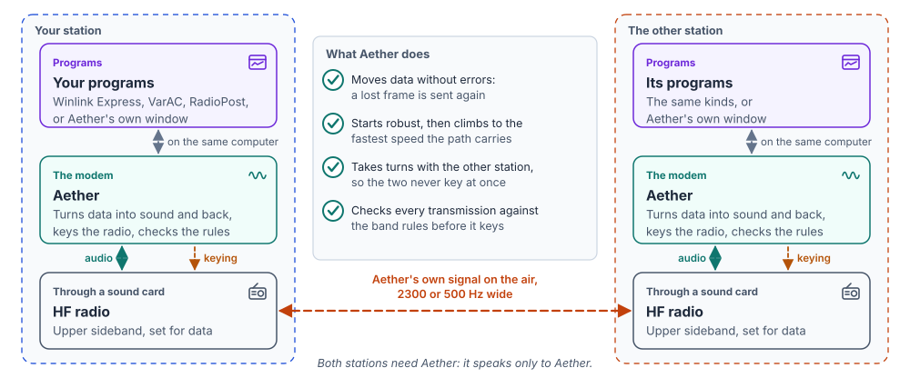

*Figure 1. Two stations, each with Aether between its programs and its radio.*

Three things to know from the start:

- **Aether talks only to Aether.** Your programs see a modem that behaves like VARA HF, but the
  signal on the air is Aether's own. Both stations need Aether, and both need versions that
  speak the same *link protocol*. The window warns you when they differ.
- **Both stations of a contact use the same bandwidth.** Aether has two: **2300 Hz** for Winlink
  and the most data, and **500 Hz** for contacts between two stations and for VarAC. A 2300 Hz
  station answers a 500 Hz call at 500 Hz by itself, and goes back afterwards.
- **Aether HF works today. Aether FM is being built.** The same application will carry both.
  [Part 5](#part-5-aether-fm) says what is coming.

### Slow and sure, or fast

A session starts slow and robust, then climbs. The slowest steps send single tones that get
through even when the signal is well under the noise. The faster steps send many tones at once
(OFDM) and carry far more data on a good path. Each step is called a **rung**. Each station
chooses the rung for its own data. It counts how much data each rung really delivered for the
time it spent on the air, from what the other station acknowledges, and now and then tries the
next rung up with one frame. So the link settles on the rung that moves the most data on this
path. A short message that would fill only part of its frames goes at the slowest rung of the
same kind that still carries it in as many frames: it takes the same time on the air and gets
through more surely, so the header's rung can read lower while short replies go. [Speeds: the
rungs](#16-speeds-the-rungs) shows them all.

### The window and the modem

Aether has two parts. The **modem** (its program is called `aetherd`) does the work: the sound,
the keying, the rules. The **window**, also called the panel, is what you see and set. On a
desktop computer the application starts both for you. A gateway can run the modem alone with no
window ([the gateway kit](../user/gateway-kit.md)).

## 3. What you need

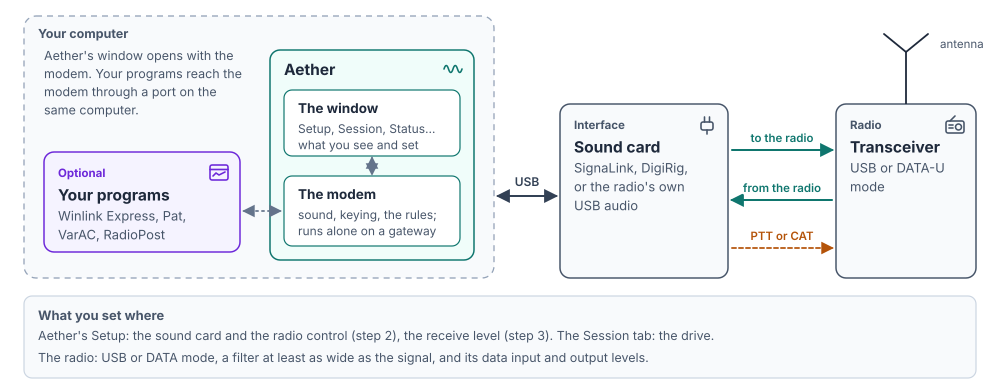

*Figure 2. Your station: what connects to what.*

- **An amateur radio licence.** Aether asks for your licence class, because it decides which
  frequencies are yours.
- **An HF radio** that can send and receive upper sideband, with its antenna.
- **An audio interface** between the radio and the computer. It carries the sound both ways and
  keys the radio. Any of these works:

| Interface | Audio | How it keys the radio |
|---|---|---|
| The radio's own USB (IC-7300, IC-705, FTDX10, FT-710 and many more) | The radio's built-in sound card | The radio's CAT command, on the same USB cable |
| DigiRig and similar | A USB sound card | A serial line (RTS), or the radio's CAT |
| SignaLink USB | A USB sound card | By itself, when it hears sound (VOX) |
| DRA or URI boards (CM108) | A USB sound card | The sound card's own pin |

- **A computer** with Windows, macOS (Apple Silicon) or Linux.
- **Aether**, from the releases page ([next chapter](#4-installing-aether)).

### Settings on the radio

- **Mode**: upper sideband for data. Many radios have a DATA-U (or USB-D) mode that takes audio
  from the rear or USB input: use it.
- **Filter**: as wide as the signal, or wider. At 2300 Hz that is 2.4 kHz or more. At 500 Hz a
  500 or 600 Hz filter centred on 1500 Hz is enough ([Bandwidth](#17-bandwidth-2300-or-500-hz)).
- **Speech processor, equaliser and noise reduction**: off for data.
- **AGC**: any setting works. In a DATA mode, AUTO usually picks a faster AGC than in USB, which
  suits data better.
- **Power**: what the path needs. Aether's average power is a fraction of its peak, so a few
  watts on an averaging meter is normal.

## 4. Installing Aether

1. Open the project's [releases page](https://github.com/KK4ODA/aether-hf/releases). The newest
   release is at the top.
2. Under **Assets**, download the installer for your computer:
   - Windows: the file ending in `x64-setup.exe`.
   - macOS (Apple Silicon): the file ending in `aarch64.dmg`.
   - Linux: the `.deb` file (Debian, Ubuntu) or the `.AppImage` file (any other).
3. Run it. The installers are not code-signed yet, so your computer asks once:
   - Windows: SmartScreen says it protected your PC. Click **More info**, then **Run anyway**.
   - macOS: open Terminal and type
     `xattr -dr com.apple.quarantine "/Applications/Aether HF.app"`, then open it normally.
4. Open **Aether HF**. The first time, it opens on **Setup** ([next chapter](#5-your-first-contact-in-brief)).

[Installing Aether HF](../user/install.md) has the details: checking a download against
`SHA256SUMS`, where each system keeps its files, updating, going back to an earlier version and
uninstalling.

**Updates.** Aether looks for a newer version when it starts and asks before it installs one.
Which releases it offers is a setting ([Step 5](#step-5-application-settings)).

**Where Aether keeps its files.** On Windows in `%APPDATA%\aether-hf\`; on Linux and macOS in
`~/.config/aether-hf/`. The settings are `station.toml`, the logs are `aetherd.log` and the
`logs` folder, and recordings go in `recordings`. **Help** › **Open the configuration folder**
takes you there.

## 5. Your first contact, in brief

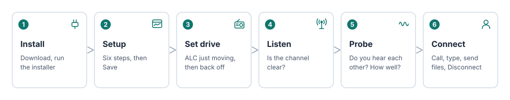

*Figure 3. Six steps from installing Aether to a first contact.*

On the first start the window opens on **Setup**, because the callsign is still the placeholder
`N0CALL`. A banner across the top says that nothing will be transmitted until the rules are set.

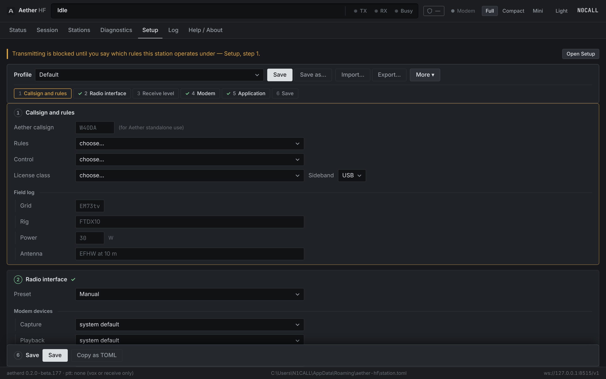

*Figure 4. The first start: Setup, and the banner that holds every transmission.*

1. **Setup**, steps 1 to 6 ([Setup](#7-setup)): your callsign and the rules, the sound card and
   how the radio is keyed, the receive level, the bandwidth. Press **Save these settings**.
2. **Set the drive** on the Session tab ([Keying and drive level](#keying-and-drive-level)).
3. **Make a contact** ([Making a contact, step by step](#14-making-a-contact-step-by-step)).

---

# Part 2. The window

## 6. The window at a glance

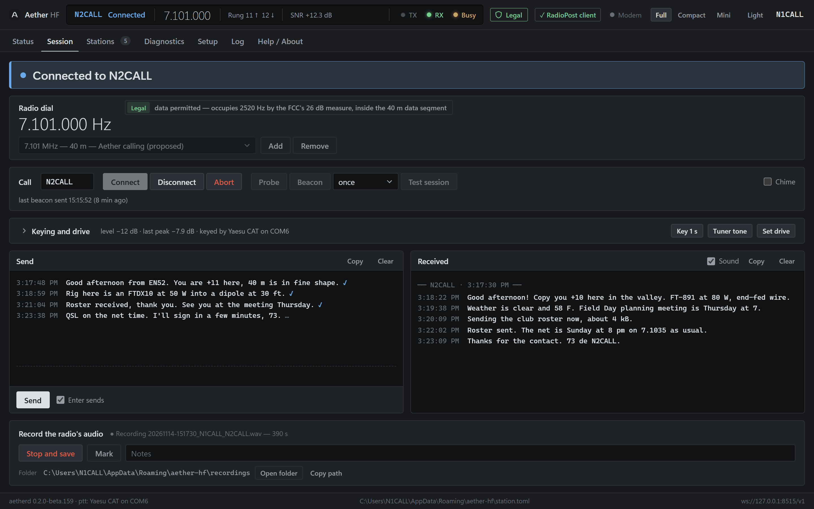

*Figure 5. The window during a session, on the Session tab.*

The window has a **header** across the top, **banners** under it when something needs your
attention, and seven **tabs**: Status, Session, Stations, Diagnostics, Setup, Log and Help.

### The header

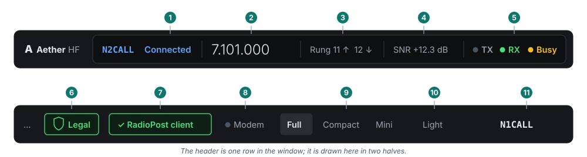

*Figure 6. The header, part by part.*

1. **State**: *Idle*, *Calling*, *Connected* or *Closing*, with the other station's callsign. In
   a narrow window the words shorten; the callsign does not.
2. **Dial**: the radio's frequency, when the radio can report it (over CAT, rigctld or FLRig).
3. **Rung**: the rung the data is moving at and its rate on the air. It shows the other station's
   while you receive (↓), yours while you send (↑), and both when data goes both ways. With no
   data moving, it shows the rung your station would send at.
4. **SNR**: the signal-to-noise ratio of the last frame heard, in a 3 kHz bandwidth.
5. **Lamps**: **TX** while the radio is keyed, **RX** while a burst is arriving, **Busy** while
   the channel carries a signal.
6. **The rules badge**: *Legal*, *Warning* or *TX blocked*, for your widest signal where the dial
   is now. Click it to see why.
7. **Programs**: a chip shows each program using the station, with a green check and its name: a
   host program such as Winlink Express, a RadioPost program, a KISS program.
   - *listening* after a name means the program answers calls.
   - A name alone means the program can call out, but calls to its callsign go unanswered until
     it listens. That is normal for a program that only calls, such as the RadioPost client.
   - A program that scans, as RMS Trimode does, stays *listening* through its short gaps.
   - With no program there, the chip may say *calls to* your callsign *not answered*. Its
     tooltip says why: under automatic control only a program answers calls.
   - A second chip shows the **bandwidth** when the station is running one that is not its own
     setting.
   - When the header is short of room, the chips shorten and end in *…*; the tooltip says all of
     it. Widen the window to see them whole.
8. **Modem**: quiet when the window is talking to the modem, red when it is not. In Compact and
   Mini, and in a narrow Full window, it shows only when it is red.
9. **Full**, **Compact** and **Mini**: how much of the window to show (below).
10. **Light**: black on white, for a screen in daylight (below).
11. **Your callsign**: the one the station is using now. During a session it is the session's.
    While a program answers for the station, it is the program's
    ([Several programs on one station](#25-several-programs-on-one-station)). Otherwise it is
    Setup's.

### Full, Compact and Mini

**Full** shows every tab. **Compact** shrinks the window to the state, the four link readings and
two small plots side by side: the speed over the last ten minutes (or the SNR, if you chose that
in Full) and the channel's activity. **Mini** is the state and the four readings alone, for a
corner of the screen.

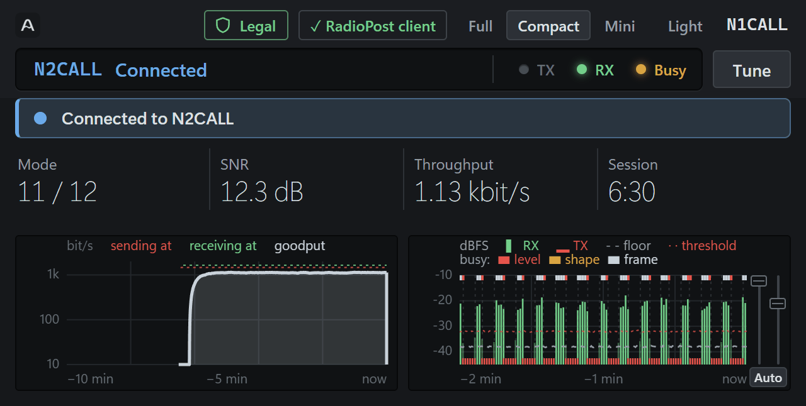

*Figure 7. Compact: the readings and two plots.*

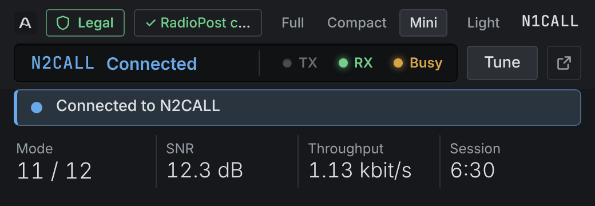

*Figure 8. Mini: for a corner of the screen.*

- **Tune**, beside the display in Compact and Mini, is the Session tab's *Tuner tone*: a steady
  tone for ten seconds, for an antenna tuner. While the tone plays it reads **Stop**; press it to
  stop. If the modem refuses the tone (a session, a busy channel, the rules), the display says why
  for a few seconds, in place of the state.
- The plots in Compact take whatever height the window has: make the window taller for taller
  plots. When a banner comes up, the plots get shorter for as long as it shows.
- Compact has no **Axes** button, but the chart keeps its two level sliders and **Auto**. Change
  the time span in Full.
- **Compact and Mini each keep the size you give them**, apart from Full's. Stretch Compact once
  to the width you want, and it opens that wide every time. Until you size one, it fits what it
  shows.
- **Full** brings the window back to its size. Maximizing the window in Compact or Mini switches
  it to Full, and so does a banner's button that opens another tab, such as **Open Setup**.
- The window stays on its screen when it changes view. Compact parked by the screen's right edge
  or the taskbar grows into Full to the left or upwards, and a size the screen cannot hold is cut
  to fit.
- Aether remembers the view, each view's size and where the window is on the screen, for the next
  start ([Arranging the windows](#arranging-the-windows)).

### Light and dark

The window is dark by design. **Light** turns it black on white, for a screen in daylight or
sunlight. The lit lamps are filled with their colour so they show in glare. Press it again for
the dark window. The signal window and the updates window follow, and Aether remembers the
choice. The waterfall keeps its own colours.

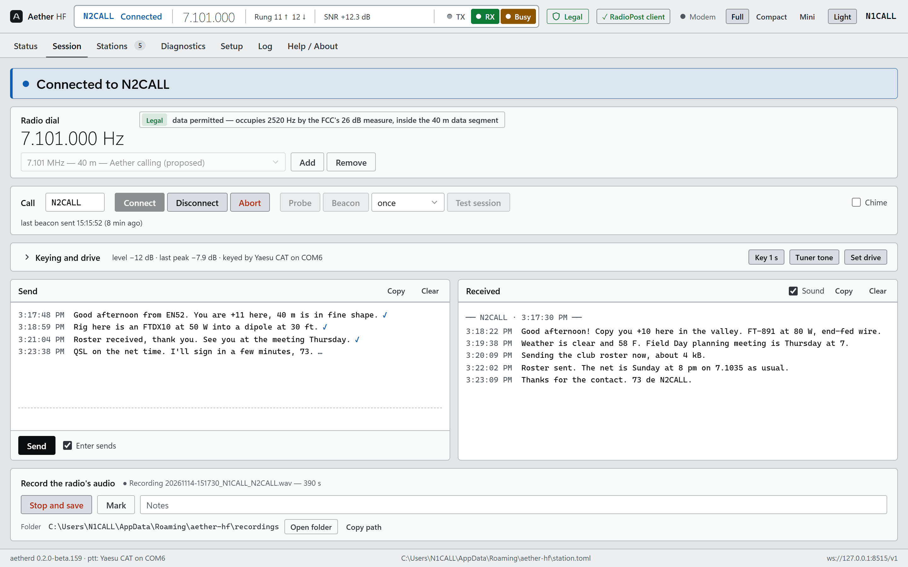

*Figure 9. The Light theme.*

### Banners

A banner across every tab tells you about something that needs attention. Each says what to do,
and most have buttons that do it.

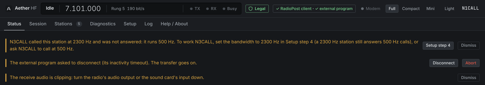

*Figure 10. Banners: a bandwidth mismatch, and clipped receive audio.*

| Banner | What it means | What to do |
|---|---|---|
| Session | Calling, connected, disconnecting, a probe, a Test, a beacon waiting, or how the last session ended. A program's call or session says *for* the program | Nothing; it is there so you see it from any tab |
| Setup needed | The rules, the control or the licence class is not set, so nothing transmits | **Open Setup**, step 1 |
| Unsaved changes | Setup has changes the modem is not using yet | **Review in Setup** and save, or **Discard changes** |
| Mismatch | A station called or probed in the other bandwidth, under another of your callsigns, or in another protocol version; or your call went unanswered while the operator was heard under another SSID; or a station called a program's callsign while that program is not running | Follow its buttons: **Setup step 4**, **Check for Updates**, **Answer as it too**, **Call it**, or **Dismiss**. For a program that is not running, start it again |
| Clipping | More than 0.1 % of the audio heard over the last ten seconds reached full scale | Turn the radio's audio output or the sound card's input down |
| Debug mode | Shown once: sessions run by a program are sent to the project | **Keep it on** or **Turn it off** ([Step 5](#step-5-application-settings)) |
| VarAC | VarAC is on this computer and not set up for Aether, or a new version of Aether changed what its VarAC profile needs | **Set up** or **Update**, then **Switch to VarAC default** if you want; **Not now** stops this offer ([VarAC in one step](#varac-in-one-step)) |
| Fault | The modem cannot hear or transmit (no sound card, a port it cannot open), or it had to start from older settings | Read what it says. Usually Setup step 2 |

The clipping banner shows in Compact too. Aether tells a host program nothing of it.

### Arranging the windows

Aether's window opens where you left it, in the view you left it in, at that view's size. The
undocked signal window opens where you left it too. RadioPost's client and RadioPost Gateway do
the same, so a station that runs them beside Aether is arranged once. One layout that fits a
single screen:

- RadioPost Gateway on the left, as tall as the screen.
- Aether in **Compact** at the top right. Stretch it to the width you want.
- The RadioPost client under Aether, as wide as Aether.

A window left on a screen that is no longer connected opens where the system puts it. A window
that would open partly off its screen, after a change of screens or of the taskbar, moves back
onto it, and is made smaller only if the screen cannot hold it.

### Tooltips and the chime

Every control, reading and box title has a **tooltip**: hold the mouse over it. A box's title
explains the whole box. A field's tooltip says what the field does, its range and its default.
The window itself shows only names, values and units.

A **chime** plays when a session comes up and when it ends. Untick **Chime** on the Session tab to
silence it.

## 7. Setup

Setup is one numbered flow, from your callsign to **Save**. The index at the top jumps to a step.
A step's number turns green when it is done, and amber when it has changes you have not saved.

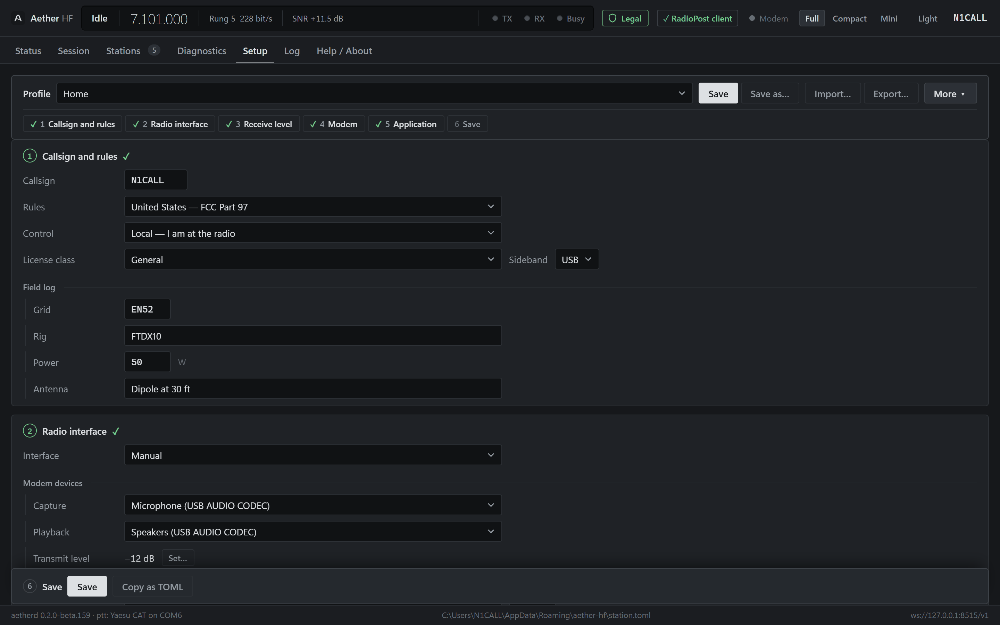

*Figure 11. Setup: the profile bar, the step index and the first steps.*

A change takes effect when you save it. Until then the modem runs on what it had, and the window
says so: the Setup tab carries an amber dot, the step you changed is marked, the bar at the foot
of the tab names what is not saved, and every other tab shows the *Unsaved changes* banner.

### Profiles

The **Profile** bar at the top keeps every Setup setting and the transmit level under a name. Make
one per radio, per place, or per way of working: for example "Home" and "VarAC", which differ in
who keys the radio.

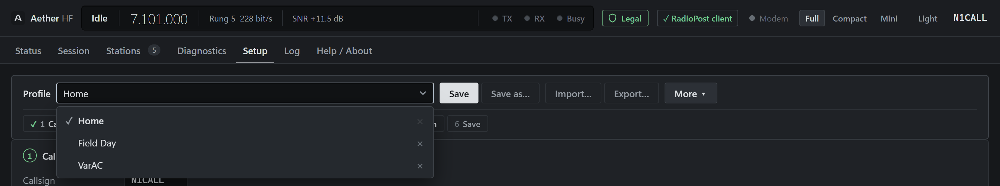

*Figure 12. The profile list: a name switches to it, the × deletes it.*

- **Open the list** and pick a profile to switch to it. The one in use has a tick. A `*` after its
  name means the running settings have changed since it was saved; switching asks first.
- The **×** beside a profile deletes it. Aether asks first, with the profile's name: a deleted
  profile cannot be brought back. The profile in use cannot be deleted (switch to another one
  first), and neither can the last one.
- **Save** writes the current settings to the profile. **Save as…** keeps them under a new name.
  Changes on the Setup tab you have not saved yet are saved to the modem first, so the profile
  gets them too.
- **Export…** writes an `.aetherprofile` file, to back up or to carry to another computer.
  **Import…** brings one in. A sound card the other computer does not have shows as *not on this
  computer* until you choose one.
- **More** has New profile, Rename and Duplicate.

What belongs to this computer stays out of a profile: the update channel, debug mode, the KISS
port's address, the window's port, the log file, the recordings folder and the waterfall's
settings.

### Step 1. Callsign and rules

- **Callsign**: yours, with an SSID (`N1CALL-1`) or a suffix (`N1CALL/P`) if you use one, up to
  nine characters. What you start from this window (a call, a probe, a Test, a beacon) goes out
  under it. While a program answers for the station, the box shows whose callsign is in use
  instead, greyed:
  - **Host**, with **Host programs** on ([Step 5](#step-5-application-settings)). The program's
    own callsign (its `MYCALL`) is the one Aether answers to and identifies as while the program
    is attached. Turn Host programs off to change the callsign here.
  - **The program's callsign and its name**, such as *N1CALL-10 · RadioPost Gateway*, while a
    RadioPost program holds a callsign. Stop the program to change the callsign here.

  Either way your own callsign is kept, and comes back when the program leaves. Set a program's
  callsign in the program itself, not here.
- **Rules**: *United States — FCC Part 97*, or *None — I check every transmission myself*. With
  **Radio control** set to *Host program* (step 2), the rules fields read **Host**: the host program
  owns the radio's dial, which Aether cannot read, so you check every transmission yourself. None
  of those settings acts then, **Control** included, whatever was set before.
- **Control**: *Local* (you are at the radio), *Remote* (you are at the radio through a control
  link), or *Automatic* (nobody at the control point: an unattended mailbox or gateway). Aether
  never guesses this. Under *Automatic*, Aether answers calls only for a program that holds the
  callsign called and is listening, such as RMS Trimode or a RadioPost gateway. With the US rules
  it also sends no beacon; with the rules at *None* it does.
- **Licence class**: decides which frequencies are yours.
- **Sideband**: USB, the convention for data. On LSB the signal lands below the dial, mirrored.
- **Field log**: your grid (six characters lets the log work out distances), rig, power in watts
  and antenna. They go into every recording, so a report about the air needs no follow-up. Each
  may be left empty.

What the rules check, and why, is in [The rules](#19-the-rules). Aether keys nothing the rules
refuse, but you remain the control operator.

### Step 2. Radio interface

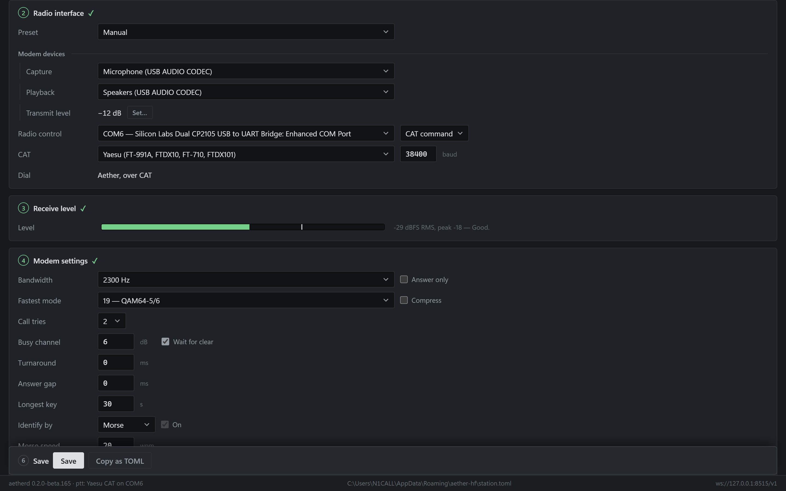

*Figure 13. Setup step 2, with a Yaesu keyed and tuned over CAT.*

- **Preset**: picking a known interface (an Icom with USB audio, a Yaesu, a Digirig, a SignaLink,
  a DRA or URI board) fills in the fields below, once. It is not a setting itself: the fields are
  what the modem uses, and you can change any of them afterwards. Changing one by hand shows
  *Manual*.
- **Modem devices**: the sound card's **Capture** (the radio's receive audio) and **Playback**
  (the radio's transmit audio). The transmit level is shown here too; you set it on the Session
  tab.
- **Radio control**: what keys the radio, and what reads and tunes its dial. There are six ways.

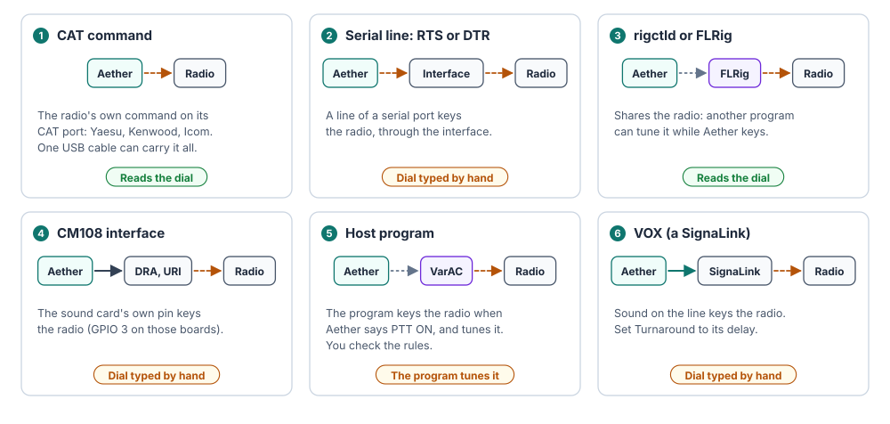

*Figure 14. The six ways to control the radio, and what each does with the dial.*

1. **CAT command**: the radio's own command on its CAT port. It needs no second port, reads the
   dial, which the rules need, and tunes the radio from the Session tab's dial list. Choose the
   radio's dialect (Yaesu, Kenwood, Icom CI-V) and its rate. An Icom also needs its CI-V address:
   IC-7300 94, IC-705 A4, IC-9700 A2. Yaesu radios keyed over CAT transmit from the DATA input.
2. **Serial line**: the RTS or DTR line of a serial port keys the radio, through the interface.
3. **rigctld (Hamlib) or FLRig**: keys the radio, reads its dial and tunes it, and another program
   can tune the radio through it at the same time.
4. **CM108**: a DRA or URI interface keys through its sound card's own pin, pin 3 on those boards.
5. **Host program**: VarAC or Winlink Express owns the radio. It keys the radio when Aether says
   PTT ON, as with VARA, and it tunes it: set the program's own frequency control (VarAC's RIG tab,
   *Frequency Control* on CAT). Aether opens no port on the radio and cannot read the dial, so the
   rules in step 1 are set to None and you check every transmission. Keep this way of working in a
   profile of its own.
6. **None**: a VOX interface such as a SignaLink, or listening only. Set **Turnaround** in step 4.

> **Note.** A radio's USB connection often shows two serial ports. On a Yaesu the *Enhanced* port
> carries CAT and the *Standard* port the RTS line. An Icom's single port carries both. Only one
> program can hold a port: close a logger that holds it, or share the radio through rigctld or
> FLRig.

- **Dial**: what reads the dial and tunes the radio with the radio control chosen: *Aether, over
  CAT*, *Aether, through rigctld* or *through FLRig*, *Host program*, or *Typed by hand*. Typed by
  hand means the radio cannot report its dial: tell Aether where it is with **Dial is at** on the
  Session tab before you transmit, and again after every change of frequency.

### Step 3. Receive level

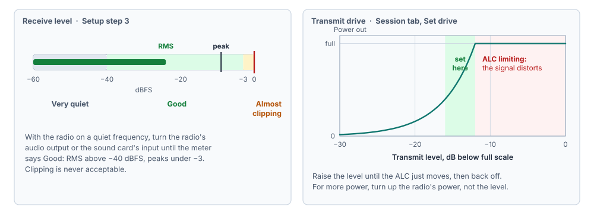

*Figure 15. The two levels: what Aether hears, and what it sends.*

With the radio on a quiet frequency, turn the radio's audio output (or the sound card's input in
the computer's sound settings) until the meter says **Good**. Clipping is never acceptable. Too
quiet leaves the signal inside the sound card's own noise.

### Step 4. Modem settings

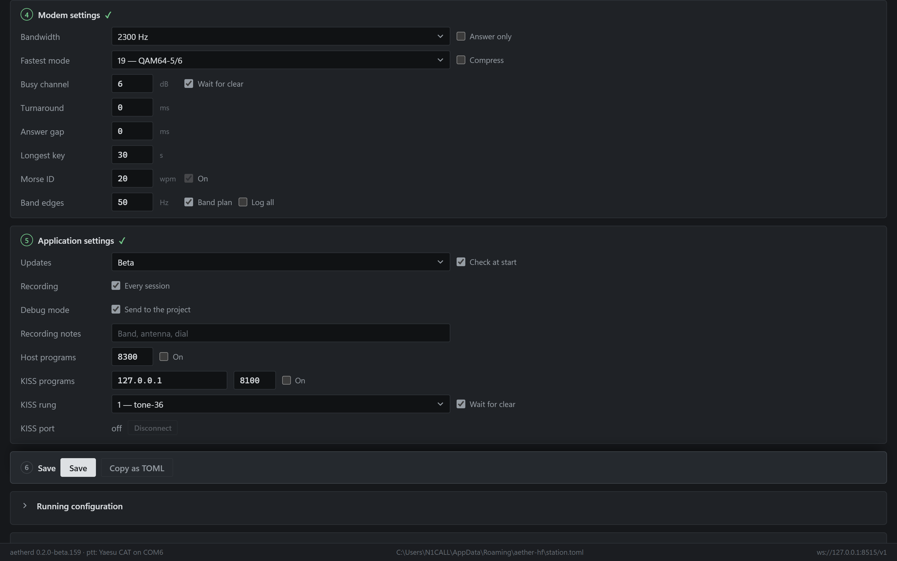

*Figure 16. Setup step 4: the modem's settings.*

- **Bandwidth**: *2300 Hz* for Winlink, Pat and the most data; *500 Hz* for contacts between two
  stations and VarAC. Both stations of a session use the same. A change takes effect once the
  station is idle, with no restart. With **Host programs** on, the box reads **Host**: the
  program sets it while it is attached (its `BW500` or `BW2300`), and your setting comes back when
  it leaves.
- **Answer only**: take calls and answer probes, but make no call and send no beacon.
- **Fastest mode**: the highest rung the link may climb to. The last entry is the fastest your
  bandwidth has, and it stays the fastest when you change bandwidth. Choose a lower one only to
  cap the link. The rules may hold it lower on some frequencies.
- **Compress**: off by default. It compresses the whole session, so on a weak path one lost frame
  can spoil the rest. Use it only on a solid link.
- **Call tries**: how many tries a call makes before it gives up: 2 (the default), 6, 8, 10 or
  15. Two reach most stations and give the frequency back in about 40 s when nobody answers. More
  tries keep calling a weak or busy station longer, and hold the frequency longer: fifteen take
  about three minutes. A call of six or more that four tries at 2300 Hz have not had answered goes
  on at 500 Hz.
- **Busy channel**: *wait for a clear channel before calling*, and how far above the noise counts
  as busy (6 dB by default). With it on, a call, probe or beacon also waits while Aether hears two
  other stations in a session, through the pauses between their transmissions, at least 4 s after
  the last one it heard. Aether's own answers never wait: they go in their slot.
- **Turnaround**: how long after your radio stops sending it hears again. 0 for a radio keyed by
  CAT, a serial line or a host program. With VOX (a SignaLink), set its delay time plus 100 ms.
  Aether tells the other station, which waits that long before it answers. Up to 1500 ms.
- **Answer gap**: the least time between the end of the other station's transmission and yours.
  Leave it at 0 unless the other station keys by VOX and has not set its own turnaround; then
  500 to 800 ms gives its radio time to get back to receive. Aether also learns a gap for each
  station that keeps calling again after being answered.
- **Longest key**: the watchdog's limit on one transmission, 30 s by default. Aether sizes its
  transmissions to fit inside it.
- **Identify by**: how your station sends its callsign at the end of each session, the last thing
  it sends for it. **On** says whether it does.
  - **Morse**, the default: your callsign as a tone, at the **Morse speed** below. It takes
    several seconds.
  - **Data signal**: your callsign in plain ASCII inside Aether's own signal, which anyone with
    the published specification can read. It takes under half a second on a good path and about
    three seconds on a weak one, so each session ends sooner. The Morse speed is hidden. Under
    US rules this is identification "by a RTTY emission using a specified digital code"
    (§97.119(b)(3)); see [Identifying in the data signal](../user/fcc-regulatory-controls.md#identifying-in-the-data-signal).
  - Never both: the setting is one choice.
  - It sends your callsign without its SSID: `N1CALL-1` goes out as `N1CALL`, and a `-T` or `-R`
    is dropped too. The rules ask for your assigned call sign (§97.119), and the SSID is not part
    of it. A `/` part such as `/P` is kept.
  - A session or call that a program made under a callsign of its own, such as RadioPost calling
    as a club callsign, is identified as that callsign, even when the program has already
    closed.
  - **A US callsign always identifies.** The box is ticked and greyed, and its tooltip says why.
    For any other callsign it is your choice, off by default; a host program's `CWID ON` turns it
    on for the program's sessions. The program cannot choose Morse: it identifies the way you
    chose here.
  - A call or probe that leads to no session is identified 30 s later, on its own. Calls,
    probes, beacons and KISS frames carry no identifier of their own.
  - The US rules cap an automatic Morse identifier at 20 wpm, whatever is set here. The speed is
    marked when the cap applies. A session longer than ten minutes is not identified in between,
    by either method: see [The rules](#19-the-rules).
- **Band edges**: the margin kept between your signal and a segment's edge (50 Hz by default), for
  dial error and the radio's transmit chain. **Band-plan guidance** says when a transmission the
  rules allow is outside the voluntary band plan's digital areas.

### Step 5. Application settings

- **Updates**: which releases to be offered (*stable only*, *betas too*, *nightlies too*), and
  whether to check when Aether starts.
- **Recording**: record every session from connect to disconnect, and on until the closing Morse
  IDs have gone, at most 30 s after the end.
- **Debug mode**: on by default. After each session that Winlink Express, Pat, VarAC or RadioPost
  runs through this station, its recording (with the audio), the logs and your settings (never a
  password) go to the Aether project, so problems on real paths can be found. Sessions you run
  from the window, and Tests, are not sent this way. With no internet they wait and go once
  there is a connection, tried every 10 minutes, kept through a restart.
- **Recording notes**: written into every recording that starts by itself.
- **Host programs**: lets Winlink Express, Pat or VarAC use this station on the VARA-compatible
  port. The command port is 8300 by default and the data port the next number up. While a
  transfer waits for the other station, the program is told how much is left every 50 s, which
  Pat needs.
  - Never give it 8515, or 8514 (whose data port would be 8515). That is Aether's control port,
    which this window and RadioPost use. Setup refuses a port number that another of the
    station's ports uses, and so does Aether at start.
- **KISS programs**: opens a KISS-over-TCP port for APRS and packet programs, and for VarAC's
  broadcasts and relay notifications ([KISS programs](#24-kiss-programs)).
- **VarAC**: VarAC's folder (found by itself at `C:\VarAC`), the VarAC profile to copy, and
  **Set up**, which writes a VarAC profile that runs on Aether and saves the Aether profile
  *VarAC default* ([VarAC in one step](#varac-in-one-step)). Once they are made the button reads
  **Update**. **VarAC profile** says whether they are there and up to date. Shown on Windows only.
- **Winlink programs**: every install of Winlink Express, RMS Trimode and RMS Packet on the
  computer, one row per callsign or setup, and **Import**, which makes an Aether profile of each
  row ticked ([Finding Winlink's programs](#finding-winlinks-programs)). **Find** looks again; **Add
  folder** adds a folder Find missed. Shown on Windows only.

### Step 6. Save

**Save these settings** writes them to the modem. Most take effect at once. A new sound card, any
radio control setting, Host programs, compression, the update channel or the callsign restarts the
modem, which takes a few seconds; the window comes back by itself.

- **Copy as TOML** copies the settings in the shape of the configuration file.
- **Discard changes** puts every field back to what the modem is using.
- The folded **Running configuration** and **Mode table** at the bottom show what the modem runs
  now, and every rung of the current bandwidth with its rate and the SNR it needs. A greyed rung
  is one the modem never asks for: another rung carries as much data from less signal.

## 8. The Session tab

The Session tab is where you operate ([Figure 5](#6-the-window-at-a-glance)). It has five boxes.

### Radio dial

- **The dial** as the radio reports it, and a chip with what the rules say about transmitting
  there. Over CAT, rigctld or FLRig it is read once a second while the station is idle, so a knob
  turned at the radio shows within a second or so.
- **The dial list**: remembered frequencies, starting from the
  [frequency plan](../user/frequency-plan.md)'s proposals. **Picking one tunes the radio there**
  when it is keyed over CAT, rigctld or FLRig. The list is held still during a session, a call, a
  probe, a Test or a transmission. **Add** keeps a dial with a name; **Remove** drops the chosen
  one. When the radio's own dial matches an entry, the list follows it.
- **Dial is at**: shown when the radio cannot report its dial. Type where it is and press **Set**.
  The rules judge every transmission against it until you change it.
- **Scanning**: shown while a program, such as RadioPost Gateway, has Aether scan its channels.
  It names the dial the radio is on, its place in the program's list, and the program. Up to
  four dials. Aether listens 4 to 5 s on a dial and moves on if it hears nothing. When it hears
  a call under way, even one too weak to read, it stays about 19 s for the caller's next try. It
  never moves while a frame is arriving, while a call or a session is up, or while your
  identifier is still to go out there, and it stays after a contact too. Answering stays on all
  the while. **Stop** ends the scan and leaves the radio where it
  is; so does turning the radio's knob, or tuning from anywhere else. The program is told, and
  does not start the scan again by itself. The dial list is held while a scan runs.

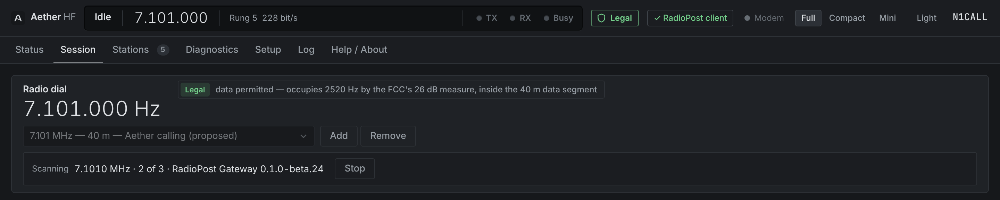

*Figure 17. The Radio dial box while a program scans: the dial the radio is on, its place in the list, and Stop.*

Every dial in a scan has to suit your antenna without a tuning cycle: a resonant antenna for each
band, or a tuner that remembers each band. A station calling one that scans needs more tries than
the usual two; the program that publishes the scan tells the caller's program how long to keep
calling.

When a host program keys the radio, this box says so and hides the dial list: choose the
frequency in the program.

### Call

Type the other station's callsign, with its SSID if it uses one. Then:

- **Connect**: call it and start a session. A call is two tries by default (**Call tries**, Setup
  step 4), chosen by how well you last heard the station: the fast OFDM frame and the robust tone
  frame together when you have not heard it lately, quick tries first when you heard it strong,
  tone frames when you heard it weak. The last try comes after a 15 to 21 s pause. If nobody
  answers, the call ends in about 40 s; press **Connect** again to call again.
- **Disconnect**: send what is still queued, then close. It waits a minute at most; past that the
  session closes anyway. While it waits, the banner and the line under the buttons say how much is
  left and the seconds left: *Disconnecting from N2CALL: sending the last 1.2 kB (45 s at most).
  Abort closes now.* When the session ends, the banner says what did not get through. While
  calling, the button reads **Stop calling**.
- **Abort**: drop the session at once. Aether sends no more data: it only tells the other station
  it has gone, then sends your Morse ID if you identify.
- **Probe**: one frame and one answer, no session. It tells you whether the other station hears
  you and how well, both ways. If the first probe gets no answer, Aether sends a second; the line
  under the buttons says *Probing N2CALL… 1/2*, then *2/2*, and *N2CALL: no answer to 2 probes*
  if neither is answered.
- **Beacon**: puts your callsign on the air once, on the tone floor, addressed to nobody, so
  anyone listening can report hearing you. The list beside it repeats it every 10, 15, 20, 30 or
  60 minutes while you are at the station. A beacon waits for a clear channel and for any session
  to finish, and the repeat stops when the modem restarts. Aether never beacons under automatic
  control.
- **Test session**: a measured contact ([The Test session](#the-test-session)). The same button
  stops it.

The line under the buttons reports the last probe, the beacon timer or the Test's progress.

### Keying and drive level

Click the box's heading to open it.

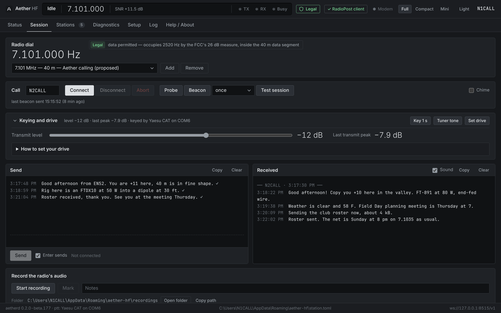

*Figure 18. Keying and drive, open.*

- **Key 1 s**: keys the radio for one second with no audio, to check the keying. The Log then says
  whether the radio's receive audio changed while it was keyed. A radio that transmits goes quiet
  (or plays back its own signal); if the audio stayed the same as the band, the radio did not key.
- **Tuner tone**: a steady tone for ten seconds, for an antenna tuner. Do not set drive with it.
  Compact and Mini have it as **Tune** ([Full, Compact and Mini](#full-compact-and-mini)).
- **Set drive**: four six-second bursts of Aether's real signal, five seconds apart.
- **Transmit level**: the slider, in dB below full scale. **Last transmit peak** is the modem's
  own headroom.

**How to set the drive** ([Figure 15](#step-3-receive-level), right):

1. Press **Set drive** and watch the radio's ALC meter.
2. Raise the transmit level until the ALC just begins to move.
3. Back it off until the ALC barely moves.
4. If the ALC moves even with the level low, turn down the radio's USB (rear) data input gain and
   start again.

Keep the last transmit peak around −6 to −12 dB, never red. For more power, turn up the radio's
power control, not the slider.

> **Note.** A tone is a pure sine wave. Aether's data signal peaks 6 to 7 dB higher, so drive set
> on a tone runs into the ALC on real traffic. Always set drive with **Set drive**.

All three buttons are refused during a session. Tuner tone and Set drive are also refused while
the channel is busy. The rules judge each one first.

### Send and Received

- **Send**: type and press Enter (Shift+Enter for a new line, or untick **Enter sends**). What you
  sent stays in the box with its time and a mark: **…** on its way, **✓** once the other station
  has all of it, **✗** if the session ended first.
- **Received**: what the other station sent. Tick **Sound** for a note when text arrives.

**Copy** copies the text without the times. **Clear** empties the box and takes nothing back from
the session.

### Recording the radio's audio

**Start recording** saves what the radio hears to a sound file, until you press **Stop and
save**. It works at any time, listening or during a session, and needs no other station. A
`.json` file beside the audio says what the modem made of it: every frame, every change of the
busy indicator, and the modem's readings four times a second. A recording is what a report about
the air should carry ([Reporting a problem](#29-reporting-a-problem)).

- Type **notes** first, in the field beside the button: band, frequency, radio settings, the other
  station.
- **Mark** writes the moment you press it into the recording, numbered 1, 2, 3 and so on. Press
  it each time you change something on purpose, such as swapping VFOs.
- **Open folder** opens the recordings folder.
- With the radio keyed over CAT, rigctld or FLRig, a recording also keeps the radio's S-meter and
  its dial. On a Yaesu over CAT it also keeps the AGC, the mode, the filter width, the RF gain, the
  attenuator and the preamp whenever they change. The radio is asked only while nothing else is
  going on.

## 9. The Status tab

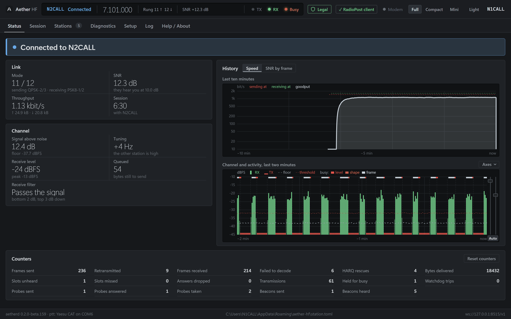

*Figure 19. The Status tab during a session.*

- **Link**: the rung, the SNR, the throughput and the session (who, and for how long).
- **Channel**: signal above noise, tuning offset, receive level and bytes still queued.
- **History**: two charts.
  - **Speed** is the session's data rate, both ways added together. Two dashed lines show the rate
    on the air of the rung the data went at: **sending at** (your data, in the transmit colour)
    and **receiving at** (the other station's, in the receive colour).
  - **SNR by frame** is every frame heard, what the other station reports hearing you at, and the
    current rung's threshold.
- **Channel and activity**: the received level, a bar every half second, with the busy periods
  shaded along the top. A bar that reaches the dotted line, the busy threshold, marked the channel
  busy. Your own transmissions are short red ticks along the bottom (the receiver is muted while
  you transmit). The dashed line is the busy detector's noise floor.
  - **Axes**, at the right of the chart's title, sets the time span (30 s to 10 min) and the level
    scale (**Auto**, or **Top** and **Bottom** in dBFS). **Reset** goes back to 2 minutes and
    Auto.
  - **Two sliders** at the right of the chart set the same level scale while you watch: the left
    one is Top, the right one Bottom. Moving one clears Auto. Aether keeps these for the next
    start.
- **Counters**: totals since the modem started. **Reset counters** sets them back to zero.

What each reading means is in [What the readings mean](#27-what-the-readings-mean).

## 10. The Stations tab

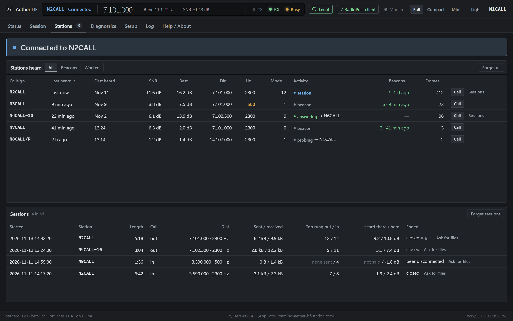

*Figure 20. The stations heard, and the sessions.*

- **Stations heard**: every station whose frame carried a callsign (a beacon, a call, a probe, an
  answer, a KISS frame, or the other end of a session), one line per callsign, the 200 most recent.
  Filters: *All*, *Beacons*, *Worked*. Click a heading to sort.
  - **Hz** is the bandwidth the station runs, amber when it is not yours.
  - **Call** puts the callsign on the Session tab. **Sessions** shows your sessions with it.
- **Sessions**: one line per session, newest first, the 500 most recent: when, how long, who
  called, what crossed each way, the fastest rung each way, how each station heard the other, and
  how it ended. **Ask for files** writes a request to the other station for its side
  ([Sending files](#sending-files)).

Both lists survive a restart. **Forget all** and **Forget sessions** empty them; recordings are not
touched.

## 11. The Diagnostics tab

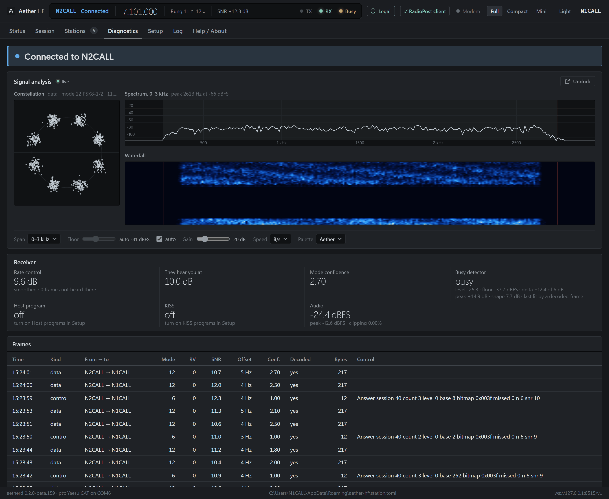

*Figure 21. Diagnostics: the signal as the receiver sees it.*

- **Signal analysis**: the constellation, the spectrum and the waterfall.
  - The **constellation** shows the last OFDM frame's points. A tone frame has none.
  - The **red lines** on the spectrum and the waterfall are the edges of your widest
    transmission at the bandwidth you run, by the FCC's 26 dB measure. They sit a little outside
    the bandwidth's own number, because the signal's skirts reach past it. A signal between them
    is on your frequency: wait for it to clear before you call. The band's noise should look
    even between them: noise that fades out inside a red line is the radio's receive filter
    cutting that edge ([The receive audio](#the-receive-audio)).
  - **Span** is the audio shown: **0–3 kHz** (the default), **0–4 kHz**, or **Channel**, a close
    view of your own channel.
  - The waterfall draws the noise dark and a signal bright. **Floor** sets the level drawn black
    (with **auto** it follows the noise). **Gain** is how many decibels above the floor reach
    full white, 3 to 90 dB (20 by default): lower it for more contrast. **Speed** is lines a
    second, **Palette** the colours. These settings belong to this computer.
- **Receiver**: how the other station hears you (which is what your station chooses its speed
  by), how many frames of your last transmission it never heard, mode confidence (below 1.3 is a
  guess), every number behind the busy detector's decision, and which programs and sound cards
  are attached.
- **Frames**: every frame the receiver found, decoded or not, newest first: kind, callsigns,
  rung, redundancy version, SNR, offset, confidence, whether it decoded, and what a control frame
  said.
- **Rules**: what the rules know about this station and what they decided, with where each of
  your signals fits on the current band.

### The signal window

**Undock** opens the signal analysis in a window of its own, to keep in view from any tab.

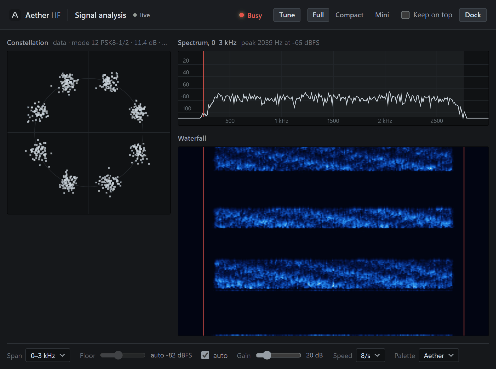

*Figure 22. The signal window, undocked.*

- It has its own **Full** (the whole card), **Compact** (the spectrum and the waterfall) and
  **Mini** (the waterfall alone, with a frequency scale, for a corner of the screen while another
  program runs). Each view keeps its own window size.
- **Keep on top** (in Compact and Mini, **On top**) keeps it over other windows.
- Every view has a **Busy** lamp and **Tune**, the same as the Session tab's *Tuner tone*. Press
  it again to stop. If the modem refuses the tone (a session, a busy channel, the rules), the
  reason shows under the title bar for a few seconds.

## 12. The Log tab, and sending files

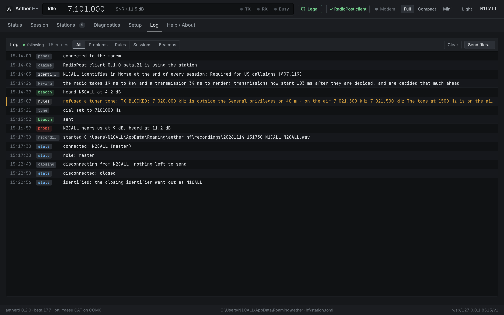

*Figure 23. The Log tab.*

The **Log** is everything the modem and the window reported since the window opened, newest last,
one entry a line. Hold the mouse over a line for the whole of it. Filters: *All*, *Problems*,
*Rules*, *Sessions*, *Beacons*. **Clear** empties the window's copy; the modem's own log file is
kept.

Two kinds of line are worth knowing:

- A **keying** line says how long your radio takes to key and how long Aether takes to prepare a
  transmission. Aether starts its transmissions that much sooner, so its answers reach the air on
  time. The line comes back only when those times change.
- A keying line that says *on the air about … ms after its slot opened* means one answer went out
  late, and says why: a slow render, a slow radio, or the computer falling behind. One now and then
  is harmless. Many in a session mean the computer is too busy: close other programs, or send
  your files to the project.

### Sending files

**Send files…** is how anything leaves your station. Nothing leaves without your press, and
nothing you typed in Send or Received is included.

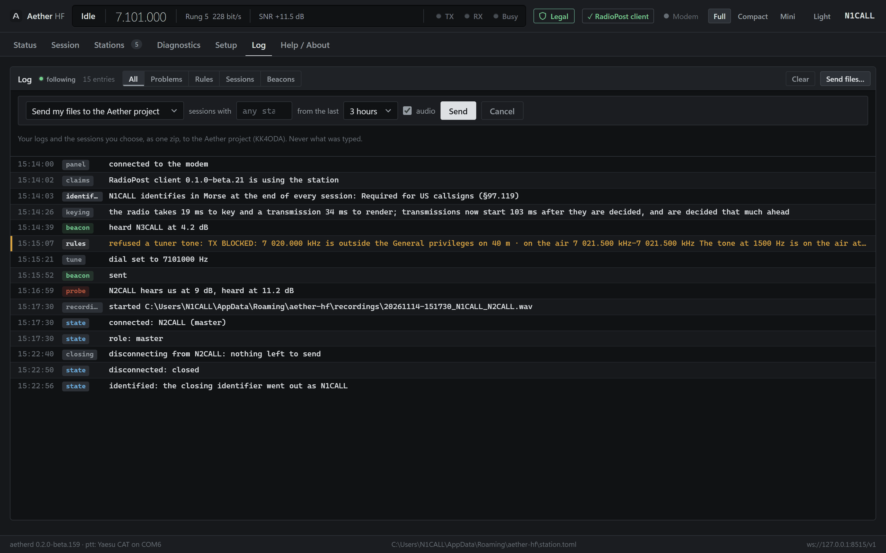

*Figure 24. Send files: one zip of your logs and recordings.*

Choose what to do:

- **Send my files to the Aether project**: one zip of your logs, the diagnostic bundle and the
  sessions you choose (one station or all; how far back; with or without the audio) goes to the
  project, with a progress bar.
- **Email my files to someone**: writes the same zip and opens an email to attach it to.
- **Ask a station to send me its files**: writes an email with a link that opens the other
  station's Aether with this form filled in.
- **Report my last test as a GitHub issue**: opens a ready-made issue. Drag the Test's `.json` file
  into it.

The zip stays in the `shared` folder beside your settings. It also carries the logs of programs
that offer them: RadioPost and RadioPost Gateway do (`radiopost.log`, `gateway.log`), in the zip's
`programs` folder. Aether remembers a program's log for 30 days after the program closed.

## 13. Help and updates

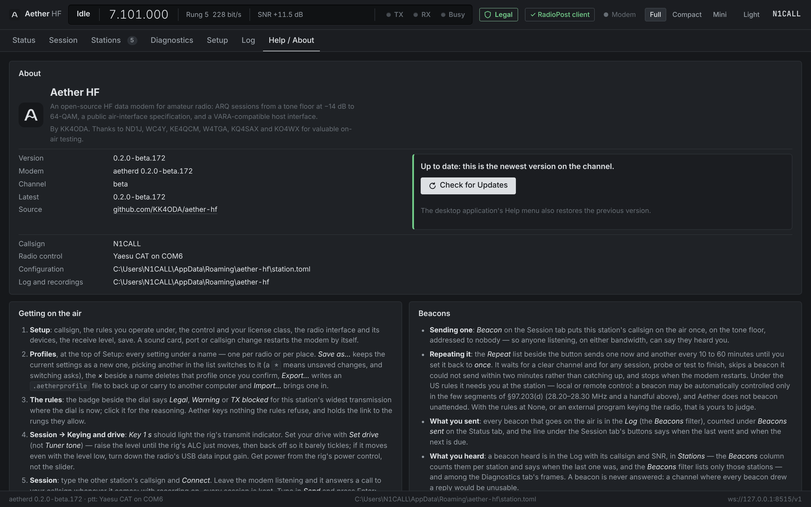

*Figure 25. The Help tab.*

- **About** shows the version, the modem, the update channel and the latest release, and where
  this station keeps its settings, logs and recordings.
- **Check for Updates** asks the release channel for a newer version. The updates window shows
  what it finds and installs it when you say. On Windows the installer waits for Aether to close,
  closes it if it must (the modem stops first, ending any session properly), and puts aside a file
  something else still holds.
- The desktop application's **Help** menu has *Check for updates…*, *Restore the previous
  version…*, *Open the configuration folder* and *Releases on GitHub*. Restoring an older version
  puts back the settings file that version can read, and keeps the newer one beside it. Restore
  works on Windows and with the Linux AppImage.
- The other boxes are short guides: getting on the air, Test sessions, beacons and reading the
  window, with links to the guides and this manual.

**Update required.** Two stations connect only when they run the same *link protocol*. Most
releases keep it. When a release changes it, the update offer is titled **Update required**, and
the release notes say so first. Update before your next contact, and ask the stations you work with
to do the same.

**Closing the window stops the modem.** When that would interrupt something (a session, a Test, a
call, a probe, a transmission) Aether asks first and names it. If you close anyway, the modem ends
a session on the air properly before it stops, which can take about 20 seconds after the window
has gone.

---

# Part 3. On the air

## 14. Making a contact, step by step

1. **Agree** a frequency, a time and a bandwidth with the other operator, and check you both run
   versions with the same link protocol.
2. **Tune** the radio there: pick it from the dial list, or tune by hand. If the radio cannot
   report its dial, set **Dial is at**.
3. **Check the rules badge** says *Legal*. If it says *TX blocked*, click it to see why.
4. **Listen** for a minute. The **Busy** lamp and the Channel chart show whether the frequency is
   in use.
5. **Probe** the other station, if you like, to see how the path is both ways.
6. Type the callsign in **Call** and press **Connect**. The banner says *Calling*, then
   *Connected*, and the chime plays.
7. **Type** in Send, and watch for the ✓.
8. **Disconnect** when you are done. The session appears in **Stations** › **Sessions**.

**To be called instead**, leave Aether running: it answers a call to your callsign whenever one
comes (under local or remote control). With **Recording** on in Setup step 5, every session is
kept.

## 15. How a session works

You do not need this to operate, but it explains what you see on the lamps and in the Log.

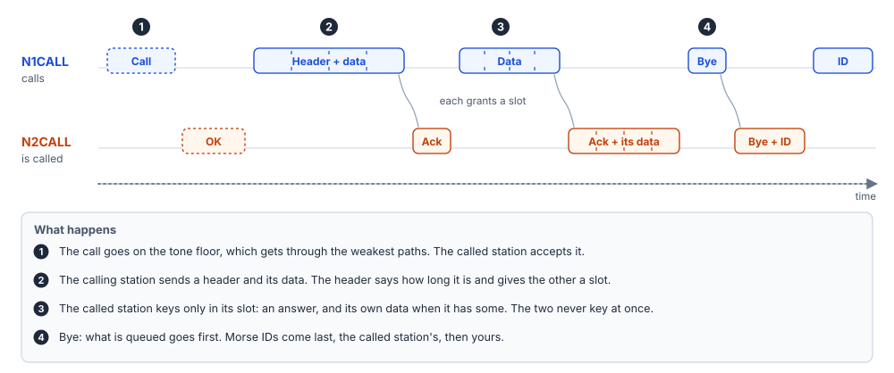

*Figure 26. A session, transmission by transmission.*

- **The call** goes on the tone floor, which gets through the weakest paths. If it is not
  answered, Aether calls again. The called station accepts it.
- **The calling station leads.** Each of its transmissions starts with a short header that says
  how many frames follow, and grants the other station a **slot** right after it.
- **The called station speaks only in its slot**: an acknowledgement (which frames arrived, how
  well it hears you), and its own data when it has some. An answer that would start too late for
  its slot is not sent. So the two stations never key over each other.
- **Lost frames are sent again** until they arrive, and copies of a frame are combined, so even a
  frame no single copy carried can be read.
- **Each station picks its own speed** for its own data, from what the other station tells it.
- **The goodbye**: what is queued goes first, then each station says goodbye. The identifiers
  come last, in Morse or in the data signal: the called station's, then the caller's.

## 16. Speeds: the rungs

Each rung is one way of sending: tones or OFDM, and a code rate. The slow rungs need little signal;
the fast ones need a clean path.

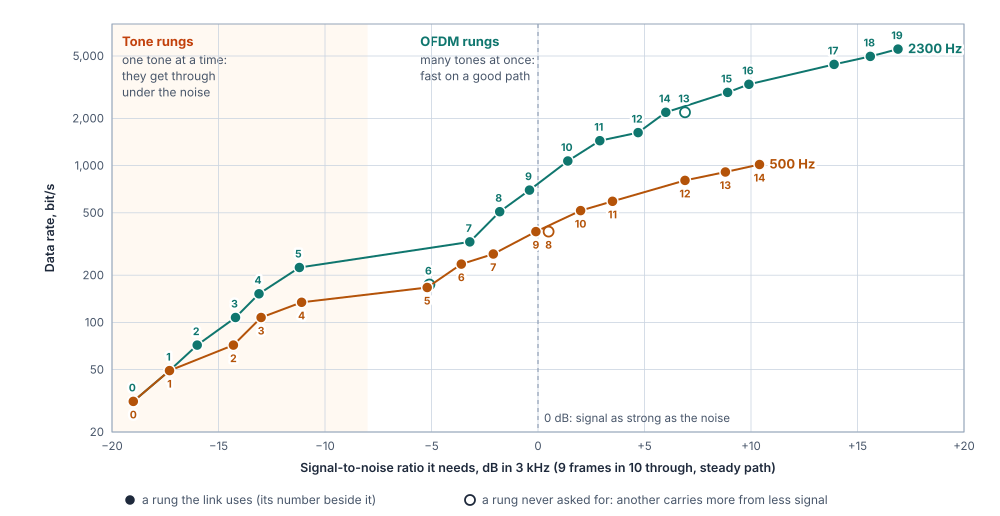

*Figure 27. Every rung's data rate against the signal it needs.*

- The **SNR it needs** is where nine frames in ten get through on a steady path, in a 3 kHz noise
  bandwidth. A fading path needs several decibels more.
- **Data rate** is what a frame carries for the time it takes on the air. A session moves less:
  answers, turnarounds and repeated frames take their share.
- A rung marked **Never** is never asked for: another rung carries as much data from less signal.
  The Test session's ladder skips it too.

The tables below are made from the modem's own figures every time the manual is built.

**At 2300 Hz:**

<!-- generated: ladder-2300 -->

| Rung | Name | Family | Data rate | Needs about | Asked for |
|---:|---|---|---:|---:|---|
| 0 | `tone-24` | Tones | 31 bit/s | −19 dB | Yes |
| 1 | `tone-36` | Tones | 49 bit/s | −17 dB | Yes |
| 2 | `tone50-51` | Tones | 72 bit/s | −16 dB | Yes |
| 3 | `tone50-75` | Tones | 107 bit/s | −14 dB | Yes |
| 4 | `tone100-105` | Tones | 152 bit/s | −13 dB | Yes |
| 5 | `tone100-153` | Tones | 224 bit/s | −11 dB | Yes |
| 6 | `BPSK-1/5` | OFDM | 175 bit/s | −5 dB | Never |
| 7 | `BPSK-1/3` | OFDM | 326 bit/s | −3 dB | Yes |
| 8 | `BPSK-1/2` | OFDM | 509 bit/s | −2 dB | Yes |
| 9 | `QPSK-1/3` | OFDM | 698 bit/s | 0 dB | Yes |
| 10 | `QPSK-1/2` | OFDM | 1,070 bit/s | +1 dB | Yes |
| 11 | `QPSK-2/3` | OFDM | 1,442 bit/s | +3 dB | Yes |
| 12 | `PSK8-1/2` | OFDM | 1,624 bit/s | +5 dB | Yes |
| 13 | `PSK8-2/3` | OFDM | 2,186 bit/s | +7 dB | Never |
| 14 | `QAM16-1/2` | OFDM | 2,186 bit/s | +6 dB | Yes |
| 15 | `QAM16-2/3` | OFDM | 2,930 bit/s | +9 dB | Yes |
| 16 | `QAM16-3/4` | OFDM | 3,302 bit/s | +10 dB | Yes |
| 17 | `QAM64-2/3` | OFDM | 4,417 bit/s | +14 dB | Yes |
| 18 | `QAM64-3/4` | OFDM | 4,972 bit/s | +16 dB | Yes |
| 19 | `QAM64-5/6` | OFDM | 5,533 bit/s | +17 dB | Yes |

<!-- /generated -->

**At 500 Hz:**

<!-- generated: ladder-500 -->

| Rung | Name | Family | Data rate | Needs about | Asked for |
|---:|---|---|---:|---:|---|
| 0 | `tone-24` | Tones | 31 bit/s | −19 dB | Yes |
| 1 | `tone-36` | Tones | 49 bit/s | −17 dB | Yes |
| 2 | `tone4x100-51` | Tones | 72 bit/s | −14 dB | Yes |
| 3 | `tone4x100-75` | Tones | 107 bit/s | −13 dB | Yes |
| 4 | `tone4x100-93` | Tones | 134 bit/s | −11 dB | Yes |
| 5 | `QPSK-1/2` | OFDM | 167 bit/s | −5 dB | Yes |
| 6 | `QPSK-2/3` | OFDM | 235 bit/s | −4 dB | Yes |
| 7 | `PSK8-1/2` | OFDM | 273 bit/s | −2 dB | Yes |
| 8 | `PSK8-2/3` | OFDM | 380 bit/s | 0 dB | Never |
| 9 | `QAM16-1/2` | OFDM | 380 bit/s | 0 dB | Yes |
| 10 | `QAM16-2/3` | OFDM | 516 bit/s | +2 dB | Yes |
| 11 | `QAM16-3/4` | OFDM | 592 bit/s | +4 dB | Yes |
| 12 | `QAM64-2/3` | OFDM | 805 bit/s | +7 dB | Yes |
| 13 | `QAM64-3/4` | OFDM | 911 bit/s | +9 dB | Yes |
| 14 | `QAM64-5/6` | OFDM | 1,017 bit/s | +10 dB | Yes |

<!-- /generated -->

## 17. Bandwidth: 2300 or 500 Hz

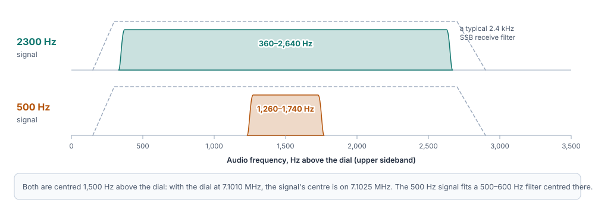

*Figure 28. Where Aether's two signals sit in the radio's audio.*

- **2300 Hz** carries the most data: use it for Winlink and Pat, and whenever both stations can.
  It needs a receive filter 2.4 kHz or wider, centred.
- **500 Hz** is for contacts between two stations, VarAC, and crowded bands. It is slower but
  fits between other signals, and works through a narrow filter.
- **Both stations use the same bandwidth.** A 2300 Hz station answers a 500 Hz call at 500 Hz by
  itself, and goes back after 20 s of quiet. A 2300 Hz station calling a station it knows runs
  500 Hz moves there first. A call of six or more tries (**Call tries**, Setup step 4) that four
  tries at 2300 Hz have not had answered goes on at 500 Hz, to a station not known to run 2300 Hz.
  With the default two tries it stays at 2300 Hz: a station running 500 Hz hears the call and
  tells its operator, and a probe tells you the bandwidth it runs.
- **The Stations tab's Hz column** shows what your station remembers of each station. A probe's
  answer says the bandwidth a station really runs.
- **A host program's bandwidth wins.** With Host programs on, the program's `BW` command sets the
  bandwidth for its sessions.

## 18. Probes, beacons and the Test session

**A probe** is one frame and one answer. It tells you, without a session, whether the other station
hears you and how well, both ways. Probe before a long session on an unknown path.

**A beacon** says your callsign to anyone listening, on the tone floor. Other stations list you in
their Stations tab, with how well they heard you. Use the repeat while you are at the station; under
automatic control with the US rules Aether sends none.

### The Test session

A Test turns a contact into a measurement the project can use. With the other callsign in **Call**,
press **Test session**. The other station only has to be listening.

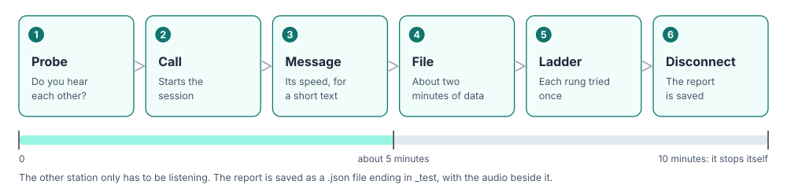

*Figure 29. The six steps of a Test session.*

1. **Probe.** If you probed the same station on the same dial in the last minute and were answered,
   that probe counts and no new one goes.
2. **Call.** If the probe found the other station at 500 Hz and you run 2300 Hz, the whole Test
   goes at 500 Hz, and your station goes back after.
3. **Message**, sized to how well the probe says you are heard.
4. **File**, sized to about two minutes at the message's rate.
5. **Ladder**: a short measurement at each rung the link uses, starting one rung under the fastest
   the message and file were acknowledged at, until three rungs in a row fail. Each rung sends a
   few frames of test filler once; the other station says which arrived.
6. **Disconnect.**

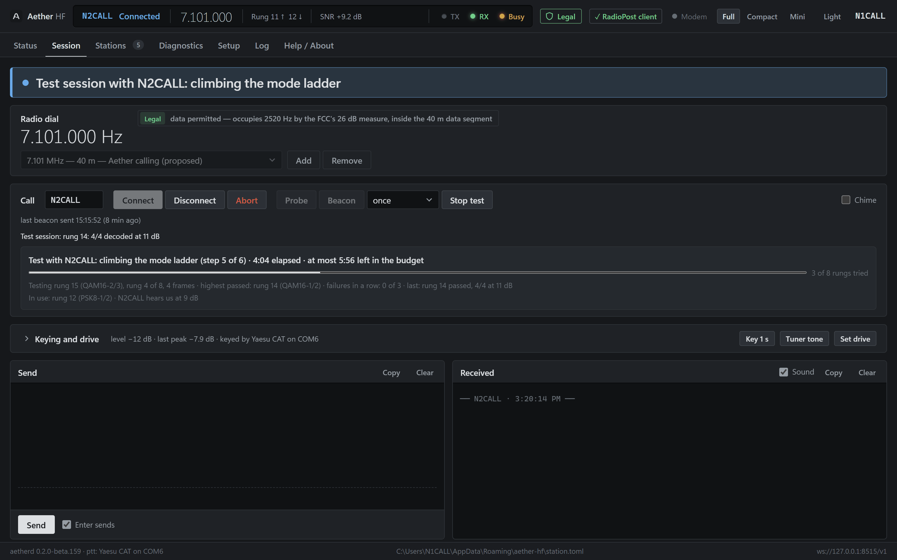

*Figure 30. A Test session in progress.*

The message and file go first, so the speeds the Test reports are the speeds you would get. It
takes about five minutes and stops itself at ten. If you wait for a clear channel, the probe and the
call wait too, and the wait counts against the ten minutes. The two stations may run different
bandwidths: the Test then runs at 500 Hz. The result is saved as two files ending in `_test`: a
`.json` report and the `.wav` audio. See [Field testing](../user/field-test.md) and the
[tester's guide](../user/tester-guide.md).

## 19. The rules

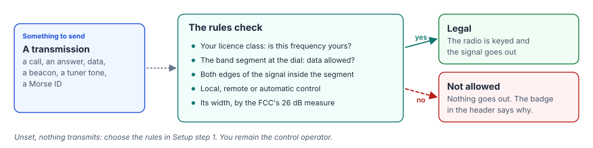

*Figure 31. Every transmission is judged against the rules before the radio is keyed.*

With *United States — FCC Part 97* chosen in Setup step 1, Aether judges every transmission before
it keys the radio: your licence class, the band segment at the dial, both edges of the signal, the
control (local, remote or automatic) and the signal's width by the FCC's 26 dB measure. A
transmission the rules refuse never goes out, and the header's badge says why.

- **Control.** At your own station you are at the controls (local control). A station left
  answering with nobody at the radio, such as a gateway, is under **automatic control**: Aether
  then transmits only in the segments where automatic control of data is allowed.
- **Identification.** Aether sends each station's identifier at the end of each session, in Morse
  or in the data signal (Setup step 4), and nothing during it. The rules ask for your callsign at
  least every ten minutes, so keep each session under ten minutes.
- **No encryption.** Aether never encrypts. Anyone who hears it can read what it carries.
- **You remain the control operator.** Aether's check helps; it does not replace you.

[FCC regulatory controls](../user/fcc-regulatory-controls.md) has every rule Aether checks, with the
rule text it rests on, and [the frequency plan](../user/frequency-plan.md) suggests where to operate.

---

# Part 4. Aether with other programs

## 20. The programs and their ports

Programs reach Aether through ports on the same computer. Each kind has its own.

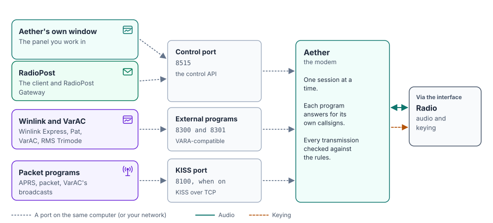

*Figure 32. The programs that use Aether and the ports they connect to.*

| Port | What it is | Who uses it |
|---|---|---|
| 8515 | Aether's control port | Aether's own window, RadioPost, RadioPost Gateway |
| 8300 and 8301 | The host programs port, VARA-compatible (Setup step 5, *Host programs*) | Winlink Express, Pat, VarAC, RMS Trimode |
| 8100 | The KISS port, off until you turn it on (Setup step 5, *KISS programs*) | APRS and packet programs, VarAC's broadcasts and relay notifications |

Leave the numbers as they are unless another program needs one. Never give the host programs port
8515 or 8514: Aether then refuses to start.

## 21. Winlink Express, Pat and VarAC

Turn on **Host programs** in Setup step 5, then point the program's VARA HF settings at
`127.0.0.1` and port 8300. There are two ways to run the radio:

- **Aether keys the radio** (CAT, rigctld, FLRig, serial, CM108 or VOX). This is the usual way for
  Winlink Express and Pat.
- **The program keys and tunes the radio** (Setup step 2, *Radio control*: *Host program*). This
  is VarAC's way, with its RIG tab's PTT and frequency control on CAT, as with VARA. Keep it in a profile of its own.

While **Host programs** is on, the program sets the callsign and the bandwidth: Setup shows **Host**
in their places, and your own come back when the program leaves.

- The program's `MYCALL` names the callsigns it answers for. While it is attached, Aether answers no
  other callsign of its own.
- A program's `CWID ON` turns the identifier on for its sessions, sent the way Setup step 4 says.
- VarAC's **TUNE** button plays Aether's **Tuner tone**: ten seconds at most, and VarAC can stop it
  sooner. It plays at Aether's transmit level: the level VarAC sends with it, and VarAC's drive
  level, change nothing here. Set the drive with **Set drive**.
- VarAC's **Call CQ** and beacons go out as Aether's beacon. With VarAC keying the radio, none of
  Aether's rules settings acts, and they go. With Aether keying it under the US rules, a station
  under *Automatic* control sends no beacon: set **Control** back to *Local* (or *Remote*) in Setup
  step 1, in the profile you run VarAC under. A CQ Aether turns down is answered `WRONG`, and the
  Log says why (a *host* line, also in the tooltip of the program's name in the header).
- The first transmission after a program attaches is checked on its own: if the receive audio does
  not change while the radio is keyed, the Log says the radio may not be transmitting. A program set
  to key a port nothing is wired to is found at once.
- The program sees only its own sessions. A session you start from the window is not reported to
  it, though its BUSY reads ON while it runs.
- A call through a digipeater (a path with *Via* in Winlink Express or Pat) is refused: Aether
  relays nothing. Call the station directly.
- One program at a time uses the host port. A program that connects again replaces the old
  connection, and the Log says so (*host:* lines).
- Winlink Express closes the modem it started: turn off its automatic launch and start Aether
  yourself.

### VarAC in one step

On a computer where VarAC is installed, Aether sets VarAC up for you. Your own VarAC settings
stay as they are, and VARA HF stays one click away.

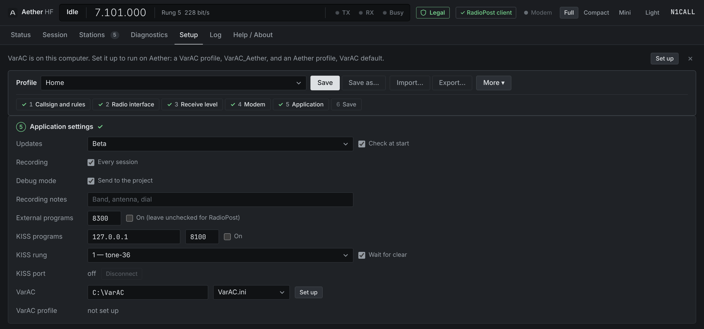

*Figure 33. The offer to set VarAC up, and Setup step 5's VarAC rows.*

1. Install Aether and do Setup steps 1 to 3 as usual: callsign, sound card, receive level.
2. A banner says VarAC is on this computer. Press **Set up** (or use Setup step 5, **VarAC**).
   Aether does two things:
   - It writes **VarAC_Aether.ini** in VarAC's folder. This is a copy of your VarAC profile
     (`VarAC.ini`, or the one you pick in step 5), so your rig, callsign and other VarAC settings
     carry over. Only the modem settings change: VarAC starts Aether instead of VARA, on Aether's
     ports, with the KISS port on and no VARA monitor.
   - It saves the Aether profile **VarAC default**: your settings with **Host programs** and
     **KISS programs** on. If your VarAC profile keys the radio itself (CAT, OmniRig, FLRig,
     Hamlib or DTR/RTS), the profile also sets **Radio control** to **Host program** and the rules
     to *None*, as Setup does for a host program. If VarAC uses VOX, Aether keeps its own radio
     control. **Control** is *Local* in it if yours was *Automatic*, as for a gateway: VarAC has an
     operator at the radio.
3. Press **Switch to VarAC default**, or pick it on the Profile bar.
4. In VarAC, choose **Switch profile**, then **VarAC_Aether**. VarAC restarts and starts Aether.
   To go back to VARA, switch VarAC back to **VarAC** and Aether back to your usual profile.

Close VARA HF before switching: while it runs it holds ports 8300 and 8100 and the sound card,
and VarAC would still reach VARA.

**After an update.** If a new version of Aether moves, changes a port, or changes what VarAC
needs, the banner says **VarAC_Aether.ini needs updating** (or that *VarAC default* has new
settings). **Update** changes only those settings. A copy of the old file is kept as
`VarAC_Aether.ini.bak`, and anything you changed in VarAC yourself is kept. Your sound card and
levels in *VarAC default* are kept too.

- VarAC writes a small `VARA.ini` beside Aether's program when it starts it. That file is
  VarAC's, and Aether ignores it.
- If VarAC is not in `C:\VarAC`, type its folder in step 5. A folder under Program Files needs an
  administrator to write in, and Aether says so.
- **Not now** stops the offer. A later version's change is offered again.

### Finding Winlink's programs

On Windows, Aether finds Winlink Express, RMS Trimode and RMS Packet and reads each one's radio and
TNC settings into an Aether profile. It only reads the programs' files; it never changes them.

*Figure 34. Winlink's programs found, two setups ticked, and what each profile will set.*

1. Setup step 5, **Winlink programs**. The list fills by itself when the window opens: one row per
   setup, with the program, the callsign, the version, whether it is running, the TNC port it
   points at (**Aether** when it is this station's) and the folder. Winlink Express keeps several
   callsigns in one install, and each is a row. **Find** looks again. If a copy is missing, type its
   folder in **Add folder** and press **Add**: it is looked in every time after.
2. Tick the rows you want. Under the list, each ticked row shows the profile's name and what it
   will set (callsign, Host programs, bandwidth, keying, rules, port), and in amber what the program
   must say for it to work. Hold the pointer on any of them to see why.
3. **Keying** says who keys the radio:
   - **Host program** (the default when the program keys the radio itself): the program keeps its
     radio setup, keys on Aether's `PTT ON` and tunes the radio, as it did with VARA. Aether reads no
     dial, so the rules are *None* and you check every transmission.
   - **Aether**: Aether keys the radio the way the program did, and the rules check stays on. Set
     the program's radio to *Manual* and its PTT port to *None*.
   - **as it is**: the program keys by VOX or controls no radio, and Aether's keying is left alone.
4. **Import** saves a profile for each ticked row, named for the program and the callsign
   (*Winlink Express KK4ODA*). **Import and switch** saves one and switches to it. Importing again
   brings a profile up to date and keeps its sound card and levels.

If the program points at another port on this computer, the profile makes Aether listen there, so
the program needs no change. A gateway's profile (RMS Trimode) also sets **Control** to
*Automatic*, so only the program answers calls, and **Wait for clear** on. A setup above 30 MHz, or one whose only TNC is VARA FM or AGW, waits
for Aether FM: its box cannot be ticked.

[VarAC, Winlink Express and Pat with Aether](../user/host-programs.md) has each program's settings,
screen by screen.

## 22. A Winlink gateway

*Figure 35. Mail by radio, through a gateway: Winlink above, RadioPost below.*

An Aether gateway runs RMS Trimode beside Aether; a station in the field runs Winlink Express with
Aether. Set the gateway's Aether to *Automatic* control (Setup step 1) when nobody is at its radio.
Under automatic control Aether answers calls only for a program that holds the callsign called and
is listening, and transmits only where automatic control of data is allowed.

RMS Trimode scans: every few seconds it stops listening for half a second, as it does with VARA.
Aether tells it of a call only while it listens. A call answered in that half second is told once
Trimode has been listening again for a moment: Trimode ignores a call it is told of the instant it
starts listening.

RMS Trimode starts its modem itself, and closes what it started to restart it. When Trimode starts
Aether, Aether runs a small helper with no window for Trimode to watch, so a restart no longer closes
Aether's window.

[Winlink through an Aether gateway](../user/winlink-gateway.md) sets up both ends step by step, and
[the gateway kit](../user/gateway-kit.md) runs the modem as a service with no window.

### Finding an Aether gateway

Winlink's channel list files every gateway under a **service code**. `PUBLIC` is the list every
Winlink program shows. Aether gateways are under **`AETHER`** instead, and never under `PUBLIC`:
Winlink lists them as VARA HF, and a VARA station could not connect to one.

- **Winlink Express**: in *Settings › Winlink Express Setup*, set **Service Codes** to `AETHER`.
  Then, in a *Vara HF Winlink* session, choose *Channel Selection › Update Table Via Internet*.
  `PUBLIC AETHER` lists the VARA gateways as well, which Aether cannot reach.
- **Pat**: add `"service_codes": ["AETHER"]` to its configuration, then run `pat rmslist`.
- **Running a gateway**: set RMS Trimode's service code (*Site Setup*) to `AETHER` alone.

### RMS Packet

RMS Packet is Winlink's gateway for VHF and UHF. Its *Vara FM* setting connects to Aether's host
programs port, and its *KISS ACKMODE* packet channel to the KISS port; both carry a Winlink session
on the bench. Keep it off the air with Aether HF: it reports its channel to Winlink as VARA FM, and
its users are on VHF and UHF, where Aether HF cannot reach them. It waits for Aether FM.
[RMS Packet with Aether](../user/rms-packet.md) has the setup, what was tried and what waits.

## 23. RadioPost

RadioPost sends and receives ordinary email by radio, through Aether. RadioPost is the mail program;
Aether is the modem. Each is set up in its own window, and each has its own manual:

| To do this | Use | Where |
|---|---|---|
| Your account, your mail, whom to call | RadioPost | [RadioPost's manual](https://github.com/KK4ODA/RadioPost/blob/main/docs/manual/manual.md#35-radiopost-and-aether-hf) |
| Sound card, keying, drive level | Aether | [Step 2](#step-2-radio-interface) and [Keying and drive level](#keying-and-drive-level) |
| Your licence class, control and the band rules | Aether | [Step 1](#step-1-callsign-and-rules) |
| Bandwidth (500 or 2300 Hz) | Aether | [Step 4](#step-4-modem-settings) |
| The frequency | Aether | [Radio dial](#radio-dial) |
| Recording a session's audio | Aether | [Recording the radio's audio](#recording-the-radios-audio) |
| Sending your logs to the project | Aether | [Sending files](#sending-files) |

> **Note.** RadioPost needs Aether to key the radio **itself**. In Setup step 2 choose CAT, serial,
> rigctld, FLRig, CM108 or VOX, not *Host program*. Keyed by a host program, Aether transmits only for that
> program, and RadioPost's calls never reach the air.

- **RadioPost connects to the control port, 8515**, not to the host programs port. Leave both
  numbers as they are.
- **Callsigns.** RadioPost calls and answers as the callsign it was enrolled with. Do not copy it into
  Aether. While a RadioPost program holds a callsign, Setup step 1 shows it greyed, such as
  *N1CALL-10 · RadioPost Gateway*, and your own comes back when it stops.
- **The header** shows *✓ RadioPost client* between calls, and *✓ RadioPost client · listening* while
  it listens. RadioPost Gateway shows there too, *listening* while it answers.
- **A gateway** runs RadioPost Gateway beside Aether, set to *Automatic* control. It can share the
  radio with RMS Trimode ([Several programs on one station](#25-several-programs-on-one-station)).
- **RadioPost's logs** travel in the zips Aether sends ([Sending files](#sending-files)).

RadioPost's manual covers the rest:
[what you need](https://github.com/KK4ODA/RadioPost/blob/main/docs/manual/manual.md#3-what-you-need),
[calling a gateway](https://github.com/KK4ODA/RadioPost/blob/main/docs/manual/manual.md#8-calling-a-gateway),
[station to station](https://github.com/KK4ODA/RadioPost/blob/main/docs/manual/manual.md#10-station-to-station),
and [setting up a gateway](https://github.com/KK4ODA/RadioPost/blob/main/docs/manual/manual.md#18-setting-up-the-gateway).

## 24. KISS programs

For APRS and packet programs, and for VarAC's broadcasts and relay notifications, turn on **KISS
programs** in Setup step 5. A relay notification needs it at both stations: the one holding the
VMail sends it on this port, and the one it is for hears it here.
The default address, `127.0.0.1` port 8100, is VARA HF's own, so a program set up for VARA needs no
change.

- Each KISS frame goes on the air on its own, outside any session, with no acknowledgement.
- KISS frames go at the second rung by default, which stations of either bandwidth hear.
- A new rung or *Wait for a clear channel* takes effect at once, and the programs connected stay
  connected. A new address closes the port and opens it there: restart a program that does not
  connect again by itself (RMS Packet).
- Keep the address at `127.0.0.1` unless the program runs on another computer of yours on a network
  you trust: anyone who can reach the port can make your station transmit.

[KISS programs](../user/kiss.md) has the details for each program.

## 25. Several programs on one station

**A program speaks for the station.** This holds for a host program (Trimode, Winlink Express,
VarAC) and a RadioPost program alike.

- While a program holds a callsign, only the programs' callsigns are answered. Your own callsign
  (Setup step 1) rests meanwhile, and comes back when the last program leaves.
- If they differ (Setup says `N1CALL`, the gateway `N1CALL-10`), a call to `N1CALL` is not answered
  while the gateway runs, even under local control. If they are the same, nothing changes.
- When a program has left, a station calling its callsign brings up the mismatch banner, which names
  the program to start again.

**Two programs on one radio.** A host program and a RadioPost program (RMS Trimode and RadioPost
Gateway, for example) can share one radio. Give them different callsigns, such as `N1CALL-1` for
Trimode and `N1CALL-10` for RadioPost.

- A call is answered only while the program holding its callsign listens, and the session is that
  program's alone. The other program sees the channel busy until it ends.
- The station runs one session at a time.
- Two programs cannot hold the same callsign: the first to claim it keeps it, and the Log says which
  program was refused it (*claims:* lines).
- RadioPost needs Aether to key the radio itself, so the station runs with Aether keying, not *Host program*.

**A program that leaves takes its session with it.** When the program that owns a session or a call
disconnects from Aether (it closed, crashed or lost its connection), Aether ends that session as
**Disconnect** does, and a call it placed stops. The Log says so (*claims:* lines), and says how when
the connection broke.

**Under automatic control only a program answers calls.** With nobody at the station, Aether answers
a call only for a program that holds the callsign called and is listening. While no program holds
your callsign, calls to it go unanswered, and the header's chip says so. Probes are still answered:
an answer to a probe opens no session.

---

# Part 5. Aether FM

## 26. Aether FM: what is coming

> **Note.** Aether FM is not in any release yet. This chapter says what is planned, so you know what
> to expect. It will grow into a full part of this manual as each piece is built and tested.

Aether FM brings the same modem to VHF and UHF FM radios, inside the same application. Its first job
is to carry RadioPost's email over FM, simplex and through repeaters.

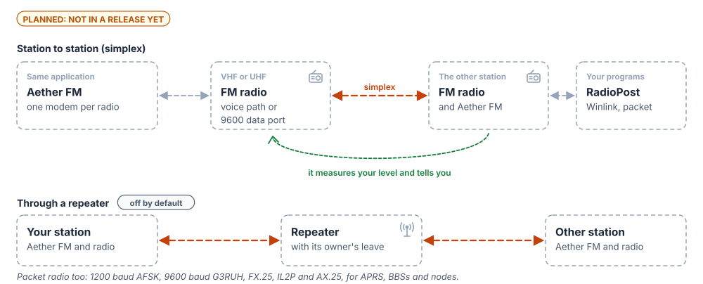

*Figure 36. Aether FM as planned.*

What has been decided:

- **One application.** Aether HF and Aether FM install together. Each radio gets its own modem.
- **Two ways in.** Through the radio's microphone and speaker audio (the voice path), or through
  a 9600 data port where the radio has one. The voice path comes first on the air.
- **The far station sets your level.** On FM you cannot see your own deviation. The other station
  measures how your signal arrives and tells your station, both at the call and during the session.
  A wrong level costs speed, not the contact.
- **The same link as HF.** Granted slots, so the two stations never key at once, and the same way of
  choosing a speed.
- **The callsign in the digital signal.** FM stations identify inside the data, with no Morse.
- **Repeaters off by default.** A repeater profile is there for the stations that need it, with the
  repeater owner's leave.
- **Packet radio too.** 1200 baud AFSK, 9600 baud G3RUH, FX.25, IL2P and AX.25 connected mode, for
  APRS, BBSs, nodes and Winlink's packet gateways.
- **The same programs.** RadioPost on the control port, programs written for VARA FM on the host
  port, and KISS.

How fast it will be is not promised yet: figures go in this manual when they have been measured.
The plan, step by step, is Phase 10 of the project's [roadmap](../ROADMAP.md).

---

# Part 6. Help

## 27. What the readings mean

| Reading | Where | What it is |
|---|---|---|
| **SNR** | Header, Link | What this receiver measured on the last frame it found, in a 3 kHz bandwidth. Negative numbers are normal on HF: the tone rungs work well under 0 dB. On a tone frame it is a lower bound. On a fast flutter (a polar path, a signal that warbles) it reads a few decibels under the path however strong it is |
| **They hear you at** | Diagnostics, SNR chart | What the other station measured on your last transmission. Compare it with your SNR: a big difference is a lopsided path |
| **Rung** | Header, Link | The step the data is moving at, with its name and rate on the air. The other station's while you receive, yours while you send, both when data goes both ways |
| **Throughput** | Link, Speed chart | Data both ways over the last 30 seconds, with the session total. One way it stays under the rung's rate: answers, turnarounds and repeated frames take their share |
| **Tuning** | Channel | The last frame's offset from your dial. Positive means the other station is above your dial. A few hertz is nothing; a hundred is a dial to check. In a session the receiver follows a station that drifts |
| **Signal above noise** | Channel | The level in Aether's channel over the learned noise floor. Noise alone reads a few decibels either side of 0 dB. Frames the modem finds never count as noise |
| **Receive level** | Channel, Setup step 3 | The sound card's whole input over the last 3 seconds: the radio's whole passband. Aim for *Good* |
| **Queued** | Channel | Bytes still waiting to be sent or acknowledged, counted as you or your program gave them |
| **Clipping** | Receive level, banner | The share of the audio at full scale over the last ten seconds. Over 0.1 % the audio clips |
| **Mode confidence** | Diagnostics | How clearly the last frame's rung was read. Below 1.3 is a guess |
| **Busy lamp** | Header | The channel carries a signal: a level over the threshold, a narrow signal's shape, or a frame that decoded |

## 28. Troubleshooting

### Transmitting

**Nothing transmits, and the rules badge says *TX blocked*.** Click the badge. The usual causes:
step 1 is not filled in; the dial is outside your class's data segment, or the signal would cross a
segment edge; the radio cannot report its dial and **Dial is at** is not set; or the station is under
automatic control outside the automatic segments.

**The radio does not key.** Press **Key 1 s** on the Session tab. If the radio's transmit light stays
off, check Setup step 2's **Radio control**: the port, the line (RTS, DTR or CAT), and for CAT the dialect, the rate and
an Icom's CI-V address. On a Yaesu, CAT is on the *Enhanced* port and RTS on the *Standard* port.

**The radio keys but no signal goes out.** Check the playback device in step 2. A Yaesu keyed over CAT
transmits from the DATA input: check the radio's data-input settings.

**The Log says the radio's receive audio did not change while it was keyed.** Aether keyed the radio,
but the audio it heard stayed the same as the band, so the radio probably did not transmit. Check the
radio control in step 2, and the radio's own setting for it (on many radios RTS or DTR keying works only on one
of its two USB ports, or after a menu setting). Then press **Key 1 s** and watch the radio and the Log.

**The ALC moves even at a low transmit level.** Turn down the radio's USB (rear) data input gain and
run **Set drive** again.

### Connecting

**The other station does not answer my call.**

- Check you both run the same bandwidth. If not, the mismatch banner says so on the other side.
- Check you both run versions with the same link protocol. A newer one shows **Update required**.
- Check the callsign, SSID included. If the operator was heard under another SSID, the banner offers to
  call that one.
- Probe first: it tells you whether either of you hears the other at all.
- A station under automatic control answers only while a program there holds the callsign you
  call and listens.

**Two 2300 Hz stations keep meeting at 500 Hz.** One of them remembers the other as a 500 Hz station.
The Stations tab's *Hz* column shows what each remembers. Probe the other station once: the answer says
the bandwidth it really runs, and the next call goes at 2300 Hz.

**The other station keys by VOX (a SignaLink) and keeps calling after I answer.** Set the **answer gap**
in step 4 to 500 to 800 ms. Aether learns a gap for such a station by itself, but setting it helps the
first contact. Better still, the other station sets its **Turnaround**.

**Disconnect does not close the session at once.** It sends what is still queued first, a minute at
most. The banner counts the seconds down. To close now, press **Abort**.

**Sessions connect but run slowly.** Look at the SNR both ways (SNR and *They hear you at*). A lopsided
path, where the other station hears you much worse than you hear it, slows every exchange: more power,
a better antenna or another band helps more than any setting. If the Frames table shows many failed
frames at a good SNR, check the receive level, the drive and the receive filter.

### The receive audio

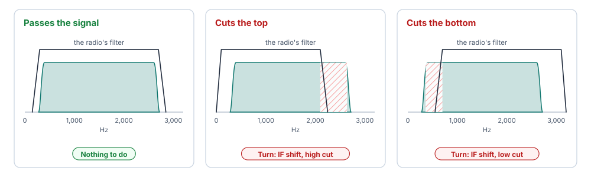

*Figure 37. When the radio's receive filter cuts the signal.*

**Checking the radio's receive filter.** Open the Diagnostics tab and look at the waterfall. The red lines
are the edges of Aether's signal, and the band's noise should look even between them. Aether does not
check this for you: the other stations on a busy band look too much like a filter.

**The noise fades out inside the top red line.** The radio's passband ends below the top of Aether's
signal. Usually the IF shift (or passband tuning) has moved the passband down: centre it. Otherwise the
high cut is set low, or the filter is too narrow: open it.

**The noise fades out inside the bottom red line.** The IF shift has moved the passband up, or the low
cut is set high: centre the shift, or set the low cut to 300 Hz or below.

**The noise fades out inside both red lines.** The filter is narrower than the signal, such as a CW or
narrow data filter under the 2300 Hz signal. Widen it to 2.4 to 3 kHz, or run at 500 Hz.

**The clipping banner shows.** The radio sends the sound card more than it can take. Turn the radio's USB
or data audio output down, or the sound card's input, until **Receive level** reads *Good*. Clipped audio
spreads strong signals across the band and costs every frame.

### The Busy lamp

**The Busy lamp stays on with nothing on the air.** The Diagnostics tab's busy line says which test marked
the channel busy. A steady carrier or a spur in your own receiver can do it. Try with the antenna
disconnected: if it is still busy, the signal is in your station.

**The Busy lamp stayed on for about a minute after you changed something at the radio.** Turning the RF
gain up, switching the attenuator off or a preamp on, or raising the radio's USB audio level makes all the
noise louder at once. Aether reads the louder noise as a signal until its noise floor learns the new
level, about a minute. Make such changes before you start listening. A move of the dial that Aether knows
of (from the dial list, or read over CAT, rigctld or FLRig) costs nothing.

### The computer

**The Log says the sound card's capture skipped some milliseconds.** Your computer or its USB audio lost a
moment of what the radio sent. Aether puts silence in its place, so everything after the gap stays in
time; a frame across the gap may not decode and is sent again. Once in a session is nothing. If it happens
often, close other programs, plug the radio into a USB port on the computer itself rather than a hub, and
turn off USB power saving.

**The Log says the playback skipped inside a transmission.** The computer stalled while Aether was
sending. The cures are the ones above.

**A host program says nothing is connected, or VARA is missing.** Check **Host programs** is on in step 5
and the program points at `127.0.0.1` and the right port. With *Host program* radio control, the program must be attached
before the window can transmit.

**The Modem lamp is red.** The modem has stopped or is restarting. Wait a few seconds after a save. If it
stays red, restart Aether and look at its log (**Help** › **Open the configuration folder**, then the
`logs` folder).

## 29. Reporting a problem

1. If it happened on the air, **record** the next time it happens: **Start recording** on the Session
   tab, with notes, and **Mark** when it happens.
2. **Log** tab › **Send files…** › *Send my files to the Aether project*. Choose the sessions with that
   station, how far back, and tick the audio.
3. Say what happened in an issue on
   [GitHub](https://github.com/KK4ODA/aether-hf/issues), or by email.
4. If the other station saw something too, **Ask a station to send me its files**: both sides of one
   session together settle most questions.

Nothing leaves your station unless you press the button, except debug mode's uploads of sessions run by
a program, which you can turn off in Setup step 5.

## 30. Glossary

| Word | What it means |
|---|---|
| **Acknowledgement** | Which frames arrived, how well the other station hears you, and how many frames of your last transmission it never heard |
| **Answer gap** | The least time Aether waits after the other station's transmission before its own, for a station that keys by VOX |
| **Bandwidth** | 2300 Hz or 500 Hz. Both stations of a session use the same |
| **Beacon** | Your callsign on the air once, addressed to nobody |
| **Control** | Local, remote or automatic, under §97.109. It decides which rules apply |
| **Datagram** | One KISS frame sent on the air on its own, outside any session |
| **Floor, tone floor** | The slowest, most robust rungs: single tones that get through under the noise. Calls, probes and beacons go there |
| **Host program** | Winlink Express, Pat, VarAC or RMS Trimode, using Aether through its VARA-compatible port |
| **Ladder** | All the rungs of a bandwidth, slowest first. Also the Test session's step that tries each rung |
| **Link protocol** | The version of the rules both stations follow on the air. Different versions cannot connect |
| **Modem (aetherd)** | The part of Aether that does the work; the window talks to it |
| **OFDM** | Many tones sent at once, each carrying part of the data: fast on a good path |
| **Probe** | One frame and one answer that measure the path both ways without a session |
| **Profile** | A saved set of Setup settings under a name |
| **Rung** | One step of the ladder: a way of sending with its own speed and the signal it needs |
| **Session** | A connection between two stations that carries data without errors |
| **Sidecar** | The `.json` file beside a recording, saying what the modem made of every frame |
| **Slot** | The time the calling station gives the called one to send in, after each of its own transmissions |
| **SNR** | Signal-to-noise ratio, here always in a 3 kHz bandwidth |
| **Test session** | A measured contact: probe, call, message, file, ladder, recorded |
| **Turnaround** | How long after a radio stops sending it hears again. Each station tells the other its own |

## 31. Quick reference

| What | Where, or what it is |
|---|---|
| First start | Setup, steps 1 to 6, then **Save these settings** |
| Callsign, rules, control, licence class | Setup step 1 |
| Sound card and radio control | Setup step 2 |
| Receive level | Setup step 3: aim for *Good* |
| Bandwidth, identify by, turnaround | Setup step 4 |
| Host programs, KISS, updates, debug mode | Setup step 5 |
| Drive | Session tab › Keying and drive › **Set drive**: ALC just moving, then back off |
| Call, disconnect, probe, beacon, Test | Session tab › Call |
| The dial | Session tab › Radio dial, or **Dial is at** |
| Signal, spectrum, waterfall | Diagnostics, or **Undock** |
| Sending logs and recordings | Log tab › **Send files…** |
| Control port | 8515 (this window, RadioPost) |
| Host programs port | 8300 and 8301 (Winlink Express, Pat, VarAC, RMS Trimode) |
| KISS port | 8100, when on (APRS, packet, VarAC's broadcasts) |
| Settings and logs | `%APPDATA%\aether-hf\` on Windows, `~/.config/aether-hf/` on Linux and macOS |
| Recordings | The `recordings` folder there; Session tab › **Open folder** |
| Releases | [github.com/KK4ODA/aether-hf/releases](https://github.com/KK4ODA/aether-hf/releases) |

---

# Appendix

## Where to read more

| Subject | Document |
|---|---|
| Installing, checking downloads, updating, uninstalling | [Installing Aether HF](../user/install.md) |
| On-air testing, for testers | [The tester's guide](../user/tester-guide.md) |
| Winlink Express, Pat and VarAC, program by program | [VarAC, Winlink Express and Pat with Aether](../user/host-programs.md) |
| RMS Packet, today and with Aether FM | [RMS Packet with Aether](../user/rms-packet.md) |
| KISS programs | [KISS programs](../user/kiss.md) |
| The rules Aether checks | [FCC regulatory controls](../user/fcc-regulatory-controls.md) |
| Where to operate | [The frequency plan](../user/frequency-plan.md) |
| Running a gateway with no window | [The gateway kit](../user/gateway-kit.md) |
| A Winlink gateway with RMS Trimode, and its client | [Winlink through an Aether gateway](../user/winlink-gateway.md) |
| Field testing and the bench | [Field testing](../user/field-test.md) |
| RadioPost, the email program | [RadioPost's manual](https://github.com/KK4ODA/RadioPost/blob/main/docs/manual/manual.md) |
| The signal on the air | [The air interface](../spec/air-interface.md) |
| The host interface | [Host interfaces](../spec/host-interfaces.md) |
| The control API | [The control API](../spec/control-api.md) |
| What is planned | [The roadmap](../ROADMAP.md) |
| Releases | [github.com/KK4ODA/aether-hf/releases](https://github.com/KK4ODA/aether-hf/releases) |
| Bugs and ideas | [github.com/KK4ODA/aether-hf/issues](https://github.com/KK4ODA/aether-hf/issues) |

## Keeping this manual current

This manual is part of the application. A change to anything an operator sees or sets (a tab, a box,
a button, a setting or its default, a banner, a reading, what a host program is told) updates the
manual in the same commit. So does a change in RadioPost that alters how it uses Aether. The rule is
in `CONTRIBUTING.md` and `docs/MAINTAINING.md`.

- **Versions.** The manual's **Version** goes up with each change: the last number for a
  correction, the middle one for something added or changed, the first one for a reorganisation.
  Each change adds a row to the change log below, and the header's **Version** and **Updated** match
  its last row. **Describes** is the release version: `tools/release.py bump` moves it with every
  other version in the repository, and `tools/release.py check` (CI) holds it.
- **The contents and the rung tables** are made by `python -m uv run python tools/manual/build.py
  update`. CI (`model/tests/test_manual.py`) fails when they are stale, when a figure number is out of
  order, when a picture is missing or unused, or when a link leads to no file or no heading.
- **The schematics** are drawn by `tools/manual/figures.py`, with the drawing kit RadioPost's manual
  uses. Edit the script and run it; CI checks the SVGs match it. The rung chart and the passband
  picture read their numbers from the modem's model.
- **The screenshots** are taken of the real window with made-up data by
  `node tools/manual/screens.mjs`. Run it after changing what the window shows, look at each picture,
  and commit them with the manual.
- **The links to RadioPost's manual** are checked by `python tools/manual/build.py xref`, both ways.
  Run it when either manual moves.
- **The PDF** is built by `python tools/manual/build.py pdf` and attached to every release.

## Change log

| Version | Date | Changes |
|---|---|---|
| 1.0.0 | 2026-11-15 | First edition: the illustrated manual in place of `docs/user/manual.md`, with Parts, schematics and screenshots, the rung tables from the model, a chapter on RadioPost, and Aether FM as planned. |
| 1.1.0 | 2026-11-16 | Link protocol 13's call (ADR-0126): **Connect** and **Bandwidth** say how a call goes, and Setup step 4 has **Call tries**. |
| 1.2.0 | 2026-11-16 | The identifier in the data signal (ADR-0127): Setup step 4's **Identify by** (Morse or Data signal) in place of **Morse ID**, the Morse speed on its own row, and the goodbye, the rules and the host programs' `CWID ON` in those words. |
| 1.3.0 | 2026-11-17 | Scanning (ADR-0129): the **Radio dial** box's **Scanning** row with **Stop**, while a program such as RadioPost Gateway scans the station's dials; what holds the radio on a dial, and what ends a scan. |
| 1.4.0 | 2026-11-17 | Scanning: up to four dials; 4 to 5 s on a quiet dial, and about 19 s where a call is heard under way (ADR-0129 §11). |
| 1.5.0 | 2026-11-17 | A short message goes at the slowest rung of its kind that carries it in as many frames (ADR-0130): **Slow and sure, or fast** says so, and why the header's rung can read lower while short replies go. |
| 1.6.0 | 2026-11-17 | The Log tab's **filter** line: the receive filter's reading each time it changes. |
| 1.7.0 | 2026-11-18 | The receive filter is no longer read (ADR-0132): the **Receive filter** banner and line and the Log's **filter** line are gone. Check the filter on the waterfall instead: [The receive audio](#the-receive-audio). The clipping banner stays. |
| 1.7.1 | 2026-11-18 | VarAC's relay notifications travel on the KISS port: **KISS programs** on at both stations. |
| 1.8.0 | 2026-11-18 | [VarAC in one step](#varac-in-one-step): the **VarAC** banner and Setup step 5's **VarAC** row write a VarAC profile that runs on Aether and the Aether profile *VarAC default*, and bring them up to date after an update. |
| 1.9.0 | 2026-11-18 | [Profiles](#profiles): the **×** beside each profile in the list deletes it, once you confirm; **More** no longer has Delete. |
| 1.9.1 | 2026-11-18 | **Identify by**: a session or call a program made under a callsign of its own is identified as that callsign, also after the program has closed (report 19 §6). |
| 1.9.2 | 2026-11-18 | **Debug mode**: with no internet, the sessions wait and go once there is a connection, tried every 10 minutes and kept through a restart. |
| 1.10.0 | 2026-11-18 | Setup step 2's **Interface** is **Preset** and its **Keying** is **Radio control**, with *Host program* in place of *Host*, and a new **Dial** line says what reads the dial and tunes the radio: a host program that keys the radio tunes it too. |
| 1.10.1 | 2026-11-19 | [Finding an Aether gateway](#finding-an-aether-gateway): Aether gateways are listed under Winlink's service code `AETHER`; how to see them in Winlink Express and Pat, and how a gateway publishes under it. |
| 1.11.0 | 2026-11-19 | [Winlink Express, Pat and VarAC](#21-winlink-express-pat-and-varac): VarAC's **TUNE** button plays Aether's tuner tone, at Aether's transmit level. |
| 1.11.1 | 2026-11-19 | [Full, Compact and Mini](#full-compact-and-mini) and [Arranging the windows](#arranging-the-windows): the window stays on its screen. Going from Compact or Mini to Full, it grows to the left or upwards where the screen's edge or the taskbar is in the way, and at start a window that would run off its screen moves back onto it. |
| 1.12.0 | 2026-11-19 | **Tune** in Compact and Mini, beside the display: the Session tab's *Tuner tone*, stopped by a second press; a refusal shows in the display for a few seconds ([Full, Compact and Mini](#full-compact-and-mini)). |
| 1.12.1 | 2026-11-19 | VarAC's **Call CQ** and beacons ([Winlink Express, Pat and VarAC](#21-winlink-express-pat-and-varac)): with the rules at *None*, or with a host program keying the radio, no beacon is refused for *Automatic* control, and none of the rules settings acts under **Host**; under the US rules it is, and a CQ Aether turns down is answered `WRONG`, with the reason in the Log's *host* line and the program's tooltip in the header. **VarAC default** is made under *Local* control ([VarAC in one step](#varac-in-one-step)). |
| 1.13.0 | 2026-11-19 | **Winlink programs** in Setup step 5 (ADR-0133): every install of Winlink Express, RMS Trimode and RMS Packet found, one row per callsign, and **Import**, which makes an Aether profile of each row ticked from the program's own radio and TNC settings, showing first what it will set and what the program must say ([Finding Winlink's programs](#finding-winlinks-programs)). |
| 1.13.1 | 2026-11-19 | [Finding Winlink's programs](#finding-winlinks-programs): a gateway's profile sets **Control** *Automatic* and **Wait for clear**. |
| 1.13.2 | 2026-11-19 | [KISS programs](#24-kiss-programs): a new rung, *Wait for a clear channel* or client limit no longer closes the KISS port; the programs connected stay connected. |
| 1.14.0 | 2026-11-19 | [RMS Packet](#rms-packet): Winlink's VHF/UHF gateway works with Aether on the bench, through its *Vara FM* setting or its *KISS ACKMODE* packet channel, and waits for Aether FM for the air. |
| 1.14.1 | 2026-11-19 | [Winlink Express, Pat and VarAC](#21-winlink-express-pat-and-varac): a call through a digipeater is refused; Aether had called the station directly. |
| 1.14.2 | 2026-11-19 | [A Winlink gateway](#22-a-winlink-gateway): a call answered while RMS Trimode is between scan steps is told to Trimode once it has been listening again for a moment, never the instant it starts listening, which it ignored. |
