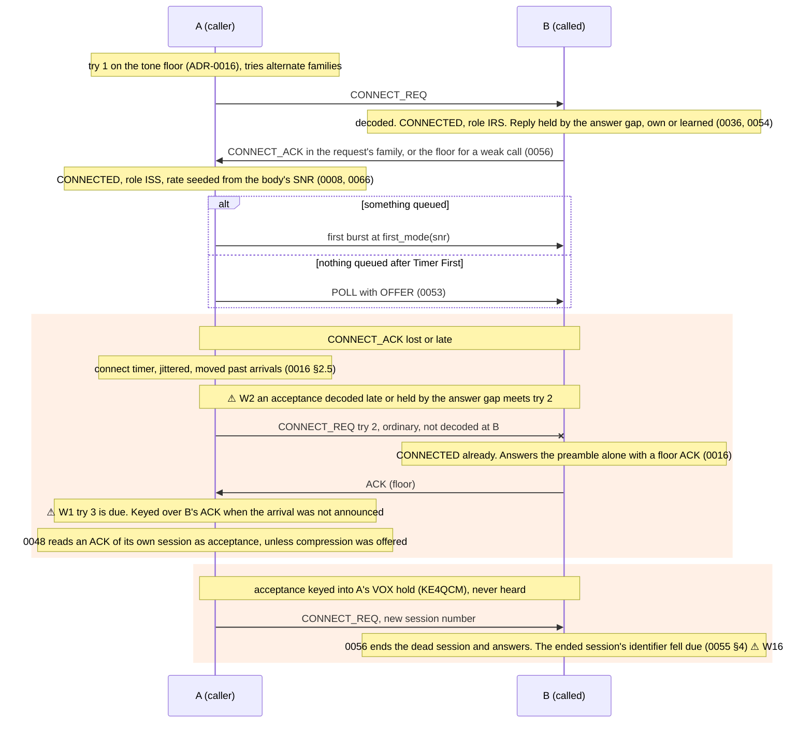
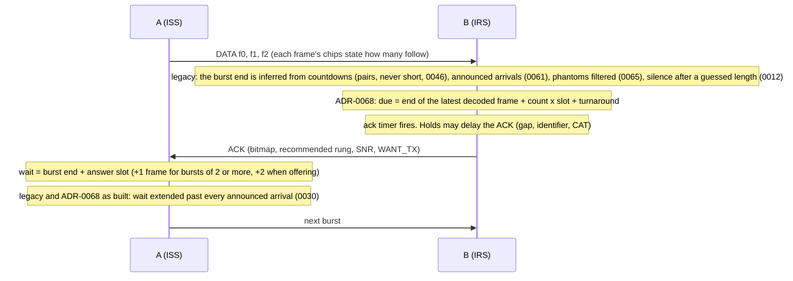
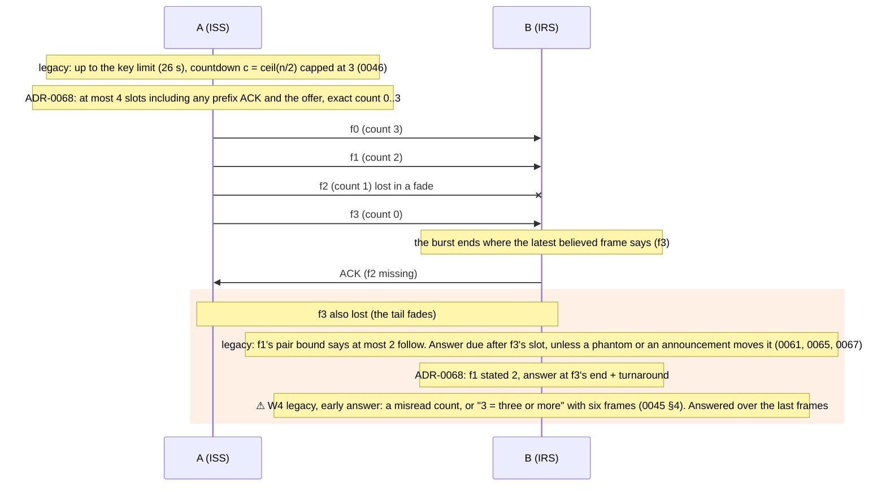
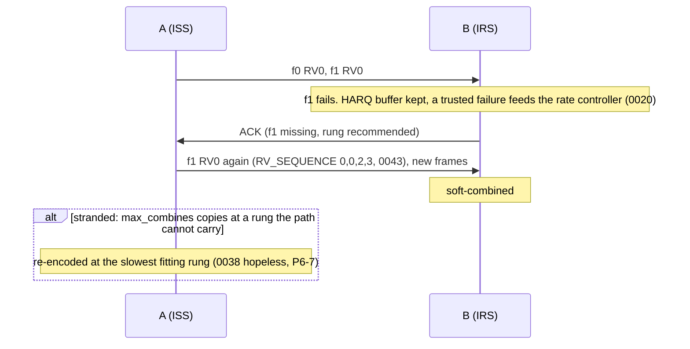
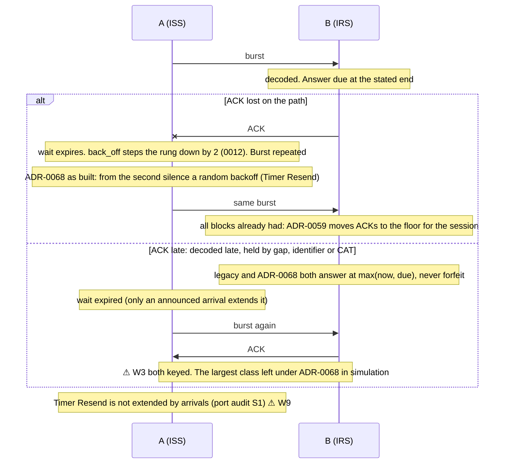
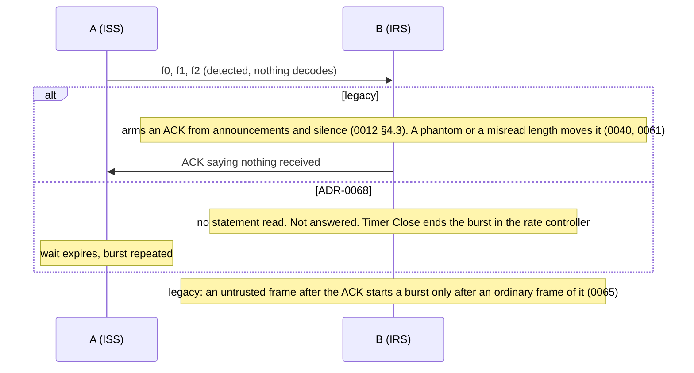
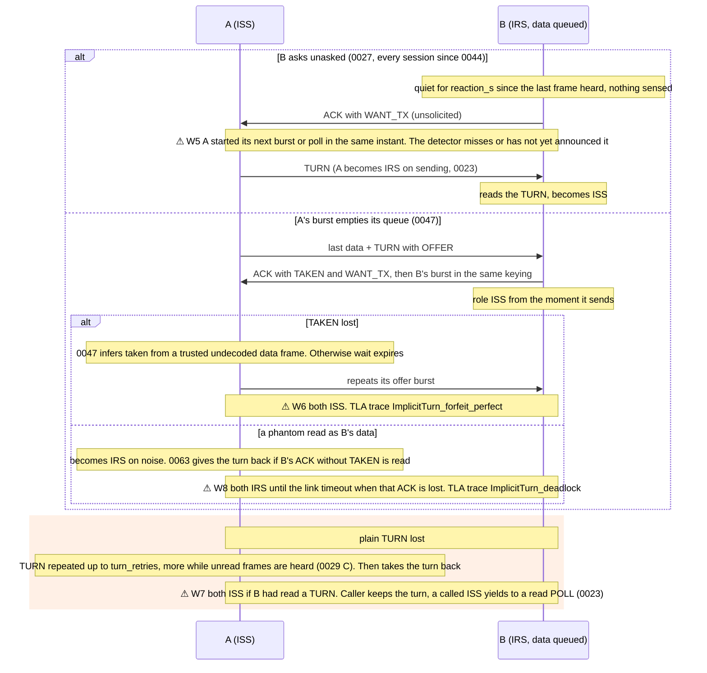
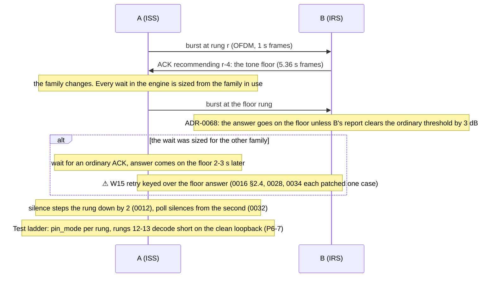
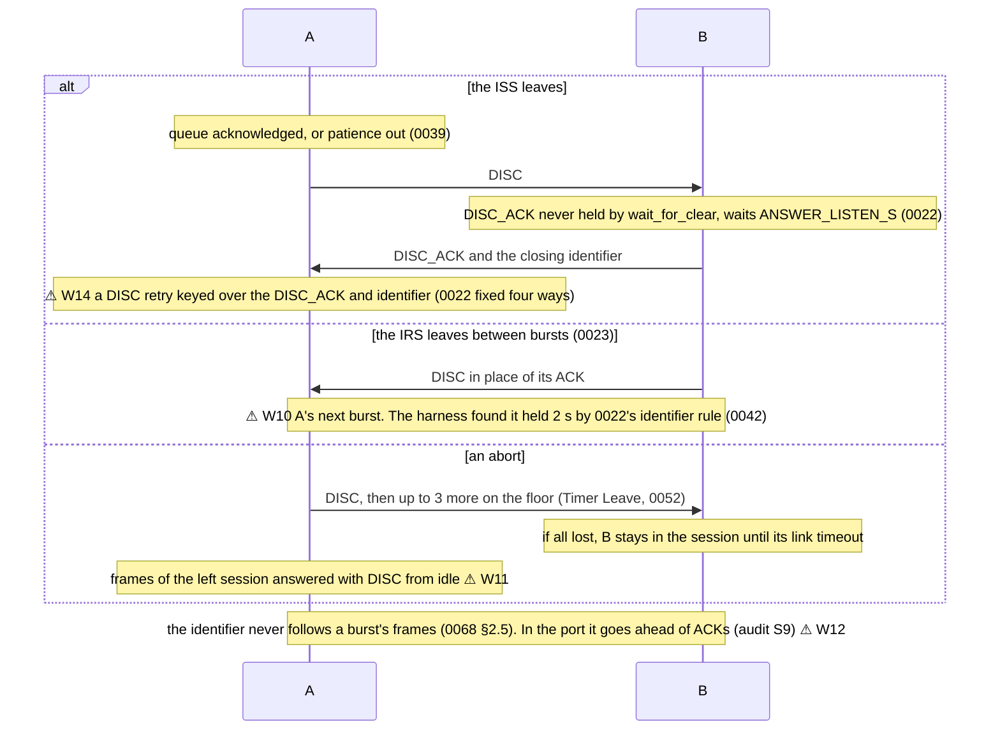
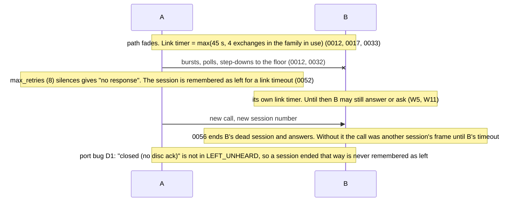

# The current link protocol, exchange by exchange

These diagrams show protocol 7 (the engine on the air, beta.105) and the ADR-0068 path
(`LinkConfig.stated_answers`, protocol 8 candidate). They were drawn from the code at `7546df3`:
the model engine `model/aether_model/link/engine.py`, the port `core/aether-link/src/engine.rs`
and the daemon `core/aetherd/src/station.rs`. The ADRs were checked against the code, not taken
as the spec. Where ADR-0068 behaves differently, the diagram says so.

A **⚠ Wn** marks a point where both stations can reasonably believe they may key at the same
moment. Section 11 lists every such point with its conditions, the rule that patched it, and
what is still open. "Holds" means the daemon's gates between the engine and the key: the answer
gap (ADR-0036/0054), the busy and identifier waits (ADR-0022), the Morse identifier, the CAT
thread (beta.98) and the regulatory gate. The engine is told of some of these
(`on_tx_delayed`) and not of others (queue order, CAT latency).

Notation: A is the caller and B the called station. ISS/IRS is each engine's own *belief* about
who holds the turn (`role`). `wait` is the sender's response timer; `ack` is the receiver's
answer timer.

## 1. Connection establishment

## 2. Normal data and acknowledgement

## 3. Multi-frame bursts

## 4. Lost data frames

## 5. Lost acknowledgement

## 6. A completely undecodable burst

## 7. TURN and data in the reverse direction

## 8. Rate adaptation and the ladder

## 9. Ending a session

## 10. Timeout and reconnection

## 11. Every point where both stations may key

| # | Point | Who keys | Patched by | Still open |
|---|---|---|---|---|
| W1 | Call retry against an answer to an undecodable try | caller's timer; callee's preamble answer | 0016 §2.5 (retry moved past arrivals), 0048 | when the arrival is not announced |
| W2 | Call retry against a late acceptance | caller's timer; callee's acceptance, decoded late or held by the gap | 0016 §2.5, 0036, 0054 | an acceptance held past the retry's jittered timer |
| W3 | Late answer against the sender's repeat | IRS's late ACK; ISS's timer | 0030 (sender waits out arrivals), 0036/0054 make answers later on purpose | **ADR-0068 answers late (`max(now, due)`)**; the sender's wait is fixed |
| W4 | Early answer from a wrong burst end | IRS's inferred deadline | 0040, 0041, 0045, 0046, 0047 f3/f4, 0061, 0065, 0067 | closed by ADR-0068 for decoded statements |
| W5 | Unsolicited turn request against the holder's next burst or poll | IRS on quiet; ISS on its own timers | 0027 §5 (holder waits out arrivals) | accepted race (0027 §6, 0030 §3); **kept by ADR-0068** |
| W6 | Lost TAKEN: both believe they hold the turn | both ISS | 0047 inference from trusted data | kept by ADR-0068 |
| W7 | Lost TURN, or a take-back after the other took it | both ISS | 0023 tie-break, 0029, 0034 | kept by ADR-0068 |
| W8 | Turn taken on a phantom: both IRS | nobody keys (deadlock) | 0063 | until the link timeout when the give-back ACK is lost |
| W9 | `Timer::Resend` backoff against an announced answer | ISS | — | introduced by ADR-0068's implementation |
| W10 | Receiving station's DISC against the next burst | IRS on its own initiative | 0023, 0042 | |
| W11 | A left session answered with DISC | idle station | 0052, 0065 (waits out arrivals) | |
| W12 | Morse identifier against the other's next frame | either | 0022, 0055, 0068 §2.5 | 0022 §3 open; port puts the identifier ahead of ACKs |
| W13 | Keepalive poll against a turn request | both on quiet timers | — | accepted race (0027 §6) |
| W14 | DISC retry against DISC_ACK and identifier | leaving ISS | 0022, 0053 busy fix | |
| W15 | A wait sized for the other family | ISS retry | 0016 §2.4, 0028, 0032, 0034, 0059 | each closes one case |
| W16 | An ended session's identifier against the new session's first move | the called-again station | 0055 §4 | |

Count: **sixteen** places where a station keys on its own belief about the other. ADR-0068
closes W4 for frames whose count was read. It adds W9 and keeps the rest. Each of the others
was patched for the case that was seen, not for the class.
