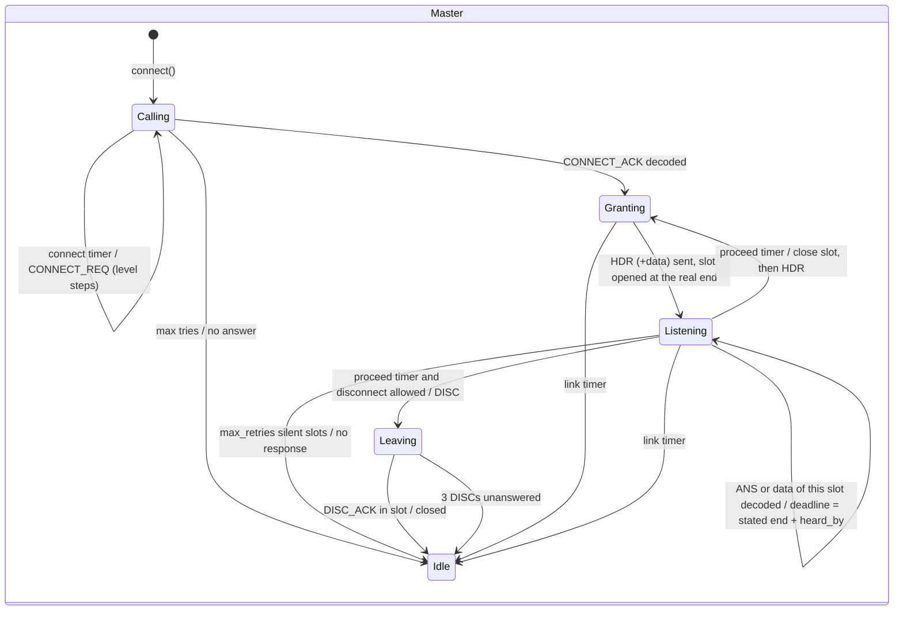
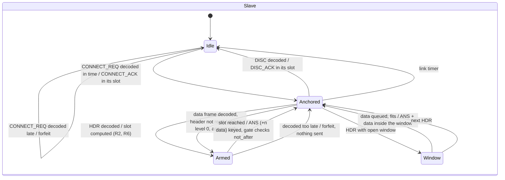
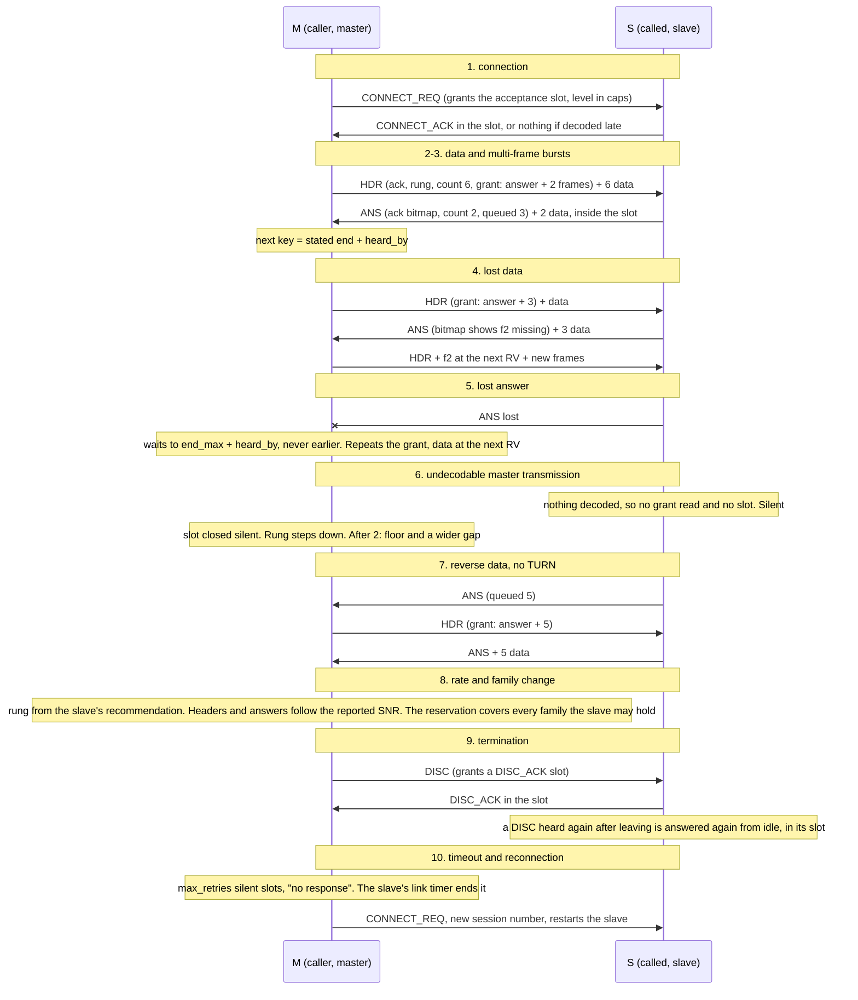

# Granted slots: the formal specification

This is the strongest candidate (candidate D in [03-alternatives.md](03-alternatives.md)),
specified precisely enough to build from. It is checked three ways:

* **TLC** model-checks it in `research/link_arch/tla/GrantedSlots.tla`;
* **the prototype** `research/link_arch/engines/gs.py` implements it on the model's PHY timing,
  HARQ and rate controller;
* **the tests** in `research/link_arch/tests/test_prototypes.py` hold the prototype to the
  invariants below on the air, not in the engine's beliefs.

"Must" is a requirement on an implementation. Where the prototype differs from this text, the
difference is listed in §9.

## 1. The protocol in one paragraph

The caller is the **master** for the whole session. It is the only station that ever keys on
its own initiative. Each master transmission is a header control frame (HDR) followed by up to
six data frames. The header does four things:

* acknowledges the slave's data;
* recommends the slave's rung;
* states exactly how many data frames follow it;
* **grants** the slave one slot.

The slot starts a fixed gap after the master's transmission ends. It is an answer only, an
answer plus *n* data frames, or an open window when neither side has anything to send.

The slave keys only inside a slot it was granted, by a header it decoded in time to start the
slot on time. The keying gate refuses to start a transmission late; this is the **forfeit**
rule. The slave's answer (ANS) acknowledges the master's data, states how many data frames
follow it, and says how many it has queued.

The master keys again a gap after the end a decoded slave frame stated. If it decoded nothing,
it keys a gap after the latest possible end of the slot. It never keys earlier, and never on
silence alone. There is no turn and nothing to hand over: data flows both ways in every
exchange, sized by the grants.

## 2. Operating assumptions

Safety rests on assumptions that are physical bounds the implementation enforces. Liveness
needs more, and says so.

| # | Assumption | Holds because | Used for |
|---|---|---|---|
| S1 | Every frame kind has a fixed air time, known to both stations from its family and mode | the PHY: OFDM and tone frames have fixed lengths per mode | locating a transmission's end from any one decoded frame |
| S2 | A transmission's radiation starts no later than `slot + slack_s`, or not at all | **enforced at the keying gate** (`SlotTransmit.not_after`): the daemon's holds, CAT latency and queue order can only cause a drop, never a late start | safety |
| S3 | Both stations place a frame's end within `guard_s` (50 ms) of each other | HF propagation ≤ 20 ms one way; sample-clock drift ≤ 100 ppm is ≤ 3 ms over a 30 s transmission | safety |
| S4 | The other station can hear again `turnaround_s` after its release (VOX hold, receiver recovery) | stated at connection; in the prototype, configured | the hardware guard (I5) |
| S5 | A transmission never lasts longer than its frames say | the key-time watchdog can only cut it short | safety |
| S6 | A decoded frame reaches the engine within the family's decode budget `D_f` | the receiver's measured latency; **slower stations ask for a wider gap level** (§4 R8) | liveness only: a later decode forfeits the slot (no answer, no overlap) |
| S7 | Loss runs are finite: within `max_retries` slots, some header and some answer get through | the channel | liveness only |

Frames may be lost, decoded late, duplicated, or detected without content (phantoms). Only
**decoded content** changes protocol state. A detection, an announcement or a silence never
moves a deadline. Silence is used in exactly one place: the master closes a slot it heard
nothing in once the slot's latest end has passed.

Two-generals limit [R33]: no exchange of messages over a lossy channel can make both stations
agree, at every instant, on who may transmit. Granted slots does not try to. It gives the slave
no standing authority. Each authority is one slot, bounded in time. Exclusivity then follows
from S2 and S3, not from agreement.

## 3. Frames

The control frame is seven bytes: one ordinary or tone-floor CONTROL frame (`Ctl` in
`engines/core.py`).

| Field | Bits | HDR (master) | ANS (slave) |
|---|---|---|---|
| kind | 2 | HDR (0) | ANS (1); also DISC (2), DISC_ACK (3) |
| count | 3 | data frames after this header, exact | data frames after this answer, exact |
| data_floor | 1 | those frames are tone-floor frames | the same |
| level | 2 | the gap level of this slot (§4 R8) | the level this slave needs |
| session | 6 | session number | the same |
| fam | 1 | the family the answer must use | the family the slave needs headers in |
| flag | 1 | the slot is an open window | the slave asks to end the session |
| base, bitmap | 8 + 16 | selective acknowledgement of the slave's data | selective acknowledgement of the master's data |
| snr | 8 | how the master hears the slave | how the slave hears the master |
| rung | 5 | rung recommended for the slave's data | rung recommended for the master's data |
| n | 3 | frames granted, or the open window's size index | frames queued, capped at 7 |

Data frames are the model's frames unchanged. Each states how many frames of its transmission
follow it, exactly, 0–3: the OFDM chips' quarter turn, or the tone frame's middle sync block
(ADR-0068 §2.1). The connect body is ADR-0008's. Capability bits 3–4 carry the gap level the
acceptance slot uses (§4 R11).

## 4. Rules

**R1 — One initiator.** Only the master starts a transmission on its own initiative. The
slave transmits only under R2, R11 (acceptance) and R10 (DISC_ACK).

**R2 — The slot.** A master transmission ending at `E` grants one slot:

```
start   = E + gap(f) + LEVEL[L]
gap(f)  = D_f + tx_latency + guard + turnaround      (f = the family of the last frame)
end_max = start + slack + grant
grant   = ans(fam) + n x frame(rung)                 (answer, then n data frames)
        | window(index)                              (open window)
```

`LEVEL = (0, 0.5, 1, 2) s`. The slave computes `E` from the header's count, or from any decoded
data frame's exact count (S1), whichever ends latest — a data frame whose own copy decoded, not
one HARQ rescued: the count rides in the chips, outside the codeword, and a copy too weak to
decode alone can read it short ([10-step-3.md](10-step-3.md) §6.2). The master reads the
slave's data frames the same way.

**R3 — Forfeit.** The slave arms its transmission for `start − tx_latency`. If its engine
learns of the grant after `start − tx_latency + slack`, it sends nothing. Independently, the
keying gate drops any transmission whose radiation would begin after `start + slack` (S2).

**R4 — The master's next key.** If a decoded slave frame of the current slot stated its end
`T`, the master keys at `T + heard_by(f)`, where `heard_by(f) = D_f + guard`. Otherwise it
keys at `end_max + heard_by(f*)`, where `f*` is the slowest family the answer may use. Nothing
else moves this deadline.

**R5 — Attribution by air time.** A slave frame belongs to the current slot if and only if it
began after the master's last transmission ended. The *content* of an older frame (a late
decode) is kept: sequence numbers make that safe. Its *timing* is ignored. This does the work
of an exchange id without spending bits on one; the TLA+ model checks the exchange-id form
(`CheckXid`).

**R6 — Reserve for anything the slave may hold.** The slave takes values the master can
change (level, grant size, answer family) **only from the current transmission's header**.
Without that header it uses the values that fit inside every slot the master can have granted:
level 0, no data, its last answer family. The master's slot reserves for the slowest answer
family the slave may hold, which is the set `possible` (the family of its last answer, plus
every family commanded since).

**R7 — Header elision.** The master may leave the header out only when all of these hold:

* it would grant nothing beyond an answer;
* the level is 0;
* the last slot was heard;
* the answer family is the only one the slave may hold;
* at most four data frames follow, so the exact counts locate the end;
* at least one of them is an RV 0 copy, the only version that decodes alone on every rung, so
  the slave can read a count it believes (R2). A transmission of RV 1–3 copies alone grants
  nothing without its header, whatever the SNR (ADR-0073).

**R8 — Gap levels.** The slave measures how late its decodes arrive and asks for a level in
every ANS. The master grants `max(asked, silence level)`. Two silent slots in a row raise the
silence level by one. Four slots answered on time lower it by one. The slave's own need eases
one level after six on-time decodes.

**R9 — Rate.** Each side recommends the other's rung in every control frame, and the sender
follows. A slot granted for data and heard silent steps the master's rung down `silence_step`
(2). Two silent slots step the slave's rung down, and put headers and answers on the floor.
Retransmissions follow the RV sequence 0, 0, 2, 3 (ADR-0043). Re-encoding and the hopeless
rule are kept (ADR-0038). A frame sent at a rung pinned to measure it (the Test's ladder) is
re-encoded at the recommendation after its first copy, if the recommendation is lower: the copy
was the measurement, and the sender follows the recommendation from then on (ADR-0074). A rung is offered only if no other carries as much *data* — after the
DATA frame's 3-byte header — per second of air from a threshold no higher (ADR-0073: it drops
the 500 Hz air's rung 4).

**R10 — Ending.**

* The master leaves with a DISC, which grants a DISC_ACK slot. It repeats at most 3 times,
  then ends "closed (no DISC_ACK)".
* The slave asks to leave by setting `flag` in its ANS.
* The master stops waiting for its own queue after `max(20 s, link timeout / 2)` without
  progress.
* A station that left answers its old session's DISC again from idle, in that DISC's slot.
* Each station's link timer is `max(45 s, 4 x the longest exchange)`. An exchange is two
  key-limited transmissions plus two floor control frames and gaps, about 244 s. The master
  also ends after `max_retries` silent slots in a row ("no response").

**R11 — Connection.**

* The CONNECT_REQ grants the acceptance slot, at the level in its capability bits 3–4.
* The called station answers only in that slot (R3).
* Tries alternate families, the floor first.
* The level rises one step every second try, so a slow called station is reached.
* A call from the same station under a new session number restarts the slave.

**R12 — Open windows.** When neither side has anything to send, the header grants an open
window of `4 s x 2^k` (the floor's is 2.5 times that), with `k ≤ window_doublings`. The slave
may start inside it when it has something to send, provided it can finish inside it. This
bounds the slave's latency on an idle link without a turn request.

## 5. State machines





## 6. Transition tables

### Master

| State | Event | Guard | Action | Next |
|---|---|---|---|---|
| Calling | `connect()` | idle | CONNECT_REQ on the floor, level 0; arm `connect` = gap + level + slack + floor frame + heard_by + jitter | Calling |
| Calling | `connect` timer | tries < 8 | CONNECT_REQ, the other family, level `⌊(tries−1)/2⌋` | Calling |
| Calling | `connect` timer | tries = 8 | end "no answer" | Idle |
| Calling | CONNECT_ACK decoded | same session, version, bandwidth | seed rate; first rung and header family from the body's SNR; arm `proceed` at its end + heard_by | Granting |
| Granting | `proceed` | — | close the slot (R8, R9 bookkeeping); HDR + data (R7 may drop the HDR); open the slot provisionally | Listening |
| Listening | `on_tx_done(t)` | — | reopen the slot from the real end `t` (R2) | Listening |
| Listening | slave frame decoded | began after `tx_end` (R5) | take ACK, want, level, family; `possible = {its family}`; `proceed` = stated end + heard_by | Listening |
| Listening | slave frame decoded | began before `tx_end` | keep its content only | Listening |
| Listening | `proceed` | disconnect requested and allowed | DISC (grants a DISC_ACK slot) | Leaving |
| Listening | `proceed` | slot heard nothing, retries > max | end "no response" | Idle |
| Leaving | DISC_ACK in slot | — | end "closed" | Idle |
| Leaving | `proceed` | 3 DISCs sent | end "closed (no DISC_ACK)", remember as left | Idle |
| any | `link` timer | — | end "link timeout" | Idle |
| any | detection, announcement, phantom | — | **nothing** | — |

### Slave

| State | Event | Guard | Action | Next |
|---|---|---|---|---|
| Idle | CONNECT_REQ decoded | for us, version, bandwidth | slot = end + gap(floor) + LEVEL[caps]; schedule CONNECT_ACK | Anchored, or Idle if forfeited |
| Anchored | HDR decoded | this session | take ACK; grant, level and family from it; `m_end` = end + count x frame; measure lateness; schedule ANS at the slot | Armed / Window |
| Anchored | data decoded, header unread | began > `m_end` + 0.3 s | a new master transmission: level 0, answer only, sticky family; `m_end` from the exact count | Armed |
| Armed | `answer` timer | `now ≤ start − tx_latency + slack` | ANS (+ up to n data at the recommended rung), `not_after = start + slack` | Anchored |
| Armed | — | decoded too late | forfeit (count it) | Anchored |
| Window | `send()` or slot reached | something queued; fits | ANS + data, `not_after = window_end − duration` | Anchored |
| Anchored | DISC decoded | this session | DISC_ACK in the DISC's slot; end "peer disconnected" | Idle |
| any | `link` timer | — | end "link timeout" | Idle |
| any | detection, announcement, phantom | — | **nothing** | — |

## 7. Invariants

### Safety

**I1 — The transmitters never radiate together (NoOverlap).** Sketch:

1. The slave radiates only in `[s, s + len]` with `s ≤ start + slack` (R3, S2), `s ≥ E + gap`,
   and `len ≤ grant` (R2).
2. The master's next key is at least `end_max + heard_by` or `T + heard_by`. `T` is a stated
   end, and a transmission ends where it states (S1, S5).
3. If the slave used a level below the granted one, because it did not read the header, its
   slot starts *earlier* but still after `E + gap`. It is answer-only, so it ends before
   `end_max` (R6).
4. A transmission belonging to an older slot started before that slot's `end_max`. That is
   before the master keyed again (R4), and it ends within its own grant.
5. Clock and propagation differences are inside `guard` (S3).

TLC checks NoOverlap in `GrantedSlots_safe` (8 272 states) and `GrantedSlots_safe_big`
(103 780 states, latency up to five ticks). The simulator checks it on the air in every run of
§8 of [05-experiments.md](05-experiments.md).

**I2 — An old acknowledgement never acknowledges new data.** Acknowledgements are selective:
`base` plus a 16-bit bitmap over sequence numbers in a 16-frame window of a 256 space. An old
ANS can only acknowledge frames its sender did receive, so the error is always in the safe
direction. R5 keeps an old answer's *timing* from being applied to the current slot.

**I3 — A delayed control frame never restores authority.** There is no transferable
authority. A header decoded late is decoded after `start − tx_latency + slack` of the slot it
grants, so it is forfeited (R3). A header from an earlier transmission can only ever have
granted a slot that is already over.

**I4 — Delivery is exactly once and in order.** This is selective repeat with sequence
numbers. HARQ combines identical codewords (the header is static across RVs), and the
receiver delivers in sequence (`Core._accept`). `test_delivery_is_exact_and_once` checks it.

**I5 — Nothing radiates inside the other's turnaround guard.** `gap` contains the other
station's stated turnaround and this station's keying latency. The slave arms at
`start − tx_latency`. The master keys only after `heard_by` past a slave frame's end, and its
radiation begins `tx_latency` later still.

### Liveness

**L1 — Progress or a clean end.** While the session is up, the master always has a deadline
pending (`proceed`, `link`). This is `BoundedSilence` in TLC: the master is never more than
one exchange from keying. Every silent slot increments `retries`. After `max_retries` the
master ends; the slave's link timer ends the slave. No reachable state has neither station
able to act. Compare `ImplicitTurn_deadlock`, where ADR-0068's engine reaches a state with
both stations IRS.

**L2 — A lost answer costs one slot.** The next header repeats the grant. Unacknowledged data
goes again at the next RV. Under S7 a slot is heard within `max_retries`.

**L3 — No lost TURN.** There is no TURN. Reverse data rides the grants: the slave's queued
count `n` in its ANS sizes the next grant, and open windows bound the slave's latency on an
idle link (R12).

**L4 — The rate escapes an unusable rung.** Silence on a data slot steps the rung down by two.
Two silences put control frames on the floor and raise the gap level. A rung the peer's report
puts beyond reach is re-encoded early (ADR-0038).

**L5 — Calls reach slow stations.** The acceptance slot's level rises every second try (R11),
up to 2 s of extra gap.

**L6 — A disconnect asked ends the session** (ADR-0072). "Allowed" in the `proceed` row below
is: both queues delivered, or `disc_drain_s` (60 s) since the disconnect was asked, or the
patience (ADR-0039) with nothing acknowledged. The drain's clock starts at the master's own
request or when the master decodes the slave's `flag`, never on an undecoded frame. So the
master's DISC goes within `disc_drain_s` and one exchange of the request, and the session ends on
the DISC_ACK or after three DISCs. Before it, a slow path that still delivered restarted the
patience at each acknowledgement and kept a session open as long as its queue lasted: 30–40
minutes in the soak of 2026-10-15.

### Performance

| Property | Bound |
|---|---|
| Control overhead | at most one control frame per master transmission (0.434 s ordinary, 3.2 s floor). It is left out when nothing changes, at most four frames follow and one of them is an RV 0 copy (R7). One ANS per slot. |
| Dead air per change of direction | `gap(f) = D_f + tx_latency + guard + turnaround` (field profile: 0.75 s ordinary, 1.10 s floor), plus `LEVEL[L]` for a slow station |
| Recovery from a lost answer | one slot: the answer length plus `slack`, then the next header |
| Burst amortisation | up to six data frames per master transmission (26 s key limit) |
| Interactive latency | a line typed at the slave waits at most one master exchange or one open window (4–8 s ordinary) |

## 8. Model-checking results

TLC (tla2tools, version 2026.10.13, rev `210df3a`) on the models in `research/link_arch/tla/`. Outputs are in `tla/out/`; condensed
traces come from `tla/condense.py`. Time is in ticks. Every frame may be lost or decoded
`0..LMax` ticks late.

| Model | Configuration | Property | Result | States |
|---|---|---|---|---|
| GrantedSlots | `_safe`: forfeit, exchange id | NoOverlap, BoundedSilence | **holds** | 8 272 |
| GrantedSlots | `_safe_big`: 3-tick frames, latency to 5 | NoOverlap, BoundedSilence | **holds** | 103 780 |
| GrantedSlots | `_late`: answer late, as ADR-0068 does | NoOverlap | violated, 12 steps | 260 |
| GrantedSlots | `_noxid`: no attribution | NoOverlap | violated, 19 steps | 719 |
| ImplicitTurn (ADR-0068) | `_oneway`: one direction, forfeit | NoOverlap | **holds** | 56 612 |
| ImplicitTurn | `_oneway_late`: one direction, late answers | NoOverlap | violated | 311 |
| ImplicitTurn | `_requests`: turn requests on | NoOverlap | violated, 6 steps | 96 |
| ImplicitTurn | `_late`: offer/take, late answers | NoOverlap | violated | 2 717 |
| ImplicitTurn | `_forfeit_perfect`: forfeit, **perfect carrier sense**, no phantoms | NoOverlap | violated, 18 steps | 2 540 |
| ImplicitTurn | `_forfeit_sensemiss`: forfeit, detector may miss | NoOverlap | violated | 655 |
| ImplicitTurn | `_deadlock` | SomeoneWillAct | violated: both IRS | 9 075 |
| TokenTransfer (candidate B) | `_naive`: grantor takes back on silence | ExclusiveAuthority | violated | 551 |
| TokenTransfer | `_lease`: Gray–Cheriton lease, caller reclaims | ExclusiveAuthority, NoOverlap, BoundedVacancy | **holds** | 11 746 754 |
| TokenTransfer | `_lease_vacancy` | SomeoneMay | violated (vacancies are the price) | 89 |

The two mutants show which rules carry the safety argument. Each trace is condensed to the
steps that change something.

**`GrantedSlots_late`** shows that the slave answering late (no forfeit) is unsafe:

```
 t=0  MasterKey       master on the air 0..2, exchange 1
 t=2  MasterEnd       grant: slot 3..5, delivered to the slave at t=5 (latency 3)
 t=5  SlaveGetsGrant  late: the slot began at 3; LatePolicy = "send" keys anyway
 t=5  SlaveKey        slave on the air 5..7
 t=6  MasterKey       the master's slot closed at 5 + Gap: it keys 6..7     ← overlap
```

**`GrantedSlots_noxid`** shows that taking any slave frame as the current answer is unsafe:

```
 t=4  SlaveEnd        answer to exchange 1 (ends 4), decoded at t=6
 t=5  MasterKey       exchange 0 (the master heard nothing in time)
 t=6  MasterGetsAnswer  the old answer moves mNext to 6 — the master keys 6..8 at once
 t=7  SlaveKey        the slave answers exchange 0's grant (slot 7..9)        ← overlap
```

**`ImplicitTurn_forfeit_perfect`** is ADR-0068 with every timing rule obeyed:

```
 t=0  SendBurst(A)    burst + OFFER (ADR-0047)
 t=3  Answer(B)       ACK|TAKEN + B's burst: B is ISS
      (the ACK|TAKEN is lost)
 t=9  Repeat(A)       A's wait expired: it repeats its burst, still ISS
 t=9  Repeat(B)       B's wait for its own burst's ACK expired: it repeats    ← both ISS
```

No timing discipline fixes this. The handover itself is the defect.

## 9. The prototype against this text

`engines/gs.py`, `engines/core.py`:

* **Ordinary family on the first header.** The first header goes in the family the CONNECT_ACK's
  reported SNR asks for (§6). A conservative floor header cost about 3 s a session at high SNR;
  measured in [05-experiments.md](05-experiments.md) §6.
* **R5 by air time.** The TLA+ model uses an exchange id. The prototype attributes by air time,
  and its two `level` bits are where the id was.
* **Early reclaim is off.** Taking a slot back early on a missing preamble (`early_reclaim`)
  was implemented and measured. It is harmful: it trusts the detector's misses. It is off.
* **Not modelled in the prototype:**
  * the hardware turnaround is configured, not negotiated;
  * the daemon's identifier rules;
  * datagrams and beacons outside sessions;
  * a third station keying inside a slot (no protocol can prevent that; carrier sense outside
    sessions is unchanged).

## 10. The ten exchanges under granted slots



Every slave transmission in these diagrams starts inside a slot defined by a frame it
decoded. There is no point at which the slave keys on silence, on a timer of its own, or on
a detection.
