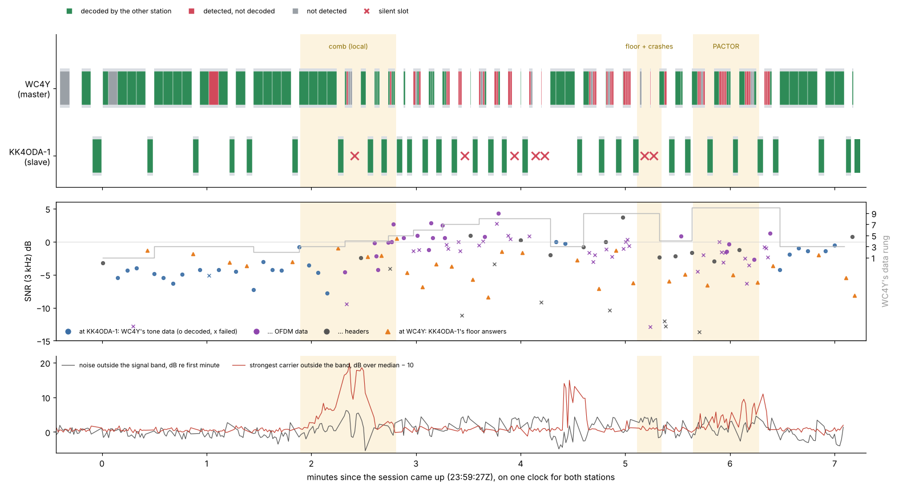
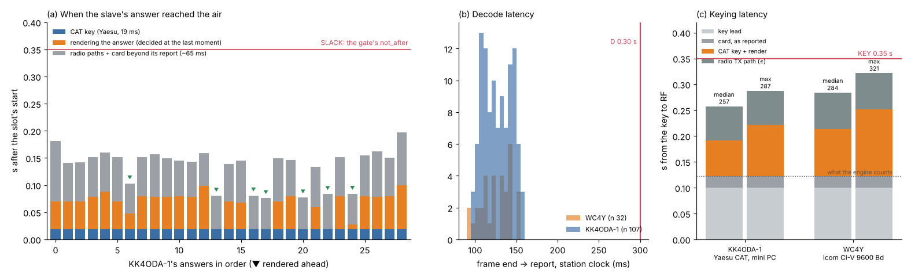
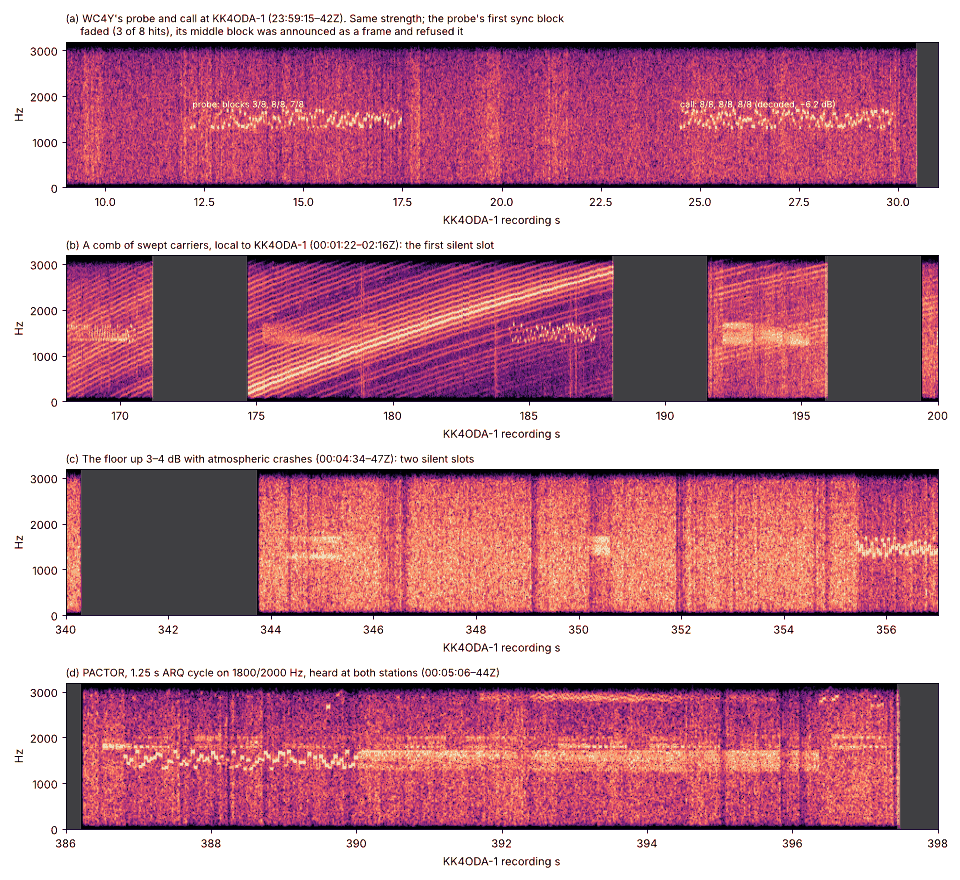

# Step 4, first on the air: WC4Y's Test of 2026-10-14

ADR-0069 §5's fourth step is hardware in the loop, then the air. This is its first session:
protocol 8 (granted slots) between two real stations, on a real path, with real interference.
Steps 0–3 are in [08-steps-0-and-1.md](08-steps-0-and-1.md), [09-step-2.md](09-step-2.md) and
[10-step-3.md](10-step-3.md).

* **When and where**: 3.590 MHz, 500 Hz, 2026-10-14 23:59:03Z to 2026-10-15 00:06:42Z. Both
  stations ran v0.2.0-beta.106 (link protocol 8).
* **Who**: WC4Y was the master. He ran a Test calling KK4ODA-1 (IC-7300, 20 W, 230 ft EFHW,
  EM73VU). KK4ODA-1 was the slave: the author's FTDX10, 50 W, T2D, EM73, driven by the mini PC
  at the radio.
* **The files**: both stations uploaded their side with audio. They are the session recording
  (WAV and sidecar), `aetherd.log`, `diagnostics.json`, `heard.json` and `sessions.json`.
  WC4Y's audio and files are not committed. The figures below are drawn from KK4ODA-1's audio
  and from times and numbers in the two sidecars.

§0 is the short answer. Each section after it names the question it answers, with its evidence.

## 0. Summary

* **Protocol 8 worked on the air.** The Test completed in 458.9 s of its 600 s.
* **Safety held.** The two transmitters never radiated together. The closest the air came to
  changing hands was 0.61 s of clear air. No frame was keyed into a receiver that could not
  hear. No slot was forfeited and no answer was dropped late.
* **Every slave transmission went inside a slot.** Each was granted by a frame KK4ODA-1 had
  decoded. Nothing was keyed on a detection, a phantom or a silence.
* **The timing budgets fit the hardware with room to spare.**
  * Decode: at most 0.22 s against D = 0.30 s.
  * Key to RF: at most 0.29 s (KK4ODA-1) and 0.32 s (WC4Y) against KEY = 0.35 s.
  * But the engine counts only 0.122 s of keying latency: the key lead and the card's own
    report. It does not count the CAT round trip, the rendering or the radios' audio paths. So
    every answer reached the air 76–197 ms after its slot's start, inside a 350 ms SLACK.
  * S2 held by a margin of at least 153 ms, not by construction. The keying gate cannot see
    those latencies.
* **Two things went wrong that the protocol did not cause.**
  * **The mini PC lost audio twice without reporting it**: 35 ms and 40 ms of capture. The first
    loss cost a data frame. The same signature was "unexplained" on 2026-10-05.
  * **The probe was lost by the streaming receiver.** It arrived clean, with its first 0.3 s
    faded. The stream took the probe's own middle sync block for a new frame and refused the
    probe. The offline detector confirms and decodes it.
* **Seven slots went silent.** In every one, KK4ODA-1 had decoded nothing that granted a slot,
  and it stayed silent, as the protocol requires.
  * Five were transmissions whose header R7 had left out.
  * Two were polls lost to fades and local noise.
  * Four of the five came from the Test's pinned ladder rungs, which the path could not carry.
* **The interference was mostly local to KK4ODA-1.**
  * A comb of swept carriers.
  * The noise floor rising 3–4 dB.
  * Atmospheric crashes, heard by both stations.
  * The "VARA burst" was a PACTOR-II/III ARQ link, heard at both stations.
* **No interference was decoded as an Aether frame.**

## 1. The session and the counters

| | WC4Y (master) | KK4ODA-1 (slave) |
|---|---|---|
| radio, keying | IC-7300, Icom CI-V on COM6 at 9 600 Bd | FTDX10, Yaesu CAT on COM6 at 38 400 Bd |
| computer | Windows, 24 CPUs | Windows mini PC, 4 CPUs |
| sound card | IC-7300 USB codec, card reports 22 ms | FTDX10 USB codec, card reports 22 ms |
| daemon running since | 23:57:01Z | 21:32:13Z (a beacon every 15 min from 21:50) |
| recording | 23:58:33Z (with 30 s preroll) to 00:06:42Z | 23:58:51Z (with preroll) to 00:06:38Z |

**The counters belong to this session.**

* WC4Y's daemon started two minutes before the Test and ran nothing else.
* KK4ODA-1's ran for 2.5 hours but held no other session; its log has beacons only.
  * So `harq_rescues` 10, `forfeits` 0 and `dropped_late` 0 are this session's.
  * `silent_slots` and `headers_elided` are master counters, 0 on the slave.
  * `frames_detected` (233) includes the idle hours' detections.

**The first look, checked.**

* **Completed in 459 s of 600: yes.** 458.9 s from `test.start` to `closed`.
* **Probe unanswered: yes.** Why is in §6.
* **Call at −6 dB: yes.** KK4ODA-1 measured it at −6.2 dB.
* **Message 512 B at 47 bit/s, at rung 3: yes,** with one correction: the first burst went at
  rung 1 (tone-36). See §7.
* **Ladder from rung 2, highest passed 7: yes.**
* **File 512 B at 52 bit/s: yes.**
* **WC4Y decoded 31 of 32: yes.** The 32nd is a detection in the middle of one of KK4ODA-1's
  answers, at −8 dB. It is not a frame.
* **KK4ODA-1 decoded 62 of 107: yes.** Of the 45 records that did not decode:
  * 36 are WC4Y frames that failed;
  * 6 are WC4Y frames read as the wrong kind;
  * 3 are detections in the middle of a frame.

  Twelve of WC4Y's frames were never detected at KK4ODA-1 at all.

## 2. One clock for both stations

Each sidecar places received frames on its own recording's clock. It places its own keyings on
its own station clock. A slot's timing is a question about both, so the two need one clock.

* **From the sidecars' `started` stamps**, KK4ODA-1's recording runs 18.226 s behind WC4Y's.
  The stamps are good to a few tenths of a second.
* **From a signal both stations heard**, the offset is exact. The envelopes of two recordings
  agree at one lag, over the stretches when both stations were listening. Two such signals
  were found:
  * **the PACTOR carriers** at 1 800 and 2 000 Hz (§8): correlation 0.37 and 0.31 at
    **18.184 s**, against a median of 0 at other lags;
  * **atmospheric crashes** between 2 700 and 3 000 Hz, above the signal: 18.181–18.183 s in
    every 90 s window with enough common listening from 200 s on. A single fit over the whole
    session gives 18.182 s.
* **The received-audio offset is therefore 18.183 ± 0.002 s.** On this clock, a signal reaching
  both antennas at once lands at the same place in both recordings. It was 75 ms less before
  W 58 s and 40 ms less until W 139 s; §4.4 explains why.
* **The two antennas are about 5 km apart**, so propagation differs by less than 0.1 ms.

Times below are on WC4Y's recording clock ("W s") or in UTC. `tools/two_sides.py` does all
of this from the two sidecars (§12).

## 3. Safety (question 1)

### 3.1 Every keying

* **WC4Y keyed 39 times**: the probe, the call, and 37 times in the session.
* **KK4ODA-1 keyed 32 times**:
  * the acceptance;
  * 29 answers;
  * the DISC_ACK;
  * after the session, its repeating beacon.

  The last two came after its recording stopped. WC4Y's recording holds the DISC_ACK. WC4Y's
  log holds the beacon ("heard KK4ODA-1 at −5.7 dB").

The table in §4.2 lists every exchange. Figure 1 shows them all on one clock.

*Figure 1.*
* **Top**: each station's transmissions on the common clock. Frames are coloured by what the
  other station made of them. Silent slots are crosses.
* **Middle**: the SNR each station measured of the other's frames, with WC4Y's data rung in
  grey.
* **Bottom**: what KK4ODA-1 heard besides WC4Y: the noise outside the signal band and the
  strongest carrier there.
* **Shaded**: the three interference episodes (§8).

### 3.2 Did they ever radiate together? No

* **How each transmission was placed.** Each station's radiation is placed where the other
  station's recording holds its first frame, with the offset in force at the time (§4.4). The
  frame-start estimates are good to about 10 ms. The offset is good to 2 ms.
* **Every time the air changed hands, it was clear first:**
  * **master to slave**: 0.78–0.90 s of clear air at gap level 0, and 1.28–1.35 s at level 1;
  * **slave to master**: 0.61–0.68 s.
* **The smallest gap** was 0.613 s, before WC4Y's DISC. There was no overlap of any length.

### 3.3 Did either station key into the other's deaf time? No

* **The radios hear again quickly.** Each radio's receive audio, muted while it transmits, came
  back 61 ms (WC4Y, 55–79) and 50 ms (KK4ODA-1, 39–56) after the release.
* **The other station's RF came much later.**
  * KK4ODA-1's answers reached WC4Y at least 0.771 s after WC4Y's release.
  * WC4Y's next transmission reached KK4ODA-1 at least 0.602 s after KK4ODA-1's release.
* **S4 held with at least 0.55 s to spare.**
* **The daemon's own deafness is irrelevant here.** Its 0.75 s after a release (`deaf_for`)
  spares only the busy detector; the receiver hears throughout.

### 3.4 What kept it safe

Each rule did what 04-formal-spec.md says it does.

* **R3 and S2 (forfeit and the gate).**
  * KK4ODA-1 decoded every grant in time: `forfeits` 0.
  * It started every answer inside its slack: `dropped_late` 0.
  * The answers began 76–197 ms after their slots' starts (§4).
* **R4 (the master's next key).**
  * In each of the 29 answered slots, WC4Y keyed 0.350–0.360 s after the end the answer
    stated. That is `heard_by` (0.35 s) plus at most one 20 ms pass.
  * In each silent slot, it keyed at `end_max + heard_by` by its own clock: 4.52–4.54 s after
    its frames ended.
  * It never keyed earlier, and never on silence alone.
* **Only decoded content changed state.**
  * KK4ODA-1 recorded 3 detections inside WC4Y's frames, 6 of WC4Y's frames read as the wrong
    kind, and WC4Y one detection inside an answer. None was keyed on.
  * Every slave transmission answers a frame the slave had decoded:
    * a header for the 13 answers whose transmission had one it read, and for the DISC_ACK;
    * a data frame decoded on its own, with a count of 0–2, for the 16 others;
    * the call, for the acceptance.

**One finding outside the protocol.** KK4ODA-1's repeating beacon keyed 138 ms after the
DISC_ACK's release. `advance_beacons` judges the channel clear on the busy detector alone, and
for 0.75 s after a release that detector is deaf.
* **Here, harmless**: in protocol 8 nothing follows a DISC_ACK.
* **In general, worth a look**: an initiation should not be judged clear on a detector that
  cannot hear (§12).

## 4. Timing on real hardware (question 2)

### 4.1 The latency chain, measured

How each number was measured:

* **Capture path**: from the key to the radio's receive mute in the station's own recording,
  less the handover delay.
* **Handover delay**: key to release, less the key lead, the frames and the keyed tail. This is
  what blocks the run loop between the key and the burst reaching the card.
* **Radio paths + card beyond its report**: the key to the frame's start as the other station
  recorded it, on the common clock, less the lead, the card's report and the handover delay.
  It holds both directions' radio audio paths and the card's latency beyond what the card
  says.

| | WC4Y | KK4ODA-1 (mini PC) | budget |
|---|---|---|---|
| decode: frame end to report, on the station's clock | median 122 ms, max 153 | median 124–133 ms, max 155 | D = 0.30 s |
| capture path: sound card to station clock | 12 ms median (2–29) | 5 ms (−14 to 17) | (inside D) |
| run-loop backlog at releases | ≤ 6 ms | ≤ 35 ms, falling to 9 | (inside D) |
| handover delay | 48–129 ms, median 92: CI-V plus rendering | 19 ms when rendered ahead (CAT alone); 48–99 ms otherwise | (inside KEY) |
| card's reported output latency | 22 ms | 22 ms | (counted) |
| radio paths + card beyond its report | 70 ms (61–78) | 66 ms (56–76) | (inside D and KEY) |
| key lead | 100 ms | 100 ms | (counted) |

* **CAT and rendering separate cleanly on the mini PC.**
  * Five of the seven answers rendered ahead keyed with a handover delay of exactly 19.4 ms.
    The answer waited in the queue for `not_before`, so that delay is the FTDX10's `TX1;` round
    trip alone. The other two took 28 and 48 ms: the port answering slower, once.
  * Every answer decided at the last moment took 48–99 ms. The rest is rendering one 3.2 s
    tone control frame, 30–80 ms on the mini PC.
  * WC4Y's master transmissions render in the pass that keys them. Its shortest handovers
    were 48 ms (the probe) and 64 ms (an ordinary header alone, and the DISC), so CI-V at
    9 600 Bd takes roughly 45–65 ms.
* **The capture path is small.** The radio mutes its receive audio when it switches to
  transmit, and the recording shows the mute 5 ms (KK4ODA-1) and 12 ms (WC4Y) after the CAT
  command returns, standard deviation 6 ms.
* **Of the 66–70 ms "radio paths + card" figure, at most 10–30 ms is capture.** The rest is the
  radios' own audio paths, receive and transmit, and the card's output beyond its report. The
  two directions cannot be separated without a reference at one antenna.

### 4.2 Slot by slot

Columns:

* **WC4Y sent**: `H(f)`/`H(o)` is a floor or ordinary header; `—` means it was elided.
  `3×r3/0` is three data frames at rung 3, RV 0.
* **KK4ODA-1 read**: each frame in order. ✓ decoded on its own, ✗ detected and not decoded,
  · not detected.
* **level**: the gap level of the slot.
* **answer late**: how far after the slot's start the answer's first frame was on the air.
  The slot starts at `E + D + KEY + GUARD + LEVEL`, where E is the end of WC4Y's frames on the
  common clock.
* **margin**: what was left of SLACK (0.35 s) to the gate's `not_after`.
* **K report**: KK4ODA-1's decode latency (ms) for the last frame before the answer.
* **K ahead**: how long before keying the answer was rendered (s), or `—` if it was decided at
  the last moment.
* **K key+render**: KK4ODA-1's handover delay (ms).
* **W report**: WC4Y's decode latency (ms) for the answer.
* **W next key**: when WC4Y keyed next, after the answer's stated end, or after its own E.

| # | UTC | WC4Y sent | KK4ODA-1 read | level | answer late | margin | K report | K ahead | K key+render | W report | W next key |
|---|---|---|---|---|---|---|---|---|---|---|---|
| 1 | 23:59:27 | H(f) + 4×r1/0 | ✓·✓✓✓ | 0 | 0.181 | 0.169 | 145 | — | 69 | 115 | +0.355 |
| 2 | 23:59:56 | r1/0 3×r3/0 | ✓✓✓✓ | 0 | 0.141 | 0.209 | 124 | — | 69 | 105 | +0.355 |
| 3 | 00:00:23 | 3×r3/0 | ✓✗✓ | 0 | 0.142 | 0.208 | 155 | — | 69 | 134 | +0.354 |
| 4 | 00:00:43 | r3/0 | ✓ | 0 | 0.152 | 0.198 | 155 | — | 78 | 95 | +0.355 |
| 5 | 00:00:53 | 4×r2/0 | ✓✓✓✓ | 0 | 0.161 | 0.189 | 155 | — | 88 | 143 | +0.353 |
| 6 | 00:01:19 | 4×r3/0 | ✓✓✓✓ | 0 | 0.152 | 0.198 | 127 | — | 69 | 93 | +0.353 |
| 7 | 00:01:46 | 4×r4/0 | ✓✗·· | 0 | silent (S1) | | | | | | +4.53 after E |
| 8 | 00:01:55 | H(f) | ✓ | 0 | 0.103 | 0.247 | 97 | 0.48 | 48 | 133 | +0.353 |
| 9 | 00:02:03 | 3×r4/0 | ✓✓✓ | 0 | 0.151 | 0.199 | 148 | — | 79 | 133 | +0.353 |
| 10 | 00:02:10 | 4×r5/0 | ✓✗✓✓ | 0 | 0.157 | 0.193 | 148 | — | 78 | 153 | +0.353 |
| 11 | 00:02:19 | r5/0 | ✓ | 0 | 0.149 | 0.201 | 133 | — | 78 | 143 | +0.353 |
| 12 | 00:02:25 | 4×r6/0 | ✗·✓✗ | 0 | 0.145 | 0.205 | 138 | — | 79 | 103 | +0.353 |
| 13 | 00:02:34 | 3×r6/0 | ✓✓✓ | 0 | 0.143 | 0.207 | 134 | — | 78 | 142 | +0.352 |
| 14 | 00:02:42 | 4×r7/0 | ✓✓✗✗ | 0 | 0.158 | 0.192 | 144 | — | 98 | 152 | +0.352 |
| 15 | 00:02:51 | 2×r7/0 | ✗✗ | 0 | silent (S2) | | | | | | +4.54 after E |
| 16 | 00:02:58 | H(o) | ✓ | 0 | 0.080 | 0.270 | 104 | 0.47 | 19 | 113 | +0.353 |
| 17 | 00:03:03 | 4×r8/0 | ✗·✗✓ | 0 | 0.139 | 0.211 | 145 | — | 69 | 113 | +0.353 |
| 18 | 00:03:12 | 3×r8/0 | ✗✗✓ | 0 | 0.145 | 0.205 | 150 | — | 68 | 142 | +0.353 |
| 19 | 00:03:19 | 2×r8/2 | ✗✗ | 0 | silent (S3) | | | | | | +4.53 after E |
| 20 | 00:03:26 | H(o) | ✓ | 0 | 0.081 | 0.269 | 104 | 0.47 | 19 | 112 | +0.352 |
| 21 | 00:03:31 | 2×r8/3 | ✗· | 0 | silent (S4) | | | | | | +4.53 after E |
| 22 | 00:03:38 | H(o) | ✗ | 0 | silent (S5) | | | | | | +4.53 after E |
| 23 | 00:03:44 | H(f) + 2×r3/0 | ✓✓✓ | 1 | 0.076 | 0.274 | 148 | 0.92 | 19 | 122 | +0.352 |
| 24 | 00:04:03 | H(f) + 4×r9/0 | ✓✗·✗✗ | 1 | 0.150 | 0.200 | 136 | — | 69 | 141 | +0.351 |
| 25 | 00:04:15 | H(o) + 4×r9/0 | ✓✗·✗✗ | 1 | 0.147 | 0.203 | 143 | — | 79 | 132 | +0.352 |
| 26 | 00:04:25 | H(o) + 4×r9/2 | ✓✗✗✗✗ | 1 | 0.077 | 0.273 | 150 | 0.95 | 19 | 141 | +0.351 |
| 27 | 00:04:35 | r9/3 | · | 0 | silent (S6) | | | | | | +4.53 after E |
| 28 | 00:04:41 | H(o) | ✗ | 0 | silent (S7) | | | | | | +4.52 after E |
| 29 | 00:04:46 | H(f) + r4/0 | ✓✗ | 1 | 0.133 | 0.217 | 119 | — | 59 | 121 | +0.351 |
| 30 | 00:04:55 | H(f) + r4/0 | ✓✓ | 1 | 0.083 | 0.267 | 149 | 0.94 | 19 | 111 | +0.351 |
| 31 | 00:05:05 | H(f) + 4×r10/0 | ✓✗✗·✗ | 1 | 0.152 | 0.198 | 141 | — | 79 | 121 | +0.351 |
| 32 | 00:05:17 | H(f) + 4×r10/0 2×r6/0 | ✓✗✗✗✗✓✓ | 1 | 0.084 | 0.266 | 140 | 0.97 | 28 | 121 | +0.351 |
| 33 | 00:05:32 | H(f) + 4×r10/2 2×r5/0 | ✓✗✗✗··✓ | 0 | 0.155 | 0.195 | 150 | — | 79 | 140 | +0.350 |
| 34 | 00:05:46 | 3×r10/3 r5/0 | ✗✗✗✓ | 0 | 0.163 | 0.187 | 141 | — | 78 | 150 | +0.350 |
| 35 | 00:05:55 | 4×r3/0 | ✓✓✓✓ | 0 | 0.150 | 0.200 | 153 | — | 79 | 110 | +0.360 |
| 36 | 00:06:21 | 2×r3/0 | ✓✓ | 0 | 0.197 | 0.153 | 150 | — | 99 | 100 | +0.360 |
| 37 | 00:06:37 | DISC (o) | ✓ | 0 | 0.093 (DISC_ACK) | 0.257 | — | — | — | 140 | closed |

Before row 1:
* **The probe** went out at 23:59:03Z. It was unanswered (§6).
* **The call** went at 23:59:15Z. KK4ODA-1 decoded it 125 ms after its end and keyed the
  acceptance in the acceptance slot. The acceptance reached the air 81 ms after that slot's
  start, with a margin of 269 ms.

*Figure 2.*
* **(a)**: when each of KK4ODA-1's answers reached the air, after its slot's start. It splits
  into the FTDX10's CAT key, rendering (when the answer was decided at the last moment) and
  the radios' paths. Answers rendered ahead are marked.
* **(b)**: decode latency on each station's clock.
* **(c)**: key to RF against KEY. The upper part is an upper bound: it counts all of the
  radios' paths as transmit.

### 4.3 Does the mini PC fit inside the budgets?

**Yes**, with this much to spare:

* **D (0.30 s)**: decode report at most 155 ms, plus a capture path of at most 30 ms. That is
  at most 0.19 s, or 0.22 s if all of the radios' paths were on the receive side. **At least
  80 ms to spare.** The master, on a 24-CPU machine, is no faster: at most 153 ms.
* **KEY (0.35 s)**, key to RF:
  * 0.122 s counted;
  * up to 99 ms of CAT and rendering;
  * at most 66 ms of transmit path.

  That is at most 0.29 s. **At least 60 ms to spare.** WC4Y, with CI-V at 9 600 Bd, comes to
  at most 0.32 s.
* **SLACK (0.35 s)**: the answers started 76–197 ms late (median 147). The 7 answers rendered
  ahead were 76–103 ms late; the 22 decided at the last moment, 133–197 ms. **At least 153 ms
  to spare.**
* **Slow passes**: none.
  * The slowest pass in KK4ODA-1's whole 2.5-hour run was 223 ms, in the capture phase.
    WC4Y's was 109 ms, in playback.
  * `machine_late_ms` 0, `stalls` 0, `starved_samples` 0, `dropped_samples` 0 at both.
  * No `loop:` or wait lines in either log.
  * The capture backlog at every release was at most 35 ms (KK4ODA-1) and 6 ms (WC4Y).
* **The replays reproduce live exactly.** Both recordings replay frame for frame: 62 of 107 and
  31 of 32 decoded, at 0.08× and 0.06× real time. The slowest replay block was 33 ms. So every
  frame lost was lost to the air or to the audio, never to CPU or timing.

**What the margins rest on.** The engine's own latency (`radiation_latency_s`) is the key lead
plus the card's report: 0.122 s. The keying gate uses the same figure. Neither counts:
* the CAT round trip, which blocks the run loop (`ThreadedPtt::key` waits for the reply);
* the rendering of an answer decided at the last moment;
* the radios' audio paths.

So the slave arms its answer 0.122 s before the slot, and the RF comes 76–197 ms after the
slot's start. The gate's `not_after` judges an estimate that is short by the same amount. A
transmission the gate let through at the last moment would start up to 0.2 s past its slack.
* **This does not break I1.** The master's next key after a silent slot is at
  `end_max + heard_by`, and its own RF starts at least 0.12 s after that. Overlap would need
  the slave's unaccounted latency to exceed about 0.5 s.
* **But S2 ("radiation starts no later than slot + slack, or not at all") holds here by margin,
  not by construction.** §12 gives the fix, which needs no protocol change.

### 4.4 Audio the mini PC lost without saying

The received-audio offset was not constant: it stepped up by **35 ms between W 58.1 and 63.4 s**
and by **40 ms between W 137.1 and 141.2 s**, then held at 18.183 s to the end. Four things say
KK4ODA-1's capture lost that audio, and the daemon did not notice:

* **The steps mirror.** Each station's loop latency is computed with the final offset. Before
  the steps, WC4Y's reads 75 and 40 ms too high, and KK4ODA-1's reads too low by the same
  amounts. A step in the offset does that; a radio's latency does not. Corrected, both are
  flat: 70 ms (WC4Y) and 66 ms (KK4ODA-1) across the session.
* **A tone frame slipped.** WC4Y's first burst was a header and four tone-36 frames. In
  KK4ODA-1's recording:
  * the third frame starts 35 ms earlier than the frames before it put it;
  * the second frame's symbol timing steps by 35 ms (≡ +5 ms of a 40 ms symbol) between
    W 57.2 and 62.8 s.
* **That frame was lost.** Its end sync block landed a symbol early. It was never confirmed,
  never reported and never decoded, live or on replay. The live station had announced it
  ("ago 0.504 frame_s 5.360"). Its loss is why KK4ODA-1's first answer acknowledged three of
  four frames (bitmap `0x000e`). The second loss fell during or just after KK4ODA-1's own
  transmission at W 137 s, and cost nothing.
* **Nothing reported it.**
  * `dropped_samples` and `starved_samples` are 0.
  * The capture lag at releases moved by only 26 ms over the whole session.
  * The sound-card backend (`audio.rs`) ignores cpal's capture timestamps. It reports as a gap
    only what its own queue drops. A discontinuity at the device or USB level reaches the
    receiver as a splice.

**Earlier sessions.** The 2026-10-05 entry in `field/LOG.md` found KK4ODA-1's acceptances in
WC4Y's audio "slipping ~30–40 ms between symbols ~90 and ~127". It recorded the cause as
"unexplained: this station's transmission or his capture". Today's losses have the same size,
on the same station. A 30–40 ms loss is consistent with a Windows audio glitch on a 4-CPU
machine: a DPC or USB isochronous stall. That 10-05 slip went the other way (audio added, in
the station's playback or WC4Y's capture), so it remains open; but it is now the obvious place
to look.

The protocol itself is immune to such a loss. The station places the other's frames and keys
its own on the same clock, so a capture loss shifts both and the slot does not move. The
answers after each step show it: there is no change in their lateness. Only a frame the loss
falls inside is hurt.

## 5. Every silent slot (question 3)

All seven slots WC4Y counted silent had the same cause: **KK4ODA-1 decoded nothing that granted
it a slot.** None of them was any of the other three possibilities:

* **an answer decoded too late**: `forfeits` is 0;
* **an answer that went unheard**: KK4ODA-1 keyed nothing in any of them, and WC4Y's recording
  holds no signal from it there;
* **an answer outside its slot**: no answer was late.

| | UTC | WC4Y sent | what KK4ODA-1 had | why there was no grant | the audio |
|---|---|---|---|---|---|
| S1 | 00:01:46 | 4×r4/0, header elided | frame 1 decoded, count 3; frame 2 ✗ at −9.4 dB; frames 3–4 not detected | Counts saturate at 3, so without a header only a count of 0–2 places the end. The frames that could have were lost. | The swept-carrier comb at KK4ODA-1, at its strongest (§8). Noise only at WC4Y in the slot. |
| S2 | 00:02:51 | 2×r7/0 (resends), elided | both ✗ alone at −0.0 and −1.4 dB, then both **rescued by HARQ** | A count from a HARQ-rescued copy is not believed (R2, [10-step-3.md](10-step-3.md) §6.2). So nothing anchored. | Clear. Rung 7 needs about +2.4 dB on this path. |
| S3 | 00:03:19 | 2×r8/2, elided | ✗ ✗ at +0.9 and +0.4 dB | Nothing decoded. | Clear. Rung 8 needs about +5 dB. |
| S4 | 00:03:31 | 2×r8/3, elided | ✗ at +0.8 dB; the other not detected | Nothing decoded on its own. Probably the tenth HARQ rescue (seq 34), and its count was rightly not believed. | Clear. |
| S5 | 00:03:38 | ordinary header alone (a poll) | detected, ✗ at −9.2 dB | The header did not decode. | A fade: the signal 1 dB over the floor. |
| S6 | 00:04:35 | r9/3, elided | not detected | Nothing heard. | KK4ODA-1's floor up 3–4 dB with crashes (§8). WC4Y's signal only 1–3 dB over it. |
| S7 | 00:04:41 | ordinary header alone (a poll) | detected as a data frame at rung 8, RV 3, at −12.9 dB | The kind was misread, so nothing decoded. | The same episode. |

What each silent slot cost:

* **One poll.** Under `hold_unknown`, the master holds unacknowledged frames back after a silent
  data slot. Its next transmission was a header granting an answer:
  * 7.8 s for the floor poll after S1;
  * 5.0–5.2 s for an ordinary poll.
* **More after two in a row.** S4 then S5, and S6 then S7, raised the gap level to 1 and put
  the headers on the floor, for ten and five exchanges respectively.

## 6. The probe (question 6)

**KK4ODA-1 neither answered the probe nor reported hearing it.** There is no frame record and
no log line, and its replay finds nothing there. So WC4Y had nothing to hear. **But the probe
was on the air and in KK4ODA-1's audio** (Figure 3a), at KK4ODA-1 12.17–17.53 s (23:59:03.3Z).

* **It was as strong as the call** twelve seconds later, which decoded at −6.2 dB. The
  model's offline detector confirms the probe at statistic 8.27 (the call: 10.0).
* **It was clean**, with no capture slip: its symbol timing is steady across the frame.
* **Its first sync block was weak.** The sync blocks had 3, 8 and 7 of 8 hits (the call: 8, 8,
  8). The first 0.32 s arrived about 3.5 dB under the rest of the frame. The other 37 of WC4Y's
  transmissions show no such pattern at their start (−1.9 to +2.9 dB, one −5.2), so this was
  a fade, not the transmitter.

**How the streaming receiver lost it.** Both the daemon's receiver and the model's
`ToneStream` lose it, the same way:

1. The probe's first block did not stand (3 hits, under `MIN_FIRST_HITS`), so its start was
   never announced.
2. Its **own middle sync block**, 2.3 s in, was announced as a frame arriving, with a
   first-block statistic of 10.0.
3. When the probe's start was evaluated (statistic 8.12), it was refused: a frame announced as
   arriving started inside it with a first block at least as strong (ADR-0014's rule).
4. ADR-0060 excuses an arrival at a candidate's own middle or end block, **but only when the
   candidate's first block stands**. This one did not.
5. The arrival was never confirmed, since it was no frame. The refusal was final, and the
   probe was never looked at again.

**How general it is.** On synthetic tone-24 frames at −8 to −12 dB with the first block faded
by 12–30 dB, the stream lost the frame in **all 26** cases where the first block fell to 0–5
hits; it found the one case with 6. The offline detector confirmed and decoded all 27. Calls and probes come out of
silence, and a burst's first frame comes out of a turnaround, so these are the frames most
exposed.

**What changes now.** The case is committed as a strict xfail:
`test_a_frame_whose_first_block_faded_is_not_refused_by_its_own_middle_block` in
`model/tests/test_tone.py`, marked `audit`. It names this finding. The fix is a receiver rule,
so it is listed in §12 for the author's decision, not made.

**Other tone frames.** Over both recordings, the offline detector confirms 40 tone frames at
KK4ODA-1 and 31 at WC4Y. The only one the live stations missed is the probe. Three more
offline "misses" at KK4ODA-1 are its own answers, which leak into its own recording 72 dB
down while it transmits.

*Figure 3. KK4ODA-1's audio. Pale bands are its own transmissions.*
* **(a)**: the probe and the call.
* **(b)**: the comb of swept carriers.
* **(c)**: the noise floor up, with atmospheric crashes.
* **(d)**: PACTOR's two carriers on its 1.25 s cycle.

## 7. Every failed frame and the HARQ rescues (question 4)

**All but one of the frames that failed in their own kind failed under their rung's
threshold.** The threshold here is the AWGN one plus the 4.5 dB penalty `bench_link --replay`
fits to this session's ladder (§13).

**KK4ODA-1, 45 records not decoded:**

* **36 of WC4Y's frames failed in their own kind**: a poll (ordinary header), one rung-3
  frame, and rungs 4–10 the rest.
  * 35 were 2.1–12.8 dB under that threshold. Most were 2–6 dB under (rungs 6–9 at −3 to
    +3 dB, needing +1 to +5).
  * The exception: a rung-3 frame of the message (#3, 00:00:28) failed at −5.1 dB, 3.4 dB
    above its threshold, between frames that decoded at −4.2 and −4.3 dB. It is a 5.36 s frame;
    a fade inside it is the likely cause, and the replay fails it too.
  * By episode: one under the comb (rung 4 at −9.4 dB) and 9 under PACTOR (rung 10, which
    failed in the same way at the ladder before PACTOR began). The other 26 were in no
    episode: the path.
* **6 of WC4Y's frames were read as the wrong kind**, at detection confidence 1.01–1.17, the
  noise floor of the chips.
  * Five OFDM data frames were read as control frames, and the ordinary header of S7 as a data
    frame.
  * One fell in the comb, one in the noise-floor episode, one under PACTOR.
* **3 detections fell in the middle of WC4Y's frames.** All failed.

**WC4Y, 1 record not decoded:** a detection inside one of KK4ODA-1's answers, at −8 dB.

**Twelve of WC4Y's frames were never detected at KK4ODA-1:**

* one to the capture slip (§4.4);
* two under the comb (S1);
* one in the noise-floor episode (S6);
* eight others at rungs 5–10.

**The HARQ rescues.** `harq_rescues` is 10. Each answer's bitmap acknowledges frames whose
every recorded copy failed on its own; those were rescued. Nine are certain from the bitmaps:

| WC4Y's transmission | frames rescued | copies combined | was the count believed? |
|---|---|---|---|
| #15, 00:02:51 | seq 32, 33 (rung 7) | RV 0 + RV 0 | **no**, and correctly: the header was elided, so S2 followed |
| #26, 00:04:25 | seq 38, 40, 41 (rung 9) | RV 0 + RV 0 + RV 2 | not needed: the header was read |
| #33, 00:05:32 | seq 42 (rung 10) | RV 0 + RV 0 + RV 2 | not needed: the header was read |
| #34, 00:05:46 | seq 43, 44, 45 (rung 10) | RV 0 + RV 0 + RV 2 + RV 3 | not needed: rung 5's frame, decoded on its own with count 0, anchored the answer |

**The tenth** is most likely seq 34 in #21 (S4): RV 0, RV 2 and RV 3 at rung 8. Its slot went
silent, and the master then re-encoded the frame at rung 3, so no answer shows it.

**beta.106's rule worked as written.**
* No answer was anchored on a count from a rescued copy.
* Twice (S2, and probably S4) the price was a silent slot and a poll. A header, had one been
  sent, would have avoided it.
* The rescued frames were delivered all the same.

## 8. The interference (question 5)

| | when (UTC) | how long | heard by | spectrum | what it was |
|---|---|---|---|---|---|
| E1 | 00:01:21–02:16, strongest 00:01:45–02:01 | 55 s, 16 s at its worst | **KK4ODA-1 only** | a comb of parallel carriers sweeping up through 0–3 kHz at about 200 Hz/s; the floor outside the band +6 dB; carriers 27 dB over the band median | local RFI with a switching supply's signature. Absent from WC4Y's audio in the same seconds |
| E2 | 00:04:34–47 | 13 s | the floor rise at KK4ODA-1 only; the crashes at both | broadband: KK4ODA-1's floor +3–4 dB, with atmospheric crashes | local noise, plus static. The crashes correlate across the two recordings at the same 18.182 s offset; the floor rise does not appear at WC4Y |
| E3 | 00:05:06–05:44 | 38 s | **both** | two carriers at 1 800 and 2 000 Hz, keyed on a **1.246 s cycle**; carriers 12–19 dB over the band median, just above the 500 Hz air's passband (1 250–1 750 Hz) | **a PACTOR-II/III ARQ link**, not VARA. 3.590 MHz is in the automatic-control segment where Winlink RMS stations run. A second signal at 2 850–2 950 Hz came and went with it |
| E4 | 00:04:01–08 | 7 s | KK4ODA-1 | a weak MFSK signal across 1.8–2.8 kHz | outside the band, with no effect: the frames under it decoded |
| — | throughout | — | both | atmospheric crashes | the "impulse noise on and off". They correlate across the two recordings in every window. No failure traces to a single crash |

The operator's estimates hold up. "Heavy QRM 2.5 to 3.5 minutes into the session" is E1; the
Test began at 23:59:03Z. "A short burst of VARA" is E3.

**What each episode did to the link:**

* **E1 (comb).**
  * S1: frames 2–4 of a four-frame ladder burst were lost.
  * The floor poll that followed decoded at −2.4 dB.
  * The next data (#9, 00:02:03) decoded 3 of 3. From the silent slot's start to data
    delivered again took **17 s**.
* **E2 (local noise and crashes).**
  * S6 and S7: a frame not detected and a poll misread.
  * Two silent slots in a row: gap level 1, floor headers.
  * The ladder's rung-4 frame (#29) was misread as control frames. The next (#30) decoded.
  * Data was delivered again **20 s** after S6. The level returned to 0 at 00:05:32.
* **E3 (PACTOR).**
  * The rung-10 frames under it failed. They also failed before it began (#31 at the ladder):
    that rung is beyond this path.
  * The rung-5 and rung-6 frames under it decoded 3 of 4.
  * No slot went silent. PACTOR's own effect cannot be separated from the path's, and it was
    at most small.

**Did the protocol stay silent instead of overlapping? Yes, every time.** In each episode the
slave keyed only in slots its decoded frames granted, and kept silent where it had none (S1,
S6, S7). The master waited `end_max + heard_by` and then polled.

**What reacted:**

* **The busy detector.** KK4ODA-1's changed state 107 times in the session, following WC4Y's
  transmissions: hangover, attack, a peaked passband, a decoded frame. Nothing in a protocol 8
  session waits on it; only initiations do.
* **The session reservation** (`station/reserve.rs`). It never engaged: no other session's
  Aether frame was decoded.
* **The impulse blanker.** It keeps no counter. The replay, which includes it, decodes exactly
  what the live receiver did.

**Was any interference taken for an Aether frame? No.**
* Every detection at either station that did not decode lies inside a frame of the other
  station's. Not one fell in the comb, the noise floor or PACTOR outside WC4Y's
  transmissions.
* Nothing decoded that was not sent.

## 9. Rate control (question 7)

**WC4Y's data.** KK4ODA-1 recommends WC4Y's rung in every answer.

* **The first burst** went at rung 1 (tone-36). The acceptance reported the call at about
  −6 dB. ADR-0066's `first_mode` on the floor asks each rung's threshold plus 4.5 dB of margin
  and step-up hysteresis, and keeps in hand the 4.3 dB that two rungs would keep. That puts
  −6.2 dB on rung 1: rung 2 needed −5.5 dB and rung 3 −4.2. **This cost about 10 s of the
  message's 86 s.**
* **The message**: KK4ODA-1 recommended rung 3. It read WC4Y's tone frames at −4.1 to −5.5 dB,
  and rung 3 needs about −8.5 dB on this path. The next rung up, 4, would need −3 with its
  margin, for no more rate. After the frame lost at #3 it recommended rung 2 once, then 3
  again. The message's data went at rungs 1 and 3; 10 of 12 copies decoded. One was lost to
  the capture slip, and one rung-3 frame failed in a fade (§7).
* **The ladder**:

  | rung | 2 | 3 | 4 | 5 | 6 | 7 | 8 | 9 | 10 |
  |---|---|---|---|---|---|---|---|---|---|
  | decoded | 4/4 | 4/4 | 1/4 | 3/4 | 1/4 | 2/4 | 1/4 | 0/4 | 0/4 |
  | at (dB) | −5 | −4 | −2 | +1 | −1 | 0 | 0 | −2 | −3 |

  Rung 4 fell in E1. With the OFDM readings that followed (−0.1 to +4.3 dB), KK4ODA-1
  recommended rung 4, then 5, then 6.
* **The file**:
  * the new data went at rung 6, then rung 5;
  * then rung 3, after a rung-5 frame was lost (seq 48, not detected, #33);
  * meanwhile the ladder's four rung-10 frames took three more transmissions and HARQ to
    deliver.
* **The floor's SNR reading did not under-read here** as it can (ADR-0016). Tone and OFDM
  frames close together read within 1–2 dB of each other.

**Families and levels.**

* **Every one of KK4ODA-1's answers went on the floor.**
  * Every header asked for it (`fam floor`), because WC4Y heard KK4ODA-1 at −1 to −7 dB.
    That is below the ordinary control frame's threshold plus the 3 dB margin.
  * WC4Y then read those answers at −8.4 to +0.5 dB. Ordinary answers would often have failed.
  * This was right, and it is the largest single cost in §11.
* **WC4Y's headers** went:
  * on the floor while KK4ODA-1 read it at −2 dB or less (the weakest of the last three
    readings);
  * ordinary from 00:02:58;
  * back on the floor after each pair of silent slots.
* **The gap level** was 1 from 00:03:44 to 00:05:32. Four slots answered in a row lowered it.
  KK4ODA-1 never asked for a level: its decodes were never late.

**Verdict: within a rung of right almost throughout.**

* **Cautious in two places:**
  * the first burst at rung 1 (≈ 10 s);
  * the file's last six frames at rung 3, where rung 5 had decoded 2 of 3 copies in the
    minute before, and 4 of 5 at the ladder (≈ 6 s).
* **Bold only where the Test pins the rung.** The pinned rungs 8–10 cost 3–4 copies a frame,
  by design.
* **Recovery from the two QRM episodes**: 17 s and 20 s, from the first silent slot to data
  delivered.

## 10. Header elision (question 8)

**All 21 elisions were made correctly under R7:**

* data only, nothing granted beyond an answer;
* level 0, the last slot heard;
* the answer family the only one the slave may hold;
* at most four data frames.

**16 cost nothing.** KK4ODA-1 anchored the slot on a data frame it decoded on its own, with
count 0–2, and answered in time.

**Five ended in a silent slot** (S1, S2, S3, S4, S6). No frame was lost by eliding: every
frame of those transmissions was resent or rescued, as it would have been anyway. What was
lost was time.

* **With a header, four would probably have been answered.** The header would have been
  ordinary at those times except S1, where it would have been floor. KK4ODA-1 decoded every
  ordinary header sent outside a fade or the noise episode, at −0.1 to +3.7 dB.
* S6 lay in the noise-floor episode, where the poll that followed was lost too.
* **The four cost about 23 s of polls**: 7.8 + 5.0 + 5.0 + 5.2 s.
* **S4 also started a pair of silent slots.** That raised the level and put the headers on
  the floor for ten exchanges.

**What elision saved.** Counting the family each header would have taken, about 40 s:
* nine floor headers early and late in the session (3.2 s each);
* ten ordinary ones in the middle (0.43 s each).

So on this session elision **paid for itself by about 15 s, before the knock-on.**

**Every one of its losses fell on a burst at a rung above KK4ODA-1's last recommendation.**
These were the Test's pinned ladder rungs 4, 7 and 8, and their resends. Elision is a bet that
the frames will mostly decode. A rung pinned beyond the path is the one transmission where the
bet is bad, and a 0.43 s header would have bought the answer. §12 lists the change.

## 11. Where the time went (question 9)

The Test's 458.9 s, on the common clock, accounted to the second:

| what was on the air | s | share |
|---|---|---|
| KK4ODA-1's answers (all on the floor, 29 × 3.2 s) | 92.8 | 20.2 % |
| WC4Y's headers, polls and DISC: floor | 28.8 | 6.3 % |
| WC4Y's headers, polls and DISC: ordinary | 3.0 | 0.7 % |
| gaps, master to slave (slot gap + level + lateness) | 29.8 | 6.5 % |
| gaps, slave to master (`heard_by` + WC4Y's keying) | 19.2 | 4.2 % |
| **the protocol's exchange (the five rows above)** | **173.6** | **37.8 %** |
| silent slots (the master waiting) | 33.7 | 7.3 % |
| resends: message 10.7, ladder 39.2, file 12.6 | 62.5 | 13.6 % |
| **the path's losses (the two rows above)** | **96.2** | **21.0 %** |
| new data: message 53.6, ladder 72.4, file 36.4 | 162.4 | 35.4 % |
| probe, its wait, the call, the acceptance, the DISC_ACK | 26.3 | 5.7 % |
| before the first RF and after the last | 0.4 | 0.1 % |

* **The protocol's own share is 38 %.**
  * Most of it is the answers: 80 s more than ordinary ones would have taken.
  * The path forced that. The reverse direction ran at −1 to −8 dB, and the floor is what
    reaches across it.
  * On a path where the ordinary control frame gets through both ways, the same exchange would
    cost about 20 %.
* **The path's share is 21 %.** The polls it caused are in the headers' rows above.
* **The ladder's first copies (72 s) are the Test measuring the path.** They are not payload.

## 12. What the session means for the specification

**Assumptions S1–S7 of [04-formal-spec.md](04-formal-spec.md):**

* **S1 (fixed air times) held.** Every frame is where its kind and count say.
* **S2 (radiation within slack, or not at all) held, by 153 ms, not by construction.** The
  gate's estimate of when a transmission will radiate leaves out 76–197 ms on this hardware
  (§4.3). This is a defect in how the daemon enforces S2. No rule is wrong.
* **S3 (both stations place a frame's end within GUARD) held.** Each station's recording
  placed the other's frames consistently. A capture loss moves the recording, not the slot.
* **S4 (the other station hears again in time) held**, with at least 0.55 s to spare.
* **S5 (no transmission outlasts its frames) held.** No watchdog trip; every release followed
  its frames.
* **S6 (decodes within D) held.** At most 0.22 s.
* **S7 (loss runs are finite) held.** The longest run was two silent slots; `max_retries` was
  never approached.

**Rules R1–R12** all did what they say. Two did it at a cost the session makes visible:
* **R7's elision**, on rungs above the recommendation;
* **R2's refusal to believe a rescued count**, with the header elided.

Neither cost a frame, and neither touches safety.

**Changes, ranked by what each costs against what it buys.** None of them has been made, except
the two tools listed under "Done" below. The two marked *protocol rule* need the author's
decision first. The scenario for judging them is committed.

| # | change | kind | cost | what it buys |
|---|---|---|---|---|
| 1 | Count the CAT key round trip and the render time in `radiation_latency_s`, learned per station the way the card's latency is (the median of the recent waits) | daemon; no protocol change | small: the daemon and a station test | Answers start on time, not 76–197 ms late. The gate judges the real start. S2 holds by construction, and a slower radio or computer stays inside SLACK |
| 2 | Detect capture discontinuities from cpal's capture timestamps, against the samples counted: count them, log them, put them in diagnostics and the recording. Then, after a check on the mini PC, hand them to `capture_gap`, so the receiver gets a hole, not a splice | daemon; no protocol change | small to medium; needs a Windows test | One lost frame per few minutes on this machine. Probably also the 2026-10-05 slips. A splice becomes a gap the receiver survives (ADR-0049) |
| 3 | A tone candidate with two clean blocks of its own is not refused by an arrival at its own middle or end block (§6) | receiver, model first; xfail test committed | small: model, port, vectors | Frames whose first 0.3 s faded: the probe here, and any call, probe or first frame after silence |
| 4 | Do not elide the header of a transmission whose data are above the rung the slave last recommended | *protocol rule* (R7) | tiny | About 20 s of this Test (4–5 %), and fewer pairs of silent slots. Nothing in sessions whose data follow the recommendation. Judge on `80m-local-rfi-ladder-500` |
| 5 | Decide an answer once a frame decoded alone with count 0 has closed a headerless transmission, not only once a header's stated frames are all in | *protocol rule* (R2/§10's render-ahead) | small: model, port, vectors | 40–80 ms of rendering moved out of the slot on the mini PC. Mostly covered by #1 |
| 6 | Hold the repeating beacon, and any initiation, while the busy detector is deaf after the station's own release | daemon | tiny | An initiation is never judged clear on a detector that cannot hear |
| 7 | The first burst's rung (ADR-0066 plus hysteresis) | rate | — | About 10 s here. Not worth changing on one session |

**Done in this step:**

* **`tools/bench_link.py --replay`** ran protocol 7's engine whatever `--engine` said. It now
  runs the engine asked for. `test_the_replay_runs_the_engine_it_is_asked_for` covers it.
* **`tools/two_sides.py`** reads two stations' recordings of one session. It reports:
  * the received-audio offset, and its steps;
  * every keying's handover delay, mute onset and loop latency;
  * the gaps on the air;
  * each answer against its slot.

  `model/tests/test_two_sides.py` checks it on synthetic recordings with a known offset and
  known latencies. On this session it reproduces the numbers above: offset 18.182 s, smallest
  gap 0.612 s, answers 7–198 ms late. The 7 ms is the acceptance, before the steps; corrected,
  it is 81 ms.
* **The scenario `80m-local-rfi-ladder-500`** has this path with KK4ODA-1's two local
  episodes. Three draws on this build all pass:
  * no overlap and no collision;
  * Tests complete in 398–546 s of air;
  * 8–15 silent slots (7 on the air) and 19–24 headers elided (21 on the air);
  * the ladder failing from rung 8–9, as on the air.

  It is where change 4 gets judged.
* **The strict xfail for the probe's case** (§6).

## 13. Comparison (question 10)

**WC4Y's Tests to KK4ODA-1, 80 m at 500 Hz:**

| Test | protocol | message, bit/s | file, bit/s | the ladder |
|---|---|---|---|---|
| 2026-10-10 13:30Z | 7 | 39 | 39 | rungs 0–6 4/4, 7–9 0/4 |
| 2026-10-11 00:57Z | 7 | 45 | 48 | rungs 0–3 4/4, then 2/4, 1/4, 1/4, 0/4 |
| 2026-10-11 15:52Z | 7 | 58 | 67 | rungs 2–5 4/4, 6 3/4, 7–9 0/4 |
| **2026-10-14 23:59Z** | **8** | **47** | **52** | rungs 2–3 4/4, 4–8 1–3/4, 9–10 0/4 |

**The predictions for this session:**

* **The link bench** (`bench_link --replay`, on this session's SNR trace, fitted penalty
  +4.5 dB over AWGN, no keying or interference charged): protocol 8 **69 bit/s**, protocol 7
  **74 bit/s** (×0.93). Measured: 52 bit/s for the file, about 75 % of protocol 8's prediction.
  The difference is the silent slots and polls, which the bench's pipe does not produce.
* **The harness, `80m-floor-top-start-500`** (WC4Y's path of 10-11 15:52Z, ten seeds, the
  current baseline):
  * protocol 8: message 68 bit/s (50–74), file 47.5 (30–63), 473 s of air (333–563);
  * protocol 7: message 77, file 60, 402 s.

  Today's 47 and 52 bit/s and 459 s sit inside protocol 8's range for file and air time, and
  just under it for the message. The message lost 10 s to the first burst's rung and 5 s to
  the capture slip.
* **The new scenario** (3 seeds): message 28–62 bit/s, file 23–34, 398–546 s.

**What this comparison can and cannot show.** These were different nights:
* each direction's SNR differed: on 10-11 15:52Z, KK4ODA-1 heard the probe at −9.5 dB and
  WC4Y heard it at −2; tonight, KK4ODA-1 measured the call at −6.2 dB and WC4Y read the
  answers at −8.4 to +0.5;
* the interference differed;
* the Test itself changed between builds (ADR-0066).

**It can show** that protocol 8's first session on the air:
* ran inside the spread of protocol 7's Tests on the same path (39–67 bit/s for the file);
* ran inside protocol 8's own harness range;
* ran at the cost the bench predicts (×0.93).

**It cannot show** a difference smaller than that night-to-night spread. One session is one
draw.

## 14. Owed

* **More sessions** with both sides and audio, before D, KEY and SLACK freeze. One session is
  one machine pair. The constants stand: nothing here asks for a change to them.
* **A reference at one antenna** to split the radios' 65–70 ms into receive and transmit. For
  example, a second receiver recording the station's own transmission.
* **Whether cpal's capture timestamps on WASAPI see a USB-level loss** at all, before change 2
  relies on them. Measure on the mini PC.
* **The 2 850–2 950 Hz signal** that came with PACTOR. Unidentified, and of no consequence
  here.
