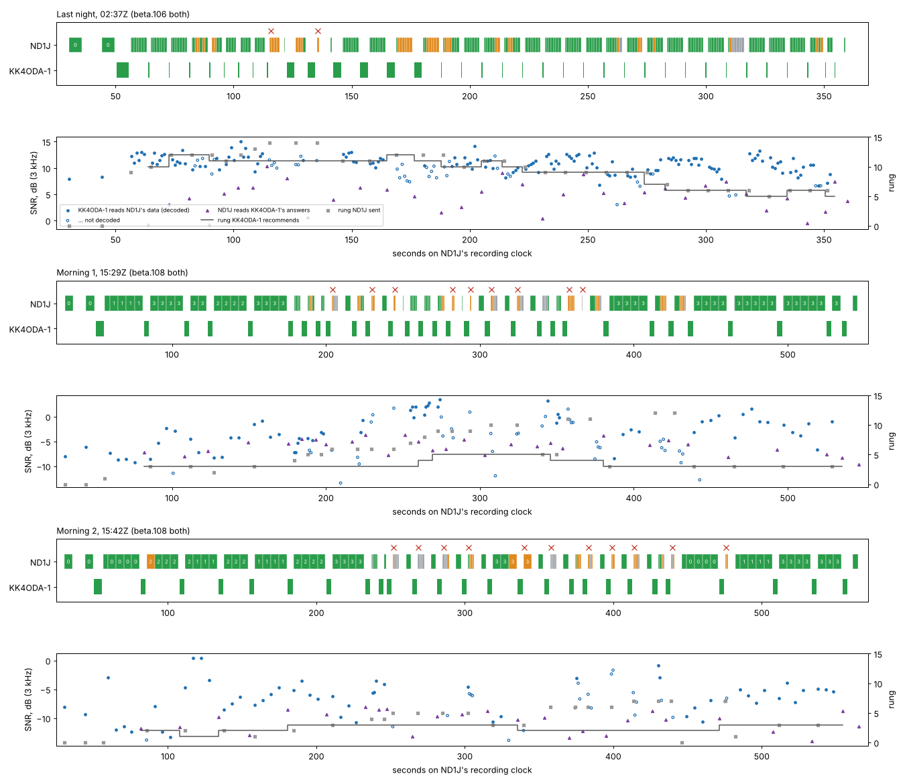
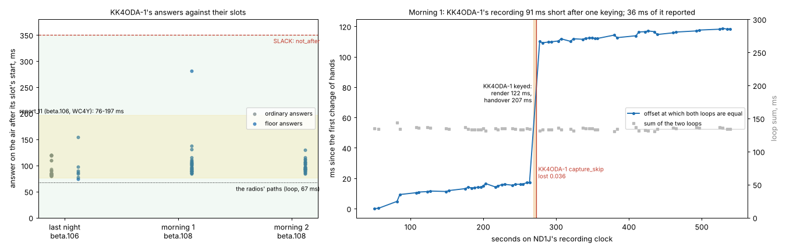
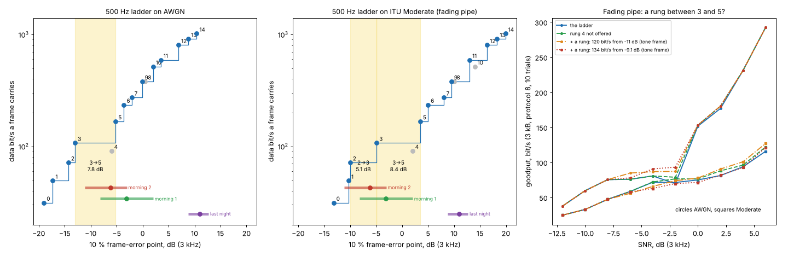
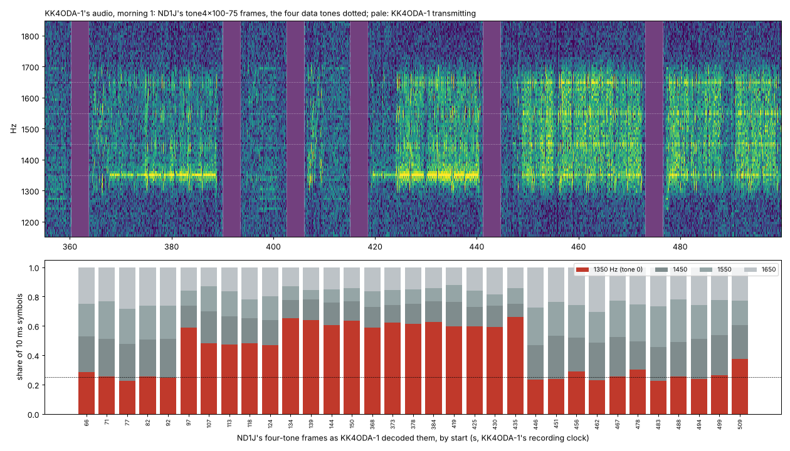

# Step 4, three more on the air: ND1J's Tests of 2026-10-15

Report [11](11-step-4-first-air.md) read protocol 8's first session on the air. This report reads
the next three, all ND1J's Tests to KK4ODA-1 on 80 m at 500 Hz: one at night on a strong path,
two in the late morning on a weak one. It follows report 11 section by section (§1–§14), then
checks what changed since (§15), the panel's speed chart (§16), and answers the author's four
questions (§17–§20).

* **When and where**: 3.590 MHz, 500 Hz, every session.
  * **Last night**: 2026-10-15 02:37:18Z to 02:42:48Z (22:37 EDT on the 14th).
  * **Morning 1**: 15:29:40Z to 15:38:20Z.
  * **Morning 2**: 15:42:12Z to 15:51:11Z.
* **Who**:
  * **ND1J** was the master in all three: he ran a Test calling KK4ODA-1. His sidecars and logs
    say an FTDX101MP keyed by Yaesu CAT on COM9, 100 W, an OCF dipole, EM73RH. Not the IC-7300
    by CI-V the brief expected.
  * **KK4ODA-1** was the slave: the author's FTDX10, Yaesu CAT on COM6, 50 W, T2D, the mini PC.
* **Builds**, from each sidecar and diagnostic bundle: **beta.106 at both ends last night;
  beta.108 at both ends both mornings.** There is no beta.106 end of a morning session, so
  §15 sets the beta.108 mornings against last night's beta.106 pair (same stations, radios and
  computers) and against report 11.

**Which upload holds which session.** Every session has both sides, with audio:

| session | ND1J's recording (upload) | KK4ODA-1's recording (upload) |
|---|---|---|
| last night | `20261015-023718_ND1J_KK4ODA-1_test` (02:46Z, again in 15:23Z) | `20261015-023737_KK4ODA-1_ND1J` (11:00Z) |
| morning 1 | `20261015-152940_ND1J_KK4ODA-1_test` (16:13Z) | `20261015-153000_KK4ODA-1_ND1J` (15:41Z, again in 15:51Z) |
| morning 2 | `20261015-154212_ND1J_KK4ODA-1_test` (16:13Z) | `20261015-154232_KK4ODA-1_ND1J` (15:51Z) |

ND1J's 15:23Z upload is not morning 1. His daemon had just restarted (15:21:57Z, beta.106) and
could not open the FTDX101MP's capture, set to 44.1 kHz, so the upload repeated last night's
session. He fixed the card, updated to beta.108 and ran both morning Tests from 15:28:09Z.

ND1J's audio and files are not committed. The figures are drawn from KK4ODA-1's audio and from
times and numbers in the sidecars.

## 0. Summary

**What happened.**

* **All three Tests completed. Protocol 8 held on the air again.**
  * The stations never radiated together. The least clear air was 0.577 s (last night),
    0.582 s (morning 1) and 0.598 s (morning 2).
  * No forfeit and no late drop in any session.
  * Every answer was inside its slot. The least margin left to `not_after` was 196, 69 and
    220 ms.
* **The two paths were very different.**
  * Last night KK4ODA-1 read ND1J's data at +6.6 to +15 dB. Message 404 bit/s, file 225 bit/s.
  * This morning it read it at −9 to +3.5 dB (morning 1) and −13 to +0.5 dB (morning 2).
    Message and file 58/55 and 40/32 bit/s. 80 m towards noon, as the author expected.
* **21 of the 22 silent slots were headerless transmissions at the Test's pinned ladder rungs**,
  or retransmissions of those frames. That is report 11's change 4 again, now on three more
  sessions. The 22nd was a poll the slave never detected.

**The author's questions, in short.**

1. **The speed ladder** worked as designed: up when the readings rose, down after failures and
   silence. Three different things held it low (§17):
   * **morning 1**: the path itself. It sat in the ladder's widest gap, between rung 3
     (tone4x100-75, 107 data bit/s) and rung 5 (QPSK ½, 167 bit/s), 7.8 dB apart on AWGN;
   * **morning 2**: a rule. Two silent slots on the Test's leftover rung-7 retransmissions
     stepped ND1J's own rung down two each (R9's silence step). The file's first two bursts went
     at rungs 0 and 1 where the path carried rung 3;
   * **last night**: the learned margin. Failures at rungs 11–12, which a fading 500 Hz path
     carries only near their Moderate 10 % points, drove the margin to its cap. The file ran at
     rungs 5–6, one to two rungs under what the fading tables put a +10 dB path at.
   * Not the tone floor's SNR lower bound, and not the re-seed. Neither mattered here.
2. **A rung between rungs 3 and 5** would have carried 4–5 % more on morning 1's path and
   nothing on the other two (§18). On the fading pipe it gains up to 34 % on AWGN inside the gap,
   but loses up to 14 % on fading channels: the controller judges it by its AWGN point. Simply
   no longer offering rung 4, which carries *less* data than rung 3, gains 0–13 % and costs
   nothing. Proposed, not built.
3. **The lopsided signal** about seven minutes into morning 1 was ND1J's zero-padded frames
   (§19). The Test's ladder sends small bodies, the frame codec has no scrambler, and zero bits
   map to the four-tone kinds' lowest tone. 59–65 % of those frames' symbols sat on 1350 Hz
   against 25 % in full frames. Not the path, his transmitter or the author's receiver. No frame
   was lost to it.
4. **The Morse after the first morning session** was ND1J's (§20). He probed by hand at
   15:38:52Z, KK4ODA-1 answered, nothing followed for 30 s, and his station identified on its
   own at 15:39:22Z: ADR-0055's setup identifier. KK4ODA-1's `cw_id` is off. The options against
   §97.119 and other programs' practice are laid out in §20. Nothing was changed.

**What changed since report 11, measured** (§15).

* **ADR-0071** (keying latency counts the radio and the render). Answers now reach the air a
  median 95–96 ms after their slots' starts, against 86–87 ms on last night's beta.106. It did
  not bring them to the radios' paths (67 ms). The learned key wait is 0–1 ms: a Yaesu `TX1;` is
  a write with no reply. The render (40–60 ms) is now counted.
* **Capture skips (ADR-0071 §3).** In morning 1 KK4ODA-1's recording ran 91 ms short after one
  keying. The capture timestamps reported 36 ms of it. The same keying's audio had a 35 ms gap
  inserted early in the answer, reported by nothing. **The skips are real when reported but miss
  most of the loss: do not hand them to `capture_gap` yet.**
* **ADR-0070.** That answer's first sync block arrived 35 ms off the rest of the frame (2 of 8
  hits at the frame's own timing). ND1J's beta.108 decoded it on its other two blocks.
* **ADR-0072** (the disconnect's minute) was not exercised. Every Test ended with its queue
  empty.

**What I would change, ranked** (details in §12):

1. *Protocol rule (R7).* Keep the header on any transmission above the rung the slave last
   recommended. It would have saved most of 21 silent slots: about 40–50 s of each morning Test.
2. *Protocol rule (R9).* Do not step the master's rung down for silence on a transmission sent
   above the recommendation (the ladder and its leftovers). The master-side twin of ADR-0020.
3. *Rate rule.* Offer only rungs that carry more *data* than every rung below them. That drops
   500 Hz rung 4.
4. *Transmitter only, no wire change.* Pad frames with a fixed pseudo-random filler, not zeros.
   Better, scramble the payload (a wire change).
5. *Daemon.* Do not feed capture skips to `capture_gap`. Do say when a keying's handover runs far
   over the learned render and key.
6. *Panel.* The speed chart's "mode rate" is the station's own sending rung, not the rung of the
   data it is moving (§16).

**Tools changed in this step** (all with tests):

* `fetch_uploads.py` asks again and resumes;
* `two_sides.py --from-loops` fixes the clock from the loop latencies when no signal both heard
  exists, and places transmissions by their decoded frames;
* `air_account.py --sidecars` accounts for a session on the air;
* `bench_link.py --rung` tries a hypothetical rung, and its replay is sized from the session's
  own frames;
* `ladder_table.py` prints each air's ladder from the model and baselines.

## 1. The sessions and the counters

| | last night | morning 1 | morning 2 |
|---|---|---|---|
| Test (ND1J's clock) | 330.4 s, complete | 519.4 s, complete | 538.8 s, complete |
| probe | answered: 8 dB there, 1.8 dB here | answered: −8 / −8.3 dB | answered: −8 / −13.8 dB |
| call | accepted first try | accepted first try | accepted first try |
| message | 2048 B, 404 bit/s, rung 12 | 512 B, 58 bit/s, rungs 1 then 3 | 512 B, 40 bit/s, rungs 0–3 |
| ladder | from rung 11: 11–13 4/4, 14 0/4 | from rung 2: 2–4 4/4, 5 2/4, 6 0/4, 7–8 4/4, 9 2/4, 10–12 0/4 | from rung 1: 1–3 4/4, 4 3/4, 5–7 0/4 |
| file | 5888 B, 225 bit/s | 768 B, 55 bit/s | 512 B, 32 bit/s |
| KK4ODA-1 read ND1J's data at | +6.6 to +15.1 dB (median 11.0) | −9.2 to +3.5 (−3.1) | −13.3 to +0.5 (−6.2) |
| ND1J read the answers at | −0.8 to +10.3 dB (median 5.1) | −9.7 to −3.6 (−5.6) | −14.0 to −8.1 (−10.0) |
| ND1J: transmissions, data frames sent (resent) | 41, 188 (33) | 43, 104 (39) | 41, 92 (37) |
| ND1J: re-encoded, headers elided, silent slots | 0, 8, 2 | 12, 23, 9 | 5, 24, 11 |
| KK4ODA-1: data records decoded / not | 146 / 39 | 63 / 38 | 53 / 22 |
| KK4ODA-1: HARQ rescues | 11 | 4 | 4 |
| forfeits, dropped late (both) | 0, 0 | 0, 0 | 0, 0 |

**Which counters belong to which session.**

* **ND1J's daemon** ran only last night's session (started 02:36:32Z). This morning it ran both
  Tests (started 15:28:09Z). So morning 2's counters are the bundle's less morning 1's.
* **KK4ODA-1's overnight daemon** (21:32:13Z, beta.106) held WC4Y's Test of report 11 and then
  ND1J's. Last night's HARQ rescues are 21 less WC4Y's 10.
* **Its morning daemon** (15:23:39Z, beta.108) answered two probes before morning 1.
* **`frames_received` is 0 on every master sidecar.** It counts DATA frames only, and a master
  receives answers. It is not a fault.

**The first look, checked against the sidecars.**

* Each probe and call is in both stations' records.
* The message and file rates are the Test's own report.
* ND1J's `silent_slots` counter (2, 9, 11) is matched one for one by §5's account.

## 2. One clock for both stations

**Last night.** A signal both stations heard sets the offset, as in report 11.

* ND1J's receiver narrowed to about 1.1–1.9 kHz after the first minute, so report 11's band
  above the signal (2.7–3 kHz) held nothing at his end.
* The envelopes in 1.0–2.0 kHz, in the 10 s both stations listened before the probe, agree at
  **+19.664 s** (r 0.32). The sidecars' stamps say +19.683 s.

**This morning, nothing both heard.** The band was quiet between the two stations'
transmissions (no crashes, §8). The envelope fit found nothing (r 0.02–0.03). So the offset
comes from the loop latencies instead (`two_sides.py --from-loops`, new in this step):

* At every change of hands, a station's loop latency (its key to its first frame in the other
  station's recording, less the lead, the card and the handover) grows with the offset, and the
  other station's shrinks by as much.
* **Their sum does not depend on the offset**, and it held steady: median 136, 134 and 138 ms in
  the three sessions.
* The offset at which the two loops are equal is exact up to the two radios' difference: a few
  milliseconds. Last night, where the noise fit is independent, the loops' offset at the start
  (19.661–19.668 s) agrees with it within 4 ms.
* **Its changes are exact.** A step is audio one recording lost or repeated; a slope is the two
  sound cards' clocks running at different rates.

| | last night | morning 1 | morning 2 |
|---|---|---|---|
| offset, KK4ODA-1's recording to ND1J's | +19.661 s at 50 s, +19.684 at 355 s | +19.699 s at 50 s, +19.818 at 539 s | +19.700 s at 50 s, +19.719 at 558 s |
| steps | **+13 ms** between 135 and 142 s | **+91 ms** between 263.5 and 277.5 s | none |
| drift (KK4ODA-1 against ND1J) | +17 ppm | +42 ppm | +38 ppm |
| capture skips reported | — (beta.106 has none) | KK4ODA-1: one, 36 ms, at 272.5 s | none |

**Both steps are positive.** KK4ODA-1's recording fell behind: KK4ODA-1 lost the audio, not
ND1J. §4.4 and §15 take them apart. Figure 2 (right) shows morning 1's step.

Times below are on ND1J's recording clock ("s") or UTC.

## 3. Safety (question 1)

### 3.1 Every keying

| | last night | morning 1 | morning 2 |
|---|---|---|---|
| ND1J keyed | 40 (probe, call, 37 in the session, DISC with his Morse identifier ahead of it) | 41 | 39 |
| KK4ODA-1 keyed, in its recording | 36 (acceptance, 35 answers) | 30 | 26 |
| outside KK4ODA-1's recording | the probe's answer (before the call), the DISC_ACK | the same | the same |

KK4ODA-1's recordings start at the call and stop with the session, so its probe answer and
DISC_ACK are only in ND1J's recordings (decoded there).

*Figure 1.* For each session:
* **Upper panel**: transmissions on ND1J's clock. ND1J's frames are coloured by what KK4ODA-1
  made of them (green decoded, orange detected and not decoded, grey not detected). Data frames
  are numbered by rung. KK4ODA-1's answers are coloured by whether ND1J decoded them. Red crosses
  are silent slots.
* **Lower panel**: the SNR each way, the rung KK4ODA-1 recommended (step line) and the rung ND1J
  sent (grey squares).

### 3.2 Did they ever radiate together? No

`air_account.py --sidecars` (new, §5) places every transmission where the other station
recorded its frames. It puts each at the position its kind and count give in its transmission,
on the loops' clock.

* **Changes of hands**: 72, 60 and 52.
* **The least clear air**: 0.577 s (last night, KK4ODA-1 to ND1J), 0.582 s and 0.598 s.
* **Master to slave** the air was clear 0.79–0.83 s at gap level 0. **Slave to master**,
  0.58–0.64 s.

### 3.3 Did either key into the other's deaf time? No

* **The radios hear again quickly.** After a release, ND1J's FTDX101MP's receive audio came back
  in 17–18 ms (8–35). KK4ODA-1's FTDX10 came back in 44–48 ms (39–58).
* **The other station's RF came at least 0.577 s after any release.** S4 held with more than
  0.5 s to spare.

### 3.4 What kept it safe

* **R3 and S2.** No forfeit and no late drop in any session. The answers started 77–281 ms after
  their slots' starts (§4.2).
* **R4.**
  * After every answered slot, ND1J keyed 0.350–0.447 s after the answer's end as he recorded
    it. That is `heard_by` (0.35 s) and his own handover; never earlier.
  * After every silent slot, he keyed 4.63–4.72 s after his own frames ended: `end_max +
    heard_by`.
* **Only decoded content changed state.**
  * In morning 2 ND1J's receiver recorded 43 detections that never decoded:
    * 16 within 0.8 s of his own releases;
    * 12 inside KK4ODA-1's decoded answers;
    * 15 at the noise floor (confidence 1.00–1.09), 9 of them before the session.
  * His receiver had a narrow filter on in morning 2, which seems to bring more of them.
  * None was keyed on.

## 4. Timing on real hardware (question 2)

### 4.1 The latency chain, measured

| | ND1J (FTDX101MP) | KK4ODA-1 (FTDX10, mini PC) | budget |
|---|---|---|---|
| decode: frame end to report | median 125–143 ms, max 154 | median 121–125 ms, max 161 | D = 0.30 s |
| receive mute after the key | 46–79 ms (median) | 35–61 ms | — |
| handover delay (key to audio at the card, past the lead) | 56–96 ms median (18–150) | 30–64 ms median (18–207) | (inside KEY) |
| of which, beta.108's `tx_end`: key, render | key 0–1 ms, render 40 ms (0–130) | key 1 ms, render 60 ms (30–122) | (counted since ADR-0071) |
| card's reported output latency | 22 ms | 22 ms | (counted) |
| loop latency (both radios' paths, the card past its report) | 68–70 ms (63–72) | 67–69 ms (63–73) | (inside D and KEY) |
| receive audio back after a release | 17–18 ms | 44–48 ms | (S4) |
| key lead | 100 ms | 100 ms | (counted) |

* **The two radios' paths are symmetric**: about 68 ms each, as in report 11 (66–70 ms). The loop
  sum is the steady quantity: 131–138 ms.
* **The key wait is 0–1 ms on both stations.** A Yaesu `TX1;` is written and not answered, so
  `ptt.key` returns at once. The radio's own switch to transmit is invisible to the computer and
  sits inside the loop latency.
* **ND1J's handover is longer than KK4ODA-1's** because his transmissions are decided in the
  pass that keys them, and rendered there.

### 4.2 Slot by slot

Each KK4ODA-1 answer against the slot ND1J's transmission granted (`two_sides.py
--from-loops` prints every row):

| | last night (beta.106) | morning 1 (beta.108) | morning 2 (beta.108) |
|---|---|---|---|
| answers in the recording | 36: 29 ordinary, 7 floor | 30, all floor | 26, all floor |
| on the air after the slot's start | 77–154 ms, median 86 | 84–281 ms, median 96 | 84–130 ms, median 95 |
| least margin to `not_after` | 196 ms | 69 ms | 220 ms |
| KK4ODA-1's decode for the last frame before the answer | 94–151 ms | 98–151 ms | 102–159 ms |
| ND1J's decode of the answer | 91–151 ms | 90–154 ms | 95–154 ms |

**The one late answer**: morning 1, the slot of ND1J's transmission at 263.54 s. KK4ODA-1 keyed
at its 248.83 s. The render took 122 ms (typically 60), the handover 207 ms, and the answer
reached the air 281 ms after the slot's start, 69 ms inside SLACK. The same keying lost 54 ms of
capture and put a 35 ms gap into the answer (§4.4).

**Where the 95 ms goes**, the beta.108 medians:

* the key came 131–145 ms before the slot's start;
* then the lead and the card, 122 ms;
* the handover, 44–64 ms;
* the radios' paths, 67–69 ms.

The ADR-0071 gate holds until the fastest recent key would not be early, then keys on the next
20 ms pass. What it cannot see is everything after the key. §15 takes this up.

*Figure 2.* **Left**: each answer's lateness. Last night's beta.106 against this morning's
beta.108, with report 11's range shaded. **Right**: morning 1's offset from the loops (blue),
the loop sum (grey), the keying where the audio was lost (orange) and the one `capture_skip`
reported (red).

### 4.3 Do both computers fit inside D, KEY and SLACK?

**Yes.**

* **D (0.30 s).** Decode at most 161 ms plus a capture path of a few ms: **at least 0.13 s to
  spare** at both stations.
* **KEY (0.35 s)**, key to RF:
  * lead 100 ms and card 22 ms;
  * a handover of 44–96 ms median (150 ms at ND1J's slowest, 207 at KK4ODA-1's);
  * up to 68 ms of transmit path.

  That is about 0.29–0.34 s typical. KK4ODA-1's slow keying came to 0.40 s, past KEY. Its answer
  still started inside SLACK, because the gate had keyed it early.
* **SLACK (0.35 s).** At least 69 ms to spare (that keying), otherwise at least 196 ms.
* **Slow passes.**
  * ND1J: none (slowest 132 ms, in playback).
  * KK4ODA-1: none during the sessions. Between them it logged two (573 ms and 992 ms at
    15:40:52Z and 15:41:36Z). The second was the share zip being built; at the first, a sleeping
    thread woke 359 ms late: the machine was busy.
* **The replays reproduce live almost exactly.**
  * All six recordings replay at 0.04–0.07× real time; the slowest block was 32 ms.
  * Five replay frame for frame.
  * KK4ODA-1's morning-1 replay decodes 76 of the live 77. The one is a rung-4 frame at −7.1 dB
    (its AWGN 10 % point is −6.0) that live decoded and the replay, on other block boundaries,
    did not: a coin-toss at threshold, not a lost capability.

### 4.4 Audio KK4ODA-1 lost without saying

**Morning 1, the keying at KK4ODA-1's 248.83 s (ND1J's 268.6 s)**:

* **The capture fell 91 ms behind**, in two parts:
  * **54 ms between the key and the release.** KK4ODA-1's loop for this keying reads 121 ms
    against 67 for every other. The loss shortened the measured handover and lengthened the
    loop by the same 54 ms.
  * **36 ms just after the release.** Recorded as `capture_skip lost 0.036` at 252.71 s.
* **Its playback put a 35 ms gap into that answer.** In ND1J's audio the answer's first sync
  block lines up 30–40 ms *earlier* than its middle and end blocks. Swept against the frame's
  start, the first block reads 8 of 8 hits from −30 to −10 ms, the other two from 0 to +20. So
  about 35 ms of silence went into the answer early in it.
  * `starved_samples` stayed 0: the samples had been handed to the card. The device or the
    driver stalled.
  * Of 180 decoded tone frames in the three sessions, both directions, this is the only one with
    a slip.
* **The render took 122 ms and the handover 207 ms** on that keying.
* **Every symptom lands on one keying.** A slow render, lost capture, a gap in playback and a
  long handover: the mini PC's USB audio stalled in both directions. It is report 11's §4.4
  again, and the most likely explanation of report 11's open "slip ~30–40 ms" on 2026-10-05: the
  sound card *inserting* audio into the station's own transmission.

**Last night (beta.106)**, a +13 ms step at 135–142 s, during KK4ODA-1's first floor answers
after a run of ordinary ones. No frame was hurt. beta.106 reports no skips.

**Between the sessions**, idle, KK4ODA-1 logged six skips (38, 38, 144, 28, 28 and 88 ms at
15:38:26–15:40:51Z). Its bundle counts 13 skips, 566 ms in all, since 15:23:39Z. ND1J's counts
one, at his daemon's start.

**Morning 1's frames survived** (§15): the loss fell while KK4ODA-1 transmitted, and ND1J
decoded the answer with the gap on its other two blocks.

## 5. Every silent slot (question 3)

`air_account.py --sidecars` names each master transmission that went unanswered by what the
slave had of it. Its tally matches ND1J's `silent_slots` counter in each session.

| | last night | morning 1 | morning 2 |
|---|---|---|---|
| answered | 36 | 30 | 26 |
| silent, header elided (R7), nothing placed the end | 2 | 8 | 9 |
| silent, nothing heard | 0 | 1 (an ordinary poll) | 2 (headerless, rungs 5 and 6) |
| silent, header lost | 0 | 0 | 0 |
| forfeit, answer unheard | 0, 0 | 0, 0 | 0, 0 |

**Which transmissions went silent:**

* **Last night**: 4×r14 and 1×r14/2. The Test's pinned top rung.
* **Morning 1**:
  * 4×r6, then 2×r6/2 and 1×r6/3 (ladder rung 6 and its resends);
  * 2×r9 and 1×r9/2;
  * 4×r10, twice;
  * 4×r11;
  * an ordinary poll (H(o)) KK4ODA-1 never detected.
* **Morning 2**:
  * 4×r5 three times (rung 5 and its resends at RV 2 and 3);
  * 1×r3 (failed at −12.1 dB);
  * 4×r6, 3×r6/2 and 2×r6/3;
  * 4×r7, then 2×r7/2 and 2×r7/3 *after the ladder had ended*.

**21 of the 22 silent slots were transmissions without a header**, at rungs above the one
KK4ODA-1 had last recommended: the Test's pinned ladder rungs and their retransmissions. The
22nd was the undetected poll.

**What a silent slot cost here:**

* about 4.6–4.7 s of waiting, then a floor poll (3.2 s) and its answer (3.2 s);
* about 41 s of waiting in morning 1 and 50 s in morning 2 (§11);
* in morning 2, also the rung (§17).

## 6. The probes (question 6)

**All five probes were answered and heard:**

* last night's (8 dB there, 1.8 here);
* ND1J's hand probe at 15:29:26Z and the Test's at 15:29:46Z (both answered, KK4ODA-1 heard
  them at −7.9 and −8.0 dB);
* ND1J's hand probe at 15:38:52Z (heard at −1.5 dB, its answer read at −8.1 dB);
* morning 2's Test probe (−8 there, −13.8 here).

Unlike report 11's probe, none had its first sync block faded.

**Found on the way.** KK4ODA-1 learned an answer gap for ND1J of 250 ms at 15:29:46Z ("it
probed again after its probe was answered", ADR-0054). But the second probe was the Test's own,
20 s after a hand probe, not a retry. The gap eased to 225 and then 200 ms with each first-try
call.

* **In protocol 8 it costs nothing.** A slave asks for a gap level only when the gap exceeds D +
  KEY − GUARD (0.6 s), and every answer here read "level 0".
* **It is a mislearning to note.** It is not worth a rule now.

## 7. Every failed frame and the HARQ rescues (question 4)

KK4ODA-1's data records that did not decode, against each rung's AWGN 10 % point plus the
penalty the link bench fits to that session's data (§13):

| | last night (+3.75 dB) | morning 1 (−1.0 dB) | morning 2 (+0.25 dB) |
|---|---|---|---|
| not decoded | 39 | 38 | 22 |
| trusted (decoded, or chip/detect confidence ≥ 1.3, or a tone frame) | 37 | 30 | 20 |
| under their threshold | 22 | 25 | 16 |
| at or over it | 15: rungs 11–12 at 9–12 dB (8), 9–10 (3), 6–7 (4) | 5: RV 2/3 copies of rungs 6 and 9 | 4: rungs 2–3 at −13.8/−12.1, two RV 3 copies of rung 6 |
| by rung | 12: 19, 14: 8, the rest one to three each | 12: 9, 11: 8, 6: 7, 9: 5 | 6: 7, 7: 7, 5: 4 |

**What the over-threshold failures mean:**

* **In the mornings, they are retransmissions.** RV 2 never decodes alone and RV 3 only on some
  rungs (ADR-0043). Those copies were rescued or re-encoded, as designed.
* **Last night, they are fading.** On ITU Moderate the 500 Hz QAM rungs need 9–10 dB more than on
  AWGN, while one session-wide penalty fitted 3.75 dB. Rungs 11–12 failing at readings of 9–12 dB
  is what the fading tables predict (§17).

**HARQ rescues**: 11, 4 and 4. Every rescued frame was delivered.

**The six frames KK4ODA-1 "decoded" as another kind** in morning 1 (a "rung 12" inside a rung-3
frame, and "control" detections) were phantoms inside ND1J's frames, at confidence 1.0–1.1. None
was acted on.

## 8. The interference (question 5)

The two stations' audio, surveyed in windows while each listened (outside its own keying and the
other station's frames):

| | last night | morning 1 | morning 2 |
|---|---|---|---|
| impulses at KK4ODA-1 (2 ms power 15 dB over the median, 2.0–2.6 kHz) | **165–1 315 per 30 s** | 0–5 per 30 s | 0–1 per 30 s |
| KK4ODA-1's noise, in band and above it | −33 to −24 dBFS in band, −34 above | −35 to −34 dBFS, flat | −35 to −32 dBFS, flat |
| carriers outside the signal at KK4ODA-1 | faint carriers sweeping *down* through the band (185–200, 225, 270–330 s) | none (≤ 12 dB over the median, in windows with little listening) | none |
| at ND1J | impulses as at KK4ODA-1 | quiet, filter about 1.1–1.9 kHz | quiet; a narrow filter, 60 dB down above 1.8 kHz |

* **Last night was impulsive.** The 2 ms median at KK4ODA-1 sat 20 dB under its mean: crashes
  heard at both stations. The faint swept carriers are the switching-supply signature of report
  11's E1, much weaker. No failure traces to them.
* **This morning was quiet.** No crashes, no carriers, no PACTOR, as the author heard.
* **The "lopsided" frames were not interference.** They were ND1J's own padded frames (§19).
* **No interference was taken for an Aether frame** at either station.

## 9. Rate control (question 7)

§17 answers the author's question 1 in full. The short form:

* **Last night.**
  * The call read 12.9 dB on the floor, and the first burst went at rung 9.
  * KK4ODA-1 recommended rungs 10–12 for the message.
  * The Test's pinned rung 14 failed (0/4, then 1 of 4 rescued at RV 2).
  * The file's own bursts at rungs 11–12 then failed at readings of 9–12 dB. The recommendation
    stepped 12 → 11 → 10 → 9 → 7 → 6 → 5 while the readings stayed at 8–13 dB.
* **Morning 1.**
  * The call read −6.1 dB. The first burst went at rung 1 (ADR-0066's steps in hand).
  * The message went at rung 3; the recommendation stayed 3 until 260 s.
  * During a good stretch at 230–260 s (+0.4 to +3.5 dB) it rose to 4 and 5; the pinned ladder
    rungs 7 and 8 decoded 4/4 there.
  * It came back to 4 and then 3 as the readings fell to −3 to −7 dB.
* **Morning 2.**
  * The call read −9.3 dB. The first burst went at rung 0.
  * The recommendation moved 2 → 1 → 2 → 3, then 2 at 336 s, then 3 at 472 s.
  * The file's first two bursts went at rungs 0 and 1 against a recommendation of 2 and 3
    (§17.2).

**Families.**

* **Last night**: every answer ordinary at first (ND1J read them at −1 to +10 dB). The 7 floor
  answers came at 122–176 s, after failures.
* **Both mornings**: every answer on the floor (ND1J read them at −4 to −14 dB). ND1J's headers
  went floor or ordinary by the weakest of the last three readings, as R6 says.

## 10. Header elision (question 8)

* **R7 was followed every time:** data only, level 0, the last slot heard, one possible answer
  family, at most four data frames. ND1J's counter: 8, 23 and 24 headers elided.
* **Last night, elision cost two silent slots.** Both were rung 14, pinned.
* **Each morning, 8–9 elided transmissions went silent**, at pinned rungs 5–11 the path could
  not carry.
* **What elision saved.** Counting the family each header would have taken (floor in the
  mornings, 3.2 s; ordinary last night, 0.43 s): about 3 s last night, about 45 s in morning 1,
  about 75 s in morning 2.
* **What it cost.** The silent slots' waits and polls: about 41 s + 8 polls, and 50 s + 9
  polls.
* **Net**: about even in morning 1 and a small gain in morning 2, before the knock-on. That
  knock-on includes morning 2's rung (§17).
* **Every loss fell on a transmission above KK4ODA-1's last recommendation**, as in report 11.
  Keeping the header there costs 3.2 s a time on the floor, about what each silent slot's wait
  and poll cost (4.6 + 6.4 s). It would have cost nothing on the transmissions at or under the
  recommendation, which were answered.

## 11. Where the time went (question 9)

Accounted on ND1J's clock from `test.start` to `closed`. Resends are split from new data by
ND1J's own `frames_resent`, an approximation.

| | last night | morning 1 | morning 2 |
|---|---|---|---|
| KK4ODA-1's answers | 31.8 s, 9.6 % | 92.8 s, 17.9 % | 80.0 s, 14.8 % |
| ND1J's headers, polls, DISC: floor | 0 | 35.2 s, 6.8 % | 41.6 s, 7.7 % |
| the same, ordinary | 13.0 s, 3.9 % | 2.2 s, 0.4 % | 0 |
| gaps, master to slave | 27.8 s, 8.4 % | 25.4 s, 4.9 % | 20.0 s, 3.7 % |
| gaps, slave to master | 25.2 s, 7.6 % | 21.4 s, 4.1 % | 18.9 s, 3.5 % |
| **the protocol's exchange** | **97.8 s, 29.6 %** | **177.0 s, 34.1 %** | **160.5 s, 29.8 %** |
| silent slots (waiting) | 6.3 s, 1.9 % | 41.0 s, 7.9 % | 50.3 s, 9.3 % |
| data resends | 34.8 s, 10.5 % | 100.9 s, 19.4 % | 118.7 s, 22.0 % |
| **the path's losses** | **41.1 s, 12.4 %** | **141.9 s, 27.3 %** | **169.0 s, 31.4 %** |
| the ladder's first copies | 18.2 s, 5.5 % | 81.7 s, 15.7 % | 75.2 s, 14.0 % |
| new data | 145.1 s, 43.9 % | 86.4 s, 16.6 % | 101.2 s, 18.8 % |
| probe, call, acceptance | 16.1 s, 4.9 % | 16.1 s, 3.1 % | 16.1 s, 3.0 % |
| the rest (the probe's wait, the call's slot, the DISC_ACK) | 12.0 s | 16.4 s | 16.9 s |

* **A strong path spends 44 % of the Test on new data.** A weak one spends 17–19 %.
* **On the weak paths, the ladder and its losses take more than the data.** Resends of failed
  pinned frames, re-encodes and silent slots come to about a quarter of the Test. That is the
  Test measuring, not the link working.
* **The protocol's own share is 30–34 %**, as in report 11 (38 %). On the weak paths most of it
  is floor answers the path forced.

## 12. What the sessions mean for the specification

**Assumptions S1–S7 of [04-formal-spec.md](04-formal-spec.md):**

* **S1 (fixed air times) held, once by 35 ms of margin.** KK4ODA-1's answer with the 35 ms gap
  inside it was 35 ms longer than its kind says. Every other frame of the 180 checked was where
  its kind and count put it. This is the first on-air evidence that the station's own playback
  can stretch a frame.
* **S2 (radiation within slack, or not at all) held**, by 69 ms at the slow keying and 196 ms or
  more otherwise. Still by margin. The gate judges the start before the key and with the key
  wait measured. A stall after the key (the render and the playback gap above) is not judged.
* **S3 (both stations place a frame's end within GUARD) held.** The stretched answer ended 35 ms
  late: inside the 50 ms GUARD, so closer than any report so far.
* **S4 held**, with more than 0.5 s to spare.
* **S5 (no transmission outlasts its frames) held, once by 35 ms**, the same answer. No watchdog
  trip.
* **S6 (decodes within D) held.** At most 161 ms.
* **S7 (loss runs are finite) held.** The longest run was two silent slots (morning 1, 357 and
  366 s). Each other silent slot was followed by an answered poll.

**Rules R1–R12 all did what they say.** Two did it at a cost these sessions make plain:

* **R7's elision** on transmissions above the recommendation: 21 of 22 silent slots.
* **R9's silence step** applied to transmissions the master sent above the recommendation. It
  set the master's own rung two below the recommendation after each one. In morning 2 that put
  the file's first bursts at rungs 0 and 1 (§17.2).

Neither touches safety.

**Changes, ranked by what each costs against what it buys.** None of the protocol or rate rules
below has been changed. The tool changes are made (§0).

| # | change | kind | cost | what it buys |
|---|---|---|---|---|
| 1 | Keep the header on a transmission whose data are above the rung the slave last recommended (report 11's change 4) | *protocol rule* (R7) | tiny | Most of 21 silent slots in three sessions: about 41 s + 8 polls in morning 1 and 50 s + 9 polls in morning 2, against 3.2 s per header kept. Judge on `80m-local-rfi-ladder-500` and a scenario of this morning's path (§14) |
| 2 | Do not step the master's rung down for a silent slot whose data went above the slave's recommendation (pinned, or retransmissions keeping a pinned rung) | *protocol rule* (R9), model first | small | Morning 2's file at rungs 2–3 from its first burst: about 1–2 bursts (26–52 s) of its 128 s |
| 3 | `usable_modes` compares the data a frame carries after its header, not the PHY payload | *rate rule* (R9), model first | tiny | 500 Hz rung 4 (QPSK ⅓: 91 data bit/s, below rung 3's 107, from 7 dB further up) is no longer offered. Fading pipe: +0 to +13 % from −2 to +2 dB on every class, nothing worse (§18) |
| 4 | Pad DATA frames with a fixed pseudo-random filler instead of zeros, in the model and the port (`encode_data`), vectors regenerated | transmitter only; the receiver ignores padding, so no wire change | small | No more one-tone frames on the four-tone kinds (§19); the same for OFDM's padded frames, whose identical symbols raise the peak. Better still, scramble the whole payload, but that is a wire change for a protocol bump |
| 5 | Do not hand capture skips to `capture_gap`. Log a line when a keying's handover runs 100 ms past its learned render and key, with the skips beside it | daemon | small | A stall on the station's own audio is named on the day, not found in a two-sided analysis |
| 6 | The speed chart's mode-rate line shows the rung of the data moving: the other station's while this one receives | panel and manual | small | The chart stops comparing two directions (§16) |
| 7 | Gate's last mile: judge `not_after` once the first sample leaves the card | daemon | medium | S2 by construction after the key too. Margins here say it can wait |

## 13. Comparison (question 10)

**ND1J's and WC4Y's Tests to KK4ODA-1 on 80 m, from `field/LOG.md` and report 11 §13:**

| Test | protocol | bandwidth | message, bit/s | file, bit/s | the ladder |
|---|---|---|---|---|---|
| ND1J 2026-09-25 01:51Z | 5 | 2 300 Hz | 28 | — | never ran (the key watchdog, ADR-0017) |
| ND1J 2026-09-25 01:58Z | 5 | 500 Hz | — | — | aborted: the session dropped |
| ND1J 2026-09-26 02:43Z | 5 | 500 Hz | — | — | aborted: the call was not answered |
| WC4Y 2026-10-10 13:30Z | 7 | 500 Hz | 39 | 39 | rungs 0–6 4/4, 7–9 0/4 |
| WC4Y 2026-10-11 00:57Z | 7 | 500 Hz | 45 | 48 | rungs 0–3 4/4, then 2/4, 1/4, 1/4, 0/4 |
| WC4Y 2026-10-11 15:52Z | 7 | 500 Hz | 58 | 67 | rungs 2–5 4/4, 6 3/4, 7–9 0/4 |
| WC4Y 2026-10-14 23:59Z | 8 | 500 Hz | 47 | 52 | rungs 2–3 4/4, 4–8 1–3/4, 9–10 0/4 |
| **ND1J 2026-10-15 02:37Z** | **8** | 500 Hz | **404** | **225** | rungs 11–13 4/4, 14 0/4 |
| **ND1J 2026-10-15 15:29Z** | **8** | 500 Hz | **58** | **55** | 2–4 4/4, 5 2/4, 6 0/4, 7–8 4/4, 9 2/4, 10–12 0/4 |
| **ND1J 2026-10-15 15:42Z** | **8** | 500 Hz | **40** | **32** | 1–3 4/4, 4 3/4, 5–7 0/4 |

**The link bench's prediction** (`bench_link --replay <sidecar> --engine granted`, five
trials; no keying or interference charged):

| | from ND1J's sidecar (the Test's own rates; the answers' SNR as the schedule) | from KK4ODA-1's (the data direction's SNR and decodes) | measured |
|---|---|---|---|
| last night | penalty +1.0 dB: **217–232 bit/s** (protocol 7: 249–268) | penalty +3.75 dB: 231–258 bit/s | file 225 bit/s |
| morning 1 | penalty −0.25 dB: **45 bit/s** (protocol 7: 49) | penalty −1.0 dB: 77 bit/s | file 55, message 58 |
| morning 2 | penalty 0.0 dB: **34 bit/s** (protocol 7: 37) | penalty +0.25 dB: 37–62 bit/s | file 32, message 40 |

* **The bench comes within 4–20 % of what the air delivered.** The replay of ND1J's sidecar
  runs the session on the SNR of the *answers*, the weaker direction this morning. It predicts
  under the measured rate.
* **The data direction's schedule over-predicts.** The bench charges no silent slot, ladder or
  playback stall.
* **Protocol 8 against protocol 7 on the same replay**: ×0.87, ×0.92 and ×0.92, the cost report
  11 and Step 3 accepted.

**The harness, nearest scenarios** (`bench/baselines/scenarios.csv`, ten seeds, protocol 8):

* **morning 1** (data −9 to +3.5 dB, the answers −4 to −8): `80m-lopsided-acks-500` (+1 / −4
  dB): message 57.4 bit/s (45.9–71.2), file 50.6 (32.6–70.4), 483 s of air (355–548).
  `80m-floor-top-start-500` (−3 / −9): 68.2, 47.5, 473 s. **Measured 58, 55, 519 s: inside
  both.**
* **morning 2** (data −13 to +0.5, the answers −8 to −14): `80m-nvis-evening-500` (+9 / +4 dB on
  NVIS fading): 35.1, 22.9, 494 s. **Measured 40, 32, 539 s: inside it.** No scenario has a path
  this weak both ways with a Test.
* **last night** (data +7 to +15, the answers −1 to +10): no 80 m 500 Hz scenario is this
  strong. The nearest, `80m-flutter-500` (+8 dB, flutter), reads 63 and 43 bit/s. **Measured 404
  and 225.** The harness has no strong 500 Hz Moderate path; §14 owes one.

**What the comparison can show:**

* protocol 8 on ND1J's path this morning ran inside the spread of every earlier weak-path Test
  (WC4Y 39–67 bit/s);
* on a strong path it carried 4–8 times as much;
* the bench and the harness predict each within their spread.

**It cannot separate protocol from path.** These are three different hours on 80 m.

## 14. Owed

* **A harness scenario for each new path**: last night's strong one (Moderate, +11 dB one way,
  +5 the other) and this morning's weak lopsided one (−3 / −6 dB, both on the floor). With them
  §12's changes 1–3 get judged where they matter.
* **A reference at one antenna**, as report 11 asked. Still owed. This report splits the two
  radios' paths only by symmetry (68 ms each).
* **The USB audio stall on the mini PC**: one keying here, one frame-sized slip on 2026-10-05,
  capture losses in report 11. A recording with `[record] tx_audio = true` would show whether the
  card's own output had the gap. A stress test on the bench (a busy machine and a long session)
  would show how often.
* **More sessions before the constants freeze**, as before. Nothing here asks for a change to D,
  KEY or SLACK.

## 15. What changed since report 11, on the air

### 15.1 ADR-0071: the keying latency counts the radio and the render

**What the beta.108 ends logged:**

* **KK4ODA-1**: "the radio takes 1 ms to key and a transmission 60 ms to render; transmissions
  now start 183 ms after they are decided". It logged the same with 0 ms and 40 ms at 15:29:26Z.
  Its bundle: key 1 ms (9 of 9), render 20–70 ms, typical 60; `engine_latency_ms` 183.
* **ND1J**: renders of 20–90 ms logged, key 0–1 ms, engine latency 142–213 ms. His bundle:
  render typical 40 ms, `engine_latency_ms` 162.
* **`tx_end`'s `key` and `render`**: key 0.000–0.005 s on every keying of both stations. Render
  0.03–0.07 s, once 0.122.

**What it did to the answers:**

| | report 11 (beta.106, WC4Y) | last night (beta.106) | mornings (beta.108) |
|---|---|---|---|
| floor answers after their slots' starts | 76–197 ms, median 147 | 75–154 ms, median 87 | 84–281 ms, median 96 (morning 2 alone: 84–130) |
| ordinary answers | — | 80–120 ms, median 85 | — |

* **ADR-0071 expected about the radios' paths.** The loops say those are 67–69 ms; the answers
  came a median 95–96 ms after their slots' starts.
* **The remaining ~28 ms is after the gate's decision.** The gate keys on the first 20 ms pass
  where the fastest recent key would not be early. Then the handover between the key and the
  audio leaving the card was 44–64 ms median on the mini PC. That is more than the render it
  already counted: the 20 ms pass and the card's own scheduling.
* **The key wait it learns is right, and tells little.** For a Yaesu radio the computer waits
  for nothing. The radio's own switch is inside the 67 ms loop.
* **What ADR-0071 did buy**: the answers decided at the last moment no longer run 133–197 ms
  late, as report 11's did. Every answer this morning but the one stalled keying sits at 84–138
  ms.
* **Against the beta.106 end of the same pair** (last night), the medians are within 10 ms. The
  floor answers last night were mostly rendered ahead too.

**S2 still holds by margin after the key** (§12, change 7).

### 15.2 Capture skips (ADR-0071 §3): can they go to `capture_gap`?

| | step in the offset (the audio's own evidence) | `capture_skip` reported |
|---|---|---|
| last night | +13 ms, KK4ODA-1, 135–142 s | — (beta.106) |
| morning 1 | **+91 ms, KK4ODA-1**, in one keying: 54 ms between key and release, 36 ms just after | **one, 36 ms**, at the right place |
| morning 2 | none | none |
| between the mornings, idle | — (no session to compare) | six, 28–144 ms |
| ND1J, all three | none | one, 48 ms, at his daemon's start |

* **When the timestamps report a skip, the audio agrees.** Right place, right size, and no false
  report in these sessions.
* **They saw 36 of 91 ms.** The 54 ms lost while KK4ODA-1 transmitted, and the 35 ms gap in its
  own playback, left no trace in the timestamps.

**Verdict: do not hand skips to `capture_gap` yet.**

* Handing them over would have moved the clock 36 ms of a 91 ms loss. A partial correction is no
  better than none.
* The receiver loses nothing from a loss during its own transmission anyway: it is muted.
* The case that matters, a loss inside a frame being received, has not been seen with a report
  beside it.
* Keep the report (it is right when it speaks), and add change 5 of §12.

### 15.3 ADR-0070: a tone frame whose first sync block faded

* **Morning 1, KK4ODA-1's answer at ND1J's 269.0 s.** Its first block arrived 35 ms off the rest
  of the frame (§4.4): 2 of 8 hits where the frame's own timing put it. ND1J's beta.108 decoded
  it on its middle and end blocks, 8 of 8 each, which is ADR-0070's case. Without ADR-0070, the
  stream would have had to take the frame from its first block. Report 11's probe was lost on
  exactly that.
* **Every other tone frame in the three sessions**, 100 sent by ND1J and 59 answers, had a first
  block of at least 7 of 8 hits. None needed it.

### 15.4 ADR-0072: the disconnect's minute

Not exercised. Each Test disconnected after its file was delivered, with nothing queued. DISC to
`closed` took 10–11 s (the DISC, its DISC_ACK, and last night ND1J's Morse identifier ahead of
the DISC). There was no `closing` line and no `leave_in_s`.

## 16. The panel's speed chart (the author's screenshot, morning 1)

The screenshot is KK4ODA-1's panel after morning 1. Its counters match the sidecar:

* frames received 65, failed 26, HARQ rescues 4, bytes delivered 1720;
* probes taken 2, beacons heard 1;
* transmissions 33: the sidecar's 32 plus the probe answer at 15:38:58Z, after the session.

**What each trace measures** (`app.js`, `station.rs`):

* **"Goodput" counts both directions.** It is the payload bytes the other station acknowledged
  *plus* those received from it, over the last 30 s (`THROUGHPUT_WINDOW_S`), divided by 30 s
  (`Station::throughput_bps`). A burst's bytes are counted when it decodes.
* **"Mode rate" is the station's own sending rung.** It is `engine.current_mode()`, the rung the
  *other* station recommended for *this* one's data, at its on-air rate.

**Why goodput sat above the mode rate:**

* KK4ODA-1 sent no data. Its mode was rung 1 (tone-36, 54 bit/s), which ND1J's headers
  recommended for it. That is the line near 45–50 bit/s on the chart's log scale.
* Its goodput was ND1J's data, delivered at rung 3 (107 data bit/s) in bursts of four frames:
  288 bytes at once, about every 26 s.
* One burst in a 30 s window reads 77 bit/s; two read about 100.
* **It is not compression.** Both sidecars say `compress: false`.
* The ~100 bit/s peaks are the message (−7 min) and the file (the end). The 10–30 bit/s stretch
  between them is the ladder: pinned frames failing, and silent slots.
* After the session the mode returned to 0 (tone-24, 36 bit/s), which the Status tab shows.

**So the chart compares two directions.** §12's change 6 proposes plotting the rung of the data
being moved. Not built: it changes what an operator sees and the manual with it.

## 17. Question 1: the speed ladder

**Did it go up and come down as intended? Yes, in all three sessions.** Rung by rung (KK4ODA-1's
recommendation, from the answers ND1J decoded, and what ND1J sent):

### 17.1 Last night (+7 to +15 dB at KK4ODA-1)

| s | recommended | why |
|---|---|---|
| 64 | 10 | from the call: 12.9 dB on the floor, `seed(lower_bound)` and `first_mode`. The first burst went at rung 9 (six frames, all decoded) |
| 72 | 12 | two clean bursts at 11–13 dB climbed two rungs (`max_up_step`) |
| 90 | 11 | rung 12 lost 3 of 6 at 10.7 dB: the margin widened (`_widen`), one step down |
| 95–135 | 11 | the Test's pinned rung 14 failed 4/4 and 3/4. Faster than asked: SNR only, no margin (ADR-0020) |
| 165–214 | 12, 11, 10, 11, 10 | the file. Rung 12 lost 6 of 6 and 5 of 6 at 8.7–9.5 dB, rung 11 2 of 6 at 10.9 |
| 222–350 | 9, 7, 6, 5, 6, 5 | rung 9 lost 2 of 6 at 8.2 dB, rung 7 1 of 6 at 9.7. The readings stayed at 8–13 dB |

**Why it came down so far.**

* On ITU Moderate the 500 Hz rungs need 8.5–12 dB more than on AWGN: rung 7 +8.0 dB, rung 9
  +9.5, rung 11 +13.0, rung 12 +16.4. A ~10 dB reading carries rung 7–9 at its 10 % point.
* The controller holds one margin over the AWGN table. Each failure at rungs 11–12 at 9–11 dB
  told it the margin should be 7–10 dB. Rebuilding its inputs gives a margin at the 12 dB cap
  (`max_margin_db`) by 255 s. The rebuild matches 17 of 34 recommendations, so take its numbers
  as indicative.
* With 12 dB of margin, a ~10 dB reading fits rung 5–6.
* **One margin for all rungs cannot price a fading penalty that grows with the rung.** The bench's
  replay fits +3.75 dB for the whole session's data, and the high rungs need 9–10.
* **So the file ran one to two rungs low**: at rungs 5–6, 167–235 data bit/s, where 7–9 would
  carry 273–380.

### 17.2 Morning 2 (−13 to +0.5 dB): a rule held it low

* **82–181 s**: 2 → 1 → 2 → 3. The call read −9.3 dB, and the first burst went at rung 0 (from
  `first_mode`'s two steps in hand). A rung-2 frame lost at −13.8 dB stepped it to 1; clean
  bursts brought it to 3. Right for readings of −5 to −9 dB, where rung 3's AWGN 10 % point is
  −13.0 and its Moderate one −4.9.
* **336 s**: 2, after a rung-3 frame lost at −12.1 dB.
* **The file, after the ladder ended at 429.8 s.**
  * The ladder's last rung-7 frames had failed, and their retransmissions went on at rung 7.
    Retransmissions keep their first rung until re-encoded.
  * They went headerless at 438.91 s (RV 2) and 475.12 s (RV 3). Both slots were silent.
  * Each silent data slot runs `_back_off()` (`granted.py:1696`): the master's own rung goes two
    below the recommendation.
  * So the file's first bursts went at **rung 0** (445.77 s, against a recommendation of 2) and
    **rung 1** (481.99 s, against 3). Only then rung 3.
  * About 1–2 bursts (26–52 s) of the file's 128 s, at 31–49 data bit/s instead of 107.
* **This is §12's change 2.** R9's silence step reads silence as news of the path, even when the
  master chose a rung the slave never asked for. ADR-0020 already makes that exception on the
  receiving side.

### 17.3 Morning 1 (−9 to +3.5 dB): the path

* **82–252 s**: 3. The call read −6.1 dB, and the first burst went at rung 1. The message ran at
  rung 3.
  * The smoothed reading sat at −5 to −6 dB.
  * Rung 3 needs −13.0 dB plus a margin of 1.5–3 dB. The next rung up, 4, would need −6.0 + 1.5
    + 1.5 (hysteresis) = −3.0 dB; rung 5, −2.2 dB.
  * The margin was at its floor (1.5 dB): no failure had widened it.
* **260–346 s**: 4, then 5. A stretch at +0.4 to +3.5 dB. The pinned ladder rungs 7 and 8 decoded
  4/4 at +1 and +2 dB there.
  * The recommendation climbed one or two rungs per clean burst, each burst about 25 s of tone
    frames.
  * It reached rung 5 when the stretch was ending.
* **380 s on**: 3, as the readings fell to −3 to −7 dB and rung-5 frames failed at −6.6 dB.

**Was the link stuck low because of how it learns?**

* **The floor's SNR reading as a lower bound (P9-11) did not matter.**
  * The seeds (12.9, −6.1, −9.3 dB) were under the floor's ceilings: 17.5 dB on AWGN, 12 on
    Moderate. Last night's 12.9 is near the Moderate one.
  * Tone and OFDM frames read alike at the same time: morning 1's rung-4 frames read −4.4 to −7.1
    dB beside tone frames at −5 to −8.
* **The re-seed did not matter.** It waits for a clean ordinary burst reading 3 dB over the seed.
  None came early in any session, and none was needed.
* **The margin learned from failures (ADR-0020):**
  * **last night, yes**: §17.1;
  * **this morning, no**: it stayed at or near its floor.
* **Or does the path carry only these rungs?**
  * **morning 1 and morning 2, mostly yes.** The path sat at −9 to +3 dB, the span between rung 3
    and rung 5, and the controller chose rung 3 there.
  * The slowest rungs the author saw were the Test's floor-family first bursts, its ladder (rungs
    1–3 decoded, 4 and up failing), and morning 2's file after the silence step.

### 17.4 The Tests' ladders

| | ladder from | passed (4/4, or 2–3 of 4) | failed | where it stopped |
|---|---|---|---|---|
| last night | rung 11 (the message ran at 12) | 11, 12, 13 (4/4 at 11–13 dB) | 14 (0/4 at 10 dB) | highest passed 13 |
| morning 1 | rung 2 (the message ran at 3) | 2, 3, 4 (4/4 at −6, −3, −6 dB); 5 (2/4 at −6); 7, 8 (4/4 at +1, +2); 9 (2/4 at 0) | 6 (0/4 at −4); 10, 11, 12 (0/4 at −6, −7, −6) | three failures in a row: highest passed 9 |
| morning 2 | rung 1 (the message ran at 2) | 1, 2, 3 (4/4 at −6, −5, −9); 4 (3/4 at −5) | 5, 6, 7 (0/4 at −13, −14, −10) | three in a row: highest passed 4 |

**Morning 1's ladder shows the path moving.** Rung 6 failed at −4 dB, then rungs 7–8 passed at
+1/+2 dB a minute later. The path swung about 6 dB within the ladder.

## 18. Question 2: intermediate speeds

### 18.1 The 500 Hz ladder

From `tools/ladder_table.py --bandwidth 500` (the model's ladder, `rate.NARROW_AWGN_THRESHOLD_DB`,
and the fading pipe's calibrated 10 % points, `bench/baselines/fading_pipe.csv`). "data" is what
a DATA frame carries after its 3-byte header. "(beaten)" marks a rung another beats on both data
rate and threshold on that channel.

| rung | frame | bytes | data B | s | bit/s | data bit/s | awgn dB | good dB | moderate dB | poor dB |
|---|---|---|---|---|---|---|---|---|---|---|
| 0 | tone-24 | 24 | 21 | 5.360 | 36 | 31 | -19.0 | -11.7 | -13.2 | -14.5 |
| 1 | tone-36 | 36 | 33 | 5.360 | 54 | 49 | -17.3 | -8.8 | -10.3 | -10.9 |
| 2 | tone4x100-51 | 51 | 48 | 5.360 | 76 | 72 | -14.3 | -7.5 | -10.0 | -10.3 |
| 3 | tone4x100-75 | 75 | 72 | 5.360 | 112 | 107 | -13.0 | -3.2 | -4.9 | -5.7 |
| 4 | QPSK-1/3 | 15 | 12 | 1.054 | 114 | 91 | -6.0 (beaten) | +2.0 (beaten) | +2.0 (beaten) | -1.3 (beaten) |
| 5 | QPSK-1/2 | 25 | 22 | 1.054 | 190 | 167 | -5.2 | +4.0 | +3.5 | +0.0 |
| 6 | QPSK-2/3 | 34 | 31 | 1.054 | 258 | 235 | -3.6 | +5.5 | +5.0 | +4.0 |
| 7 | PSK8-1/2 | 39 | 36 | 1.054 | 296 | 273 | -2.1 | +7.0 | +8.0 | +4.5 |
| 8 | PSK8-2/3 | 53 | 50 | 1.054 | 402 | 380 | +0.5 (beaten) | +10.0 (beaten) | +10.0 (beaten) | +6.9 |
| 9 | QAM16-1/2 | 53 | 50 | 1.054 | 402 | 380 | -0.1 | +9.0 | +9.5 | +8.0 (beaten) |
| 10 | QAM16-2/3 | 71 | 68 | 1.054 | 539 | 516 | +2.0 | +12.0 | +14.0 (beaten) | +8.4 |
| 11 | QAM16-3/4 | 81 | 78 | 1.054 | 615 | 592 | +3.5 | +14.0 | +13.0 | +9.9 |
| 12 | QAM64-2/3 | 109 | 106 | 1.054 | 827 | 805 | +6.9 | +17.0 | +16.4 | +13.3 |
| 13 | QAM64-3/4 | 123 | 120 | 1.054 | 934 | 911 | +8.8 | +18.0 | +18.3 | +15.2 |
| 14 | QAM64-5/6 | 137 | 134 | 1.054 | 1040 | 1017 | +10.4 | +21.0 | +19.9 | +16.8 |

**The gaps between neighbours on each channel's front:**

* **AWGN**: every step is 1.3–3.4 dB for ×1.12–1.57 in rate, except **3 → 5: 7.8 dB for ×1.55**.
* **Moderate**: **2 → 3: 5.1 dB** and **3 → 5: 8.4 dB**. Elsewhere 0.3–3.5 dB.
* **Good**: 3 → 5 7.2 dB; 2 → 3 4.3 dB.
* **Poor**: 3 → 5 5.7 dB; 2 → 3 4.6 dB.

**The ladder's one real hole is between the four-tone floor and OFDM:** from 107 data bit/s at
rung 3 to 167 at rung 5, about 8 dB apart on every channel. Rung 4 sits in it and carries *less*
data than rung 3. The rate controller still offers it, because `usable_modes` compares PHY
payloads (15 bytes in 1.054 s against 75 in 5.36 s), not the data after the header.

*Figure 4.* **Left and middle**: data rate against 10 % point. Beaten rungs are grey, gaps of 5
dB or more shaded. The bars are the three sessions' readings of ND1J's data at KK4ODA-1, 10th to
90th percentile, with the median. **Right**: the fading pipe, protocol 8, 3 kB sessions, 10
trials a point.

### 18.2 Measured against it

* **Last night** read +7 to +15 dB: rungs 5–12 territory, where the steps are 1.5–3.5 dB.
  **No gap mattered.**
* **Morning 1** read −9 to +3.5 dB, median −3.1: **squarely in the 3 → 5 gap.** It sat on rung 3,
  with rungs 7–8 decoding 4/4 at +1/+2 dB in the one good minute.
* **Morning 2** read −13 to +0.5, median −6.2: rungs 1–3. The 2 → 3 step (1.3 dB on AWGN, 5.1 on
  Moderate) mattered little, because the path decoded rung 3 4/4 at −9 dB, like AWGN (the
  replay's penalty, +0.25 dB).

### 18.3 Would an extra rung have carried more? The counterfactuals

`bench_link --rung INDEX=BYTES@DB~LIKE` (new) puts a hypothetical rung in rung 4's place. It goes
out in rung LIKE's frame and fades as LIKE does. Four variants, each against the real ladder:

* **"no rung 4"**: rung 4 made unusable, as change 3 would;
* **"mid 134 @ −9.1"**: 134 data bit/s from −9.1 dB on AWGN, in a tone frame like rung 3 (93
  bytes). The geometric middle of the 3 → 5 gap;
* **"mid 120 @ −11"**: 120 bit/s from −11 dB, tone frame (83 bytes);
* **"mid 134 OFDM"**: 134 bit/s from −9.1 dB in an OFDM frame (21 bytes).

**The sessions replayed** (granted engine, ten trials each):

| replay | the ladder | no rung 4 | mid 134 @ −9.1 tone | mid 120 @ −11 tone | mid 134 OFDM |
|---|---|---|---|---|---|
| morning 1, KK4ODA-1's data direction (penalty −1.0 dB) | 77.1 bit/s | 77.1 | 80.5 (+4 %) | 81.2 (+5 %) | 76.2 (−1 %) |
| morning 1, ND1J's sidecar | 45.2 | 45.2 | 45.2 | 45.2 | 45.2 |
| morning 2, both sidecars | 57.3 / 33.7 | the same | the same | the same | the same |
| last night, both sidecars | 258.9 / 223.0 | 260.1 / 223.0 | the same | the same | the same |

**The fading pipe** (3 kB sessions, ten trials a point; the change against the ladder):

| channel | SNR | the ladder | no rung 4 | mid 134 @ −9.1 tone | mid 120 @ −11 tone | mid 134 OFDM |
|---|---|---|---|---|---|---|
| AWGN | −6 dB | 75.9 bit/s | 0 % | +3 % | +12 % | −7 % |
| AWGN | −4 | 80.6 | 0 % | +12 % | +8 % | −26 % |
| AWGN | −2 | 69.7 | +13 % | +34 % | +25 % | 0 % |
| AWGN | 0 to +6 | 152–292 | 0 to +2 % | 0 to +2 % | 0 to +2 % | 0 to +1 % |
| Good | −4 to +4 | 55–96 | −0 to +9 % | −1 to +4 % | −3 to +9 % | −3 to +6 % |
| Moderate | −4 | 71.7 | +1 % | **−12 %** | −8 % | −10 % |
| Moderate | −2 to +2 | 71–81 | +2 to +8 % | −5 to +1 % | +3 to +11 % | −8 to −3 % |
| Moderate | +4, +6 | 94, 116 | +2, +5 % | −1, +5 % | +8, +10 % | +2, +7 % |
| Poor | −4, −2 | 74, 75 | +1, +3 % | **−14, −9 %** | −8, −4 % | −9, −16 % |
| Poor | 0 to +4 | 73–111 | 0 to +9 % | −14 to −1 % | 0 to +15 % | −4 to +6 % |

**What it says:**

* **On a steady path inside the gap, a middle rung pays: up to +34 %.** Morning 1's path, which
  the data fit as AWGN, shows +4–5 % over a whole Test. Inside a session most time goes to
  answers, headers, gaps and the ladder, not to data frames at the middle rate.
* **On a fading path, a middle rung of the four-tone kind loses at −4 to −2 dB**, by up to 14 %.
  * The controller judges it by its AWGN point plus a margin. On Moderate a four-tone frame needs
    about 8 dB more than on AWGN, and the margin learns that only by losing frames.
  * The lower variant (120 bit/s from −11 dB) is the better bet: +3 to +15 % from 0 dB up, −4 to
    −8 % below.
  * This counterfactual borrows rung 3's fading behaviour. A faster four-tone code would fade
    worse, so the real figure is lower still.
  * An OFDM-framed middle rung loses most: 12 carriers in 500 Hz have little diversity.
* **Not offering rung 4 gains 0–13 % where the gap is and never loses.** It is the cheapest
  change on the table: `usable_modes` counting the data after the header. It is §12's change 3.
  * The replays show nothing, because these sessions' recommendations reached rung 4 only during
    the Test's pinned ladder.
  * The whole effect is in the fading pipe, where the controller climbs onto rung 4 and loses
    frames for less data than rung 3 carries.

### 18.4 The proposal (not built)

**A new rung needs a waveform that fades less, not just more bits on the four-tone frame.** To
fill the 3 → 5 gap on fading paths it must carry about 130–150 data bit/s and reach its 10 %
point near −1 dB on Moderate and −2 dB on Poor.

* The four-tone kinds lose 8 dB from AWGN to Moderate.
* So the rung needs either frequency diversity across the 500 Hz (tones spread over the band,
  the P9-12 idea), or time diversity across frames (P9-5's interleaver).
* At those numbers the pipe's +8 to +15 % from 0 to +4 dB on Moderate is the prize.
* It is a PHY and protocol change (a new kind, a ladder renumbering, a protocol bump). Decide it
  on a curve from `bench_tone.py` for the candidate kind, then `bench_link --rung` with its
  measured points.

**Until then, change 3 (stop offering rung 4) takes the free part.**

## 19. Question 3: the lopsided signal, seven minutes into morning 1

**What it was:** ND1J's own frames whose bodies were mostly zero padding.

* A tone4x100 frame sends 440 data symbols, each one of four tones 100 Hz apart (1350, 1450,
  1550, 1650 Hz), two bits a symbol, Gray-labelled.
* The link pads every DATA frame to its rung's capacity with zero bytes (`frames.encode_data`).
* The frame codec has no scrambler. A mostly-zero frame's LDPC codeword is mostly zero bits, so
  most symbols carry label 00, which is the lowest tone.

**Measured in KK4ODA-1's audio** (Figure 3):

* **The share of each frame's 10 ms symbols on each tone:**
  * the message's and the file's full frames: 23–29 % on each tone;
  * the frames in the two windows the author saw: **59–65 % on 1350 Hz**.
* **Which frames were lopsided:**
  * the end of the message (a short last frame);
  * the Test's ladder bursts at rungs 2 and 3 (small bodies, by design);
  * the failed ladder frames re-encoded at rung 3 (ND1J's `frames_reencoded`: 12 in morning 1),
    at 367–384 s and 419–435 s on KK4ODA-1's clock. That is about six minutes after the Test
    started.
* **In power:** the 1350 Hz tone came in 6–9 dB over the mean of the four, and the other three
  2–7 dB under. Absolute: −31 to −33 dBFS against −40 in a full frame.
* **The busy detector's "shape" marks** on the author's chart are this peak.

**The other explanations, checked and ruled out:**

* **Frequency-selective fading, a two-hop delay**: ruled out. In the same transmission, ND1J's
  16-tone floor header (3.2 s) arrived flat across 1300–1700 Hz (+1.0, −0.3, +1.0, +1.3 dB by
  100 Hz). The four-tone data frames seconds later were lopsided. The OFDM frames between the
  episodes were flat within 2 dB.
* **ND1J's transmit chain**: ruled out. His full frames, before and after, were flat.
* **KK4ODA-1's receive filter or AGC**: ruled out. The noise floor between transmissions is flat
  within ±0.5 dB from 1100 to 1700 Hz.
* **A carrier or interferer at the low edge**: ruled out. Nothing at 1350 Hz in any gap between
  ND1J's frames.
* **The panel**: no. The audio shows it.

**It cost nothing.** Every lopsided frame decoded. But the spectrum depends on the data, and an
OFDM frame of zero padding sends the same symbol on every carrier, which raises its peak. §12's
change 4 proposes a fixed pseudo-random filler instead of zeros. It is a transmitter-only change:
the receiver reads only the body. A scrambler over the whole payload is the clean fix, for a
protocol bump.

*Figure 3.* **Top**: KK4ODA-1's audio over the episodes, with the four data tones dotted and its
own transmissions pale. **Bottom**: the share of each decoded four-tone frame's symbols on each
tone, across morning 1. 25 % is a full frame.

## 20. Question 4: Morse identification

### 20.1 What happened after the first morning session

From both stations' logs (UTC):

| time | ND1J | KK4ODA-1 |
|---|---|---|
| 15:38:20 | the Test closed (DISC, DISC_ACK) | — |
| 15:38:50 | `config.set` tx_level 0.0199 → 0.0224 | — |
| 15:38:52.5 | `probe` by hand: keyed 5.6 s | heard the probe at −1.5 dB (15:38:58.3), answered it in its slot (the panel's transmissions 32 → 33) |
| 15:39:04.4 | "KK4ODA-1 hears us at −2 dB, heard at −8.1 dB" | — |
| **15:39:22.47** | **keyed 3.37 s: his Morse identifier** | — |
| 15:42:12 | the next Test | — |

* **The frame that came in was a probe, not a poll.** No session was up. KK4ODA-1 sent a probe's
  answer: a tone-floor frame carrying both callsigns and the SNR.
* **The Morse was ND1J's.** His `cw_id` is on (20 wpm, 600 s). KK4ODA-1's is off
  (`status.identifier.enabled = false`), so it sent no Morse, then or in any session.
* **Which rule keyed it: ADR-0055 §2.4, the setup identifier.**
  * A contact that goes no further than its setup is identified on its own, once the station has
    been idle `SETUP_ID_WAIT_S` (30 s) since it last sent a setup frame (`setup_at`).
  * ND1J's probe went at 15:38:52.5, and he identified at 15:39:22.47: 30.0 s later.
  * It was not the session's end; that was identified at 15:38:09, ahead of his DISC.
  * It was not the ten-minute rule.

### 20.2 What the rules say (e-CFR, Title 47 up to date as of 2026-10-13)

* **§97.119(a)**: "Each amateur station … must transmit its assigned call sign on its
  transmitting channel at the end of each communication, and at least every 10 minutes during a
  communication, for the purpose of clearly making the source of the transmissions from the
  station known to those receiving the transmissions. No station may transmit unidentified
  communications or signals …"
* **§97.119(b)**: "The call sign must be transmitted with an emission authorized for the
  transmitting channel in one of the following ways:" (1) "By a CW emission. When keyed by an
  automatic device used only for identification, the speed must not exceed 20 words per minute;"
  … (3) **"By a RTTY emission using a specified digital code when all or part of the
  communications are transmitted by a RTTY or data emission;"**
* **§97.309(a)** lists the specified digital codes: Baudot, AMTOR, ASCII. **(a)(4)**: "An amateur
  station transmitting a RTTY or data emission using a digital code specified in this paragraph
  may use any technique whose technical characteristics have been documented publicly, such as
  CLOVER, G-TOR, or PacTOR, for the purpose of facilitating communications."
* §97.307(f)(3) (as amended 2023): "Only a RTTY or data emission using a specified digital code
  listed in § 97.309(a) may be transmitted."
* **No FCC or ARRL statement was found** on whether a data mode may identify inside its own
  frames, nor one requiring CW for data. The 2023 symbol-rate Report and Order (FCC 23-93) is
  silent on identification.

### 20.3 What the other programs do, from their public documents

* **VARA HF** (*VARA HF 4.7 Quick Guide*): "CW ID — For USA calls, the CW ID is forced."
  * **When** it is sent is not stated in the guide, the modem specification or the TNC command
    list.
  * Its published commands name a callsign for a connect (`CONNECT`) and for a CQ frame
    (`CQFRAME`); the documents say nothing of what else carries one.
* **VarAC** (official quick start guide): "VarAC periodically sends your callsign on air to
  comply with 'self identification' regulations." A third-party manual describes a "Call ID
  interval" that sends "DE MyCallsign" over the chat.
  * Its CQs and beacons go out as VARA CQ frames.
  * No VarAC CW ID setting was found. Whether its beacons draw VARA's CW ID is not documented.
* **Winlink over ARDOP** (ARDOP specification rev. 0.3.1; the ardopcf documentation):
  * an **ID frame** (callsign and grid, a digital frame) "automatically inserted at least every
    10 minutes by the current ISS", and "also sent at the end of a session";
  * one before each CONREQ when calling;
  * "If the station sending the ID frame has CW ID enabled the ID frame will be followed by a CW
    call sign ID … at 20 wpm or less." The CW is optional and off by default in ardopcf, whose
    author writes: "By my reading of FCC rules, sending a CW ID is not required." That is an
    opinion, not a ruling.
* **Winlink Express, RMS Trimode and RMS Relay**: no public document of a CW ID option was found.
* **PACTOR** (ARRL's description): the callsigns travel in the connect frames ("System specific
  data, including the Master call sign"). No CW.
* **WSJT-X / FT8**: callsigns in every message. CW ID optional, off by default.

**So the author's view holds in part.**

* **True of the mature digital modes:** they identify in their own frames at the start, every 10
  minutes and at the end (ARDOP, PACTOR, FT8). Morse is an option on top.
* **Not established for VARA:** whether it sends Morse only at a session's end is not in its
  public documents. VARA forces CW ID for US calls.
* **No public document says VarAC or Winlink never identify a beacon or poll.** They rely on the
  modem.

### 20.4 Could a probe and its answer identify themselves in their own frames?

* **They already carry the callsigns.** A PROBE and its PROBE_ACK each carry both callsigns in
  their 16-byte body, in every frame. So do calls, acceptances and beacons.
* **But in Aether's own packing**: a 6-bit code over `CALL_ALPHABET` (`frames.pack_callsign`),
  LDPC-coded inside a data emission. That is neither ASCII nor Baudot.
* **(b)(3) names "a RTTY emission using a specified digital code".** Whether a publicly
  documented technique (§97.309(a)(4); Aether's air interface is public) carrying the callsign
  in its own frames meets (b)(3) is the open question every data mode lives with. PACTOR and
  ARDOP act as though it does.
* **Within a session, KK4ODA-1's frames carry no callsign at all.** The answers and DISC_ACK are
  7-byte control frames. So with `cw_id` off, nothing identifies KK4ODA-1 at the end of these
  communications except the acceptance at their start. That is a configuration the author
  chose. It is set out here because it bears on the decision, not as advice.

### 20.5 The options, for the author's decision (nothing changed)

1. **Keep ADR-0055 as it is.**
   * Morse at the end of every session, every ten minutes inside one, on a beacon when ten
     minutes have passed, and 30 s after a setup that led nowhere.
   * The most conservative reading of (a) and (b)(1).
   * Costs: 3–4 s of CW after a probe nobody followed up (ND1J's case), and the "who sent that
     Morse?" puzzle.
2. **Identify setups and beacons in their own frames; keep Morse for sessions.**
   * Drop the setup identifier and the beacon's CW, relying on the callsigns in the frames, as
     the author describes VarAC and Winlink.
   * Rests on (b)(3) covering Aether's frames: unresolved.
   * No protocol change.
3. **Add an ID frame in a specified code, then make Morse optional.**
   * A short frame carrying the callsign in ASCII, a specified code (§97.309(a)(3)), sent where
     Morse is sent now. ARDOP's model.
   * A tone-floor control frame, about 3.2 s: the length of ND1J's 3.4 s of CW.
   * Puts (b)(3) on its firmest footing for a data mode. Morse becomes the operator's choice, as
     in ardopcf.
   * A protocol change (a new kind). The default for US stations is a separate decision.
4. **Keep Morse and wait longer after a setup.**
   * For example, until the station next transmits, or ten minutes. A probe followed by a Test
     within minutes (ND1J's case, 3 min 20 s) would then be identified once.
   * Stretches "at the end of each communication": a probe and its answer are a communication
     that has ended.
   * No protocol change.

**Separately**, whether KK4ODA-1 runs with `cw_id` off (§20.4) is a station setting, independent
of 1–4.
