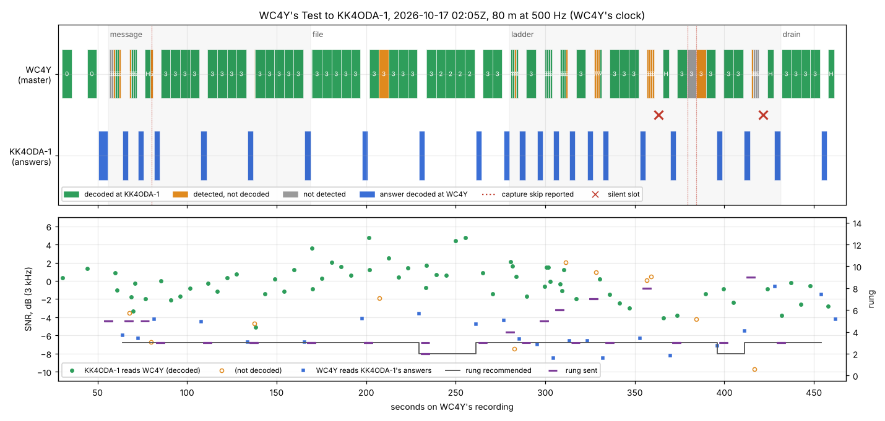
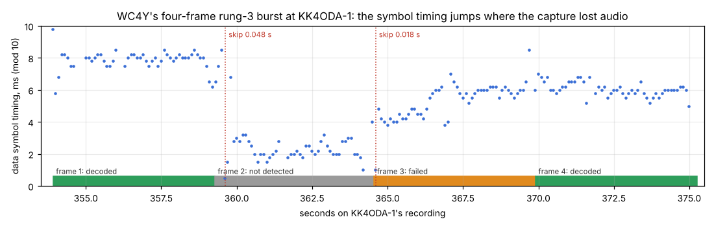
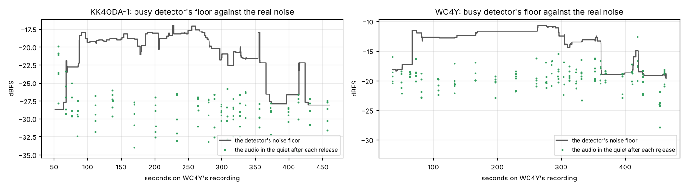

# Step 4, once more on the air: WC4Y's Test of 2026-10-17

Reports [11](11-step-4-first-air.md) and [12](12-two-paths-80m.md) read protocol 8's first four
sessions on the air. This report reads the fifth, WC4Y's Test to KK4ODA-1 on beta.111, the same
way: §1–§11 follow report 12's sections, then the author's two questions, the Morse identifiers
(§12) and the Status tab (§13), and what to change (§14–§15).

* **When and where**: 3.590 MHz, 500 Hz, 2026-10-17 02:05:02Z to 02:12:28Z (22:05 EDT on the
  16th).
* **Who**:
  * **WC4Y** was the master: he ran a Test calling KK4ODA-1. IC-7300 keyed by Icom CI-V on
    COM6, 20 W ("25 W" in his notes), 230 ft EFHW, EM73VU, the US regulatory profile, Extra.
    A 24-core PC.
  * **KK4ODA-1** was the slave: the author's FTDX10, Yaesu CAT on COM6, 50 W, T2D, EM73, the
    mini PC (4 cores). No regulatory profile. A beacon repeating every 15 minutes.
* **Builds**: v0.2.0-beta.111 at both ends (link protocol 8, configuration schema 13). It
  carries everything report 12 led to: ADR-0072 (the disconnect's minute), ADR-0073 (the header
  rule, 500 Hz rung 4 no longer offered), ADR-0074 (the ladder after the file) and ADR-0075 (each
  station's Morse identifier last).
* **The files**: both stations uploaded their side with audio at 02:12Z (`fetch_uploads.py`):
  WC4Y's `20261017-020502_WC4Y_KK4ODA-1_test` and KK4ODA-1's `20261017-020522_KK4ODA-1_WC4Y`,
  with each daemon's log and diagnostic bundle. WC4Y's audio and files are not committed. The
  figures are drawn from KK4ODA-1's audio and from the two sidecars.

## 0. Summary

**What happened.**

* **The Test completed** in 435.4 s of its 600 s: probe, call, a 1024-byte message at 72 bit/s,
  a 1024-byte file at 74 bit/s, the ladder (rungs 4–9), disconnect, and both identifiers.
* **Protocol 8 held again.** The stations never radiated together; the least clear air was
  0.622 s. No forfeit, no late drop. Every answer reached the air 81–111 ms after its slot
  opened, at least 239 ms inside its limit.
* **The path** was about 0 dB both ways in the 3 kHz reference: KK4ODA-1 read WC4Y's data at
  −7 to +5 dB (median −0.2), WC4Y read the answers at −8.5 to −0.6 dB (median −6.3). The link ran at rung 3
  (tone4x100-75) for nearly all of both transfers. That is the 3 → 5 gap of report 12 §18
  again; the bench and the harness put this path where it ran (§11).
* **The two silent slots** were the ladder's rungs 8 and 9, sent without their header.
* **Two frames were lost to KK4ODA-1's own sound card** (§5): its capture skipped audio inside
  two of WC4Y's rung-3 frames at −1 to −4 dB, where that rung decodes 10 dB lower. The skips were
  reported, but only 66 of the 134 ms lost. This is the case report 12 §15.2 said had not yet
  been seen: a loss inside a frame being received, with the report beside it.
* **The Test's leftovers cost a fifth of it** (§10): delivering the ladder's failed 10-byte
  filler took 93 s of 435, more than the ladder's own measurements.

**The author's questions, in short.**

1. **The Morse identifiers ran at exactly the set speed, 20 wpm** (§12). Both keyings match
   PARIS timing at 20 wpm to within 7 ms. 20 wpm is also the most an automatic identifier may run
   under §97.119(b)(1). It sounds slow because KK4ODA-1's callsign is long in Morse: the SSID
   "-1" is a hyphen (−····−) and a 1 (·−−−−), 2.3 s of its 6.3 s. The order was right:
   KK4ODA-1's identifier behind its DISC_ACK, then WC4Y's, about 0.7 s apart.
2. **The plots and indicators** (§13). The counters, SNR, tuning, throughput, receive level and
   the speed chart were all right against the sidecar. Three things were not:
   * **The noise floor was wrong for most of the session**, on both stations: the busy
     detector learned the other station's signal as noise. KK4ODA-1's floor read −18 to
     −22 dBFS against a real −28; WC4Y's −11.7 against a real −19. The channel chart's floor
     and threshold lines, and "Signal above noise", followed it. The chart drew the detector
     faithfully; the detector was wrong.
   * **The Mode tile showed KK4ODA-1's own rung** (1, tone-36), which it never used. WC4Y's
     data was arriving at rung 3. The manual says the tile is "the step the sender is using".
   * **The display well cut the callsign off**: "Connected with …".

**What changed since report 12, measured** (§12, §15):

* **ADR-0075**: both identifiers last, in the right order, 0.7 s apart. Neither recording holds
  them: a recording stops at the session's end, before the identifiers.
* **ADR-0074**: the ladder ran after the file, from under the fastest rung the transfers were
  acknowledged at, and the Test went to its disconnect at the last rung's answer. The message
  and file rates are now the link's own: 72 and 74 bit/s, neither carrying the ladder's
  after-effects.
* **ADR-0073**: the RV 2 copy went with its header and was answered. No headerless
  transmission of RV 1/2 copies, so no certain silent slot.
* **ADR-0072**: exercised. "40 bytes still queued go first, for at most 60 s"; they went in
  26 s and the session closed cleanly.

**What I would change, ranked** (details in §14):

1. *Daemon.* The Test's ladder skips rungs the link never uses (500 Hz rung 4, since
   ADR-0073). About 15 s a Test.
2. *Engine (model first).* A ladder rung whose transmission went unanswered records no SNR. Now
   it records the next poll's: rung 8 is logged "at −4 dB" while its frames arrived at 0 dB.
   `ladders.csv` and `bench_link --replay`'s fits read these.
3. *Daemon.* A frame that a reported capture skip falls inside is not trusted, so it is not
   counted against the path, and its report says why.
4. *Daemon.* The `keying` "late" line and count only for transmissions in a slot. WC4Y's
   probe and call (held 1.8 s for a busy channel) were reported late.
5. *Daemon.* The busy detector never learns a decoded frame's blocks as noise, and does learn
   the quiet after one. The floor, the threshold and the panel's readings stay true in a
   session.
6. *Panel and manual.* The Mode tile and the well's rung show the rung the data moves at;
   the well names the callsign first.
7. *Daemon.* A recording runs on until the station's closing identifier has gone, so the
   identifiers can be checked from both sides.
8. *Daemon.* The Test closes without delivering its own ladder filler. 26 s here.
9. *Protocol rule (R7).* On a transmission pinned above the recommendation, keep the header
   when it would go ordinary (0.43 s). It would have answered both silent slots: about 13 s
   net here.
10. *Protocol, at the next bump.* Ladder frames that the slave counts and never delivers. They
   remove the leftovers altogether: about 93 s here.
11. *The author's decision.* Send the Morse identifier without the SSID ("KK4ODA", 4.0 s).

And on the station: **the mini PC's capture** has skipped 279 times (9.4 s) since 2026-10-16
10:38Z, mostly in the evening hours, and its loop has seen a sleeping thread wake 818 ms late.
That is the machine, not the modem (§5).

## 1. The session and the counters

| | WC4Y's Test, 2026-10-17 02:05Z |
|---|---|
| Test (WC4Y's clock) | 435.4 s, complete |
| probe | answered: 0 dB there, −5.9 dB here (KK4ODA-1 read it at +0.3 dB) |
| call | accepted first try: KK4ODA-1 read it at +1.4 dB |
| message | 1024 B in 113.2 s, 72.4 bit/s: rung 5 for the first 6 frames, then rung 3 |
| file | 1024 B in 111.0 s, 73.8 bit/s: rung 3, one burst at rung 2 |
| ladder | from rung 4: 4 3/4, 5 4/4, 6 3/4, 7 1/4, 8 0/4, 9 0/4; highest passed 6 |
| disconnect | 40 bytes of ladder filler queued; delivered, then DISC at 457.8 s |
| KK4ODA-1 read WC4Y's data at | −6.7 to +4.8 dB (median −0.2) |
| WC4Y read the answers at | −8.5 to −0.6 dB (median −6.3; the last three −1.5 to −0.6) |
| WC4Y: transmissions, data frames sent (resent), re-encoded | 27, 80 (21), 13 |
| WC4Y: headers elided, silent slots | 16, 2 |
| KK4ODA-1: frames recorded, decoded; HARQ rescues | 90, 67; 1 |
| forfeits, dropped late (both) | 0, 0 |

**Which counters belong to which session.** WC4Y's daemon started at 02:03:48Z and ran only
this session, so its counters are the session's (its bundle adds the identifier). KK4ODA-1's
daemon has run since 2026-10-16 10:38Z; its sidecar counters are lifetime. `frames_received` is
0 on WC4Y's sidecar because it counts DATA frames, and a master receives answers.

## 2. One clock for both stations

**Nothing both stations heard**: the band was quiet between the two stations' transmissions,
and the envelope fit found nothing (r 0.09). So the clock comes from the loop latencies
(`two_sides.py --from-loops`), as for report 12's mornings.

| | |
|---|---|
| offset, KK4ODA-1's recording to WC4Y's | +19.702 s at 50 s, +19.869 s at 458 s (the stamps: +19.731 s) |
| loop sum | median 139 ms over 45 changes of hands |
| steps | +17 ms (76–81 s), +9 ms (197–201 s), **+134 ms (370–396 s)** |
| drift | +9 ppm |
| capture skips reported, KK4ODA-1 | 18 ms at 80.2 s; **48 ms at 379.5 s, 18 ms at 384.5 s** |

All three steps are positive: KK4ODA-1's recording fell behind, so KK4ODA-1 lost the audio.
The +134 ms step is §5's. Times below are on WC4Y's recording clock ("s") unless they say
otherwise.

## 3. Safety

*Figure 1.* **Upper**: WC4Y's frames coloured by what KK4ODA-1 made of them, numbered by rung
(H a header or poll); KK4ODA-1's answers coloured by whether WC4Y decoded them; red crosses the
silent slots; red dotted lines the capture skips KK4ODA-1 reported. **Lower**: the SNR each
way, the rung KK4ODA-1 recommended and the rung WC4Y sent.

* **They never radiated together.** `air_account.py --sidecars`: 46 changes of hands, the
  least clear air 0.622 s, radiated overlaps 0.
  * Master to slave the air was clear 0.78–0.81 s; slave to master 0.62–0.67 s.
* **Nobody keyed into the other's deaf time.** Both radios' receive audio was back 0.1 s after
  a release (rx_trace: KK4ODA-1 at the noise, −28 dBFS, from 0.10 s; WC4Y from 0.10 s). The
  other station's RF came at least 0.62 s after any release.
* **What kept it safe.** No forfeit and no late drop. After each answered slot WC4Y keyed
  0.35 s and its handover after the answer's end; after each silent slot, `end_max + heard_by`
  after his own frames (4.6–4.7 s).
* **Only decoded content changed state.** KK4ODA-1 recorded three of WC4Y's OFDM data frames
  as other kinds (rung 12, twice "control"), one ordinary header it could not decode, and five
  ghosts inside WC4Y's tone frames at detection confidence 1.00–1.03. None was acted on. WC4Y
  recorded one, under its own key (`frames_under_own_tx` 1).

## 4. Timing on real hardware

### 4.1 The latency chain

| | WC4Y (IC-7300, 24 cores) | KK4ODA-1 (FTDX10, mini PC) | budget |
|---|---|---|---|
| decode: frame end to report | median 127 ms, max 148 | median 121 ms, max 154 | D = 0.30 s |
| keying command (learned, ADR-0071) | 24–25 ms (CI-V at 9600 Bd) | 0–1 ms (Yaesu, no reply) | (counted) |
| render (learned) | 30–70 ms, typical 50 | 20–80 ms, typical 60 | (counted) |
| handover: key to audio at the card, past the lead | median 79 ms (38–124) | median 78 ms (19–99) | (inside KEY) |
| card's reported output latency | 22 ms | 22 ms | (counted) |
| loop latency (both radios' paths) | median 69 ms (51–75) | median 70 ms (63–91) | (inside D, KEY) |
| receive audio back after a release | about 0.10 s | about 0.10 s | (S4) |
| key lead | 100 ms | 100 ms | (counted) |

* **The radios' paths are about 70 ms each**, as in reports 11 and 12 (66–70 ms).
* **WC4Y's keying command is the first real wait the latency learner has seen**: the IC-7300's
  CI-V reply takes 24–25 ms. It is counted in his engine latency (186–216 ms). KK4ODA-1's Yaesu
  `TX1;` takes nothing, as before.

### 4.2 Slot by slot

Each of KK4ODA-1's 23 answers against the slot WC4Y's transmission granted:

| | this session (beta.111) | report 12 mornings (beta.108) |
|---|---|---|
| on the air after the slot's start | 81–111 ms, median 91 | 84–281 ms, median 95–96 |
| least margin to `not_after` | 239 ms | 69 ms |

No stalled keying this time: the slowest answer was 111 ms late, in the slot of WC4Y's
transmission at 76.31 s.

### 4.3 Do both computers fit inside D, KEY and SLACK?

**Yes**, with at least 0.14 s to spare for D, and at least 239 ms for SLACK. No slow pass at
either station during the session. **The replays reproduce live**: WC4Y's recording 25 of 25
frames decoded, at 0.05× real time; KK4ODA-1's 66 of 67 at 0.08× real time. The one is a rung-4
frame at +0.4 dB that live decoded and the replay did not detect, on other block boundaries:
§8 has why OFDM acquisition sits that close to its edge here.

## 5. Audio KK4ODA-1 lost inside WC4Y's frames

**What happened.** WC4Y's burst at 373.39 s carried four rung-3 frames (tone4x100-75), the
ladder's rung-8 leftovers re-encoded. KK4ODA-1:

| frame (KK4ODA-1's clock) | SNR | what KK4ODA-1 made of it |
|---|---|---|
| 1, 353.91 s | −3.8 dB | decoded |
| 2, 359.27 s | — | **not detected** |
| 3, 364.55 s | −4.2 dB | **detected, not decoded** |
| 4, 369.90 s | −1.4 dB | decoded |

Rung 3's AWGN 10 % point is −13.0 dB: frames 2 and 3 should have decoded with 9 dB to spare.

**Why.** KK4ODA-1's capture reported two skips in exactly those frames: 48 ms at 359.63 s and
18 ms at 364.61 s (its clock). The audio agrees. Along a four-tone frame every 10 ms symbol is
one of four tones; the timing that best concentrates each window's energy on one tone shows
where audio went missing (Figure 2):

* frame 1 holds steady at 8 ms (mod 10);
* at 359.6 s, 0.36 s into frame 2, just after its first sync block, the timing jumps by about
  5.5 ms (mod 10): the 48 ms skip;
* at 364.6 s, in frame 3's first sync block, it jumps again by about 1.7 ms (mod 10): the
  18 ms skip;
* inside frame 3 it then slides another 2 ms over 2.5 s, which no skip report covers;
* frame 4 holds steady at 6 ms.

*Figure 2.* The data symbols' timing (mod 10 ms) along the burst, from KK4ODA-1's audio.

* **Frame 2**: its first sync block was heard before the skip and its middle and end blocks
  48 ms earlier, more than a sync symbol. The detector could not place one frame on all three.
* **Frame 3**: the skip fell inside its first block and its data then slid. Found, its symbols
  read off their grid.
* **The loss in that stretch was 134 ms** (§2's step); the timestamps reported 66 ms of it. The
  rest was lost while KK4ODA-1 transmitted its answer just before the burst, or reported by
  nothing, as in report 12 §4.4.

**What it cost.** A resend burst (399.47 s: the two frames, 10.7 s), its answer and gaps:
about 15 s, 3.5 % of the Test. The answer after the loss recommended rung 2 for one exchange:
the receiver counted the failure as the path's (a trusted tone frame that failed).

**How often.** KK4ODA-1's bundle: 279 capture skips, 9.4 s in all, the largest 388 ms, since
2026-10-16 10:38Z. They cluster in the evening (52 in 22Z, 62 in 23Z, 47 in 01Z) and are rare
by day. The loop logged 12 slow passes, all in capture, and a thread that only sleeps woke up
to 818 ms late: the mini PC itself was busy. WC4Y's 24-core PC reported no skip and no slow
pass.

* **The skips are right when they speak and miss half**, as report 12 found. Handing them to
  `capture_gap` would still be a partial correction, and a receiver cannot re-time a frame in
  the middle anyway.
* **What the daemon can do** is not count such a frame against the path: §14, change 3.
* **What the station can do**: find what loads the mini PC in the evening. One candidate to
  test is the remote desktop session the author drives it through; others are Windows' power
  plan and USB selective suspend, and scheduled scans. A recording with the remote session
  closed would say.

## 6. The silent slots

| | |
|---|---|
| answered | 23 (and the probe's answer and the DISC_ACK, outside KK4ODA-1's recording) |
| silent, header elided (R7), nothing placed the end | 2 |
| silent, nothing heard; header lost | 0; 0 |
| forfeit, answer unheard | 0, 0 |

* **356.81 s: 4 × rung 8**, the ladder's pinned rung. KK4ODA-1 detected all four (−0.9 to
  +0.4 dB) and decoded none (PSK8-2/3 needs +0.5 dB on AWGN, +10 on Moderate).
* **415.12 s: 4 × rung 9**, the ladder's last rung. One detected, one read as a control frame,
  two not detected.
* **Both were headerless RV 0 first copies above the recommendation**, which ADR-0073 still
  allows to go without a header. Report 12 §12.1 found that a floor header on every such
  transmission breaks even. Here the header would have been ordinary (0.43 s), because KK4ODA-1
  read WC4Y at about 0 dB: §14, change 9.
* **Each cost about 8 s**: WC4Y's 4.6 s wait, a floor poll (3.2 s) and its answer, against a
  0.43 s header.

## 7. The probe and the call

* **The probe** went at 02:05:02Z. KK4ODA-1 read it at +0.3 dB and answered; WC4Y read the
  answer at −5.9 dB. WC4Y's first keying of the run was reported "on the air about 114 ms after
  its slot opened": it was the daemon's first keying, before the CI-V wait was learned.
* **The call** was held 1.8 s by WC4Y's `wait_for_clear` (the busy hangover after the probe's
  answer) and went at 43.97 s; KK4ODA-1 read it at +1.4 dB and accepted it first try. It too
  was reported late, "1820 ms after its slot opened". A call has no slot: §14, change 4.
* KK4ODA-1's repeating beacon fell due during the session at 02:10:07Z and was skipped ("the
  station was busy"), as it should be.

## 8. Failed frames, acquisition and the HARQ rescue

**The tone frames** (rung 3 and the control frames): every one decoded, except the two §5 lost
to the capture and one at −1.9 dB (207.3 s) that the next burst resent.

**The OFDM frames** (rungs 4–9): 35 sent. KK4ODA-1

* acquired 28 as what they were (80 %), read 3 as another kind (9 %) and missed 4 (11 %);
* acquired them at confidence 1.08–1.58 times its threshold, at readings of −3.6 to +2.1 dB
  (and one RV 2 copy at −6.7).

That matches the 500 Hz baseline's acquisition on ITU Moderate (`phy_fer_500.csv`, QPSK ½: 22–24
of 30 acquired from −2 to +6 dB, whatever the SNR). At 500 Hz on a fading path, a twelve-carrier
OFDM frame's preamble is lost to a fade one time in five. It is one more reason the controller
was right to stay on rung 3 here (§9), and the case P9-5 and P9-12 are for. The first burst of
the session (a header and six rung-5 frames) lost its header and first two frames this way.

**The HARQ rescue**: the message's first frame, rung 5, failed at RV 0 twice and was rescued by
its RV 2 copy (76.31 s), as designed.

## 9. Rate control

* **The first burst** went at rung 5: the call read +1.4 dB on the floor, and ADR-0066's
  decibels in hand put rung 5 in reach. Of the eleven copies of the message's six rung-5
  frames, KK4ODA-1 decoded five alone; the sixth came by HARQ.
* **KK4ODA-1 recommended rung 3 from its first answer**, and held it but for two answers (rung 2
  after the failure at 207 s, and after §5's loss). Its readings sat at −2 to +2 dB, and its
  learned margin stood at 3 dB at the end of the session.
* **The ladder showed the path could carry rung 5 at times** (4/4 at +1 dB, rung 6 3/4 at 0 dB)
  but rungs 7–9 not. Rung 5 decoded 5 of 11 copies in the message and 4 of 4 in the ladder;
  rung 3 decoded all but one of its 26 transfer copies. With one OFDM frame in five lost to
  acquisition (§8), staying on rung 3 was the safe call, and the bench agrees (§11).
* **This is report 12's 3 → 5 gap**: 107 data bit/s at rung 3 against 167 at rung 5, 7.8 dB
  apart on AWGN. Rung 4 is no longer offered (ADR-0073), so the controller could not step onto
  it, and on this path that cost nothing.

## 10. The Test: where the time went

Accounted on WC4Y's clock from `test.start` to `closed` (435.4 s):

| | seconds | share |
|---|---|---|
| new data: message 76.0 s, file 85.8 s | 161.8 | 37.2 % |
| KK4ODA-1's answers (22 floor frames) | 70.4 | 16.2 % |
| WC4Y's headers (ordinary), polls and DISC (floor) | 15.0 | 3.4 % |
| gaps, master to slave / slave to master | 18.2 / 15.0 | 7.6 % |
| **the protocol's exchange** | **118.6** | **27.2 %** |
| resends of the transfers' frames | 10.7 | 2.5 % |
| silent slots, waiting | 9.7 | 2.2 % |
| the ladder's first copies (24 OFDM frames) | 25.3 | 5.8 % |
| **the ladder's leftovers**, re-encoded at rung 3 (13 frames) | **69.7** | **16.0 %** |
| §5's resend of two of them | 10.7 | 2.5 % |
| probe, call, acceptance | 16.1 | 3.7 % |
| the rest (the probe's wait, the call's hold, the DISC_ACK) | 12.9 | 3.0 % |

Counting the answers and gaps they took (inside the exchange's row), the six leftover batches
occupied about 108 s, a quarter of the Test: about 93 s for the filler itself, 26 s of it in
the disconnect's drain, and 15 s to resend the two frames §5 lost.

**The leftovers are the Test measuring, not the link working.** ADR-0074 re-encodes a pinned
frame at the recommendation after its first copy. Here the recommendation was rung 3, a tone
frame: 5.36 s for each 10-byte filler body, and one family per burst, so the leftovers go alone,
each batch with its own answer. Five batches inside the ladder and one in the drain took more air
than the ladder's own measurements (25 s). §14 ranks three ways out: skip the rungs the link
does not use (change 1), close without delivering the filler (change 8), and, at the next
protocol bump, ladder frames the slave counts and never delivers (change 10).

**The Test's own words.** "ladder from rung 4: the transfers ran at rung 5" says *ran at*; the
rule (ADR-0074) is the fastest rung the transfers were *acknowledged* at. They ran at rung 3.
"Reached" would be right.

## 11. Comparison

**WC4Y's Tests to KK4ODA-1 on 80 m at 500 Hz** (`field/LOG.md`, reports 11–12):

| Test | protocol | message, bit/s | file, bit/s | the ladder |
|---|---|---|---|---|
| 2026-10-10 13:30Z | 7 | 39 | 39 | 0–6 4/4, 7–9 0/4 |
| 2026-10-11 00:57Z | 7 | 45 | 48 | 0–3 4/4, then 2/4, 1/4, 1/4, 0/4 |
| 2026-10-11 15:52Z | 7 | 58 | 67 | 2–5 4/4, 6 3/4, 7–9 0/4 |
| 2026-10-14 23:59Z | 8 | 47 | 52 | 2–3 4/4, 4–8 1–3/4, 9–10 0/4 |
| **2026-10-17 02:05Z** | **8** | **72** | **74** | 4 3/4, 5 4/4, 6 3/4, 7 1/4, 8–9 0/4 |

**The link bench's prediction** (`bench_link --replay --engine granted`, five trials):

* from WC4Y's sidecar (the answers' SNR, penalty +2.75 dB): 54–71 bit/s (protocol 7: 77);
* from KK4ODA-1's (the data direction, penalty +2.25 dB): 72–82 bit/s (protocol 7: 81–87);
* measured: 72 and 74 bit/s, inside the bench's spread.

**The harness**: `80m-floor-top-start-500`, made from WC4Y's path of 2026-10-11, reads message
62.6 bit/s (62.6–73.9), file 84.1 (82.6–84.1), 410 s of air (360–492), highest rung 6. The
message and the air time fall inside; the file about 11 % under its range. The harness has no
capture losses, and no fifth of its OFDM frames lost to acquisition.

**It cannot separate protocol from path.** Five evenings on 80 m, and since ADR-0074 the file
no longer carries the ladder's leftovers, so the last row's file is not comparable with the
first four's.

## 12. The Morse identifiers (the author's question)

**Both went out at exactly 20 wpm.** Identifier audio is PARIS timing (`cwid.rs`): a dit of
1.2/wpm s, 60 ms at 20 wpm; a dah three dits; one dit inside a character, three between
characters. Neither recording holds the identifiers (each stops at the session's end), so they
are timed from each station's key and release in its log:

| | keyed | released | held | what it holds | at 20 wpm |
|---|---|---|---|---|---|
| KK4ODA-1 | 02:12:14.395 | 02:12:24.222 | 9.827 s | lead 0.1 + DISC_ACK 3.2 + gap 0.1 + "KK4ODA-1" + tail 0.102 + card 0.022 | "KK4ODA-1" = 105 dits = 6.30 s: 9.824 s |
| WC4Y | 02:12:24.744 | 02:12:28.155 | 3.411 s | lead 0.1 + "WC4Y" + tail 0.102 + card 0.022 | "WC4Y" = 53 dits = 3.18 s: 3.404 s |

* Measured and computed agree within 3 and 7 ms. A speed one wpm off would move KK4ODA-1's by
  0.3 s.
* The settings: KK4ODA-1's `cw_id_wpm` is 20 and it has no regulatory profile; WC4Y's is 20 and
  his US profile caps it at 20 (`max_wpm`). `status.identifier.sent_wpm` is 20 at both.
* **20 wpm is the ceiling, not a choice.** §97.119(b)(1): "When keyed by an automatic device
  used only for identification, the speed must not exceed 20 words per minute."
* **Why it sounds slow.** Callsigns are long in Morse. "PARIS" is 50 dits a word with its
  space; "KK4ODA-1" is 105, so at 20 wpm it runs at 76 characters a minute against a word's 100.
  The SSID costs most: the hyphen (−····−, 15 dits) and the 1 (·−−−−, 17), 2.3 s of the 6.3 s.
  The hyphen is rarely heard on the air. "KK4ODA" alone is 67 dits, 4.0 s, and is the assigned
  callsign §97.119 asks for (§14, change 11, for the author's decision).

**The order was ADR-0075's.** WC4Y sent the DISC at 457.8 s; KK4ODA-1 answered with its
DISC_ACK and its identifier behind it, in the slot every DISC grants; WC4Y's identifier came
after KK4ODA-1's declared identifier time. Between the end of KK4ODA-1's identifier on the air
and the start of WC4Y's: about 0.7 s (the two computers' clocks agree within about 30 ms, from
the recordings' start stamps against the loops' offset).

**What WC4Y's busy detector made of KK4ODA-1's identifier**: busy until 02:12:20.5 (the
DISC_ACK, then the identifier's first characters by level), busy by shape 20.8–21.7, then clear
until it ended at about 24.2. A keyed tone 5 dB over the passband's noise is under the level
margin, and the hyphen's dits break the shape windows. WC4Y keyed by his timer, not his ear, so
nothing came of it; a third station's channel reserve (4 s of quiet, ADR-0075) still covered
the identifiers.

## 13. The Status tab (the author's screenshot)

The screenshot is KK4ODA-1's panel at session time 5:19, about 02:11:12Z (349.5 s on its
recording), just before its answer to WC4Y's poll after the rung-8 silent slot.

### 13.1 Every reading, checked against the sidecar

| reading | shown | from the data | verdict |
|---|---|---|---|
| Counters: frames received, failed, HARQ, bytes delivered, transmissions | 51, 11, 1, 2208, 34 | the final 59, 13, 1, 2288, 39 less what came after 349.5 s (8 frames, 2 failures, 80 bytes, 5 keyings) | right |
| SNR, "they hear you at" | −4.1 dB, −6.0 dB | the poll read −4.1 dB; WC4Y read the last answer at −6.3 dB, sent in whole decibels | right |
| Throughput, ↑ ↓ | 11 bit/s, ↑ 0 B ↓ 2.2 kB | 40 bytes delivered in the 30 s window (the rung-7 leftovers); 2208 bytes in all | right |
| Session | 5:19 with WC4Y | from the acceptance at 02:05:52Z | right |
| Tuning | −2 Hz, on frequency | every frame −1.4 to −2.5 Hz | right |
| Receive level | −22 dBFS, peak −13 | the sound card's meter over its window, the poll in it | right |
| Signal above noise | 1.0 dB, floor −27.5 dBFS | the quiet before the answer; the floor had just come back during the silent slot | right at that moment; see 13.2 |
| **Mode** | **1, tone-36 (floor), 54 bit/s** | WC4Y's data arriving at **rung 3** (tone4x100-75, 112 bit/s) | **wrong against the manual** |
| Speed chart, "receiving at" | rung 5, then rung 3, a step to rungs 5–7, back to 3 | the rungs of the data KK4ODA-1 decoded | right |
| Speed chart, goodput | about 100 bit/s, a dip, about 120, falling to 10 | in-order delivery: the dip is the frame lost at 207 s holding back the three after it until its resend | right |
| Speed chart, "sending at" | nothing drawn | KK4ODA-1 sent no data | right |
| **Channel chart, noise floor and busy threshold** | about −21 and −15 dBFS for most of the two minutes | the busy detector's floor, as it stood | **drawn right; the floor itself wrong** |
| **Display well** | "Connected with …" | WC4Y | **cut off** |

### 13.2 The noise floor learned the other station

*Figure 3.* Each station's busy-detector floor (the line) against the audio level in the quiet
just after each of its releases (the dots), on WC4Y's clock.

* **KK4ODA-1**: −28.7 dBFS when the session began, −18 to −19 within 45 s, about −18 to −22 for
  the rest, back to −27.7 only in the rung-8 silent slot's quiet and at the end. The quiet after
  each release read −27 to −32 dBFS throughout: that is the noise.
* **WC4Y**: −18.1 dBFS at the start, −11.7 to −12.8 through the session, against −19 to −22 in
  his quiet. His floor became KK4ODA-1's answers.

**Why** (`busy.rs`): a block is floor evidence when it is steady, not busy, not over the
threshold and not in a peaked window. A weak Aether signal is all four for most of a frame:

* a tone frame has a constant envelope, so it is steady;
* at about 0 dB in 3 kHz, a 500 Hz signal lifts the whole passband's power by only 3 dB, under
  the 6 dB margin;
* a decoded frame marks the channel busy only from its decode, for a 2 s hold, so most of its
  own 5.36 s went in as evidence before it was decoded;
* once the floor has risen, the shape path's peak test against the floor
  (`SHAPE_PEAK_FLOOR_MARGIN_DB`, the first 10-mile test's fix) fails too, and more of the signal
  goes in. It feeds itself.

And the quiet that would pull it back down is excluded: after a decoded frame the hold marks the
channel busy, so the gap before this station's answer is not evidence either.

**What it does.** In a session nothing waits on the busy detector but calls and probes, so the
link was not hurt. But for the minutes after a session the level path is up to 10 dB blind, a
third station's reserve rests on it, and the panel draws signal as noise: the floor and
threshold lines, and "Signal above noise", which read signal over signal.

**The fix** (§14, change 5): a decoded frame's own span never counts as noise, back to its
start; the quiet after it does, the hold notwithstanding, so long as it is steady and under the
threshold. The hold stays what it is for: keeping a busy channel busy.

### 13.3 The other two

* **The Mode tile** (and the well's rung, hidden at this width) shows `metrics.mode`, the rung
  the *other* station recommends for *this* one's data. KK4ODA-1 sent no data. The manual calls
  it "the step the sender is using, with its name and rate on the air". Since beta.109 the speed
  chart draws `sending_rung` and `receiving_rung` (report 12, change 5); the tile should read
  the same: the receiving rung while only receiving, the sending rung while only sending, both
  when both.
* **The display well** shortens "Connected with WC4Y" to "Connected with …" at 994 px: the
  dial, the SNR and the lamps take the room. The callsign is the part worth keeping; the state
  is already in its colour and in the banner. "WC4Y · connected", or the callsign alone with the
  state in the tooltip, survives.

### 13.4 Smaller

* **"Signal above noise" and "Receive level"** sit side by side and measure different windows
  (the detector's last block, the meter's longer window): 1.0 dB over −27.5 is −26.5 dBFS beside
  −22. Both were right. A word in each tooltip on what window it reads would stop the doubt.
* **The speed chart** draws "no session" as a line on its 10 bit/s floor (the left half of the
  screenshot). A gap would say "nothing to measure" rather than "10 bit/s".

## 14. What the session means for the specification, and what to change

**Assumptions S1–S7** ([04-formal-spec.md](04-formal-spec.md)):

* **S1, S3, S5** (fixed air times; both ends place a frame's end within GUARD; no transmission
  outlasts its frames): held for every transmission. The capture losses changed what KK4ODA-1
  *heard* of WC4Y's frames, not where they were on the air.
* **S2** (radiation within slack): held, by at least 239 ms.
* **S4**: held, with more than 0.5 s to spare.
* **S6** (decodes within D): at most 154 ms.
* **S7** (loss runs finite): no two silent slots in a row.

**Rules R1–R12 all did what they say.** R7's elision cost the two silent slots, at the ladder's
pinned rungs, as in reports 11 and 12.

**Changes, ranked by what each costs against what it buys.** None is made yet.

| # | change | kind | cost | what it buys |
|---|---|---|---|---|
| 1 | The Test's ladder climbs only the rungs `usable_modes` offers: at 500 Hz it skips rung 4 | daemon (`fieldtest.rs`) | tiny | Rung 4 and its leftover: about 15 s here, a rung's measurement the link can never use |
| 2 | A ladder rung whose transmission went unanswered (a silent slot) records no SNR rather than the next poll's | engine, model first | small | `ladders.csv` and `bench_link --replay`'s penalty fits read the rung's own SNR or none: here rung 8 is "−4 dB" for frames at 0 dB |
| 3 | A frame a reported capture skip falls inside is not trusted (no failure for the rate controller) and its frame report says "capture skip" | daemon | small | §5's loss read as the path's, and stepped the recommendation down one exchange |
| 4 | The `keying` "late" line and count only for a transmission in a slot: not a call or probe, which have none and may be held for a busy channel | daemon | tiny | WC4Y's two false reports (bundle `keying.late` 2) |
| 5 | The busy detector: a decoded frame's span, back to its start, is never floor evidence; the steady quiet after a frame is, through the frame's hold | daemon (`busy.rs`), with tests; judge on recordings and the harness | medium | The floor, the threshold and the panel stay true in a session; the level path is not blinded for minutes after one |
| 6 | The Mode tile and the well's rung show the rung the data moves at; the well names the callsign first | panel and manual | small | The tile matches the manual; the callsign survives a narrow window |
| 7 | A recording runs on until the station's closing identifier has gone (at most about 20 s) | daemon | small | ADR-0075's identifiers can be checked from both sides on the air |
| 8 | The Test closes without delivering its own ladder filler (its disconnect drains nothing) | daemon (`fieldtest.rs`) | small | 26 s here (6 %); the other station reports "the last 4 frames not received", which for a Test is true and harmless |
| 9 | R7 keeps the header on a transmission pinned above the recommendation when the header would go ordinary | protocol rule, model first; judge on the harness's Test scenarios | small | Both silent slots answered: about 16 s saved for 2.6 s of headers here |
| 10 | Ladder frames of their own kind, counted in the answer and never delivered | protocol, at the next bump | medium | The leftovers gone: about 93 s here (21 %) |
| 11 | The Morse identifier sends the callsign without its SSID (`-1`, `-T`, `-R`); a `/` designator stays | daemon; the author's decision | tiny | KK4ODA-1's identifier 4.0 s instead of 6.3 s, in the form §97.119 names |

**Owed:**

* **The mini PC's evening capture losses**: a session with the remote desktop closed, and the
  power plan and USB selective suspend checked. A recording with `[record] tx_audio = true`
  would also show whether its playback stalls with them.
* **More sessions before the constants freeze.** Nothing here asks for a change to D, KEY or
  SLACK.

## 15. What changed since report 12, on the air

* **ADR-0072, the disconnect's minute**: the first time it ran on the air. At the ladder's end
  WC4Y logged "40 bytes still queued go first, for at most 60 s; Abort closes at once"; the 40
  bytes went in one burst and the DISC followed 26.3 s after the request.
* **ADR-0073, the header rule**: the one transmission of RV 2 copies (76.31 s) carried its floor
  header and was answered. Rung 4 was no longer offered to the controller: it recommended 3,
  then 2, never 4. The ladder still pinned rung 4 (change 1).
* **ADR-0074, the Test's order**: message, file, then the ladder from rung 4, then the
  disconnect at the last rung's answer. Thirteen pinned frames were re-encoded at rung 3 after
  their first copy, none sent twice at a rung that had failed. What it did not remove is §10's
  leftovers.
* **ADR-0075, the identifiers**: §12.
* **ADR-0071, the keying latency**: WC4Y's CI-V command, 24–25 ms, is the first keying wait
  learned on the air that is not zero. Answers came a median 91 ms after their slots' starts
  (report 12: 95–96).
