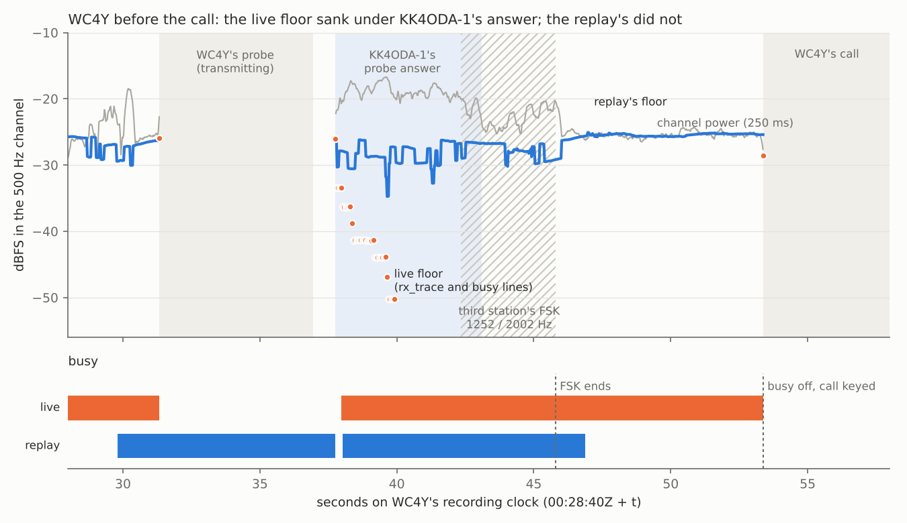
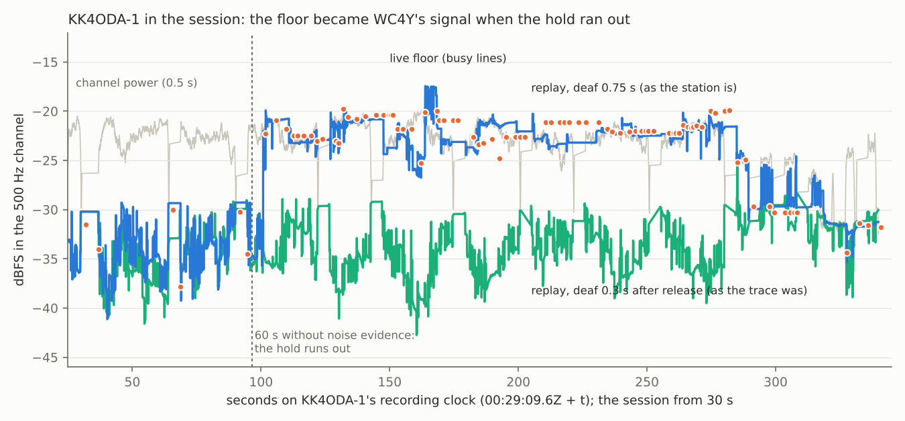

# Step 4 on the air again: WC4Y's Test of 2026-10-21

Reports [11](11-step-4-first-air.md), [12](12-two-paths-80m.md) and
[13](13-wc4y-beta111.md) read protocol 8's first sessions on the air. This report reads WC4Y's
Test to KK4ODA-1 on beta.118 the same way: §1–§6 follow report 13's sections, §7 is the busy
detector, which misbehaved at both ends, then §8–§13 as before, and what to change (§14–§15).

* **When and where**: 3.590 MHz, 500 Hz, 2026-10-22 00:29:10Z to 00:35:01Z (20:29 EDT on the
  21st).
* **Who**:
  * **WC4Y** was the master: he ran a Test calling KK4ODA-1. IC-7300 keyed by Icom CI-V on
    COM6, 20–25 W, 230 ft EFHW, EM73VU. A 24-core PC.
  * **KK4ODA-1** was the slave: the author's FTDX10, Yaesu CAT, 50 W, T2D, EM73, the mini PC
    (4 cores).
* **Builds**: v0.2.0-beta.118 at both ends (link protocol 10). Since report 13 it carries
  ADR-0076 (the Test pays only for what it measures), ADR-0077 (the ladder's own measurement
  frames), ADR-0078 (the busy floor follows the radio's gain), ADR-0080 and ADR-0081
  (tone4x100-93 at the 500 Hz rung 4) and ADR-0082 to ADR-0085.
* **The files**: both stations uploaded their side with audio at 00:35Z (`fetch_uploads.py`):
  WC4Y's `20261022-002910_WC4Y_KK4ODA-1_test` and KK4ODA-1's `20261022-002939_KK4ODA-1_WC4Y`,
  with each daemon's log and diagnostic bundle. The audio and files are not committed.

## 0. Summary

**What happened.**

* **The Test completed** in 342.8 s of its 600 s: probe, call, a 1024-byte message at
  74 bit/s, a 1024-byte file at 104 bit/s, the ladder (rungs 3–9), disconnect, and both
  identifiers.
* **The granted slots held again.** The stations never radiated together. The least clear air was
  0.643 s. No forfeit, no late drop. Every answer reached the air 87–132 ms after its slot
  opened, at least 218 ms inside its limit.
* **The path** was lopsided as on 10-17: KK4ODA-1 read WC4Y's data at −5.8 to +3.7 dB (median
  −0.6), WC4Y read the answers at −11.1 to −1.0 dB (median −6.7). Both transfers ran at rung 4,
  tone4x100-93, the rung ADR-0081 added. The file's 104 bit/s is 1.41 times report 13's 74.
* **The two silent slots** were the ladder's rung 9, in a fade of about 10 dB. Its header was
  sent (ADR-0076) and misread; the next poll, an ordinary header, was lost too.
* **KK4ODA-1's sound card lost 56 ms inside one of WC4Y's frames**, and the frame was never
  detected (§5). Put back as silence where the card's timestamps said, the replay finds the
  frame and decodes it. The same two skips moved KK4ODA-1's clock against WC4Y's by the amount
  lost. That is the two-sided proof ADR-0071 asked for before acting on the skips.

**The busy detector misbehaved at both ends** (§7).

* **KK4ODA-1's noise floor sat at WC4Y's signal level** for most of the session: −20 to −25
  dBFS against a noise of about −31. That is report 13's §13.2 again, which ADR-0076 was meant
  to fix. It did fix what it was aimed at. This is another path: in a session the window holds
  no noise for 60 s, the hold runs out, and the floor becomes the median of every block, the
  frames the receiver explained included.
* **The busy trace could not show this.** It assumed a station is deaf for 0.3 s after its
  release; the station is deaf for 0.75 s. Fixed with this report. With it, the trace of
  KK4ODA-1's recording reproduces the live floor to within 2 dB and 0.1 s.
* **WC4Y waited 10.2 s for a clear channel** between the probe's answer and his call. About
  3 s of it was a third station's FSK on the channel's lower edge. The other 7.6 s his
  detector held busy on a floor 3 dB under the noise; the same audio through the same detector
  clears 1 s after the FSK. His live floor sank to −50 dBFS during KK4ODA-1's answer, where
  the replay draws it at about −28. The cause is state the daemon carried into the recording, which
  the sidecar does not hold. Not explained.

**What I would change, ranked** (details in §14):

1. *Daemon, a bug.* When the floor's hold runs out, do not take the floor while the window is
   mostly frames the receiver explained. Tried on this recording, it keeps KK4ODA-1's floor at
   the noise all session. The panel's help already says "Frames the modem finds never count as
   noise".
2. *Daemon.* Put a capture skip back as silence where the capture timestamps say it fell.
   Here that recovers the lost frame.
3. *Recording.* Write the busy detector's state when a recording starts, and its readings all
   through, and let `--busy-trace` start from that state. Without it, WC4Y's 7.6 s stays
   unexplained.
4. *Daemon.* The gain reference relearns the radio's levels on quiet when the dial moves, and
   neither it nor the first floor learns from the capture's first second. WC4Y's daemon begins
   busy at every start, for a minute when it runs that long.
5. *Panel help and manual.* "Signal above noise" is measured in Aether's channel, "Receive
   level" across the radio's whole passband. Say so.
6. *Engine, harness first.* After one silent slot, the next header on the floor (now after
   two). A few seconds here.
7. *The author's call.* The ladder starts at the rung the transfers ran at, not one under.
   29 s here.

**Fixed with this report**: `aetherd --busy-trace` takes the live station's deafness after a
release (0.75 s, from the same two constants the station uses) instead of 0.3 s. Nothing in the
corpus changes: its clips have no sidecar, so nothing is muted.

## 1. The session and the counters

| | WC4Y's Test, 2026-10-22 00:29Z |
|---|---|
| Test (WC4Y's clock) | 342.8 s, complete |
| probe | answered: +1.0 dB there (KK4ODA-1 read it at +1.4), −5.6 dB here |
| call | accepted first try: KK4ODA-1 read it at −1.1 dB; WC4Y read the acceptance at −4.4 |
| message | 1024 B in 110.6 s, 74 bit/s: rung 4 throughout, 17 frames sent for 12 |
| file | 1024 B in 78.8 s, 104 bit/s: rung 4, 12 frames, none lost |
| ladder | from rung 3: 3 4/4, 4 4/4, 5 3/4, 6 1/4, 7 0/4, 9 0/4; highest passed 5 |
| disconnect | at the last rung's answer, nothing queued; closed 8.3 s later |
| KK4ODA-1 read WC4Y's data at | −5.8 to +3.7 dB (median −0.6) |
| WC4Y read the answers at | −11.1 to −1.0 dB (median −6.7), every one on the floor |
| WC4Y: transmissions, data frames sent (resent), re-encoded | 19, 53 (5), 0 |
| WC4Y: headers elided, silent slots | 4, 2 |
| KK4ODA-1: frames recorded, decoded | 69, 45 (the replay: 45) |
| forfeits, dropped late (both) | 0, 0 |

**Which counters belong to which session.** WC4Y's daemon started at 00:28:10Z and ran only
this session. KK4ODA-1's has run since 2026-10-21 16:53Z; its sidecar counters are lifetime.

## 2. One clock for both stations

**Something both stations heard**: a third station, before the call and right after the
probe's answer (§7.1). The envelope fit found it (r 0.23 over 0–90 s).

| | |
|---|---|
| offset, KK4ODA-1's recording to WC4Y's | +29.153 s from the shared signal; the loops: +29.156 s at 60 s, +29.269 s at 365 s |
| loop sum | median 144 ms over 27 changes of hands |
| steps | **+74 ms between 93.6 and 119.6 s** |
| drift | +140 ppm (KK4ODA-1 against WC4Y) |
| capture skips reported, KK4ODA-1 | 28 ms at 103.1 s, 28 ms at 104.7 s, 18 ms at 174.6 s |

The step is positive: KK4ODA-1's recording fell behind, so KK4ODA-1 lost the audio. §5 has it.
Times below are on WC4Y's recording clock ("s") unless they say otherwise. WC4Y's clock is
00:28:40.3Z + t; KK4ODA-1's is 00:29:09.6Z + t.

## 3. Safety

* **They never radiated together.** `air_account.py --sidecars`: 29 changes of hands, the
  least clear air 0.643 s, radiated overlaps 0.
  * On the fixed clock of §2, master to slave the air was clear 0.80–0.95 s (1.4 s twice at
    the end, after floor frames); slave to master 0.53–0.64 s.
* **What kept it safe.** No forfeit and no late drop at either end.
* **Only decoded content changed state.** KK4ODA-1 recorded four ghosts inside or beside
  WC4Y's tone frames (OFDM detections at confidence 1.005–1.03, three read as data at rungs 13
  and 14, one as a control frame) and two headers it read as data frames (§6). None was acted
  on.

## 4. Timing on real hardware

### 4.1 The latency chain

| | WC4Y (IC-7300, 24 cores) | KK4ODA-1 (FTDX10, mini PC) | budget |
|---|---|---|---|
| decode: frame end to report | median 124 ms, max 154 | median 129 ms, max 158 | D = 0.30 s |
| keying command (learned) | 24–26 ms (CI-V) | 0–3 ms (Yaesu) | (counted) |
| render (learned) | 0–80 ms, typical 40 | 50–60 ms, typical 60 | (counted) |
| engine latency (lead, card, key, render) | 186 ms | 183 ms | (counted) |
| handover: key to audio at the card, past the lead | median 79 ms (38–120) | median 39 ms (19–88) | (inside KEY) |
| card's reported output latency | 22 ms | 22 ms | (counted) |
| loop latency (both radios' paths) | median 71 ms (66–83) | median 72 ms | (inside D, KEY) |
| key lead | 100 ms | 100 ms | (counted) |

The radios' paths are about 70 ms each, as in every report since 11.

### 4.2 Slot by slot

Each of KK4ODA-1's 15 answers against the slot WC4Y's transmission granted, on the loops'
clock:

| | this session (beta.118) | report 13 (beta.111) |
|---|---|---|
| on the air after the slot's start | 87–132 ms, median 101 | 81–111 ms, median 91 |
| least margin to `not_after` | 218 ms | 239 ms |

**On a fixed clock the answers drift late**, from 97 to 245 ms. That is KK4ODA-1's recording
clock losing the 74 ms of §5 and the 140 ppm, not the answers: measured against WC4Y's
transmission each time, they stay at 87–132 ms. The keying gate judges the slot on the card's
playback clock, which the capture's losses do not move (ADR-0069 Step 3).

### 4.3 Do both computers fit inside D, KEY and SLACK?

**Yes**, with 0.14 s to spare for D and 218 ms for SLACK. **The replays reproduce live**:
WC4Y's recording 16 of 16 frames decoded, at 0.04× real time; KK4ODA-1's 45 of 45, at 0.06×.

## 5. The audio KK4ODA-1 lost, put back

KK4ODA-1's capture reported two 28 ms skips at 73.86 and 75.49 s on its own clock (103.1 and
104.7 s on WC4Y's). They fell at the start and inside the second frame of WC4Y's second message
transmission, a rung-4 frame at about −3.5 dB. KK4ODA-1 never detected that frame.

**The two sides agree the audio was lost.**

* The loops' offset stepped by +74 ms between 93.6 and 119.6 s. The skips account for 56 ms
  and the drift for 4 ms. The other 14 ms went unreported: the report counts only a jump of
  10 ms or more in one callback.
* The next frame landed 62 ms early on KK4ODA-1's clock: frame 3 began at 79.205 s, where
  frame 1's end and one frame's length put it at 79.267 s.

**Putting the silence back recovers the frame.** I inserted 28 ms of zeros into KK4ODA-1's
recording at each skip and replayed it with `aetherd --replay`:

| silence inserted (KK4ODA-1's clock) | frame 2 |
|---|---|
| none (as recorded) | not detected |
| 75.49 only | not detected |
| 73.85, and 75.22–75.43 | detected at −3.5 dB, failed |
| 73.70–73.88, and 75.46 or 75.49 | **decoded, 93 bytes** |
| 73.85, and 75.52 | detected, failed |

Nothing else in the replay changed. The first gap may sit anywhere in the 180 ms tested before
the frame's start. The second must sit at 75.46–75.49 s, just before where the skip was
reported; 30 ms either side fails.
The capture callback knows the place exactly: the gap lies just before the first sample of the
callback whose timestamp jumped. Padding there keeps the symbol timing, so a tone frame's sync
blocks stay where its first one says they are, and LDPC carries the 28 ms of missing symbols.

This is the case ADR-0071 left open. It made the skips a report only "until a two-sided
recording shows the skips mark real losses". This one does, and shows that padding recovers
what the loss broke (§14, change 2).

**The machine.** KK4ODA-1's capture has skipped 77 times (2.9 s, the largest 148 ms) since
16:53Z, 49 of them in the 95 minutes before 00:35Z, evening-heavy as before. Its slowest pass
was 504 ms, in capture. WC4Y's capture reported none.

## 6. The silent slots

Both were rung 9 of the ladder, at 341.8 and 351.3 s, in a fade. KK4ODA-1 read control frames
at +0.7 dB at 332.4 s, −6.1, −8.5 and −9.5 dB over the next 25 s, and −3.6 dB at 364.8 s.

1. **341.8 s**: an ordinary header and four rung-9 measurement frames. The header was sent, as
   ADR-0076 requires above the recommendation. KK4ODA-1 read it as a data frame at rung 8 at
   −6.1 dB, failed. Its first rung-9 frame was not detected; the other three failed at −1.3 to
   −3.5 dB, under rung 9's +9.5 dB. No grant decoded, so no answer.
2. **351.3 s**: a lone ordinary header, the poll for the measurement's report. KK4ODA-1 read
   it as a rung-7 data frame at −8.5 dB, failed. No grant.
3. **356.3 s**: after two silent slots in a row the header went on the floor. KK4ODA-1 decoded
   it at −9.5 dB and answered.

**Rung 9 cost 23.1 s**, against 9.3 s for each of rungs 5–7. A floor header after the first
silent slot would have been read (the third one was, 5 s later, 1 dB weaker). §14 change 6.

## 7. The busy detector

### 7.1 WC4Y: ten seconds between the probe's answer and the call

*Figure 1.* WC4Y's channel power and floor from 28 to 58 s. Orange points: the live floor (the
`rx_trace` after his probe's release, and the busy lines). Blue: the replay's floor, the same
audio through the same detector from the recording's start. Lower panel: when each read busy.
The replay also reads busy over WC4Y's probe, by shape on the third station's first signal at
29.8 s; the live daemon, busy since it started, went clear at 31.33 s and keyed the probe.

The Test decided the call at 43.22 s, when KK4ODA-1's answer decoded. A call waits for a clear
channel, and the call went at 53.38 s.

* **A third station.** From 42.35 to 45.80 s both stations heard an FSK signal: two tones,
  1252 and 2002 Hz on WC4Y's dial (1250 and 2000 on KK4ODA-1's), switching every 50–150 ms,
  20–30 dB over the noise. One tone is on the 500 Hz channel's lower edge. The radio's AGC took
  the noise down 3 dB while it was on. It began 0.75 s before KK4ODA-1's answer ended, and
  reading busy for it was right. Both also heard wider signals across 1300–2800 Hz at 28.5–30.0
  and 37.0–38.0 s.
* **Then 7.6 s more.** WC4Y's detector held busy until 53.38 s. It went off "with the energy
  under the threshold" at a floor of −28.6 dBFS. The channel's noise was −25.3. A floor 3 dB
  low leaves the threshold 3 dB over the noise, and the noise's own swings keep re-arming it.
* **The replay clears at 46.9 s**, a second after the FSK, at a floor of −25.6.
* **Where they part.** After WC4Y's probe the live floor fell from −26.0 to −50.2 dBFS in two
  seconds while KK4ODA-1's answer was on the air. The replay drew it mostly at −27 to −30. The
  floor is drawn at the gain the reference reads (ADR-0078), so the live reference read a cut of
  about 24 dB where this audio, read by a reference that learned from it, shows 2 to 8 dB.

**Why the live reference read 24 dB: not established.** What is known:

* WC4Y's daemon started at 00:28:10Z, 30 s before the recording. Its first floor was −40.8
  dBFS (the band's is −26), and it read busy for its first 61 s, until the hold ran out at
  30.4 s. Each of the four starts in his uploads began busy, at first floors of −51.1, −57.2,
  −40.8 and −26.5 dBFS. The two that ran past a minute stayed busy for 61 s.
* The gain reference learns the radio's levels on quiet in its first two seconds. The operator
  set the dial to 3.590 MHz 20 s after the start. Nothing corrected the levels while the
  channel read busy. The hold's end at 30.4 s moved every level by one number, a second after
  a third station's signal.
* I rebuilt the start several ways: a quiet first quarter second, an old frequency 8 or 14 dB
  quieter or 6 dB louder, the other radio's noise. None reproduces the −50 dBFS or the 7.6 s.

So the cause is state the daemon carried into the recording. The sidecar holds the
detector's readings only for 3 s after each release (`rx_trace`), and none of its state. Change
3 is the instrument that would settle it; change 4 is what the start-up evidence already
supports. The call lost 7.6 s. On a band with traffic the same state would cost a call or a
beacon each time.

### 7.2 KK4ODA-1: the floor became WC4Y's signal

*Figure 2.* KK4ODA-1's floor during the session. Orange points: the live floor (every busy
line). Green: the replay as the trace was, deaf 0.3 s after each release. Blue: the replay deaf
0.75 s, as the station is. Grey: the channel's power.

KK4ODA-1's busy lines show a floor of −38 to −30 dBFS before 96 s of its clock, then −20 to
−25 until the ladder's short OFDM frames at about 285 s. The channel's noise was about −31.
The panel's floor, threshold and "Signal above noise" followed it, as on 10-17.

**How.** A slave in a session hears noise only in the gaps, and none of them counted:

* after its own answers, 0.53–0.64 s until WC4Y keyed, all inside the 0.75 s the detector is
  deaf after a release;
* after WC4Y's transmissions, 0.80–0.95 s until its own answer, all inside the 0.75 s
  hangover of the busy-by-level his transmission caused, plus the 200 ms a block needs to be
  steady.

So from 36.6 s on its clock (just after the call) the window held no block it could call
noise. ADR-0076 keeps frames' blocks out of the evidence, so the floor held, as designed. Then,
60 s on, the hold ran out (96.6 s). At that point the detector takes "the median of every
block, silence excepted":
a signal that never stops is the environment. Every block in the window was a frame of WC4Y's.
The floor became his signal, the energy fell under the threshold, and the channel read clear
5 s later at 101.7 s. After that, his steady tone frames sat at the floor and some passed as
noise themselves.

**The trace now reproduces it.** `aetherd --busy-trace` muted a station for 0.3 s after each
release; the station mutes its detector for the card's latency plus the capture's allowance,
0.75 s, and every sidecar's `tx_end` says so. The extra 0.45 s of each gap gave the old trace
noise evidence the station never had, and its longest stretch without evidence was 57.7 s:
never quite the hold. With the station's 0.75 s, the trace goes clear at 101.8 s at −20.3 dBFS
(live: 101.7 s, −22.3), and its session median is −22.6 (live −22.0). Fixed with this report:
the trace takes its deafness from the station's constants.

**What it costs.** Inside a session nothing: the slots do not wait for a clear channel. The
panel's readings are wrong for most of every long session, and the help text says they are not.
After a session the floor needs evidence to come down. KK4ODA-1's came down during the ladder.

**What would fix it, tried on this recording.** The trace explains a frame only when the sidecar
reports it, at its decode; the live station explains it at its announcement, about half a
second in. The sidecar's `preamble` events record each announcement, so for these runs I added
the 53 heeded ones as explained spans. Then, in a scratch build:

| the hold's end takes | KK4ODA-1's floor, 100–285 s (median, p10–p90) | clear at 101.8 s? |
|---|---|---|
| every block but silence (beta.118) | −22.3 dBFS (−23.7 to −20.9) | yes |
| every block outside explained frames | −24.8 (−35.2 to −21.2) | no; the floor rises at 111.2 s |
| nothing, while half the window or more is explained frames | **−34.6 (−37.5 to −26.3)** | no |

The plain filter is not enough. When the hold has run out it is taken again every block, and
the first half second of each new tone frame comes before its announcement: those blocks pass
the filter and set the floor. The second rule holds the floor through the session. Its median
sits under the noise's −31 dBFS because it is drawn at the gain of the moment, and WC4Y's signal
holds the FTDX10's AGC down a few decibels (ADR-0078). WC4Y's trace does not change.

## 8. Failed frames

Six of the message's data frames and one header went undecoded. The file lost none.

| s (WC4Y) | frame | read at | why |
|---|---|---|---|
| 65.8 | first transmission's header | +2.0 dB, detection 1.12 | a selective fade: the channel's lower half at the noise, its upper half 9–14 dB over |
| 66.2, 71.6 | frames 1 and 2, rung 4 | −1.2, −1.0 dB | the same fading. Frame 3 decoded at −3.3 dB |
| 103.1 | frame 2 of the second transmission | — | not detected: §5 |
| 108.4 | frame 3 of the second transmission | −4.9 dB | under rung 4's −3.8 dB Poor point |
| 124.3 | an RV 2 copy | +1.0 dB | an RV 2 copy does not decode alone (ADR-0043) |
| 135.0 | frame 3 of the third transmission | −0.3 dB | fading |

**The lost header cost nothing.** KK4ODA-1 answered from the counts of the three frames it
decoded alone (R2), in the slot they stated. The header was not lost to KK4ODA-1's own deafness:
the receiver hears through it; only the busy detector is deaf.

**The failures sit where this path's fading puts them.** Rung 4 decodes 90 % of its frames at
−0.7 dB on Good, −2.2 on Moderate and −3.8 on Poor (`tools/ladder_table.py`). Here it decoded
down to −5.8 dB and failed at −1.2, −1.0 and −0.3. The SNR reading of a frame is its average.
A fade that takes two of the four tones, 200 Hz apart, is invisible in it.

## 9. Rate control

**KK4ODA-1 recommended rung 4 in every answer**, and WC4Y sent every new frame of both
transfers at it.

* Rung 4 was right. KK4ODA-1 read his data at a median −0.6 dB. Rung 5 (OFDM QPSK ½) needs
  +4.0 / +3.5 / 0.0 dB on Good / Moderate / Poor, for 24 % more data rate. The ladder agrees:
  rung 5 decoded 3 of 4 at 0 dB, which delivers 125 bit/s against rung 4's 134.
* **ADR-0084 held rung 4 through the message's bursts that lost a share.** Before it, one
  lost frame of six widened the margin from 3 to 6 dB and stepped the rung down.
* **The 4 → 5 gap is 5.7 dB on Moderate for ×1.24.** Report 12's 3 → 5 gap is now two
  steps, 4.0 and 5.7 dB. Nothing here asks for a rung inside the new one.

## 10. The Test: where the time went

| step (WC4Y's clock) | seconds | what took it |
|---|---|---|
| start → probe keyed | 1.3 | busy since the daemon started, then a third station |
| probe and its answer | 11.9 | two 5.36 s floor frames and the turnarounds |
| waiting for a clear channel | 10.2 | the third station's FSK, then the 7.6 s of §7.1 |
| call and acceptance | 11.9 | two floor frames |
| message, 1024 B | 110.6 | rung 4, five frames sent again |
| file, 1024 B | 78.8 | rung 4, nothing sent again |
| ladder, six rungs | 109.8 | rungs 3 and 4 29.3 s each, 5–7 9.3 s each, 9 23.1 s |
| disconnect | 8.3 | a floor DISC and DISC_ACK |
| **total** | **342.8** | |

* **The ladder's leftovers are gone** (ADR-0077). The DISC went 0.26 s after the last rung's
  answer. On 10-17 the leftovers took 93 s.
* **Rung 3 told nothing the transfers had not**: they ran at rung 4. The ladder starts one rung under the fastest
  the transfers were acknowledged at (ADR-0076). Here that is rung 3, 29.3 s, after 29 frames
  at rung 4. Change 7.
* **Rung 9 took 13.8 s more than a rung** (§6).

## 11. Comparison

| | 10-17 (beta.111, report 13) | 10-21 (beta.118, this report) |
|---|---|---|
| Test | 435.4 s | 342.8 s |
| message | 72 bit/s, rung 5 then rung 3 | 74 bit/s, rung 4 |
| file | 74 bit/s, rung 3 | 104 bit/s, rung 4 |
| ladder | rungs 4–9, highest passed 6 | rungs 3–9 without 8, highest passed 5 |
| ladder leftovers | 93 s | none |
| answers after the slot | 81–111 ms | 87–132 ms |
| least clear air | 0.622 s | 0.643 s |
| silent slots | 2: headerless rungs 8 and 9 | 2: rung 9's header and poll, in a fade |
| frames lost to capture skips | 2 | 1 |
| KK4ODA-1 read WC4Y's data at | median −0.2 dB | median −0.6 dB |
| WC4Y read the answers at | median −6.3 dB | median −6.7 dB |
| KK4ODA-1's floor in the session | at WC4Y's signal | at WC4Y's signal (§7.2) |

The path was the same within a decibel. The file's rate is the new rung's. The Test's 93 s
saving is the leftovers'.

## 12. The Morse identifiers

Both went last and in order (ADR-0075), and both recordings hold both (ADR-0076's recording
tail).

* **KK4ODA-1's** went behind its DISC_ACK: keyed 7.56 s, the DISC_ACK's 3.20 s and then
  "KK4ODA" without the SSID (ADR-0076), 67 dits, 4.02 s at 20 wpm. The key came up 4.16 s after
  the DISC_ACK's end.
* **WC4Y's** went alone 0.79 s after KK4ODA-1's key came up: keyed 3.40 s for "WC4Y", 53 dits,
  3.18 s at 20 wpm. KK4ODA-1's audio holds its tone for 3.17 s.

KK4ODA-1's identifier arrived at WC4Y too weak to time by its envelope; its keying times match
20 wpm.

## 13. The Status tab (the author's screenshot)

KK4ODA-1's Status tab after the session, against the sidecar:

| reading | shown | sidecar |
|---|---|---|
| SNR | −3.6 dB | the last frame, the DISC, −3.598 dB |
| Tuning | −2 Hz | its offset, −1.69 Hz |
| Counters | 24 received, 15 failed | the sidecar's lifetime counters |
| Signal above noise | −4.0 dB, floor −30.2 dBFS | the latest 25 ms against the floor, after the session |
| Receive level | −27 dBFS (peak −15) | the sound card's whole input over 3 s |
| Channel chart | busy by frame during WC4Y's transmissions, floor −21 to −30 | §7.2 |

* **The chart drew the detector faithfully**, and the floor it drew sat at WC4Y's signal for
  most of the session (§7.2).
* **The two level readings measure different bandwidths.** "Signal above noise" and its floor
  are in Aether's 500 Hz channel. "Receive level" is the radio's whole passband, signals
  included: on flat noise alone a 500 Hz channel holds 6.8 dB less than a 2.4 kHz passband.
  The two numbers measure different things and need not match. The help says the two use
  different windows, not that they use different bandwidths. A negative "Signal above noise" is
  a 25 ms block under the floor, which noise often is: the floor is noise's median. Change 5.

## 14. What to change

1. **Daemon, a bug: the hold's end takes no frame as noise.** In
   `BusyDetector::settle_floor`, when the hold runs out, the median is taken over every block
   but silence. Do not take it while half the window or more lies inside frames the receiver
   explained (a `Block` remembers that `explain` covered it), and leave those blocks out when
   it is taken. A session's channel is then never "the environment", and the panel's help,
   "Frames the modem finds never count as noise", becomes true. §7.2 has the scratch build's
   result; a plain filter alone is not enough. Test: a unit test of 70 s of explained frames
   with the first half second of each unexplained until its announcement; this recording's
   trace; the harness, since a station waits for a clear channel after a session.
2. **Daemon: pad a capture skip with silence.** The capture callback knows where its timestamps
   jumped. Insert that much silence into the capture queue there, before the callback's samples,
   and the station's clock stays on the air's. §5 shows the frame recovered and nothing else
   changed. Jumps back stay a report. The recording then holds what the receiver heard,
   so a replay reproduces it. Test: a backend unit test with a synthetic jump, this
   recording's replay, and a harness station whose capture drops audio.
3. **Recording and trace: the busy detector's state.** At a recording's start, write the
   detector's floor, drawn gain and the reference's levels on quiet. Through it, write its
   readings at 4 Hz, as the panel polls them. Let `--busy-trace --expect` start from that
   state, and explain each heeded announcement (the sidecar's `preamble` events) when the
   station did, as §7.2's runs did by hand.
4. **Daemon: the busy detector's start.** The gain reference relearns its levels on quiet
   when the dial moves (`frequency.set`, or a dial read from the radio). Neither the reference
   nor the first floor learns from the capture's first second, and a first floor that no
   steady block has confirmed is not held for a minute. Each of WC4Y's starts began busy; the
   two that ran past a minute stayed busy for 61 s.
5. **Panel help and manual: what the readings measure.** One sentence each: "Signal above
   noise" and the floor are in Aether's channel; "Receive level" is the radio's whole passband,
   so it reads higher. A negative value is noise under the floor.
6. **Engine, harness first: the floor after one silent slot.** `_send_header` puts the header
   on the floor after two silent slots in a row. After one, an ordinary header was lost here in
   the same fade. The trade is 2.8 s on every silent slot against a slot saved when the fade
   holds. Measure it on the harness's fading scenarios before changing the rule.
7. **The author's call: where the ladder starts.** One under the fastest rung the transfers
   were acknowledged at (ADR-0076) re-measured rung 3 for 29.3 s. Starting at that rung would
   save it; starting above it would also skip rung 4, which the transfers measured over 29
   frames.

**Built after the author's go (2026-10-22, "yes to changes 1–6").** Changes 1, 3 and 4 are
[ADR-0088](../../adr/0088-the-busy-detector-holds-through-a-session-starts-clean-and-is-recorded.md):
the hold's end takes no floor while half the window is explained frames and leaves them out when
it does; nothing is heard in the capture's first second; an unconfirmed first floor is not held;
a dial move of 10 kHz or more starts the detector over; a recording keeps the detector's state
and its readings at 4 Hz, and `--busy-trace --expect` starts from the state and explains every
announcement as the station did. Traced again, KK4ODA-1's floor through this session is
−32.5 dBFS (it was −22.3; the noise −31). Change 2 is
[ADR-0089](../../adr/0089-a-capture-skip-is-put-back-as-silence.md): a skip of 10 ms to 0.5 s is
put back as silence in the capture callback. On the harness, with the channel server now able to
skip a station's capture, a skip every 8 s left 0 of 4 sessions complete with the audio spliced
and 4 of 4 with the silence put back: the splice puts the station's clock behind the air, and the
keying gate drops its answers as late. Change 5
is in the panel's help and the manual. Change 6 was measured and not kept
([ADR-0090](../../adr/0090-the-header-on-the-floor-after-one-silent-slot-measured-and-not-kept.md)):
on 112 harness runs the fading paths' silent slots did not move (156 against 156) and their air
time rose 1.4 %. Change 7 is the author's call.

## 15. What changed since report 13, on the air

* **ADR-0077, measurement frames**: no leftovers. The DISC went at the last rung's answer.
* **ADR-0081, tone4x100-93 at rung 4**: both transfers ran on it. The file at 104 bit/s is
  1.41 times 10-17's.
* **ADR-0084, partial failures**: rung 4 held through three bursts that lost a share.
* **ADR-0076**: the ladder skipped rung 8 and kept rung 9's header; the unheard rung 9 recorded
  no SNR ("at ? dB"); both identifiers are inside both recordings; KK4ODA-1 identified as
  "KK4ODA"; the Test closed without a drain. Its busy fix holds frames out of the evidence, but
  the hold's end lets them back in (§7.2).
* **ADR-0078, the gain reference**: KK4ODA-1's busy lines say "radio gain −7 to −10 dB" when a
  signal holds its FTDX10's AGC down, as designed. WC4Y's start-up is §7.1.
* **ADR-0079, ADR-0082, ADR-0083, ADR-0085**: not exercised. The offset was 2 Hz, the OFDM
  frames were only the ladder's, and no frame was stranded.
