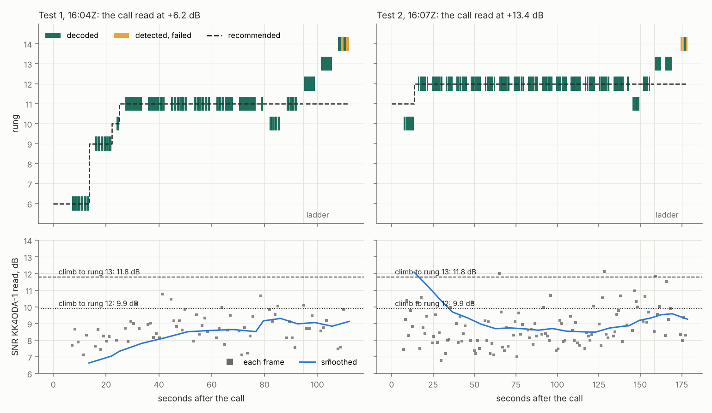

# Step 4: ND1J's two Tests at 500 Hz on beta.121, and KQ4SAX on another band

ND1J ran two Tests to KK4ODA-1 three minutes apart on 2026-10-23. He is about 50 miles away
and an experienced P2P operator, and the link was better than any of WC4Y's. Both sides
uploaded their files with audio. KQ4SAX also uploaded his files after trying to reach
KK4ODA-1. This is the first report read under the rule the author set the same morning
(CLAUDE.md, *The rate controller: no more patches*). Each session is read for the rate
controller's review: what each rung delivered, and what its neighbours would have delivered.
§4 is that reading.

* **When and where**: 3.590 MHz, 2026-10-23, Test 1 at 16:04:00Z, Test 2 at 16:07:04Z
  (12:04 and 12:07 EDT). **Both ran at 500 Hz, not 2300.** ND1J's station is set to 500 Hz.
  KK4ODA-1, set to 2300 Hz, moved down to answer his call and went back after each session
  (ADR-0026; four moves in its status). The panel's Sessions list says so too.
* **Who**:
  * **ND1J** was the master: he ran both Tests. FTDX101MP keyed by Yaesu CAT, 100 W, OCF
    80–10, EM73RH.
  * **KK4ODA-1** was the slave: the author's FTDX10, Yaesu CAT, the mini PC.
  * **KQ4SAX**: FT-710 keyed by Yaesu CAT, Skyloop, EM73WX.
* **Builds**: v0.2.0-beta.121 at all three stations (link protocol 11).
* **The files**:
  * ND1J's `20261023-160400_ND1J_KK4ODA-1_test` and `20261023-160704_ND1J_KK4ODA-1_test`.
  * KK4ODA-1's `20261023-160420_KK4ODA-1_ND1J` and `20261023-160724_KK4ODA-1_ND1J`.
  * KQ4SAX's `20261023-170716_KQ4SAX_KK4ODA-1_test`, plus the daemon logs and diagnostic
    bundles of all three.
  * Nothing from the uploads is committed.

## 0. Summary

**What happened.**

* **Both Tests completed**:
  * **Test 1**: 135 s; a 512-byte message at 204 bit/s and a 2 816-byte file at 413 bit/s.
  * **Test 2**: 204 s; a 2 048-byte message at 514 bit/s and a 7 680-byte file at 579 bit/s.
  * These are the fastest Tests on the air so far at 500 Hz.
* **The data was clean.** KK4ODA-1 detected every data frame ND1J sent and decoded every one
  below the top rung at its first copy. There were no retransmissions.
* **The granted slots held.** The stations never transmitted together; the least clear air
  was 0.585 s. There were no forfeits and no late drops. Every answer reached the air 71–110 ms
  after its slot opened, at least 240 ms inside its limit. Both Morse identifiers went out at
  the end, in order.

**The rate controller left speed on the table, by an amount set by luck** (§4).

* **Same path, different rungs.** Both Tests ran on the same path at the same readings
  (KK4ODA-1 read ND1J's data at mostly 8–10 dB). The link carried Test 1's file at rung 11 and
  Test 2's at rung 12, a 40 % difference.
* **Why.** The only difference was the first reading:
  * In Test 1, ND1J's call read 6.2 dB at KK4ODA-1, so the link started low and climbed. It
    stopped at rung 11 because climbing to rung 12 needs a smoothed 9.9 dB, and the reading
    never got there.
  * In Test 2 the call read 13.4 dB, so the link started high and kept rung 12.
* **Rung 13 decoded all 12 of its frames** on the Tests' ladders, at the same readings. On
  this path it would have carried about 13 % more than rung 12, and 54 % more than rung 11.
  Rung 14 decoded 3 of 8, so it would have carried less.
* **This meets the rule's condition for the review.** Report 15 found the controller holding
  a rung too high, and this session finds it settling one or two rungs too low. It is the
  author's call whether to start now or after more sessions; either way, no patch.

**One answer was hidden by a false detection** (§3).

* **What happened.** Just after ND1J released his key, his receiver reported a frame in the
  noise. The link correctly ignored it. But the receiver had already reserved that frame's
  whole second for it, and KK4ODA-1's answer arrived inside that second, so it was never
  looked at.
* **The cost** was one repeated ladder rung and two slow answers, about 12 s of 204.
* **How often.** It is the only answer either master missed in the five two-sided sessions
  since 2026-10-17 (about 130 answers). That is about the rate the 500 Hz detector's threshold
  allows: it sits at the noise's maximum. I suggest no change yet.

**The busy detector misread its floor once, during a session** (§5).

* **What happened.** In Test 2, KK4ODA-1's floor sat at ND1J's signal for most of the
  session. The move to 500 Hz had rebuilt the detector empty, and its first reading was
  ND1J's signal.
* **The effect** was limited to the panel's floor and threshold readings during the session.
  No transmission depended on them, and the floor was back at the noise before the session
  ended.
* **No patch**, by the author's decision. It is the second count toward the review.

**KQ4SAX was on 40 m** (§6). All his calls and his Test went out on 7.082 MHz. KK4ODA-1 was on
3.590 MHz the whole afternoon, so neither heard the other. Earlier, his first call lost the
FT-710's USB link the moment it keyed, which points to RF getting into the USB cable.

## 1. The sessions

| | Test 1 | Test 2 |
|---|---|---|
| ND1J's Test started | 16:04:00.8Z | 16:07:04.6Z |
| probe: ND1J read KK4ODA-1 at / KK4ODA-1 read ND1J at | −3.2 / −3.0 dB | +3.2 / +13.0 dB |
| message | 512 B in 20.1 s, 204 bit/s | 2 048 B in 31.9 s, 514 bit/s |
| file | 2 816 B in 54.6 s, 413 bit/s | 7 680 B in 106.2 s, 579 bit/s |
| ladder | from rung 10: 10, 11, 12, 13 4/4; 14 2/4 | from rung 11: 11, 12 4/4; 13 4/4 twice; 14 1/4 |
| Test | complete, 135.3 s | complete, 204.4 s |
| KK4ODA-1 read ND1J's data at | 5.8–10.8 dB (median 8.6) | 6.8–12.1 dB (median 8.6) |
| ND1J read KK4ODA-1's answers at | 2.5–9.0 dB | 1.9–13.1 dB |

The path was lopsided by about 4 dB: ND1J at 100 W was read higher than KK4ODA-1's answers.
The ladder's fit on the link bench puts the path 1.5–1.75 dB better than the AWGN table at the
SNR read. So I have logged it as *good*, matching the author's "a better quality link".

## 2. Safety and timing

The two recordings were put on one clock by the loop latencies (`two_sides.py --from-loops`).
Offset +19.64 s in Test 1 and +19.69 s in Test 2, drift 28–42 ppm.

* **No radiated overlap** in either Test. The least clear air was 0.585 s in Test 1 and 0.606 s
  in Test 2 (`air_account.py --sidecars`).
* **KK4ODA-1's answers against their slots**:
  * Test 1: 17 answers, 75–110 ms after the slot opened (median 80), at least 240 ms inside
    `not_after`.
  * Test 2: 24 answers, 71–108 ms (median 77), at least 242 ms inside.
  * This is the same as on WC4Y's paths (reports 13–15).
* **No forfeits and no late drops** at either station. No capture skips in any of the four
  recordings. The loop latency was 61–72 ms at both stations.
* **Both Morse identifiers went out last, in order**: KK4ODA-1's (as KK4ODA) behind its
  DISC_ACK, then ND1J's 0.8 s after it ended, in both Tests (ADR-0075).
* **A tool fix.** `two_sides.py` first reported one of KK4ODA-1's answers in Test 2 as keyed
  389 ms before its slot, with only 0.311 s of clear air. That was the tool, not the station.
  ND1J had recorded nothing of that answer but a false detection 0.44 s before it (§3), and the
  tool placed the answer on it. On KK4ODA-1's own clock the answer went out 0.567 s after the
  last frame, exactly like every other answer. The tool now places a transmission it can only
  find phantoms of where its key puts it (`rf_start_of`, with a test).

## 3. One answer hidden by a false detection

At 207.4 s on ND1J's clock in Test 2, ND1J sent rung 13's ladder measurement: a header and four
frames. KK4ODA-1 decoded all five and answered on time. ND1J recorded no answer, so its slot
went silent.

**What ND1J's receiver did.**

* **The radio comes back from transmit.** ND1J released his key at 212.09 s. His radio's
  receive audio was digital silence for 60 ms, then band noise from 212.14 s.
* **A false detection.** At 212.384 s his receiver reported an OFDM data frame: rung 8, RV 3,
  acquisition 1.04, read at −13.4 dB, not decoded. It was a false detection in the noise. The
  500 Hz detector's threshold (0.56) sits at the noise's own maximum (0.549, ADR-0009).
* **Decided too early.** The receiver announced it at 212.59 s, as soon as the input was far
  enough past it to decide. KK4ODA-1's answer only began at 212.82 s, about 11 dB above the
  noise in the channel (−34 against −45 dBFS).
* **The real answer goes unseen.** The stream reserves a candidate's whole frame, here 1.054 s
  to 213.44 s, so the answer inside it was never looked at. The link layer ignored the false
  detection, correctly: it was below the trusted confidence of 1.3 ("heeded 0"). But the
  receiver had already given its span away.
* **It repeats exactly.** `aetherd --replay` of ND1J's recording through beta.121's receiver
  reports the same false frame at 212.38 s and no answer.

**What it cost.** The silent slot did what it should:

* ND1J measured rung 13 again, and the second report credited it 4 of 4 (ADR-0092, built two
  days earlier).
* ND1J asked for floor answers for the next slots (Step 3's `floor_answer_memory`), so
  KK4ODA-1's last two answers took 3.2 s each instead of 0.43 s.
* In all, about 6.5 + 2 × 2.8 = 12 s of a 204 s Test.

**How often.**

* **Across sessions.** In the five two-sided sessions since 2026-10-17, about 130 answers, it
  is the only answer the master never recorded.
* **The detection rate.** ND1J's receiver logged six such noise detections in its two
  recordings, about one a minute (three of them in the half minute before Test 2 began).
  KK4ODA-1's logged none.
* **What that rate predicts.** At one a minute, the chance that a false frame's 1.05 s span
  covers the start of an answer is about 1.5 %. One in 130 is in line with that, so the radio's
  return from transmit is not needed to explain it.

**The fix it would take** is a receiver rule, not a link rule:

* **The rule.** A candidate that is neither trusted nor decoded should not hide a stronger
  preamble that starts inside its span. ADR-0060 made the same rule for tone frames.
* **Why it needs measuring first.** At 500 Hz the threshold is above what data symbols reach
  (0.3–0.4), so the risk is small. At 2300 Hz the threshold (0.348) is below it, so the rule
  could add false frames from data symbols.
* **My suggestion is to wait.** It would need its own bench (frames recovered against false
  frames added), and one answer in 130 does not justify it yet. §7 ranks it.

## 4. The rate controller, read for the review

### 4.1 What each rung carried

Every data frame ND1J sent, and what KK4ODA-1 made of it (from both sidecars). The counts
include the ladder's measurement frames: rung 10 in Test 1 is one transfer frame and the
ladder's four, rung 11 is 37 and four, and rung 12 in Test 2 is 89 and four.

| rung | frame | data bytes | Test 1: sent / detected / decoded at first copy | Test 2 |
|---|---|---|---|---|
| 6 | QPSK ⅔ | 31 | 6 / 6 / 6 | — |
| 9 | 16-QAM ½ | 50 | 6 / 6 / 6 | — |
| 10 | 16-QAM ⅔ | 68 | 5 / 5 / 5 | 6 / 6 / 6 |
| 11 | 16-QAM ¾ | 78 | **41 / 41 / 41** | 4 / 4 / 4 (ladder) |
| 12 | 64-QAM ⅔ | 106 | 4 / 4 / 4 (ladder) | **93 / 93 / 93** |
| 13 | 64-QAM ¾ | 120 | 4 / 4 / 4 (ladder) | 8 / 8 / 8 (ladder) |
| 14 | 64-QAM ⅚ | 134 | 4 / 4 / 2 (ladder) | 4 / 4 / 1 (ladder) |

No frame went undetected, none needed combining, and nothing was sent twice. The things report
15 found the controller blind to did not happen here. This path shows a different blind spot.

### 4.2 Why the two Tests settled on different rungs

The current controller, re-run on KK4ODA-1's recorded readings, gives exactly the rungs
KK4ODA-1 sent in its answers (rung 11 in Test 1 from 54 s on, rung 12 in Test 2). The rule
that decides it:

* **To climb** to the next rung, the smoothed reading must reach that rung's AWGN threshold
  plus the learned margin plus 1.5 dB of step-up headroom (`up_hysteresis_db`). The margin
  bottoms out at 1.5 dB after clean bursts (`min_margin_db`).
  * At 500 Hz that is 9.9 dB for rung 12 and 11.8 dB for rung 13.
* **To stay** on a rung, the threshold plus the margin is enough: 8.4 dB for rung 12.
* **The start** comes from one reading: the call's.
  * **Test 1**: the call read 6.2 dB, so the link started at rung 6. It climbed through 9 and
    10 to 11 in 25 s, as clean bursts brought the margin down. Then the smoothed reading
    levelled at 8.5–9.3 dB and never reached 9.9.
  * **Test 2**: the call read 13.4 dB, so the link started at rung 11 and was at rung 12 by
    the second burst, while the smoothed reading still carried the seed. Its later 8.5–9.6 dB
    was enough to stay.

*Figure 16-settle. Top: every data frame ND1J sent, at its rung (green decoded, amber failed),
and KK4ODA-1's recommendation (dashed). Bottom: the SNR KK4ODA-1 read on each frame, the
controller's smoothed reading, and what climbing to rungs 12 and 13 needs. The same readings
kept one Test at rung 11 and the other at rung 12, and rung 13 decoded every frame on both
ladders.*

**The readings that set the start.**

* **The tone readings swing.** KK4ODA-1 read ND1J's tone-floor frames at −3.4 dB (Test 1's
  probe), +6.2 (its call), +12.7 (Test 2's probe) and +13.4 (its call). The OFDM data read
  8–10 dB throughout.
* **Part of that is a real fade.** By band power in KK4ODA-1's audio, Test 1's probe arrived
  5 dB weaker than Test 2's floor frames, and its call 1.2 dB weaker.
* **Part of it is the reading.** The tone readings stray from the band power by about ±5.5 dB.
  The radio's AGC also cut its gain by about 12 dB under ND1J's signal (the busy detector's
  gain reading), which makes any outside measurement uncertain.
* **Either way**, the session's rung depended on one reading of one frame, and the step-up
  headroom then kept it.

### 4.3 What the neighbours would have delivered

* **The arithmetic.** A data transmission here was a header and six frames, answered, about
  8.6 s each time. Six frames carry 468 data bytes at rung 11, 636 at rung 12 and 720 at
  rung 13. That is about 435, 592 and 670 bit/s.
* **The measured files** came close to that: 413 bit/s in Test 1 at rung 11, 579 in Test 2 at
  rung 12.
* **Rung 13**, decoding as it did on both ladders (12 of 12), would have carried about 13 %
  more than rung 12, and 54 % more than rung 11.
* **Rung 14** decoded 3 of 8, and would have carried less.
* **The caution.** Twelve frames are a small sample, and rung 13 at an 8–10 dB reading sits
  at its AWGN 10 % point. The margin is the controller's guard against the fade these three
  minutes did not show.
* **The conclusion.** On the evidence of the session, the controller chose a rung that
  delivered about 12 % less than its neighbour in Test 2. In Test 1 it delivered 27 % less
  than its neighbour, and 35 % less than rung 13.

**The link bench's replay could not answer this.**

* **It read the wrong direction.** `bench_link --replay` on the two Test sidecars gave 222 and
  229 bit/s, against 413 and 579 measured. It runs on the sender's sidecar, whose SNR trace is
  the other direction: KK4ODA-1's answers as ND1J read them, at 2–9 dB.
* **What the review needs instead.** Its reading has to come from both sidecars, as this
  section did by hand: the sender's frames and the receiver's fate of each.

### 4.4 Against the rule

CLAUDE.md: "If the sessions show it choosing rungs that deliver less than a neighbour would,
**do the full review**."

* **Report 15** showed it holding a rung above what the path carried at 2300 Hz.
* **This report** shows it settling one or two rungs below at 500 Hz, at a rung that depended
  on the first reading.
* **The cause in both** is the same: rungs are chosen from an SNR reading against AWGN
  thresholds, with fixed margins and step-up headroom, not from what each rung delivered.
* **The condition is met.** The author leaned toward more sessions first, so the timing is the
  author's call (§7). Nothing here argues for a patch: lowering the headroom or the minimum
  margin would be a twelfth adjustment.

## 5. The busy detector

The standing check from ADR-0088: the floor against the noise, in each recording.

* **ND1J, both Tests**: the floor at full radio gain stayed at the noise (−38 to −40 dBFS
  against −40 to −41).
* **KK4ODA-1, Test 1**: the floor was at the noise from 48 s (−31.8 dBFS against −32 to −34).
* **KK4ODA-1, Test 2**: the floor sat at ND1J's signal, −22.1 dBFS at full gain against −32
  to −35 of noise, from 36.8 s to 203.9 s. `aetherd --busy-trace` from the state the recording
  kept repeats it:
  * **Rebuilt empty.** Moving to 500 Hz to answer ND1J's call rebuilt the detector with
    nothing learned (`confirmed: false`).
  * **The first floor was the signal.** At 36.8 s it took that floor from a block of ND1J's
    signal not yet marked as a frame (−22.4 dBFS).
  * **Then it was kept.** ADR-0088's rule does not retake the floor while half the window or
    more is frames. A session fills the window, so the floor stayed until the frames thinned
    at the end. Then it dropped to the noise (−31.9) 10 s before the session ended.
* **The effect.** The panel's floor, threshold and *Signal above noise* read signal over
  signal during the session. No transmission depended on them: inside a session the slave
  keys in its slots, and only calls, probes and beacons outside one wait for a clear channel.
* **No patch**, by the author's decision. It counts toward the review, the second count after
  WC4Y's gain reference in report 15 §7.
* **A pattern to watch.** A station set to 2300 Hz that answers 500 Hz callers rebuilds its
  detector at the start of every such session.

## 6. KQ4SAX

His logs and diagnostic bundles tell the afternoon in order:

* **16:52Z.** He updated beta.114 → beta.121.
* **16:53:35Z, his first call.**
  * Keyed for 3 s, then "the sound card stopped delivering audio while transmitting; releasing
    the key".
  * Then "the radio would not release after the card stalled: COM8: A device attached to the
    system is not functioning".
  * Then the CAT port refused writes and the FT-710's USB audio devices vanished ("no longer
    available").
  * The FT-710's USB link (audio and CAT together) dropped out the moment it transmitted. That
    is the usual sign of RF getting into the USB cable, or of a USB port sagging under load.
    The daemon ran receive-only until he chose the port again (COM9, then back to COM8).
* **16:57–17:01Z.** A drive test, then a call to KK4ODA-1: eight tries, no answer.
* **17:07–17:09Z.** A Test: the probe went unanswered, then six call tries.
* **The band.** Both bundles and the Test's recording say his radio was on **7.082 MHz
  (40 m)**, DATA-U with a 500 Hz filter. KK4ODA-1's log and status show it on 3.590 MHz
  (80 m) the whole afternoon, with no dial change.
  * His receive audio was live band noise with nothing decodable in it, and KK4ODA-1 heard
    nothing of him.
  * The two stations were on different bands; nothing in either daemon was wrong.

**Advice for KQ4SAX**, through the author:

* **Agree the band first.** With an apartment antenna, 40 m is the likelier band, so the
  author would QSY to 7.082 MHz.
* **Fit ferrite chokes** on the USB cable at the radio end, and try lower power first.
* **Set the FT-710's own transmit time-out timer.** When the USB link drops while the radio is
  keyed, Aether cannot release it; the radio's own timer is the backstop.

## 7. What to change

Ranked; each is the author's call.

1. **The rate controller's review** (§4).
   * **The condition is met.** By CLAUDE.md's rule, the condition to do the full review is
     met: report 15 and this report show it choosing rungs that delivered less than a
     neighbour, in both directions.
   * **The review's job**, in plain words: pick the rung that delivers the most data per
     second of air on this path, counting a frame never heard as lost.
   * **How it would be judged**: on the field recordings and the harness, not the link bench's
     fading pipe, as ADR-0069 did for the link.
   * **When to start.** It can start on paper now while sessions continue; nothing ships until
     it has been judged. Or wait for one or two more sessions. No patch either way.
   * **One input it needs** is a reading that takes both sidecars (§4.3), which `bench_link
     --replay` cannot give. That is the per-session tool offered earlier.
2. **The false detection that hid an answer** (§3).
   * **No change now**: one answer in about 130.
   * **If it comes back**, measure the receiver rule on a bench (frames recovered against false
     frames added at both bandwidths) before building it.
3. **The busy detector** (§5): no patch, the second count toward its review.
4. **KQ4SAX** (§6): operating advice, through the author.
5. **Done here:** `two_sides.py` places a transmission that only false detections were recorded
   of where its key puts it (§2).

## 8. What changed since report 15, on the air

* **ADR-0092** (a measurement whose slot went silent is measured again) ran once, as built:
  rung 13, silent after the false detection, was measured again and credited 4 of 4 from its
  own report.
* **ADR-0093** (no cap on the first OFDM rung) did not come into play: these sessions were at
  500 Hz, where the controller had no cap before either.
* **ADR-0091** (a beacon waits out the closing identifier) did not come into play: no beacon
  was due.
