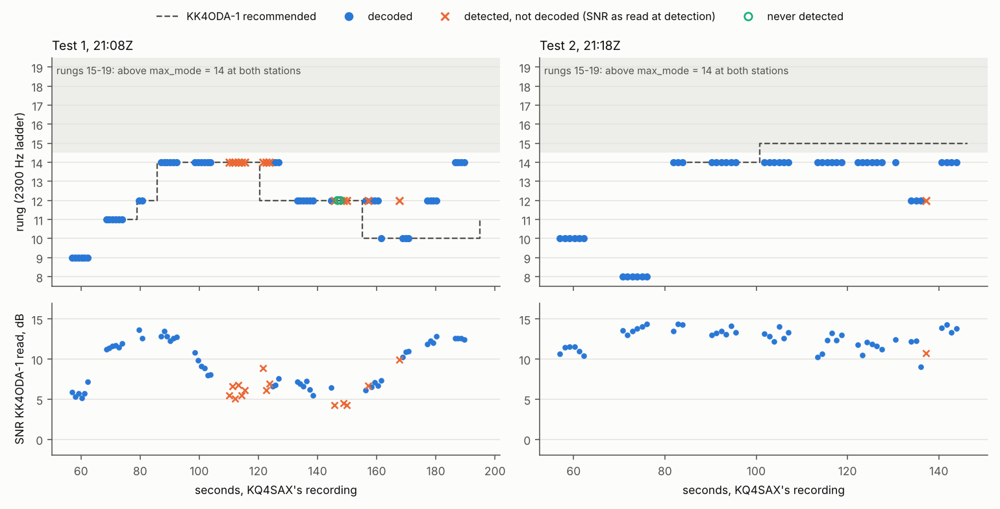
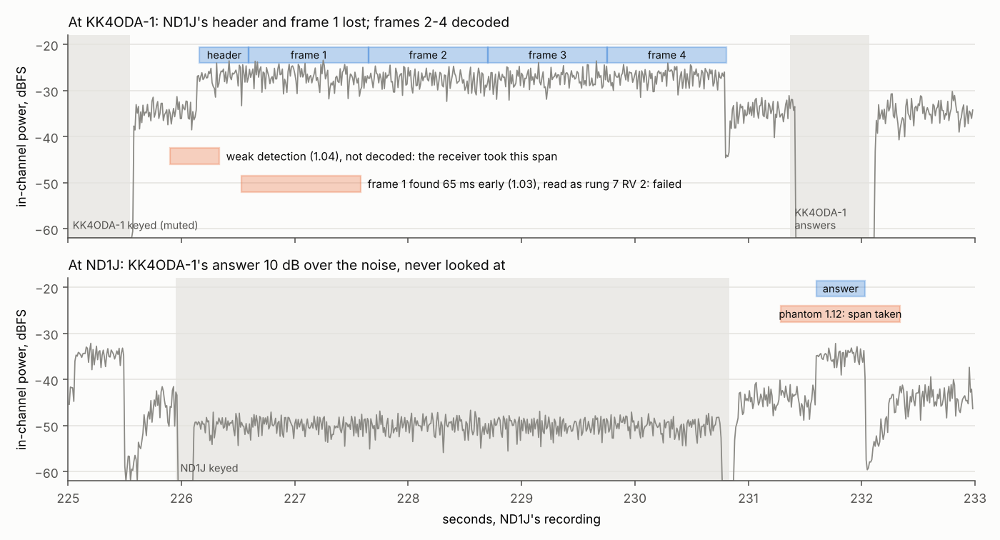
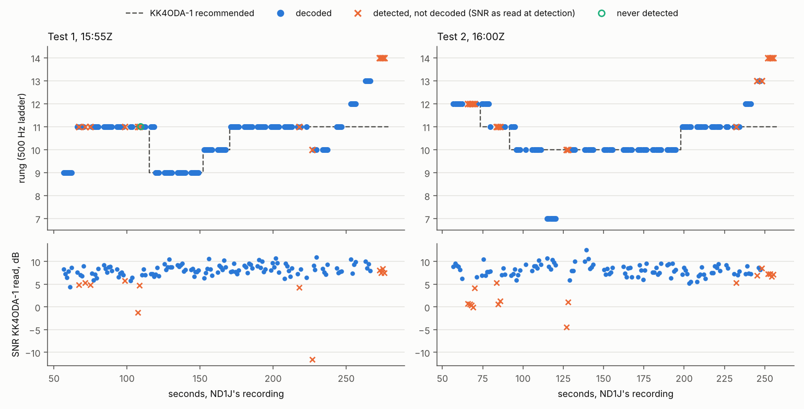

# Step 4: five Tests on beta.121, KQ4SAX and WC4Y at 2300 Hz, ND1J on 40 m at 500 Hz

Three uploads came in after report 16, each with both stations' files and audio:

* **KQ4SAX's two Tests** to KK4ODA-1 on the evening of 2026-10-23, on 40 m at 2300 Hz. They are
  the first complete sessions between the two stations, and the fastest Tests on the air so far.
* **WC4Y's Test** on 80 m at 2300 Hz, half past eight that evening (local time).
* **ND1J's two Tests** on the morning of 2026-10-24, on 40 m at 500 Hz. ND1J had updated to
  beta.122, so his recordings number every data frame he sent, the first field check of Gate 1's
  reconstruction (`docs/research/rate-control/01-evidence.md` §1.5).

Each session is read as reports 14–16 were: both recordings on one clock, the safety
invariants, then what went wrong and why. §8 is the reading for the rate controller's review.

* **Who**:
  * **KQ4SAX**: FT-710 keyed by Yaesu CAT, 100 W, Skyloop, EM73WX, about 18 km from the author.
  * **WC4Y**: IC-7300 keyed by Icom CI-V, 20–25 W, 230 ft EFHW, EM73VU.
  * **ND1J**: FTDX101MP keyed by Yaesu CAT, **200 W** this time, OCF 80–10, EM73RH.
  * **KK4ODA-1**, the slave in all five: the author's FTDX10, Yaesu CAT, 50 W, T2D, the mini PC.
* **Builds**: beta.121 everywhere, except ND1J on beta.122 (recordings only; the link is the
  same, protocol 11).
* **The files**, none committed:
  * KQ4SAX's `20261023-210839_KQ4SAX_KK4ODA-1_test` and `20261023-211807_…`; KK4ODA-1's
    `20261023-210859_KK4ODA-1_KQ4SAX` and `20261023-211827_…`.
  * WC4Y's `20261024-002051_WC4Y_KK4ODA-1_test`; KK4ODA-1's `20261024-002212_KK4ODA-1_WC4Y`.
  * ND1J's `20261024-155500_ND1J_KK4ODA-1_test` and `20261024-160000_…`; KK4ODA-1's
    `20261024-155520_KK4ODA-1_ND1J` and `20261024-160020_…`.
  * Every station's daemon log and diagnostic bundle.

## 0. Summary

**What happened.** All five Tests completed.

* **KQ4SAX** at +10 to +13 dB: files at **727 and 1309 bit/s**, the second the fastest Test yet.
* **WC4Y** at about −4 dB: a file at 161 bit/s, nearly three times report 15's 61 bit/s on the
  same band and bandwidth, on a path 3 dB weaker. That is ADR-0093 on the air (§4).
* **ND1J** at about +8 dB: files at 326 and 311 bit/s.

**The granted slots held** (§2). The stations never transmitted together; the least clear air
was 0.611 s. There were no forfeits and no late drops. Every answer reached the air 77–155 ms after
its slot opened, at least 195 ms inside its limit. The closing identifiers went out last, in
order.

**Two defects, both outside the rate controller.**

* **The panel saves the wrong fastest mode** (§3). Setup step 4's *Fastest mode* list is built
  from the ladder the modem is running. A station at 500 Hz is offered rungs 0–14; choosing
  2300 Hz in the same form only hides entries, it never adds rungs 15–19. Saving writes
  `max_mode = 14` with `bandwidth = 2300`. KQ4SAX, WC4Y and KK4ODA-1 all ran 2300 Hz with
  `max_mode = 14`, and in KQ4SAX's second Test it held the link on rung 14 while KK4ODA-1 asked
  for 15. The daemon clamps `max_mode` to the running ladder itself, so 19 is the right value at
  either bandwidth.
* **A Test does not call a 500 Hz station at 500 Hz** (§5). WC4Y's Test probed KK4ODA-1, then
  at 500 Hz, and logged "runs 500 Hz". ADR-0035 says a 2300 Hz station calling one it knows runs
  500 Hz moves to 500 Hz first. The Test's call does not: `movable()` refuses while a Test runs,
  so the move is skipped. KK4ODA-1 ignored three 2300 Hz tries, and the session began 74 s late,
  only because the author switched KK4ODA-1 to 2300 Hz by hand. A scratch test in the station
  harness repeats it.

**Report 16's hidden frame came back, at both ends of one exchange** (§6, Figure 17-hidden).

* **What happened.** In ND1J's first Test, KK4ODA-1's receiver took a weak detection (confidence
  1.04) just before ND1J's header. Its span covered the header, which was lost along with the
  first measurement frame. Then ND1J's receiver took a phantom (1.12) 0.34 s before KK4ODA-1's
  answer, 10 dB over the noise, and never looked at the answer. `aetherd --replay` repeats it.
* **How often.** Two answers hidden in about 220 over the ten two-sided Tests since 2026-10-17,
  and this header, the first case looked for at the slave. This exchange cost about 18 s of a
  252 s Test.
* **The suggestion.** Report 16's condition for measuring the receiver rule has been met.

**A learned answer gap that came from a misread** (§7). ND1J probed KK4ODA-1 twice by hand, then
started a Test, which probes again. KK4ODA-1 took each new probe as a sign that its last answer
was lost (ADR-0054) and raised ND1J's gap twice, to 900 ms. The second step was wrong: ND1J had
heard that answer. At 900 ms KK4ODA-1 asks for gap level 1, so every slot in both of ND1J's
Tests opened half a second late: about 13 s a Test, 5 %. The gap is still 850 ms and eases by
only 25 ms a clean session.

**For the rate controller's review** (§8, Figures 17-rungs and 17-kq4sax).

* **Where it chose well.** WC4Y's path: rung 5 was the best rung measured.
* **Slow climbs back.** Three sessions show the same thing. After a fade the link stepped down,
  then took 40–106 s to climb back while the readings had recovered. In ND1J's second Test it
  stayed on rung 10 from 92 s to 198 s, where rung 11 would have carried 24 % more.
* **K6.** The review's field replay, with C1 at the sender, comes out at 1.057 against the
  current controller over these five sessions (worst session 0.919). That is a pass.
* **Gate 1, checked on the air.** In both of ND1J's Tests the tool's reconstruction numbered all
  253 data frames as ND1J recorded them, and the replayed controller matched ND1J's recorded
  state at every step.

**Smaller findings.**

* **Capture skips are fixed.** Five frames had a skip of KK4ODA-1's sound card inside them, and
  all five decoded. That is ADR-0089 working (§9).
* **The busy floor passed** its standing check in all ten recordings (§9).
* **The end of KQ4SAX's first Test** (§10). KQ4SAX asked for an ordinary DISC_ACK, by the family
  rule at its boundary, and could not read it. It repeated its DISC on the floor, and KK4ODA-1
  answered again with its identifier, as ADR-0075 intends.
* **Two tool fixes** (§2, §8): a call's gap level, and an acceptance sent late in its slot.

## 1. The sessions

| | KQ4SAX, Test 1 | KQ4SAX, Test 2 | WC4Y | ND1J, Test 1 | ND1J, Test 2 |
|---|---|---|---|---|---|
| started (UTC) | 10-23 21:08:40 | 10-23 21:18:07 | 10-24 00:20:52 | 10-24 15:55:01 | 10-24 16:00:01 |
| band, bandwidth | 40 m (7.082), 2300 | 40 m, 2300 | 80 m (3.590), 2300 | 40 m (7.082), 500 | 40 m, 500 |
| probe: heard there / here | +7 / −1.1 dB | +6 / −1.5 | −4 / −7.6 | +7 / +2.8 | +11 / +7.2 |
| call | first try, read at +8.8 dB | first try, +9.8 | fourth try, −1.5 (§5) | first try, +10.7 | first try, +14.8 |
| message | 2048 B, 548 bit/s | 2048 B, 494 | 512 B, 154 | 2048 B, 325 | 2048 B, 335 |
| file | 8192 B, 727 bit/s | 7168 B, **1309** | 2304 B, 161 | 4864 B, 326 | 4864 B, 311 |
| ladder | 12 4/4, 14 4/4 | 12 3/4, 14 4/4 | 4 3/4, 5 0/4, 7 1/4, 8 0/4 | 10 7/8, 11–13 4/4, 14 0/4 | 11 3/4, 12 4/4, 13 2/4, 14 0/4 |
| Test | 182.6 s | 118.7 s | 319.3 s | 251.7 s | 231.0 s |
| KK4ODA-1 read the data at | +5.1 … +13.6 (median +10.1) | +9.0 … +14.4 (+13.0) | −5.7 … −0.8 (−4.1) | +4.4 … +10.9 (+8.2) | +5.3 … +12.5 (+8.1) |
| the master read the answers at | −10.0 … +1.2 (−3.4) | 0.0 … +5.3 (+3.1) | −10.0 … −6.1 (−7.2) | −0.9 … +11.4 (+7.1) | +0.5 … +10.4 (+6.9) |

* **KQ4SAX's path is lopsided by 10–15 dB.** KK4ODA-1 heard KQ4SAX's 100 W at a median of +10
  and +13 dB. KQ4SAX heard KK4ODA-1's 50 W at −3 and +3 dB, and at −10 dB in a fade. Power is
  3 dB of it; local noise at KQ4SAX is the likely rest. So KK4ODA-1's answers went on the floor
  for most of Test 1.
* **ND1J's 40 m path faded** by 5–10 dB within seconds, several times in each Test (Figure
  17-rungs, bottom). His 200 W also pulled KK4ODA-1's AGC (FAST) down by 10–16 dB under each of
  his transmissions. It recovered at once between them.
* **The ladders tell the 2300 Hz story.** KQ4SAX's stopped at rung 14 because both stations'
  `max_mode` was 14 (§3); WC4Y's climbed four rungs from 4, three of them failing.
* **Classes for the field log**: KQ4SAX *moderate* (a deep fade in Test 1), WC4Y *moderate* as in
  report 15, ND1J on 40 m *moderate*, as the author classed that path on 2026-09-26.

## 2. Safety and timing

The recordings were put on one clock by the loop latencies (`two_sides.py --from-loops`).

| | KQ4SAX 1 | KQ4SAX 2 | WC4Y | ND1J 1 | ND1J 2 |
|---|---|---|---|---|---|
| offset (slave's recording to the master's) | +19.831 s | +19.815 s | +77.098 s | +19.707 s | +19.648 s |
| drift | +6 ppm | +55 ppm | +93 ppm | +23 ppm | −18 ppm |
| loop sum (both radios' paths) | 196 ms | 186 ms | 137 ms | 130 ms | 131 ms |
| least clear air | 0.677 s | 0.705 s | 0.667 s | 0.611 s | 0.615 s |
| KK4ODA-1's answers, late after the slot | 115–154 ms (median 119) | 109–155 (117) | 85–138 (105) | 77–113 (87) | 78–143 (90) |
| least margin to `not_after` | 196 ms | 195 ms | 212 ms | 237 ms | 207 ms |

* **No radiated overlap** in any of the five (`air_account.py --sidecars`).
* **No forfeits and no late drops** at any station.
* **The closing identifiers** went out last and in order. In each Test KK4ODA-1's (as KK4ODA) went
  behind its DISC_ACK, then the master's 0.8–0.9 s after it ended. KQ4SAX's first Test ended with
  KK4ODA-1's identifier twice (§10).
* **KQ4SAX's radio path is the slowest seen.** Its loop sum is about 60 ms longer than the others'.
  That is why its answers sit 30 ms later in their slots. The margins stay near 200 ms.
* **A tool fix.** `two_sides.py` first placed KK4ODA-1's acceptance of WC4Y's call 590 ms after its
  slot, 240 ms past its limit. It was the tool's slot, not the station's timing:
  * **Why the slot was later.** A call grants its acceptance a gap level that goes up one every
    second try (`GrantedEngine._call_level`). WC4Y's fourth try granted level 1, half a second
    later. The level rides in the connect body, which no sidecar records, and the tool judged
    every acceptance at level 0.
  * **The fix.** The tool now counts the master's tries (its keyings while `Connecting`) and
    judges the acceptance at its try's level (`call_levels`, with a test). The acceptance was
    90 ms into its slot, like every other answer.

## 3. KQ4SAX at 2300 Hz, and the fastest mode the panel saved

KQ4SAX's Tests are the first complete sessions between the two stations: report 16 found them
on different bands, and earlier ones went one way only. This evening they agreed on 40 m.

**The link ran as fast as the stations let it.**

* **Test 2.** All 28 of KQ4SAX's rung-14 frames (16-QAM ½, 288 data bytes) decoded at their
  first copy, at +11 to +14 dB. From 101 s on, KK4ODA-1 recommended **rung 15** in every answer,
  and KQ4SAX kept sending rung 14 (Figure 17-kq4sax).
* **Test 1.** The link climbed to rung 14 in 30 s, then a fade from +13 to +5 dB took it down to
  rung 10 (§8). It never reached the cap again.
* **The ladder.** Both ladders measured only rungs 12 and 14. The ladder climbs the usable rungs
  up to `max_mode`, and at 2300 Hz rung 13 is skipped (ADR-0076).



*Figure 17-kq4sax. Top: every data frame KQ4SAX sent, at its rung (blue decoded, orange detected
and not decoded, aqua never detected), and KK4ODA-1's recommendation (dashed). The shaded rungs
are above both stations' `max_mode`. Bottom: the SNR KK4ODA-1 read on each frame. In Test 2
KK4ODA-1 asked for rung 15 from 101 s; KQ4SAX's `max_mode` held it at 14.*

**Why `max_mode` was 14.** It is in every 2300 Hz station's file:

| station | `[radio] bandwidth` | `max_mode` | how it got there (the daemon's log) |
|---|---|---|---|
| KQ4SAX | 2300 | 14 | 21:06:20Z: a Setup save, made while the station ran 500 Hz, wrote `radio.bandwidth: 2300` with `radio.max_mode: 14` |
| KK4ODA-1 | 2300 | 14 | Setup saves at 00:47Z and 00:50Z on 10-23, just before report 15's session, wrote it, and the daemon ran from that file all day. On 10-24 a save 4 s after loading the *Default 2300* profile wrote 14 again; one 45 s later wrote 19, which it has run since |
| WC4Y | 2300 | 14 | in the file the daemon started from at 00:20:25Z |
| ND1J | 500 | 14 | the narrow ladder's top, correct |

**The panel's code** (`app/ui/app.js`) explains it.

* **The list comes from the running ladder.** `fillModes` fills the list from `capabilities.modes`:
  fifteen entries (0–14) while the modem runs 500 Hz. If the file says 19, that is not in the
  list, so the last entry is selected: 14.
* **Choosing 2300 Hz does not grow it.** The *Bandwidth* handler only hides entries past the
  chosen ladder. Going to 2300 Hz it hides nothing and adds nothing, so 14 stays selected.
* **The save writes what is selected.** The modem moves to 2300 Hz with `max_mode = 14`.
* **The comment is wrong too.** The handler's comment says a fastest mode past the ladder "would
  be refused on save". The daemon does not refuse it. `RadioSection::fastest_mode` clamps
  `max_mode` to the running ladder, and its comment says 19, the default, means "the top" at
  either bandwidth.
* **A profile switch can do it too.** A Setup save in the seconds after a profile switch, before
  the panel has the new ladder, writes what the old list held. KK4ODA-1's save 4 s after loading
  *Default 2300* wrote 14; its next, 45 s later, wrote 19.

**What it cost.**

* **In Test 2**: four of the file's five transmissions went at rung 14 where rung 15 was asked
  for. Rung 15 carries 386 data bytes a frame against 288, a third more.
* **What is not known**: whether rung 15 would have decoded. Its thresholds are +8.9 dB on AWGN
  and +16.3 on ITU Good, and the readings were +11 to +14 dB. The controller's own rule said
  yes, and the ladder could not try it.
* **For every 2300 Hz station with the cap**: rungs 15–19 (up to 5.5 kbit/s on the frame) are
  never used, however strong the path.

**The operator's remedy, now.** On a station running 2300 Hz, open Setup step 4, choose the
last *Fastest mode* (19), and save. At 500 Hz the modem still stops at 14 by itself. KQ4SAX's
and WC4Y's stations need it. KK4ODA-1 runs 19 since 00:22:49Z on 10-24; its *Default 2300*
profile should be checked, since loading a profile applies the profile's own value.

**The fix**, the author's call (§11 item 1). Either the list shows the chosen bandwidth's ladder,
or the last entry means "the fastest" and saves 19, which the daemon already reads that way.
The second is smaller and leaves no list to keep in step. The handler's comment and the manual's
*Fastest mode* line change with it.

## 4. WC4Y at 2300 Hz, after ADR-0093

Report 15 read WC4Y's last 2300 Hz Test (beta.120). The link sat on rung 7 (BPSK ⅓ on OFDM),
where a third of the frames were never detected: message 55 and file 61 bit/s. ADR-0093
removed the 2300 Hz air's cap on rung 7's margin. This is the first 2300 Hz session since.

| | report 15 (beta.120) | this session (beta.121) |
|---|---|---|
| KK4ODA-1 read WC4Y's data at | median −1.6 dB | median −4.1 dB |
| the rung the data went at | 7 (BPSK ⅓), 58 frames | 5 (tone100-153), 21 frames |
| what KK4ODA-1 made of them | 7 decoded alone, 9 more by combining, 20 never detected | 19 of 20 decoded at their first copy, the other at its second; none missed |
| message, file | 55, 61 bit/s | **154, 161 bit/s** |

* **The rung was right.** The controller replayed on KK4ODA-1's readings gives the rung it sent,
  10 of 10. Rung 5 carried 170 bit/s over its exchanges. The neighbours as the ladder measured
  them would have carried less: rung 4 (3 of 4) about 100 bit/s, rung 7 (1 of 4) about 47.
* **The ladder after the file.** Rung 5 got 0 of 4, at the bottom of a fade (−5.4 dB), half a
  minute after 19 of the file's 20 first copies had decoded. Four frames measure a moment, not a path.
* **The answers** went on the floor throughout. WC4Y read them at −10 to −6 dB.

## 5. A Test does not call a 500 Hz station at 500 Hz

**What happened**, from both logs:

* **00:17:25Z.** KK4ODA-1 loaded its *Default* profile and moved to 500 Hz.
* **00:20:51Z.** WC4Y, at 2300 Hz, started a Test. Its probe was answered across bandwidths
  (ADR-0035), and WC4Y logged "KK4ODA-1 hears us at −4 dB, heard at −7.6 dB — **runs 500 Hz,
  this station 2300 Hz**". KK4ODA-1 showed the mismatch banner.
* **00:21:05–00:21:43Z.** WC4Y's call went out at 2300 Hz, three tries. KK4ODA-1 heard the two
  floor tries at −2.2 and −2.6 dB and ignored them, "WC4Y calls in another bandwidth".
* **00:22:00Z.** The author loaded *Default 2300*. WC4Y's fourth try, at 00:22:11Z, was accepted.
* **The cost.** The call took 74 s of the Test's 319 s. Without the author, ADR-0058 would have
  moved WC4Y to 500 Hz before a fifth try.

**Why WC4Y did not move first.**

* **The rule.** ADR-0035: "a 2300 Hz station calling one known to run 500 Hz moves there first".
  `Station::connect_as` calls `move_for_call`, which moves only if `movable()` says the station
  may move.
* **The refusal.** `movable()` refuses while a Test runs ("a Test session is running"), and the
  Test's own call is made while the Test runs. So a Test never makes this move. Its probe learns
  the other station's bandwidth, and the call that follows ignores it.
* **ADR-0058 still applies.** `advance_call_bandwidth` does not ask `movable()`, so a Test's
  call does go to 500 Hz, but only before its fifth try.
* **Reproduced.** A scratch test in the station harness (not committed): a 2300 Hz station runs
  a Test to a 500 Hz one. It learns "runs 500 Hz" from the probe and calls at 2300 Hz. The only
  move is ADR-0058's ("has not answered at 2300 Hz") before the fifth try, which connects.
* **The fix**, the author's call (§11 item 2). The Test's call should move as a plain call does.
  `movable()` guards a move while something is under way, and a Test between its probe and its
  call has nothing on the air. A test like the scratch one would hold it.
* **Was 2300 Hz better here?** Probably: at −4 dB the 2300 Hz rung 5 carries 224 bit/s on the
  frame, the 500 Hz rung 4 134. That is the operators' choice, made by hand as here. The defect
  is that the Test calls in a bandwidth the other station is known to ignore.

## 6. Two frames hidden in one exchange

In ND1J's first Test, at 226 s on ND1J's clock, ND1J sent a measurement at rung 10: a header and
four frames. KK4ODA-1 decoded frames 2–4 at +8 to +11 dB, but neither the header nor frame 1.
It answered anyway, from the counts the decoded frames carry (R2). ND1J never looked at the
answer.



*Figure 17-hidden. Top: KK4ODA-1's audio in Aether's channel, on ND1J's clock, with ND1J's
header and frames as they arrived (blue) and the spans KK4ODA-1's receiver gave two weak
detections (orange). Bottom: ND1J's audio, KK4ODA-1's answer, and the span ND1J's receiver gave
a phantom. Shaded: each station keyed.*

**At KK4ODA-1, the header.**

* **The real header.** KK4ODA-1 released its key after its previous answer, and its audio came
  back as band noise at −34 dBFS. ND1J's header arrived 0.6 s later, as in every exchange, about
  8 dB over the noise.
* **The weak detection.** The receiver reported a control frame at 0.26 s *before* the header,
  at confidence 1.04, not decoded. Its span ran into the first 0.17 s of the header, and the real
  header (confidence 1.5–1.8 in every other exchange of the Test) was never taken.
* **Frame 1.** It was found 65 ms early (confidence 1.03), read as rung 7 RV 2, and failed.
* **It repeats.** `aetherd --replay` of KK4ODA-1's recording through beta.121's receiver repeats
  both detections exactly.

**At ND1J, the answer.**

* **The phantom.** ND1J released at 230.83 s. At 231.29 s his receiver reported a data frame
  (rung 14, RV 2, confidence 1.12, −12 dB), in noise with nothing in it, and gave it 1.05 s.
* **The answer it hid.** KK4ODA-1's answer arrived at 231.60 s, 10 dB over the noise, inside that
  span, and was never looked at. This is report 16 §3 again, at the same station.

**What it cost.**

* **The repeat.** The slot went silent, so ND1J measured rung 10 again (ADR-0092).
* **Floor answers.** ND1J asked for its next four answers on the floor (`floor_answer_memory`),
  each 2.8 s longer.
* **In all** about 7 + 4 × 2.8 = 18 s of a 252 s Test.

**How often.**

| | answers the master never looked at | headers the slave never looked at |
|---|---|---|
| reports 13–16 (five Tests, about 130 answers) | 1 (report 16: ND1J, a phantom 0.44 s before) | not looked for |
| this report (five Tests, about 90 answers and 90 master transmissions) | 1 (ND1J, a phantom 0.34 s before) | 1 (KK4ODA-1, a detection 0.26 s before) |

* **Where they fall.** All three came 0.29–0.46 s after the receiving station's own release.
  Weak detections were a little more frequent just after a release in these recordings: 3 of 11
  at ND1J and KK4ODA-1 fell 0.25–0.75 s after one, 10 % of the time they listened. That is three
  events, too few to say the radio's return from transmit causes them.
* **Not the threshold.** All three read 4–12 % over the detector's threshold, and two were in
  plain noise. ADR-0036 rejected ignoring detections that close to the threshold, because real
  frames at −8 dB sit there too. The fix is in what a weak candidate may hide.

**The rule**, as report 16 proposed: a candidate neither trusted nor decoded should not hide a
stronger preamble that starts inside its span. ADR-0060 made that rule for tone frames.
Report 16 said to measure it on a bench if it came back. It has come back, at both stations.
§11 item 3.

## 7. A learned answer gap from a misread probe

**What happened** before ND1J's first Test, from both logs:

* **15:54:09Z.** ND1J, just moved to 7.082 MHz, probed KK4ODA-1 by hand. KK4ODA-1 heard it at
  +6.1 dB and answered. ND1J logged "no answer".
* **15:54:34Z.** ND1J probed again. KK4ODA-1 raised ND1J's answer gap a step (ADR-0054: "it
  probed again after its probe was answered"), 400 → 650 ms. **This step was right**: the
  first answer had been lost. Why is not known: neither recording reaches back that far, and ND1J
  had moved to 40 m two seconds before the first probe.
* **15:54:45Z.** ND1J heard this answer: "hears us at 12 dB".
* **15:55:00Z.** ND1J started a Test, which probes first. KK4ODA-1 raised the gap again,
  650 → 900 ms. **This step was wrong**: ND1J had heard the last answer. It probed again because
  a Test starts with a probe.

**What it cost.**

* **Level 1 on every slot.** A slave asks for the gap level that starts its slots the answer gap
  after the master's frames (`_asked_level`). 650 ms fits level 0; 900 ms needs level 1, half a
  second more.
* **Both Tests.** Every header and answer said `level 1`. KK4ODA-1's answers began 1.29 s after
  ND1J's frames ended, against 0.80 s on WC4Y's level-0 path.
* **In all** 0.5 s on each of 27 and 24 exchanges: about 13 s of 252 and 12 s of 231, 5 %.
* **It is not over.** KK4ODA-1's `heard.json` still holds 850 ms for ND1J. At 25 ms eased a clean
  session, it takes six sessions to fall back under level 1.

**Why the rule misread it.** `PROBE_AGAIN_S` says "a Test probes once, and an operator probing
again is asking why there was none". An operator who probes by hand and then starts a Test
probes twice in a minute with nothing lost. The day before went the same way: ND1J's hand probe
was answered and heard ("hears us at −1 dB", 16:03:26Z in his log), his first Test probed at
16:04:06Z, and KK4ODA-1 raised the gap a step to 450 ms (report 16's first Test; at that size it
still fitted level 0).

**The fix**, the author's call (§11 item 4), at the prober: a Test reuses a probe answered in the
last minute, to the same station on the same dial, instead of sending its own. That changes
nothing on the air, and it also saves the Test's probe, about 12 s.

## 8. The rate controller, read for the review

### 8.1 What each rung carried

The masters' data as KK4ODA-1 received it (`rung_reading.py`), data frames only: the ladder's
measurement frames are left out here and listed below.

| session | rung | frame | sends | 1st | never | failed | decoded alone | exch s | bit/s over exchanges | median SNR |
|---|---|---|---|---|---|---|---|---|---|---|
| KQ4SAX 1 | 9 | QPSK ⅓ | 6 | 6 | 0 | 0 | 6 | 11.5 | 384 | +5.7 |
| | 10 | QPSK ½ | 4 | 4 | 0 | 0 | 4 | 9.4 | 480 | +10.6 |
| | 11 | QPSK ⅔ | 6 | 6 | 0 | 0 | 6 | 11.5 | 796 | +11.5 |
| | 12 | 8PSK ½ | 20 | 14 | 2 | 5 | 13 | 41.6 | 576 | +7.1 |
| | 14 | 16QAM ½ | 24 | 18 | 0 | 9 | 15 | 46.0 | 901 | +12.2 |
| KQ4SAX 2 | 8 | BPSK ½ | 6 | 6 | 0 | 0 | 6 | 11.5 | 280 | +13.7 |
| | 10 | QPSK ½ | 6 | 6 | 0 | 0 | 6 | 13.7 | 492 | +11.2 |
| | 14 | 16QAM ½ | 28 | 28 | 0 | 0 | 28 | 51.7 | 1247 | +13.1 |
| WC4Y | 5 | tone100-153 | 21 | 20 | 0 | 1 | 20 | 141.1 | 170 | −4.4 |
| ND1J 1 | 9 | 16QAM ½ | 27 | 27 | 0 | 0 | 27 | 45.6 | 237 | +8.2 |
| | 10 | 16QAM ⅔ | 12 | 12 | 0 | 0 | 12 | 18.3 | 357 | +8.4 |
| | 11 | 16QAM ¾ | 69 | 62 | 1 | 7 | 61 | 106.0 | 365 | +7.8 |
| ND1J 2 | 7 | 8PSK ½ | 6 | 6 | 0 | 0 | 6 | 11.9 | 145 | +9.5 |
| | 10 | 16QAM ⅔ | 52 | 50 | 0 | 2 | 50 | 94.1 | 289 | +8.3 |
| | 11 | 16QAM ¾ | 30 | 27 | 0 | 3 | 27 | 41.4 | 407 | +7.4 |
| | 12 | 64QAM ⅔ | 17 | 12 | 0 | 5 | 12 | 26.8 | 379 | +7.7 |

The ladders, as the slave decoded them: KQ4SAX 12 4/4, 14 4/4, then 12 3/4, 14 4/4; ND1J 10 7/8,
11 4/4, 12 4/4, 13 4/4, 14 0/4, then 11 3/4, 12 4/4, 13 2/4, 14 0/4; WC4Y in §4.



*Figure 17-rungs. Top: every data frame ND1J sent, at its rung, and KK4ODA-1's recommendation.
Bottom: the SNR KK4ODA-1 read on each frame, decoded (blue) and not (orange, as read at
detection). The fades are the orange clusters; the climbs back are the dashed steps after them.
Test 2's rung 7 at 114 s is ND1J's own step down after a silent slot (R9), not a recommendation.*

### 8.2 What the readings show

* **WC4Y**: the controller chose the best rung measured (§4).
* **ND1J, Test 1**: the same settle as report 16.
  * **Where it settled.** Rung 11 at readings of +8 dB, while the ladder decoded rungs 12 and 13
    at 4 of 4 each.
  * **The caution.** This path is not report 16's. Rung 11 itself lost 7 of its 62 first copies,
    in fades, so four clean ladder frames at rungs 12 and 13 say less here.
* **The climb back after a fade**, three times:
  * **ND1J, Test 1.** Three of six frames failed at +5 dB at 106 s. The link went to rung 9 for
    37 s and to rung 10 for 18 s, and was back on 11 at 170 s. The readings were back at
    +7 to +9 dB from 124 s.
  * **ND1J, Test 2.** It started at rung 12, from a call read at +14.8 dB. A fade at 65 s took
    five of six frames, another at 83 s three of six, and the margin rose to 5.8 dB. It then
    came down slowly, to 2.8 dB over ten transmissions with one more partial failure on the way,
    and the link stayed on rung 10 for **106 s** at steady +8 dB readings. Rung 11, measured in
    the same Test at 87 % of 31 first copies, would have carried 24 % more.
  * **KQ4SAX, Test 1.** A fade from +13 to +5 dB at 100–150 s took the link from rung 14 to 12
    and then 10. The readings were back at +11 to +13 dB from 170 s, and the recommendation was
    still rung 10 at 185 s and 11 at 195 s. Rung 10 delivered 480 bit/s where rung 14, at 73 % of
    22 first copies, would have carried about 874.
* **The cause is the learned margin.** It widens after failed transmissions and decays slowly
  (ADR-0007), and the climb needs the next rung's threshold plus margin plus step-up headroom.
  That is a reason the review's brief already has. Nothing here argues for a patch, by the rule.
* **K6**: `rate_k6.py` with C1 at the sender (`delivery-s`) on these five sessions, open loop:

  | session | steps judged | current | C1 at the sender | ratio |
  |---|---|---|---|---|
  | KQ4SAX 1 | 11 of 11 | 7552 | 8074 | 1.069 |
  | KQ4SAX 2 | 2 of 8 | 1819 | 2442 | 1.343 |
  | WC4Y | 6 of 6 | 928 | 928 | 1.000 |
  | ND1J 1 | 20 of 20 | 6764 | 7503 | 1.109 |
  | ND1J 2 | 19 of 19 | 6688 | 6149 | 0.919 |
  | all | | 23 751 | 25 096 | **1.057**, worst 0.919: passes |

  C1 lost on ND1J's second Test at its start. After a call read at +14.8 dB it would have sent
  rung 14 and then 13, which the ladder measured at 0 of 4 and 2 of 4. KQ4SAX's second Test is
  judged on 2 steps only: C1 chose rungs the session never measured.

### 8.3 Gate 1 on the air

ND1J's recordings (beta.122) number every data frame he sent.

* **The numbering.** `rung_reading.py` reconstructed the same numbers from the sends and the
  acknowledgements for all 132 frames of Test 1 and all 121 of Test 2.
* **The controller's state.** The replay matched the state ND1J recorded (`rate` events) at all
  26 and 23 steps.
* **Still owed.** KK4ODA-1, the receiver, ran beta.121, so its word on which frames it combined
  is not yet in a field recording. It will be once the slave runs beta.122.

**A tool fix.** `rung_reading.py` read KK4ODA-1's acceptance of WC4Y's call as a data
transmission, a block "decoded and not acknowledged". It skipped an acceptance only within 0.5 s
of the slave's role, and this one was keyed 0.95 s in, at gap level 1 (§2). It now skips the
slave's first keying when it is a lone data frame, with a test.

## 9. The busy detector, and the capture skips

**The busy floor** at full radio gain against the noise, in all ten recordings. Both are medians
over the recording from `floor_trace.py` with beta.121's daemon. The noise is the level of the
blocks with no frame or signal in them at full gain; the last column compares the trace with
what the live detector recorded (`busy.readings`).

| recording | the floor at full gain | the noise | the trace against the live detector |
|---|---|---|---|
| KQ4SAX, Test 1 / Test 2 | −31.0 / −26.9 dBFS | −30.3 / −26.7 | within 0.3 / 0.1 dB (median), never 3 dB apart |
| KK4ODA-1, KQ4SAX's Tests | −23.3 / −23.2 | −23.4 / −23.4 | — |
| WC4Y | −19.8 | −20.1 | within 0.5 dB, never 3 dB apart |
| KK4ODA-1, WC4Y's Test | −21.9 | −24.1 | within 1.2 dB, 3 dB apart 9 % of the time |
| ND1J, Test 1 / Test 2 | −38.3 / −38.1 | −38.8 / −38.8 | within 0.9 / 0.7 dB |
| KK4ODA-1, ND1J's Tests | −28.2 / −28.1 | −28.8 / −28.6 | within 1.1 / 1.2 dB |

* **Each floor sat at its noise**, within 0.7 dB in nine of the ten. In the tenth, the trace's
  floor is 2.2 dB over the noise where it parts from the live one, which read −25 to −26 dBFS.
* **KK4ODA-1 after each move to 500 Hz** for ND1J's calls. The move rebuilt the detector
  (`confirmed: false`, 7 s without readings), and this time its first floors were noise.
* **WC4Y's gain reference** read within 2 dB of 0 all session. Report 15 found it 13–26 dB off
  after the IC-7300's silent first seconds; this time WC4Y's daemon had run 26 s before the Test.
* **The radios' AGC cut 10–20 dB** under the other station's signal at both ends of ND1J's
  40 m path (KK4ODA-1 on AGC FAST, from its recorded settings). The detector read it as its gain
  and the floor followed. That is ADR-0078 doing its job.
* **No patch**, by the author's decision. Nothing here counts toward the review.

**Capture skips.** KK4ODA-1's sound card skipped 18–38 ms of capture, by its own timestamps, one
to four times a session. Each skip was padded with silence (ADR-0089). Five landed inside a
frame:

| session | frames with a skip inside | decoded |
|---|---|---|
| WC4Y | 3 (tone100-153, at −4 dB) | 3 |
| ND1J, Test 1 | 1 (rung 10) | 1 |
| KQ4SAX, Test 2 | 1 (rung 14) | 1 |

Report 13 lost two frames this way and report 14 one. With the padding, none was lost.

## 10. The end of KQ4SAX's first Test

From both logs and sidecars (UTC):

* **21:11:25.1.** KQ4SAX sent its DISC, an ordinary frame, asking for an ordinary DISC_ACK.
* **21:11:26.4–31.2.** KK4ODA-1 answered with an ordinary DISC_ACK and its identifier.
* **21:11:26.8.** KQ4SAX detected the DISC_ACK at confidence 1.18 and could not decode it.
* **21:11:34.9.** KQ4SAX sent its DISC again, on the floor.
* **21:11:38.9–46.5.** KK4ODA-1, idle by then, answered with a floor DISC_ACK and its identifier
  again.
* **21:11:42.6.** KQ4SAX read this DISC_ACK and closed.
* **21:11:47.4–51.7.** KQ4SAX's identifier went out, 0.9 s after KK4ODA-1's.

Two things to note:

* **The family rule at its boundary.** A DISC asks for its DISC_ACK's family by the same rule as
  a header (`_wants_floor`): the floor unless the weakest of the last three readings clears the
  ordinary control threshold by 3 dB. KQ4SAX's last three readings of KK4ODA-1 were −1.4, +0.3
  and +0.2 dB, all of floor frames (a lower bound). The line was −5.1 + 3 = −2.1 dB, so ordinary
  it was, and at that level KQ4SAX could not decode it.
  * **The cost**: about 13 s and a second identifier, after the Test had completed.
  * **The same rule** chose the floor for most of the session's answers, rightly. One case does
    not move a margin that Step 1 swept (ADR-0069).
* **The second identifier is by design.** ADR-0075 and `_send_disc_answer`: "A DISC heard again
  is answered again, identifier and all, so the identifier stays last".

## 11. What to change

Ranked, each the author's call. Items 1, 2 and 4 are outside the rate controller and the link
protocol, and change nothing on the air.

1. **The panel's fastest mode** (§3). Today it can save 14 at 2300 Hz, and three stations run
   that way. The smallest fix: the list's last entry saves 19, "the fastest", which the daemon
   already clamps to the running ladder. Correct the bandwidth handler's comment and the manual's
   *Fastest mode* line with it. Meanwhile, KQ4SAX and WC4Y need 19 chosen in Setup step 4
   while running 2300 Hz, and KK4ODA-1's *Default 2300* profile should be checked.
2. **A Test's call moves to the bandwidth its probe learned** (§5). ADR-0035's move is skipped
   for a Test because `movable()` refuses while a Test runs. Let the Test's call move as a plain
   call does, with a test that a Test to a 500 Hz station connects on its first try.
3. **The receiver rule for an untrusted candidate's span** (§6). Measure it on a bench first:
   frames recovered against false frames added, at both bandwidths, as report 16 laid out. It is
   the third case, and the first at the slave.
4. **A Test reuses a fresh probe** (§7). A probe to the same station on the same dial answered
   in the last minute stands for the Test's own. That saves its 12 s, and the other station no
   longer misreads the Test's probe as a lost answer. KK4ODA-1's 850 ms for ND1J will ease by
   itself over six sessions. It could be cleared by hand meanwhile, though the panel has no
   control for one station's gap.
5. **The rate controller** (§8): no patch. Three more readings of the slow climb back after a
   fade, and K6 at 1.057 for C1 at the sender, go to the review.
6. **Done here**: `two_sides.py` judges a call's acceptance at the gap level its try granted;
   `rung_reading.py` no longer reads an acceptance sent late in its slot as data. Each has a
   test.

## 12. Reproducing

```
# both sides of the three uploads, into field/inbox (one at a time)
python tools/fetch_uploads.py get 20261023-212556 --extract      # KQ4SAX
python tools/fetch_uploads.py get 20261023-221600 --extract      # KK4ODA-1, KQ4SAX's Tests
python tools/fetch_uploads.py get 20261024-002754 --extract      # WC4Y
python tools/fetch_uploads.py get 20261024-002645 --extract      # KK4ODA-1, WC4Y's Test
python tools/fetch_uploads.py get 20261024-160417 --extract      # ND1J
python tools/fetch_uploads.py get 20261024-171252 --extract      # KK4ODA-1, ND1J's Tests
# one session: one clock, the air, each rung (with the model of the build it ran)
git worktree add /tmp/beta.121 v0.2.0-beta.121
uv run --project model python -I tools/two_sides.py MASTER.json SLAVE.json --from-loops
uv run --project model python -I tools/air_account.py --sidecars MASTER.json SLAVE.json
uv run --project model python -I tools/rung_reading.py MASTER.json SLAVE.json \
    --tree /tmp/beta.121 --replay --timeline
# the review's field replay over everything in the inbox
uv run --project model python -I tools/rate_k6.py --inbox field/inbox --candidate delivery-s
# the receiver and the busy detector, with beta.121's daemon
(cd /tmp/beta.121/core && cargo build --release -p aetherd)
aetherd --replay RECORDING.wav --expect RECORDING.json
uv run --project model python -I tools/floor_trace.py RECORDING.wav --bandwidth 500 \
    --daemon /tmp/beta.121/core/target/release/aetherd
```
