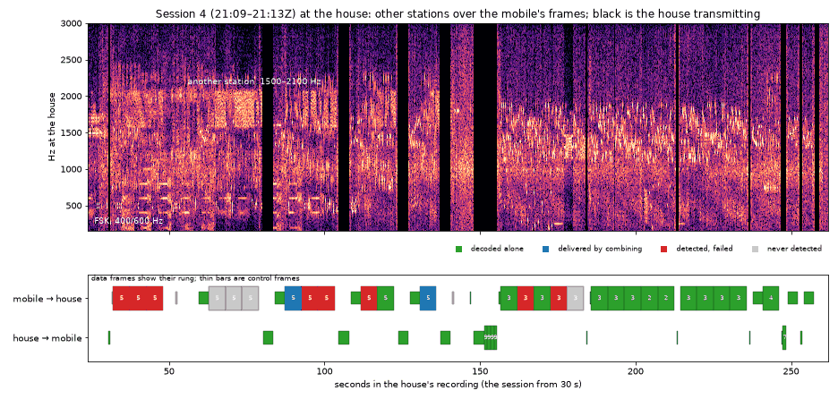

# RadioPost gateway and P2P on 40 m under QRM, the mobile and the house (2026-11-18)

Four sessions on the afternoon of 2026-11-18 (20:50–21:13Z, local time 15:50–16:13), on 7.101
MHz at 2300 Hz, from the mobile's RadioPost client to the house. Both stations' recordings were
uploaded with audio. The author's notes: overall a good afternoon; the gateway exchange and the
first P2P session went fine; the second P2P call failed because the house's RadioPost client had
stopped listening after the first; the last session, with an attachment and an ICS-213, sat stuck
for a while under heavy QRM and then completed. A VarAC attempt at the end ran out of time.

* **Who**:
  * **The mobile**: station `KK4ODA-2` (TS-480, 65 W, screwdriver, keyed by RTS on the DigiRig's
    COM9, no CAT), beta.164. RadioPost client 0.1.0-beta.27, calling as `WD5EMA`.
  * **The house**: `KK4ODA-1` (FTDX10 on Yaesu CAT, 50 W, T2D, a 4-core mini PC), beta.164, under
    automatic control. Two programs on one Aether: RadioPost Gateway 0.1.0-beta.27 holding
    `KK4ODA-1` and scanning 7.101 and 3.590 MHz, and the RadioPost client 0.1.0-beta.27 holding
    `KK4ODA` for P2P.
* **The files**, none committed: the house's debug zips `20261118-205315Z KK4ODA-1 …`,
  `20261118-205821Z KK4ODA-1 …` and `20261118-211407Z KK4ODA-1 …`, and the mobile's
  `20261118-232452Z KK4ODA-2 aether-KK4ODA-2-20261118-232450.zip`. The mobile had no Internet
  during the sessions (its debug uploads failed: `No such host is known`), so the author sent its
  files by hand that evening. Both sides of sessions 1, 2 and 4 are there; session 3 left no
  recording at either end, and its account comes from both daemons' logs.
* **Read with** `tools/two_sides.py --from-loops`, `tools/air_account.py --sidecars`,
  `tools/rung_reading.py`, `tools/c1_replay.py` (both corrected for these sessions, §5.3) and
  `tools/ladder_table.py --bandwidth 2300`, and spectrograms of the house's audio.

## 0. Summary

**What happened.** Three sessions delivered everything. The gateway exchange (session 1)
carried RadioPost's 268 bytes out and 87 back in 93 s. The first P2P session (session 2) carried
an 8.4 kB text, compressed to about 1 kB on the air, in 123 s. The last (session 4) carried a 2.4 kB attachment
and ICS-213 in 227 s, 110 s of it spent getting the 336-byte opening across while a fade and
other stations' signals sat on the mobile's frames. Session 3's two calls were heard at the house
and not answered, because no program held `KK4ODA` (§3).

The path was weaker than the day before: the house read the mobile at −4 to +2 dB and the mobile
read the house at 0 to +5 dB, where on 2026-11-17 they read +4 and +15. The band was crowded:
another station's 500 Hz-wide signal, a 400/600 Hz FSK signal and carriers sweeping across the
passband were all in the recordings.

**The granted slots held** (§2). No overlaps; the least clear air 0.555 s; every answer reached the
air 68–121 ms after its slot opened.

**Why session 4 completed** (§4). For about 75 s the house decoded none of the mobile's data. The
link stayed up because its control frames went on the tone floor, which the house read at −6.7 and
−9.0 dB; the copies of each block combined across the fade; and the mobile's rate controller,
down since the first silent slot, put the message's new blocks at slower rungs, where nine of
twelve first copies decoded.

**Findings, ranked by what they cost.**

1. **The mobile's closing identifier never went out in session 4, nor after session 3's calls**
   (§6; fixed after the report, §12). Both stations changed to identifying in the data signal at 20:58Z. The mobile's
   identification frames named `WD5EMA`, the callsign its session ran under, and the rules gate
   refused them: "the identifier names WD5EMA, not this station". RadioPost had left Aether 60 ms
   after the session ended, and with its claim went `WD5EMA` from the callsigns the gate counts as
   the station's. In Morse, before 20:58, the same race made the mobile identify a `WD5EMA` session
   as `KK4ODA`. A regulatory bug: the author's call how to fix it.
2. **The house's RadioPost client stopped listening after every P2P session** (§3). Its connection
   to Aether closed 88 ms after session 2 ended. The mobile's calls in session 3 were heard and
   answered by nothing, as the rules say (ADR-0107, 0108). RadioPost's to fix; another session is
   on it.
3. **A both-ways call teaches the house a longer answer gap for the caller** (§7; fixed after
   the report, §12). The house
   accepts a both-ways try at its OFDM part; its tone part arrives five seconds later and is read
   as "called again after its call was accepted", so `WD5EMA`'s learned gap rose 75 → 325 →
   575 ms over sessions 1 and 2. No cost yet; a few more such calls and every exchange with
   `WD5EMA` waits half a second longer. A bug in `station/gaps.rs`.
4. **The first 28 s of session 4 were two lost headers** (§4.1). The acceptance stated −2 dB,
   0.1 dB above the edge at which a master's headers go on the floor (−5.1 + 3 dB). Both ordinary
   headers were lost in the QRM, two silent slots followed, and only then did the headers move to
   the floor. Evidence for the rate review, not a change.
5. **Rung 5 under a partial-band interferer** (§4.2). The mobile's tone100-153 frames span
   700–2300 Hz; another station covered 1500–2100 Hz of it. Of twelve copies, one decoded alone.
   The fast tone kinds read their noise as one level (ADR-0104), so they cannot weigh down the
   tones an interferer sits on. A measurement for the author to decide on.
6. **The house's capture and its scan** (§8). The house lost about 150 ms of capture in session 4
   in pieces under the 10 ms that the skip report counts, and every scan move costs a 400 ms pass
   that the log calls slow (1 556 of them since 18:10Z). No frame was lost to either that the
   records show.

## 1. The sessions

Times UTC, on the mobile's clock. *Call* is from the mobile's `connect` to `connected`;
*session* from `connected` to `closed`. *App* bytes are what RadioPost handed Aether; *air* bytes
what the link acknowledged after compression. *House read* is the last frame the house read from
the mobile (best in brackets), *mobile read* the reverse (the sessions' histories).

| # | start | to | what | tries | call | session | app bytes out / in | air bytes out | house read | mobile read | path |
|---|---|---|---|---|---|---|---|---|---|---|---|
| 1 | 20:50:30 | `KK4ODA-1` | gateway exchange | 1 (both-ways) | 10.7 s | 93.4 s | 268 / 87 | 288 | −4.0 (−0.1) | +0.3 (+3.9) | moderate |
| 2 | 20:55:06 | `KK4ODA` | P2P: an 8.4 kB text | 1 (both-ways) | 11.6 s | 122.7 s | 8 695 / 322 | 1 354 | +1.7 (+1.7) | +3.3 (+6.6) | moderate, QRM |
| 3 | 21:07:18 | `KK4ODA` | P2P, twice | 4 + 4 | no answer | — | — | — | heard, not answered | — | — |
| 4 | 21:09:04 | `KK4ODA` | P2P: attachment and ICS-213 | 2 | 14.4 s | 227.5 s | 2 707 / 322 | 1 093 | +0.4 (+4.3) | +2.2 (+4.8) | poor, then moderate |

The path classes come from what the sessions measured. In sessions 1 and 2 frames failed at
readings where the AWGN curves say they decode, and the readings moved 4–6 dB within a minute. In
session 4 the mobile's signal faded by about 6 dB for a minute under QRM (§4), and the session was
moderate again after it. The field log has only the four classes. The QRM is in its notes.

In session 2 the text crossed in 77 s, from the client's `send` at 20:55:52 to "8359 bytes
delivered" at 20:57:09: about 870 bit/s of RadioPost's data, about 105 bit/s on the air. In
session 4 the attachment went at about 206 bit/s of RadioPost's data (2 371 bytes in 92 s),
about 73 bit/s on the air.

## 2. The granted slots

`two_sides.py --from-loops` on the three two-sided sessions. In session 1 the signal both stations
heard gave a weak correlation (r 0.30), and in session 4 none (r 0.07). The loops' offset places
both, as it does session 2:

| session | handovers | least clear air | overlaps | house answers, late | least margin | loop latency, mobile / house |
|---|---|---|---|---|---|---|
| 1 | 18 | 0.557 s | 0 | 81–102 ms | 248 ms | 59 / 59 ms |
| 2 | 26 | 0.555 s | 0 | 79–118 ms | 232 ms | 57 / 56 ms |
| 4 | 22 | 0.576 s | 0 | 68–121 ms | 229 ms | 60 / 58 ms |

`air_account.py`: no forfeit and no late drop at either end. The master transmissions that drew no
answer are all accounted for: one answer unheard in session 1; one header lost in session 2; in
session 4 one header lost (30.5 s) and two headers alone that nothing heard (51.1 and 139.9 s).
The mobile keyed in an idle exchange's open window once in sessions 2 and 4, 0.2 s in. The
house's keying was 1 ms (CAT); the mobile's render took 50–110 ms for a first transmission and
10–40 ms after.

The loops' offset held to within 30 ms in sessions 1 and 2, with two 10–12 ms steps in session 2
beside a 38 ms capture skip the house padded (ADR-0089). In session 4 it moved 182 ms over 227 s,
smoothly (§8).

## 3. The calls, and session 3

**Sessions 1 and 2.** One both-ways try each (the OFDM part and the tone part back to back, 6.6 s
keyed), the station not heard lately under the name called. The house decoded the OFDM part at
−2.4 and −0.6 dB, accepted, and keyed its acceptance on the floor once the tone part had ended.

**Session 3, from Aether's side.** At the house, RadioPost Gateway held `KK4ODA-1` and scanned;
the RadioPost client held `KK4ODA` and had listened since 18:11:42. The house's log:

```
20:54:49.121 claims: RadioPost client 0.1.0-beta.27 has gone: no longer answering for KK4ODA
20:54:51.601 claims: RadioPost client 0.1.0-beta.27 answers for KK4ODA
20:54:51.617 listen: answering calls to KK4ODA
20:55:08.691 heard: call from WD5EMA to KK4ODA at -0.6 dB           (session 2)
20:57:19.488 disconnected: peer disconnected
20:57:19.576 claims: RadioPost client 0.1.0-beta.27 has gone: no longer answering for KK4ODA
21:07:19.668 mismatch: WD5EMA called KK4ODA, which RadioPost client 0.1.0-beta.27 answered for:
             RadioPost client 0.1.0-beta.27 is not running now, so nothing answers KK4ODA.
             Start RadioPost client 0.1.0-beta.27 again.
21:08:38.013 mismatch: (the same)
21:08:58.494 claims: RadioPost client 0.1.0-beta.27 is using the station
21:08:58.540 claims: RadioPost client 0.1.0-beta.27 answers for KK4ODA
21:08:58.560 listen: answering calls to KK4ODA
21:09:17.466 heard: call from WD5EMA to KK4ODA at -1.6 dB           (session 4)
```

* **Heard.** The house decoded the first call's first try (21:07:19.7) and the second call's
  tone try (21:08:38.0). The mismatch line comes at most once a minute for a station and kind, so
  the other tries it may have decoded are not in the log. The scan lingered on 7.101 MHz for the
  second call, from 21:08:08.9 to 21:08:41.1.
* **Not answered.** Nothing held `KK4ODA` from 20:57:19.576 to 21:08:58.494. The house's own
  callsign is `KK4ODA-1`, held by the gateway, and the house runs under automatic control, where
  only a program answers a call (ADR-0107). So Aether answered nothing, as the rules say, and told
  the operator which program to start again (ADR-0108's `gone_holder`, `what` = `program`, on the
  panel's mismatch banner).
* **Why nothing held it.** The house's `radiopost.log` says `the session with WD5EMA is over` at
  20:57:19 and nothing more until `listening as KK4ODA` at 21:08:58, when the author pressed
  Listen. The client's WebSocket closed 88 ms after the session ended, after session 4 the same
  (21:13:05.098), and when the listen was stopped by hand at 20:54:49. Every listen was a new
  connection. That is the Listen fix another session is making in RadioPost. Its notes folder has
  this account.
* **At the mobile.** Each call was four tries, three short OFDM tries and a 5.6 s tone try after
  the pause (ADR-0126, the house heard strongly in session 2). Some were held a few seconds for a
  busy channel. After each, the mobile said: "No answer from KK4ODA. KK4ODA-1 was heard 16
  minutes ago: if that is the station you meant, call KK4ODA-1" (ADR-0057). Here that points at
  the gateway, which cannot take a P2P session (report 18 §5). The caller cannot tell a station
  whose program left from a wrong callsign.
* **Session 4's call.** The author pressed Listen at 21:08:58; the mobile called at 21:09:04. The
  house did not decode the first try. Its recording, which keeps 30 s before a session, shows
  another station's signal at 1600–2450 Hz and the FSK at 400/600 Hz on the channel then. The
  second try came 10.5 s after the first ended (the first call's tries came 3 s apart). The mobile's
  busy hold accounts for its last 4 s, and the log does not say why the rest. It was accepted at
  −1.6 dB.

## 4. Session 4: where the time went



The figure is the house's audio for the whole session (the session from 30 s; black where the
house transmitted and heard nothing), with every frame of each direction underneath. The other
signals in the channel:

* **Another station's signal, about 500 Hz wide, at 1500–2100 Hz**, on and off from before the
  session to about 105 s. While the mobile's frames of 63–78 s were on the air, the band
  1500–2100 Hz at the house stood 5–6 dB over the rest of the mobile's span; at 117 s, when one of
  the same blocks decoded, it stood 1–4 dB under. Nothing about that station is read here beyond
  its place and width.
* **An FSK signal at 400 and 600 Hz** (200 Hz shift) in bursts throughout, below the tone frames'
  span and inside the OFDM rungs'.
* **A fade of the mobile's signal**: its tones at 700–1100 Hz were 6.5 dB lower during the frames
  of 63–78 s than at 117 s. The house read the mobile's floor headers at −6.7 dB (60 s) and −9.0 dB
  (84 s), then −1.4 (108 s) and −0.3 (127 s).

### 4.1 The opening, 30–140 s

RadioPost's 336-byte opening went as three blocks at rung 5 (tone100-153, 150 bytes, 5.36 s a
frame). The mobile's transmissions, on its clock:

| at | air to next | the mobile sent | what the house made of it |
|---|---|---|---|
| 30.2 | 20.6 s | ordinary header, blocks 0–2 | header never detected; data detected at −7.4 to −9.5 dB, failed. No grant: a silent slot |
| 50.9 | 7.4 s | ordinary header alone (R9: the frames' answer unheard) | never detected. A second silent slot |
| 58.2 | 24.5 s | header on the floor, blocks 0–2 again | header read at −6.7 dB; all three frames never detected; answered "missed 3" |
| 82.6 | 24.3 s | floor header, blocks 0–2 (RV 2) | header at −9.0 dB; block 0 delivered by combining its three copies |
| 107.1 | 19.0 s | floor header, blocks 1–2 (RV 3) | block 2 decoded alone at −1.1 dB; block 1 failed |
| 126.1 | 13.7 s | floor header, block 1 (RV 0) | block 1 delivered by combining its five copies |

So 110 s for 336 bytes. Of it:

* **28 s were two lost ordinary headers.** A master's headers go on the floor when the acceptance
  states an SNR under the ordinary control threshold plus `answer_floor_margin_db`, −5.1 + 3 =
  −2.1 dB at 2300 Hz. The acceptance stated −2, 0.1 dB above it, so the headers went in the short
  ordinary control frame. The QRM took both, and the headers moved to the floor only after the
  silent slots, as R9 has them. ADR-0090 tried moving after one silent slot and was rejected on
  the harness. This is one more sample for that question.
* **About 50 s were copies that could not decode**: the second copies never detected (58–78 s),
  the third copies of blocks 1 and 2 failing (88–103 s).
* **The rest delivered**: block 0 by combining at 103 s, block 2 alone at 122 s, block 1 by
  combining at 136 s.

No block was re-encoded, though C1 had chosen rung 3 for new data from the first silent slot (a
transmission nothing answers steps it down two rungs, `silence_step`). A block keeps the rung it
was cut at. A 150-byte block fits no slower tone rung whole (rung 4 carries 102 bytes), so it can
move only in pieces, and a block is split only after four copies with the choice below its rung
(ADR-0086). Block 1 was rescued at its fifth copy, the transmission at which a split would have
come due.

### 4.2 Rung 5 under a partial-band interferer

The mobile's rung 5 frames sent 12 copies in this session: 3 never detected, 8 detected and
failed, 1 decoded alone; with combining the three blocks got through. Its 1600 Hz span (700–2300
Hz) had the other station over three-eighths of it. The fast tone kinds (rungs 2–5 at 2300 Hz) read
their data against one noise level for the whole frame: per-tone noise shaping was kept to the
floor's kinds because, read tone by tone, the fast kinds lost on ITU NVIS (ADR-0104). So nothing in
the receiver weighs down the tones the interferer sits on. Whether per-tone noise would have
decoded these frames is not something these files can show. It needs the fast kinds benched under
a partial-band interferer, with and without per-tone noise, and on NVIS, ADR-0104's reason.

### 4.3 The reply and the message, 140–257 s

The house's 302-byte reply went at rung 9 (QPSK ⅓) in one transmission, four frames read at
+4.5 dB at the mobile. RadioPost then sent the attachment and the ICS-213, 2 371 bytes, about 850
on the air. These were new blocks, so they went at C1's choice, rung 3 (and rung 2 for the last
two, ADR-0130). The message went in four transmissions at rungs 3, 2 and 4 (tone50-75, tone50-51,
tone100-105): 12 first copies, 9 decoded alone, 3 more delivered by a later copy, in 93 s. A try
of rung 4 near the end decoded its one frame. The session closed with the house's identifier
(§6).

### 4.4 Why it completed, and VARA

What kept the session alive through 75 s with no data decoded:

* **The link timeout counts exchanges, and the exchanges went on.** Once the headers were on the
  floor (decoding down to about −19.5 dB at 2300 Hz, against −5.1 for the ordinary control frame),
  every header and answer got through, at −6.7 and −9.0 dB at the worst. The link was never quiet
  long enough to time out.
* **Every copy counted.** The receiver combined the copies of each block across the fade: block 0
  with an RV 2 copy, block 1 at its fifth copy, block 2 with an RV 3 copy that decodes alone.
* **The slots kept the two stations apart.** No overlap between them, whatever the other stations
  did. A station in a session keys in its slot and does not wait for a clear channel, so the other
  signals and Aether's overlapped both ways.
* **The rate controller had come down.** It put the message's new blocks at rungs 3 and 2, where
  nine of twelve first copies decoded.

The author notes that VARA might not have completed under this QRM. These files cannot test that:
no VARA session was recorded on this path, and these notes assume nothing about VARA's design
(CLAUDE.md). What they show is narrower. For about 75 s the house decoded none of the mobile's
data and read its control frames at −6.7 to −9 dB. A link that needed its control frames read near
0 dB, or that gave up after a minute without progress, would have ended in that stretch.

## 5. What each direction carried, and the rate controller

### 5.1 The mobile's data, read at the house (`rung_reading.py`)

| session | rung | frame | sends | first copies | never | failed | alone | delivered by 1st / later / combining | exchange bit/s |
|---|---|---|---|---|---|---|---|---|---|
| 1 | 4 | tone100-105 | 4 | 3 | 0 | 1 | 3 | 2 / 1 / 0 | 60 |
| 2 | 3 | tone50-75 | 6 | 0 | 0 | 0 | 6 | 0 / 6 / 0 | 119 |
| 2 | 5 | tone100-153 | 3 | 3 | 0 | 0 | 3 | 3 / 0 / 0 | 155 |
| 2 | 7 | BPSK ⅓ | 9 | 6 | 2 | 1 | 6 | 3 / 3 / 0 | 126 |
| 2 | 8 | BPSK ½ | 18 | 12 | 3 | 12 | 3 | 1 / 2 / 3 | 105 |
| 4 | 2 | tone50-51 | 2 | 2 | 0 | 0 | 2 | 2 / 0 / 0 | — |
| 4 | 3 | tone50-75 | 12 | 9 | 1 | 2 | 9 | 6 / 3 / 0 | 64 |
| 4 | 4 | tone100-105 | 1 | 1 | 0 | 0 | 1 | 1 / 0 / 0 | 71 |
| 4 | 5 | tone100-153 | 12 | 3 | 3 | 8 | 1 | 0 / 1 / 2 | 35 |

Every data frame was numbered as the mobile recorded it. Nothing was lost.

* **Session 2** started at rung 8 (BPSK ½) from an acceptance stating −1 dB. The 2300 Hz guess
  (the AWGN curve 1 dB under the reading, ADR-0111) puts rung 8 at −1.8 dB, so it fit. Its first
  six copies decoded one; the next six new blocks at rung 8 decoded none, three never detected,
  while carriers swept across the passband. Re-encoded at rung 3 (ADR-0085), all five decoded. A
  try of rung 7 decoded three of six and lost; rung 5 decoded three of three. The best measured
  neighbour would have delivered 14 % more over the rungs used. This is the pattern of the first
  rate review's Gate 0: an OFDM rung chosen where the floor's top carried more.
* **Session 4** is §4: rung 5 for 110 s under the fade and the QRM, then rungs 3 and 2.
* **Session 1**: the mobile's 268 bytes went at rung 4, under C1's choice of 5 (ADR-0130: a short
  transmission at the most robust rung that carries it).

### 5.2 The house's data, read at the mobile

| session | rung | frame | sends | first copies | never | failed | alone | delivered by 1st / later / combining |
|---|---|---|---|---|---|---|---|---|
| 1 | 7 | BPSK ⅓ | 3 | 3 | 1 | 0 | 2 | 2 / 0 / 0 |
| 1 | 0 | tone-24 | 1 | 0 | 0 | 0 | 1 | 0 / 1 / 0 |
| 2 | 9 | QPSK ⅓ | 4 | 4 | 0 | 0 | 4 | 4 / 0 / 0 |
| 2 | 10 | QPSK ½ | 2 | 1 | 0 | 2 | 0 | 0 / 0 / 1 |
| 4 | 9 | QPSK ⅓ | 4 | 4 | 0 | 0 | 4 | 4 / 0 / 0 |
| 4 | 7 | BPSK ⅓ | 1 | 1 | 0 | 0 | 1 | 1 / 0 / 0 |

The house sends little: RadioPost's greeting and receipt, 87 bytes a gateway session and 322 a P2P
session. In session 1 one rung 7 frame was never detected and its block was re-encoded at rung 0,
the floor. In session 2 the 20-byte receipt went at rung 10 (C1's choice at +3 dB) and failed
twice before its two copies combined. Report 18's 64-QAM replies (its finding 1) did not recur:
the mobile read the house about 12 dB lower than the day before, and ADR-0130 (beta.163) puts a
short block at the most robust rung that carries it.

### 5.3 C1 replayed, and two corrections to the tools

`c1_replay.py` at first said the replay agreed with the mobile's choices in 3 of 8 and 2 of 9
data transmissions. Two faults in the tools, not in C1:

* **The master's seed.** From protocol 13 the acceptance is a control frame stating, in whole
  decibels, the SNR the slave read the call at, and the master's engine seeds C1 from that, with
  the exchange already priced in both stations' control families (`_heard` prices before
  `rate.seed`). The replay seeded from the slave's raw reading of the call (−1.58 dB in session 4,
  where the acceptance stated −2) with no families, and chose rung 8 where the engine sent rung 5.
  `rung_reading.replay_sender` now seeds from the acceptance it finds in the master's record, in
  the families of that moment (`_acceptance`), and an earlier build's session reads as before.
* **Copies are not choices.** A transmission of blocks already sent goes at their own rungs, or a
  stuck-frame rule's, not at C1's choice. On a path where blocks stick, most transmissions are
  such. `c1_replay.py` now judges a transmission by its new blocks only, takes the rung it was
  trying as its choice too, and counts the transmissions of copies alone apart
  (`new_blocks_rung`, `copies_only`).

Tests for both are in `model/tests/test_rung_reading.py` and `test_c1_replay.py`. With them, every
transmission of new blocks in the three sessions is explained, both directions:

| session | the mobile's data: agree / below (ADR-0130) / of, copies alone | the house's |
|---|---|---|
| 1 | 0 / 2 / 2, 1 | 0 / 2 / 2, 1 |
| 2 | 4 / 0 / 4, 4 | 1 / 1 / 2, 1 |
| 4 | 5 / 0 / 5, 4 | 1 / 1 / 2, 0 |

Report 18's sessions read the same way with the corrections: every master's new-block
transmission agrees; one slave transmission of beta.162 (rung 17 against the replay's 16, before
ADR-0130) does not.

In session 4 the replay rated rung 4, the rung above its choice of 3, better for 131 s of 195 s
of exchanges and held off it. The silent slot had stepped the choice down two rungs, and a rung
above becomes choosable again only through a try or frames of its own. Until 140 s that cost
nothing (the session was sending rung-5 copies anyway). From 155 s it is the familiar slow climb:
the try of rung 4 began at 213 s, and its one frame went at 236 s and decoded, when the message
was nearly through. The best measured neighbour, +179 %, sets that one frame against rung 5's time
under the QRM and says little.

## 6. The identifiers

Both stations identified in Morse in sessions 1 and 2, the house (the called station) first and
the mobile after it, as ADR-0075 orders. At 20:58Z the author changed both to identify in the data
signal (`[radio] identify_by = "data"`, ADR-0127; the `config.set` lines at 20:58:00 and
20:58:33). After that:

* **The house** identified at the end of session 4 in the data signal as `KK4ODA`, keyed 1.1 s.
  The mobile decoded it: `ident: identified KK4ODA`.
* **The mobile** did not identify at all. Its log:

```
21:08:44.409 claims: RadioPost client 0.1.0-beta.27 has gone: no longer answering for WD5EMA
21:09:03.154 regulatory: decision=blocked rule="§97.119(a)" code=identifier callsign=KK4ODA-2
             ... reason="TX BLOCKED: the identifier names WD5EMA, not this station"
...
21:13:06.101 disconnected: closed
21:13:06.162 claims: RadioPost client 0.1.0-beta.27 has gone: no longer answering for WD5EMA
21:13:06.771 identified: the closing identifier is not sent
21:13:06.771 regulatory: decision=blocked ... reason="TX BLOCKED: the identifier names WD5EMA,
             not this station"
```

The first refusal was the identifier owed after session 3's failed calls (ADR-0055), the second
the closing identifier of session 4. Each time the identification frames named `WD5EMA`, the
callsign the call or session went as: the engine keeps that callsign for its identifier on purpose
(`GrantedEngine::id_call`, set at the session's end). And each time the gate's check that an
identifier names the station's own callsign (`Station::foreign_identifier`, ADR-0127 §2.5) ran
after RadioPost had left. The check looks at the callsigns the station answers to at that moment
(`engine.callsigns`, `engine.my_call`). When the program's claim ends, `set_callsigns` puts back
the station's own, `KK4ODA-2`. RadioPost closes its connection as a session ends, so the race is
lost every time. So from 21:07:18 to 21:13:06 the mobile transmitted on and off for six minutes,
three calls and a session, without identifying once.

The Morse path has the opposite form of the same race. It does not use `id_call`: it renders the
identifier from `engine.my_call` at the moment it keys, after the program left, so in sessions 1
and 2 the mobile identified a `WD5EMA` session as `KK4ODA` ("the closing identifier went out as
KK4ODA"). Morse has no check against another callsign, so it went.

Which callsign identifies a session a program ran under its own claimed callsign is the author's
call (and the licensee's). The one the session's frames carried seems the natural answer for both
paths: the station was `WD5EMA` for that contact, and `WD5EMA` is a callsign the station was
configured for when it used it. A test should hold it: a program's session under a callsign of its
own ends, the program leaves at once, and the identifier still goes naming that callsign, in Morse
and in data.

## 7. The learned answer gap and the both-ways try

The house's log in sessions 1 and 2:

```
20:50:32.766 heard: call from WD5EMA to KK4ODA-1 at -2.4 dB         (the try's OFDM part: accepted)
20:50:38.014 heard: call from WD5EMA to KK4ODA-1 at -8.4 dB         (the same try's tone part)
20:50:38.014 gap: answer gap for WD5EMA now 325 ms: it called again after its call was accepted
20:50:38.411 ptt: keyed                                              (the acceptance)
...
20:55:13.953 gap: answer gap for WD5EMA now 575 ms: it called again after its call was accepted
20:55:14.333 ptt: keyed
```

ADR-0054 learns a station's answer gap from one sign: it asks again after this station's answer,
so the answer was lost. But here the "second call" is the tone half of the same both-ways try
(ADR-0126), heard 0.4 s before the acceptance was even keyed. `Gaps::called` compares the second
call's decode time with the time the call was accepted (decided), not with when the acceptance
went on the air or ended. Every both-ways call the house accepts at its OFDM part raises the
caller's gap by 250 ms; a session after it lowers it by 25 ms (session 4: 575 → 550 ms).

The cost so far is nothing: a 575 ms gap is inside what a slave's slot already waits (the slot's
decode budget, `KEY` and the guard), and all three sessions ran at level 0 except where silent
slots raised it. Two or three more both-ways calls take it past that, and from then on every
exchange with `WD5EMA` waits 0.5 s longer, up to 2 s at the ceiling. `heard.json` keeps it across
restarts. The fix is small: a repeated call says the acceptance was lost only when the repeat
began after the acceptance went on the air. A station test should hold it with a both-ways try
(done, §12).

## 8. The stations

* **The house's capture.** 26 capture skips since the daemon started at 18:10Z, 1 088 ms in all
  (the largest 158 ms), all padded (ADR-0089). In the sessions: one 38 ms skip in session 2 and
  three of 18 ms in session 4, none inside a frame that failed. Beyond them, in session 4 the
  house's recording is 153 ms shorter than its wall-clock span (the other five recordings are
  within 17 ms), and the loops' offset moved 182 ms over the session, smoothly. So the house lost
  about 150 ms of capture in pieces under the 10 ms the skip report counts. Its clock fell that far
  behind the air without the keying gate losing a slot: its answers stayed 68–121 ms after their
  slots' starts, at least 229 ms inside their limits. This is the FTDX10's USB codec on the 4-core
  mini PC again (reports 13, 14, 17). If it grows, the margin shrinks.
* **The house's slow passes are its scan.** 1 556 slow passes since 18:10Z (the log names 589 of
  them); 588 of those 589 came within 1.5 s of a dial move (median 0.9 s after), at a median
  399 ms, all in capture. That is the receiver restarting after a move with the longest tone frame of
  silence behind it (ADR-0129 §12), on this machine about 0.4 s of work. They cost nothing in
  these sessions, but the warning line is noise in the log, and the pass is the largest the
  machine makes.
* **The scan held all day.** 4 788 dial moves from 11:24 to 21:14Z, none missed (ADR-0129 §13,
  beta.163, report 18's finding 2 fixed).
* **The busy floor** at both stations sat 3–9 dB over the noise between the signals: the per-bin
  10th percentile of the channel's spectrum over the listening time, put on the detector's scale
  and corrected by 9.8 dB for a noise bin's 10th percentile. The band carried other stations most
  of the time, and the detector read busy for 62–97 % of the listening time. The mobile's busy
  state flapped every few seconds when idle ("the passband is peaked"), and the VarAC copy attached
  later saw 30 `BUSY ON`/`OFF` pairs in six minutes. After each of the house's dial moves its log
  printed a floor of −inf (the detector relearning, ADR-0088's `retune`). This is evidence for the
  busy detector's review, which CLAUDE.md asks for in place of another patch. Its third count:
  the floor learning the other stations on a crowded band.
* **The receive filter** is no longer read (ADR-0132, beta.163): no warnings, by design.
* **Clipping**: none. The peaks sat 11–14 dB under full scale in all six recordings, and neither
  log has a clipping line.
* **The mobile's radio setup** is report 18's: keyed by RTS with the rules judging a declared dial
  of 3.590 MHz while the radio was on 7.101 (`dial_hz=3590000 dial_source=declared` in its
  regulatory lines). Report 18's change 3 (Kenwood CAT on COM9) has not been made.

## 9. The VarAC attempt

Only the mobile's side was recorded: no session, nothing keyed. At 21:14:09 the mobile loaded the
*VarAC default* profile (keyed by the host program) and restarted. VarAC attached at 21:15:59
with `MYCALL KK2ODA KK2ODA-T`, a typo, left after 19 s, and attached again at 21:16:25 as
`MYCALL KK4ODA KK4ODA-T`. It sent `BW500`, `CHAT ON`, `LISTEN ON`, `LISTEN CQ`, and the adapter
moved the station to 500 Hz. Then nothing but `IAMALIVE` and the busy lines until it left at
21:22:25; Aether stopped at 21:22:28. The house's side after 21:14 was not uploaded.

For the next try: the two VarAC copies need different callsigns. VarAC strips the SSID from its own
alias, so `KK4ODA` at both ends cannot work; the mobile could be `WD5EMA` in VarAC as it is in
RadioPost.

## 10. For the rate controller (P9-21)

* **Paths**: 40 m, afternoon, the mobile to the house at 2300 Hz, the house reading the mobile at
  −4 to +2 dB and the reverse at 0 to +5 dB. Sessions 1 and 2 moderate; session 4 poor for its
  first 105 s (a 6 dB fade under a 500 Hz-wide interferer), moderate after.
* **Session 2** is one more case of an OFDM rung chosen where the floor's top carried more: rung 8
  from a −1 dB acceptance decoded 1 of 12 first copies, rung 5 3 of 3 (+14 % for the best measured
  neighbour).
* **Session 4**: three blocks cut at rung 5 went up to five copies there under the QRM (one copy
  decoded alone), although C1 had chosen rung 3 from the first silent slot on. A 150-byte block
  can leave rung 5 only in pieces, after four copies (§4.1). Whether moving or splitting them
  sooner would have been faster is a counterfactual the review would have to bench.
* **The header family at the edge** (§4.1): a −2 dB acceptance put the headers in the ordinary
  frame by 0.1 dB, and that cost 28 s.
* **The climb after a silence step** (§5.3): stepped down to rung 3 by the first silent slot, C1
  rated rung 4 better for most of session 4 and reached it only by a try at 213 s, whose frame
  decoded. One more sample of the slow climb.
* `c1_replay.py` and `rung_reading.py` now replay a protocol 13 session's opening as the engine ran
  it (§5.3).

## 11. Changes proposed, in order

| # | change | where | whose call |
|---|---|---|---|
| 1 | A session's or a setup's identifier names the callsign it went as (the engine's `id_call`, the setup's `setup_call`), and the gate accepts that callsign after the program has left; Morse and data alike | Aether, `station.rs` (`foreign_identifier`, `link_identifier`, `render_link_identifier`) | **done** (§12; ADR-0075 §7, ADR-0127 §11) |
| 2 | The RadioPost client listens again after a P2P session ends | RadioPost | in hand in another session |
| 3 | A repeated call teaches a gap only when it began after the acceptance went on the air | Aether, `station/gaps.rs` | **done** (§12; ADR-0054 §5) |
| 4 | Bench the fast tone kinds (2300 Hz rungs 2–5) under a partial-band interferer, with and without per-tone noise, and on NVIS | `tools/bench_cut.py`-style bench | the author's |
| 5 | The scan's restart pass is not logged as a slow pass, or is made cheaper | Aether, the run loop's pass report or `Air::listen_after_silence` | the author's; low |
| 6 | The house's capture losses under 10 ms: count them (the samples a callback delivers against its timestamps) before deciding anything | Aether, `audio::CaptureSkips` | the author's; low |
| 7 | Debug mode keeps a zip it could not send and tries it again when the Internet is back, not only twice | Aether, `debug.rs` | the author's; low |
| 8 | The mobile keys by Kenwood CAT on COM9 (report 18's change 3), and the two VarAC copies get different callsigns | the mobile's Setup, VarAC | the author |

The rate controller (§10) and the busy detector (§8) wait for their reviews, by the author's
rules.

## 12. Fixed after the report (the author's go, 2026-11-18)

**Change 1, the identifier.** The engine already keeps the ended session's callsign for its owed
identifier (`id_call`); it now says so (`GrantedEngine::identifier_call`, model and port). The
daemon's Morse paths render that callsign instead of `my_call` at the moment they key. The rules gate
accepts it, and the setup identifier's `setup_call`, beside the station's callsigns of the moment. A
frame naming any other callsign is still refused. Two station tests run the mobile's case through
real audio: a program's session ends, the program leaves at once, and the identifier names its
callsign, in Morse and in data; and a program's unanswered call is identified as its callsign after
the program left. On the code before, each reproduces the field: Morse "went out as" the station's
own callsign, and data "is not sent", refused with "the identifier names WD5EMA, not this station".
ADR-0075 §7, ADR-0127 §11; the manual's **Identify by** says it (1.9.1).

**Change 3, the learned gap.** An answer is watched from the moment it is keyed: the station notes
what each rendered transmission answers and tells the gaps when it keys it (`LearnedGaps::aired`). A
call or probe says the answer was lost only when it began on the air after that keying. A both-ways
try's tone part, begun before the acceptance went out, no longer counts. A two-station test runs a
both-ways call over real audio, checks both parts are heard and no gap is learned, and fails on the
rule before. ADR-0054 §5.

Neither changes the wire, a configuration key or the replay vectors. The house's `heard.json` still
holds 550 ms for `WD5EMA`; clean sessions ease it, 25 ms each.
