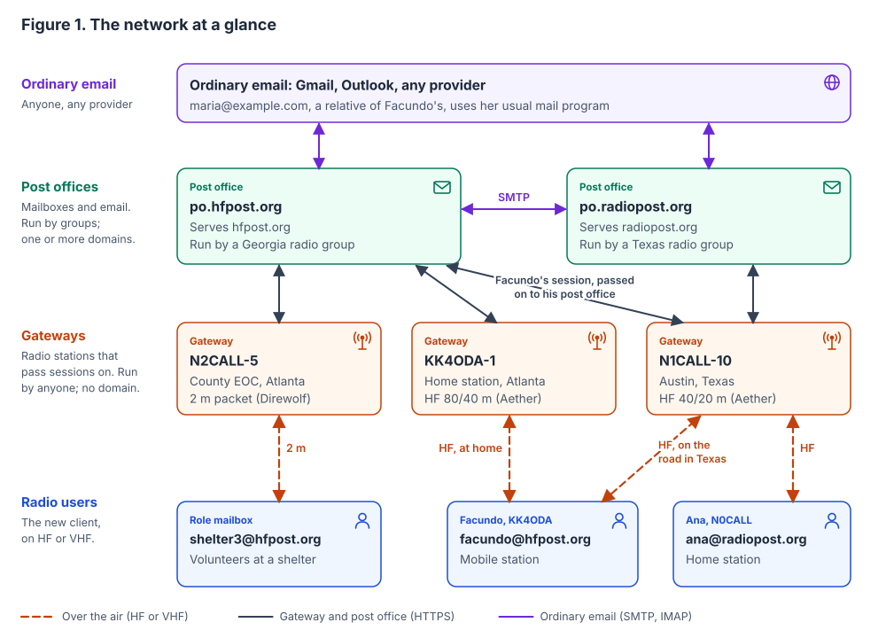
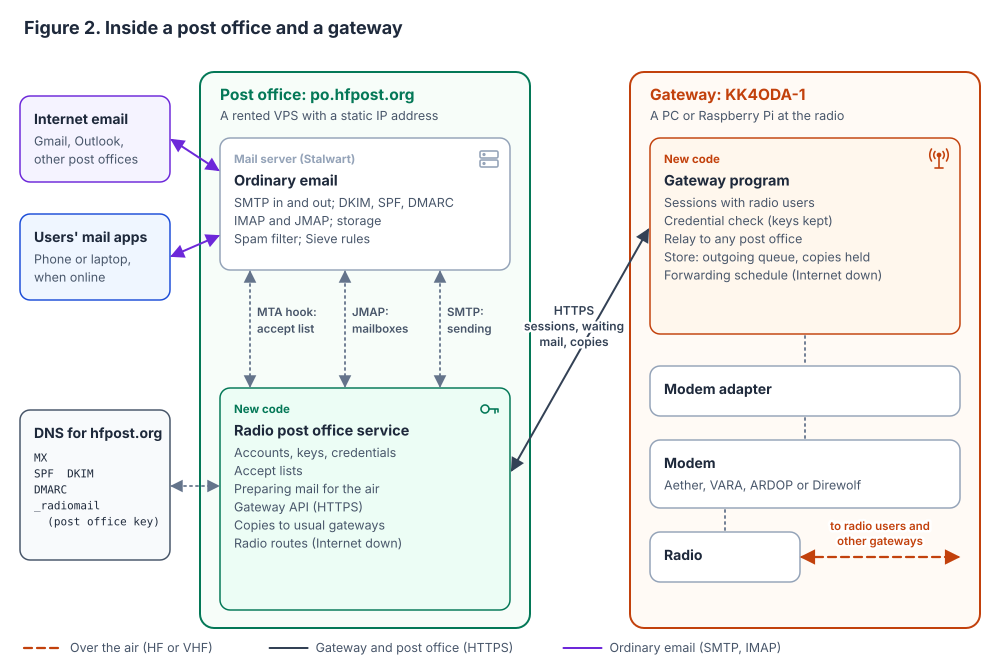
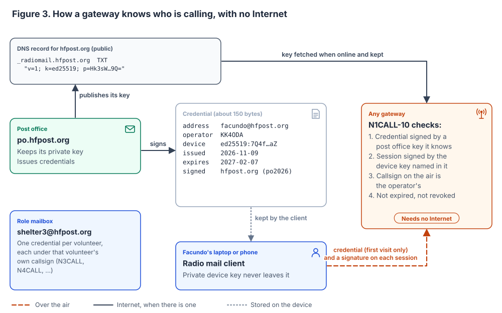
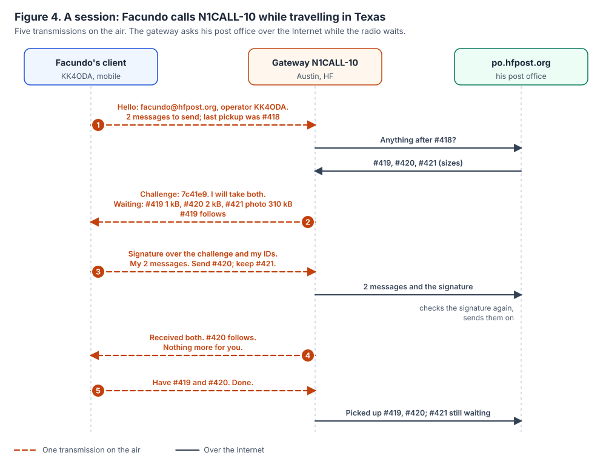
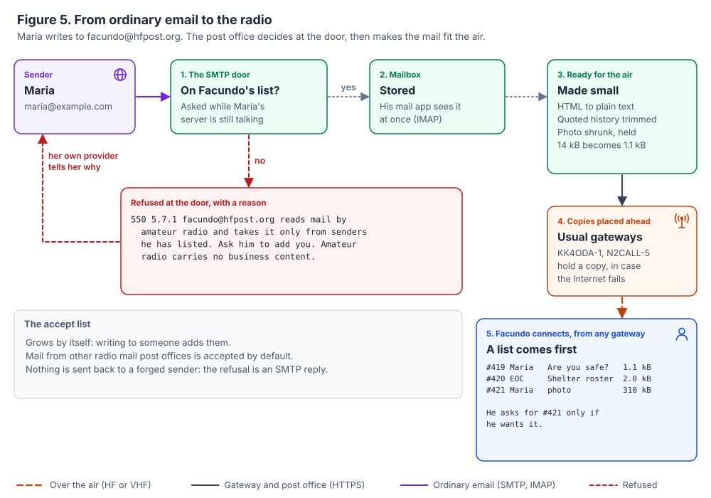
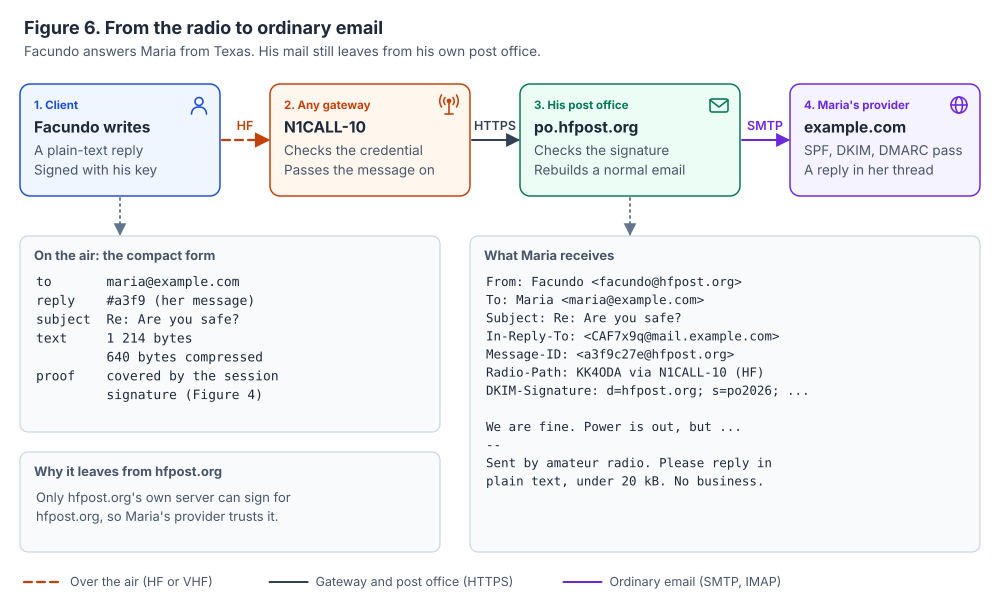
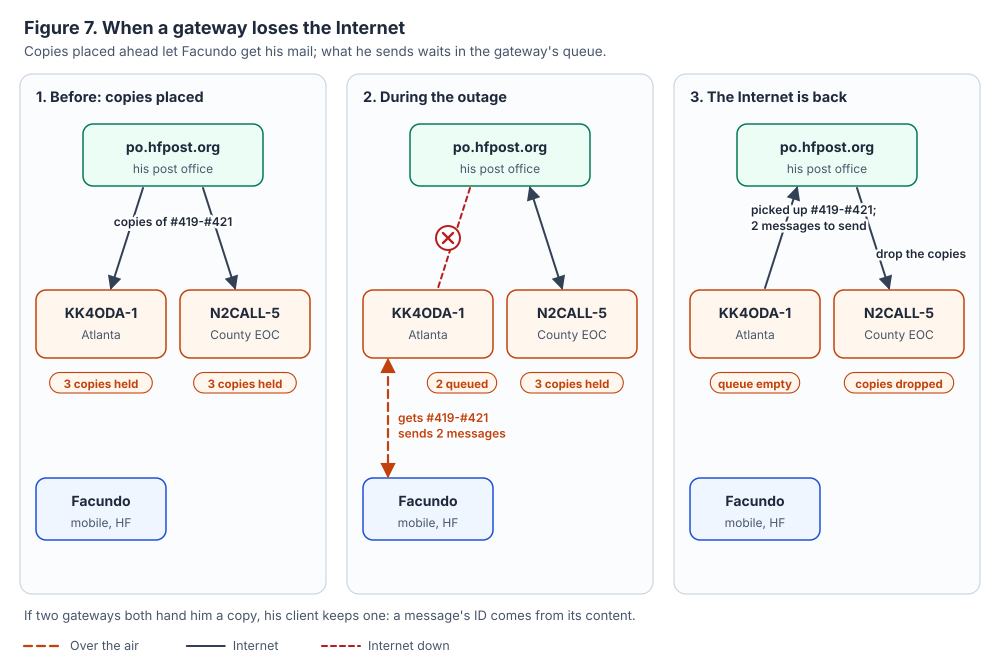
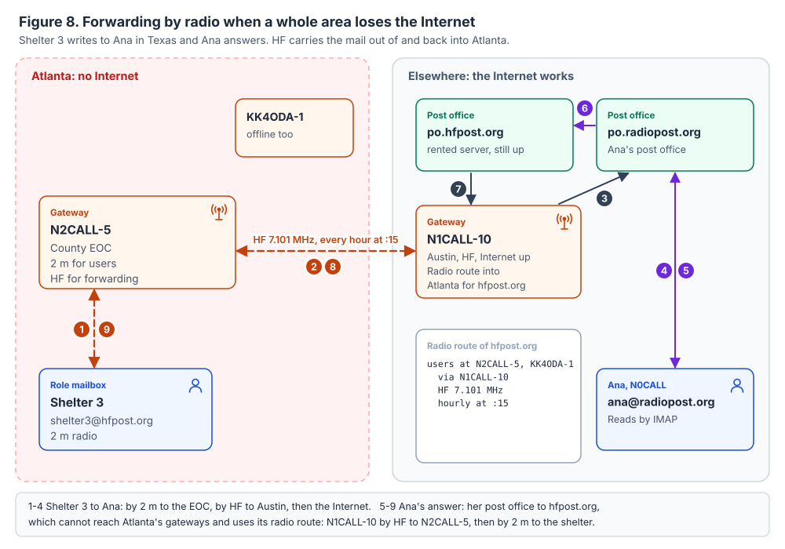
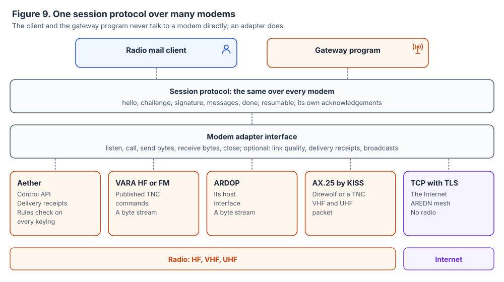

# Radio mail: a federated mail system for amateur radio

*Concept document, 2026-11-09. A detailed design follows it. "Radio mail" is a working name.*

This document describes a system that lets licensed amateurs send and receive ordinary email by
radio, through gateways that anyone can run, with no central server. It covers the parts and how
they fit, with examples and schematics. It leaves message formats, protocol fields and code for
the detailed design (§13 lists what that document must settle).

The system is separate from Aether. Aether is the first modem it runs over, and these notes live
in Aether's repository only until the system has a repository and a name of its own.

---

## In one page

* **Three roles, kept apart.** A *gateway* is a radio station that passes sessions on. A *post
  office* is a mail server that holds mailboxes and talks to ordinary email. A *domain* is the
  name after the @. Anyone can run a gateway, with no domain and no mail server. Groups run post
  offices.
* **Addresses are ordinary email addresses**, like `facundo@hfpost.org`. A callsign says who is
  transmitting. It is not the address.
* **Any gateway serves any user.** The gateway checks a short credential issued by the user's post
  office, with no Internet needed, and passes the session on to that post office.
* **It works with ordinary email both ways.** Each post office is a normal mail server
  ([Stalwart](https://stalw.art)) plus one new service. Someone with a Gmail address simply writes
  to `facundo@hfpost.org`.
* **It keeps working when the Internet fails.** Waiting mail is copied ahead to the gateways a
  user usually calls. Outgoing mail waits in a gateway's queue. Gateways forward mail to each other
  by radio.
* **One protocol over any modem**: Aether, VARA, ARDOP, AX.25 packet, or plain TCP.
* **Open**: a published protocol with test vectors, and open-source client, gateway program and
  post office service.
* **Not compatible with Winlink's programs, by choice.** It has a new client of its own.



*Figure 1.* Two post offices, three gateways and three radio users. Facundo calls his home gateway
in Atlanta. On the road in Texas he calls N1CALL-10, which passes his session to his own post
office over the Internet. He never needs a gateway that "belongs" to hfpost.org.

---

## 1. Why build it

Winlink works. It has hundreds of gateways, carries email both ways, has forms, and is used in
emergencies. What we want to change is its shape:

* Everything goes through central servers (the CMS) run by one team. A gateway needs that team's
  authorisation, and its channel appears in their list.
* The gateway software and the main client are closed. Our recent gateway work went largely into
  working around the behaviour of a closed gateway program.
* Addresses are callsigns at one domain (`KK4ODA@winlink.org`).

**Goals.**

| | Goal |
|---|---|
| G1 | Anyone licensed can run a gateway: a radio and a small computer. No domain, no mail server, nobody's permission. |
| G2 | A group can run a post office on ordinary hosting, and it handles ordinary email both ways. |
| G3 | Addresses are ordinary email addresses. |
| G4 | Any gateway serves any user. |
| G5 | Mail keeps moving when the Internet fails, as far as the radio reaches. |
| G6 | It runs over different modems. |
| G7 | It is open and documented: a published specification, test vectors and open-source code. |
| G8 | It follows the amateur rules (Part 97 in the US) by design. |

**Not goals.** Compatibility with Winlink's programs or its B2F protocol. Encryption on the air,
which the rules forbid. Being an email provider for people who are not amateurs. A single domain
served by several post offices (a later option, §12).

---

## 2. The pieces

| | Gateway | Post office | Domain | Client |
|---|---|---|---|---|
| **What it is** | A radio station that carries sessions between radio users and post offices | A mail server that holds mailboxes and talks to ordinary email | The name after the @ | The program a radio user runs |
| **What it keeps** | Post office keys, outgoing mail waiting for the Internet, copies placed ahead for its regular users | Mailboxes, accounts, accept lists | DNS records | The user's mail and private key |
| **What it needs** | A radio, a modem, a small computer; the Internet most of the time | A rented server with a fixed address, a domain, DNS records | A registration | A radio and modem, or the Internet |
| **Who runs it** | Any licensed amateur | A club, an ARES group, a county, or one person | Whoever runs the post office | Each user |

### The example cast

The same people and places appear in every figure.

| | Name | Details |
|---|---|---|
| Post office | **po.hfpost.org** | Serves `hfpost.org`. Run by a Georgia radio group on a rented server. |
| Post office | **po.radiopost.org** | Serves `radiopost.org`. Run by a Texas radio group. |
| Gateway | **KK4ODA-1** | Home station near Atlanta. HF on 80 and 40 m, Aether. |
| Gateway | **N2CALL-5** | The county EOC in Atlanta. 2 m packet with Direwolf for local users, and HF for forwarding. |
| Gateway | **N1CALL-10** | Austin, Texas. HF on 40 and 20 m, Aether. |
| User | **Facundo, KK4ODA** | `facundo@hfpost.org`. A mobile HF station. |
| User | **Ana, N0CALL** | `ana@radiopost.org`. A home HF station. |
| Role mailbox | **Shelter 3** | `shelter3@hfpost.org`. Worked by licensed volunteers (N3CALL, N4CALL). |
| Ordinary email | **Maria** | `maria@example.com`. Facundo's relative. Uses ordinary email only. |

The callsigns other than KK4ODA are placeholders. The domains are examples only; Appendix B says
which were free when checked.

### Inside a post office and a gateway



*Figure 2.* A post office is an off-the-shelf mail server plus one new service. A gateway is a
radio, a modem and one new program. The two new pieces talk to each other over HTTPS.

**The post office** runs two programs on one rented server:

* **The mail server (Stalwart).** It does everything ordinary email needs: receiving and sending
  (SMTP), the signatures other providers check (DKIM, SPF, DMARC), mailbox access for mail apps
  (IMAP and JMAP), storage, spam filtering and per-user rules (Sieve).
* **The radio post office service (new code).** It keeps accounts, keys and credentials, keeps
  each user's accept list, prepares mail for the air, answers gateways, places copies at users'
  usual gateways, and publishes the post office's radio routes. It talks to the mail server three
  ways. The mail server asks it at the SMTP door whether a sender may reach a mailbox (an *MTA
  hook*). It reads and files mail through JMAP. It sends a user's outgoing mail through ordinary
  SMTP submission.

**The gateway** runs one new program beside its modem. The program holds sessions with radio
users, checks credentials, relays to any post office, keeps a store (outgoing mail waiting for the
Internet, and copies placed ahead), and runs the forwarding schedule. A *modem adapter* connects
it to whichever modem the station uses (§7).

---

## 3. Addresses and identity

### 3.1 Addresses are ordinary email addresses

An address is `name@domain`. The name is the user's choice. The domain decides which post office
holds the mailbox, through DNS, exactly as for all email.

There are three kinds of account:

* **Personal**: owned by one licensed amateur, like `facundo@hfpost.org`.
* **Role**: `shelter3@`, `eoc@`, `net-control@`. A licensed trustee owns it, and the trustee
  authorises the licensed operators who may use it. When the volunteers change, the address stays
  the same, which suits emergency work.
* **Email only**: a member who is not licensed, such as agency staff. They use ordinary mail apps
  and never transmit. Their mail to radio users is third-party traffic (§11).

A post office can also offer a callsign alias (`kk4oda@hfpost.org`) beside the chosen name. As
with any email provider, moving to another post office changes the address, unless the user owns
the domain.

### 3.2 Where callsigns still matter

Callsigns stay wherever the rules put them:

* **Station identification on the air.** The modem does it (Aether sends its Morse identifier).
* **Account ownership.** Every account that can send by radio is owned by a licensee.
* **Keys.** Every key is tied to one operator's callsign.
* **Calling.** A user calls a gateway by its callsign.
* **The record.** Every message sent by radio carries the callsign of the station that sent it, in
  a `Radio-Path` header (§5.2).

### 3.3 Keys and credentials



*Figure 3.* The post office signs a credential once. Any gateway that knows the post office's key
can then check the user with no Internet.

* **Each device has its own key pair** (Ed25519: a 32-byte public key and 64-byte signatures). The
  private key never leaves the device.
* **Each post office has a key pair too.** It publishes the public half in DNS (a `_radiomail`
  record) and on its website.
* **A credential** is a short statement signed by the post office: this address, this operator's
  callsign, this device key, valid until this date. It is about 150 bytes.
* **A gateway checks four things**: that a post office key it knows signed the credential; that
  the device key named in it signed the session; that the callsign on the air is the operator's;
  and that the credential has not expired or been revoked.
* **Gateways fetch post office keys when they are online and keep them.** A gateway that has never
  seen a post office's key cannot check that post office's users while it is offline. Gateways
  therefore keep the keys of every post office they know about (§8.5).
* **Credentials last about 90 days.** The client renews its credential whenever it reaches its
  post office, by Internet or through any gateway with the Internet. A lost device is revoked at
  the post office. Gateways fetch the revocation list when online. An offline gateway might accept
  a revoked key until it next syncs, and the short validity limits that window.
* **Role mailboxes** give each volunteer a credential of their own, under their own callsign.
* **Nothing secret is stored on servers and no password goes over the air.** A signature leaves
  the text readable, which matters under the rules (§11).

---

## 4. A session on the air



*Figure 4.* Facundo sends two messages and picks up two, in five transmissions. While the radio
waits, the gateway asks his post office over the Internet.

What each transmission says, in plain words:

1. **Facundo's client:** "I am facundo@hfpost.org, operator KK4ODA. I have two messages to send,
   with these IDs and sizes. My last pickup was #418." The gateway asks his post office what is
   waiting after #418.
2. **Gateway:** "Here is a challenge to sign. I will take both your messages. Waiting for you:
   #419 (1 kB), #420 (2 kB), #421 (a photo, 310 kB). #419 follows."
3. **Client:** "Here is my signature over your challenge and my message IDs. Here are my two
   messages. Send #420, keep #421 for later." The gateway hands both messages and the signature to
   the post office, which checks the signature again and sends them on.
4. **Gateway:** "Received both. #420 follows. Nothing more for you."
5. **Client:** "I have #419 and #420. Done." The gateway tells the post office what was picked up.

**Design points.**

* **Few turnarounds.** Each change of direction costs seconds on a weak HF path. This session
  needs five transmissions; Winlink's B2F protocol needs about eight to ten for the same work.
* **The list comes first.** The user sees what is waiting before any of it is sent. Small
  messages come straight away; large ones only when asked for. The user sets the limit (for
  example, 5 kB).
* **Two kinds of number.** `#419` is the mailbox's own counter, which shows where the last pickup
  ended. Every message also has an ID made from its content (a hash). Because that ID depends only
  on the content, the same message received twice, through two gateways, is recognised and kept
  once.
* **Resume.** A message cut off by a lost link continues from the last byte received on the next
  session, through any gateway.
* **A compact form on the air.** Only the headers that matter are sent, and the text is
  compressed with a published method. Nothing is encrypted.
* **One signature per session.** It covers the challenge and the IDs of every message sent. The
  post office checks it again, and it travels with the messages when they are forwarded by radio
  (§6.3). It costs 64 bytes: about 14 s on Aether's slowest rung (36 bit/s) and under a second on
  most. The 150-byte credential, about half a minute on that rung, goes only on a first visit to a
  gateway.
* **Without the Internet**, the gateway answers step 1 from the copies it holds and queues what
  the client sends (§6).
* **Station to station.** Two clients can hold the same session directly, with no post office,
  like Winlink's peer-to-peer sessions.

---

## 5. Working with ordinary email

### 5.1 From ordinary email to the radio



*Figure 5.* Maria writes to Facundo. The post office decides at the SMTP door, stores the message,
makes it small, places copies ahead, and offers it to Facundo at his next session.

1. **The SMTP door.** While Maria's mail server is still connected, the mail server asks the
   radio post office service whether Maria is on Facundo's accept list. If she is not, the mail is
   refused with a reply that explains why:

   ```
   550 5.7.1 facundo@hfpost.org reads mail by amateur radio and takes it only
     from senders he has listed. Ask him to add you. Amateur radio carries no
     business content.
   ```

   Maria's own provider shows her that reply. Nothing is ever sent to a forged sender (no
   *backscatter*), because the refusal is part of the SMTP conversation rather than a separate
   email. Encrypted mail (PGP, S/MIME), mail over a size limit and executable attachments are
   refused the same way.
2. **The mailbox.** Accepted mail is stored. If Facundo has the Internet, his ordinary mail app
   shows it at once.
3. **Ready for the air.** HTML becomes plain text, with links listed at the end. Quoted history is
   trimmed (the full message stays in the mailbox). Photos are shrunk and held back, with only a
   line in the list. A typical 14 kB HTML message becomes about 1.1 kB.
4. **Copies placed ahead** at Facundo's usual gateways (§6.1).
5. **Pickup**, from any gateway, the list first (§4).

**The accept list** grows by itself: writing to someone adds them. Mail from users of other radio
mail post offices is accepted by default, because it is signed and traceable. The user can add and
remove entries from the client or a web page.

### 5.2 From the radio to ordinary email



*Figure 6.* Facundo answers Maria from Texas. The gateway passes the message to his own post
office, which rebuilds a normal email and sends it.

* **The message leaves from the user's own post office**, whichever gateway carried it. Only
  hfpost.org's server can produce the DKIM signature for hfpost.org that Maria's provider checks.
  A message sent from somewhere else would fail those checks and land in spam, or be refused.
* **The post office rebuilds a normal email**: the `From:` address, the real `Message-ID`, and
  `In-Reply-To` and `References` restored from the IDs, so the reply sits in Maria's thread. It
  adds a `Radio-Path` header naming the station and the gateway, and a one-line footer: sent by
  amateur radio; please reply in plain text, under 20 kB; no business content.
* **Bounces** come back to the post office and become a short notice at the user's next pickup.
* **Delivery is the hard part.** Large providers distrust new mail servers and refuse mail from
  home Internet connections. A post office needs a rented server with a fixed address and reverse
  DNS, or a shared outgoing relay run together by several post offices.

### 5.3 Between radio users

Mail between users of different post offices is ordinary email between their post offices (the
SMTP line in Figure 1). Mail between users of the same post office never leaves it.

### 5.4 The same mailbox without a radio

With the Internet, a user reads the same mailbox from any ordinary mail app (IMAP) or from the
client (JMAP). Radio is how they reach it when there is nothing else. One setting decides whether
mail already read online is still offered by radio.

---

## 6. When the Internet is down

The order of the three parts below is the order they will be built.

### 6.1 Copies placed ahead



*Figure 7.* The post office copies Facundo's waiting mail to his two usual gateways. When
KK4ODA-1 loses the Internet, he still gets his mail there, and his outgoing mail waits in its
queue. Afterwards, the post office drops the copy at N2CALL-5.

* **The user names their usual gateways** in the client (Facundo: KK4ODA-1 and N2CALL-5). The
  post office keeps the list.
* **When mail arrives**, the post office sends each usual gateway a copy of the air-ready form,
  which is small. Large items (photos) are not copied ahead, only their line in the list.
* **Each gateway keeps copies for a limited time** (for example, seven days), up to a quota it
  chooses. A gateway may decline to hold copies at all.
* **On pickup from a copy**, the gateway tells the post office as soon as it can, and the post
  office has the other copies dropped.
* **Duplicates are harmless.** If two gateways hand over the same message, the client keeps one,
  because the ID comes from the content.
* **The cost** is a little storage at gateways and some traffic from the post office. Amateur
  traffic is not private in any case, and the user chooses which gateways hold copies.

### 6.2 Outgoing mail waits at the gateway

* An offline gateway still checks credentials and signatures (§3.3), so it can accept outgoing
  mail.
* It keeps that mail in its queue and hands it to the post office when the Internet returns, or
  forwards it by radio (§6.3).
* The client shows where each message is: *written*, *sent by radio*, *waiting at KK4ODA-1*, *at
  hfpost.org*, *delivered to the recipient's provider*.

### 6.3 Forwarding by radio



*Figure 8.* Atlanta has lost the Internet. Shelter 3's message to Ana goes out by 2 m and HF to a
gateway in Austin. Ana's answer comes back the same way, using the radio route that hfpost.org
publishes.

* **Radio routes.** Each post office publishes how its users can be reached by radio when its
  gateways are cut off. For example: *users at N2CALL-5 and KK4ODA-1, via N1CALL-10, HF 7.101 MHz,
  hourly at :15*. Each gateway publishes what it can reach.
* **Outward.** A gateway with no Internet forwards its queue by radio to a gateway that has the
  Internet (N2CALL-5 to N1CALL-10). That gateway hands the mail in as if a user had brought it.
* **Inward.** A post office that cannot reach a user's gateways over the Internet sends the mail
  to the gateway its radio route names (N1CALL-10). That gateway forwards it by radio at the next
  window (to N2CALL-5).
* **Same protocol.** Gateway-to-gateway forwarding uses the session protocol of §4. A gateway has
  its own key and credential, like a user.
* **Proof travels with the message.** Every message keeps its author's signed list of IDs from
  the session where it entered the network. A forwarding gateway can carry a message but cannot
  alter it.
* **Schedules.** Unattended gateways forward in fixed windows, so both ends listen at the same
  time. An attended station can forward on demand.
* **Local delivery.** Two users of the same cut-off gateway can still exchange mail: a gateway
  holds mail for users who named it as a usual gateway, and reports to their post offices
  afterwards.
* **The rules.** An unattended gateway may start transmissions only where automatic control is
  allowed (in the US, the §97.221(b) segments). The detailed design picks bands and schedules
  within them.
* **What still fails.** If a recipient's post office and all of their usual gateways are cut off
  by both Internet and radio, the mail waits until one of them returns.

---

## 7. Different modems



*Figure 9.* The client and the gateway program speak the session protocol to an adapter, never to
a modem directly.

**The adapter interface** is small: listen for calls to a callsign, place a call, send bytes,
receive bytes, close. Optionally it also reports link quality, delivery receipts and broadcasts.

| Adapter | How it talks to the modem | Notes |
|---|---|---|
| **Aether** | Its control API | The native one. It reports when the other station holds the data, and checks the band rules before every keying. |
| **VARA HF or FM** | VARA's published TNC commands | A byte stream. |
| **ARDOP** | Its host interface | A byte stream. |
| **AX.25 by KISS** | Direwolf or a hardware TNC | VHF and UHF packet. |
| **TCP with TLS** | Direct | The Internet and AREDN mesh networks. No radio. |

**For the protocol to work over all of them, it needs:**

* **Its own acknowledgements.** Aether's delivery receipts are a bonus, not something the protocol
  depends on.
* **Batched exchanges,** so half-duplex modems do not pay for every turnaround.
* **Resume by message ID and byte offset.**
* **Nothing tied to one modem's frame sizes.**

**One job moves out of the modem.** Aether's regulatory gate checks every keying against the band
rules. Other modems check nothing, so with them the gateway program checks the automatic-control
segments itself, or relies on the operator for that modem.

---

## 8. Building a post office

### 8.1 Stalwart

[Stalwart](https://stalw.art) is one program that does all of ordinary email: SMTP in and out,
IMAP, JMAP, storage, spam filtering, DKIM/SPF/DMARC and Sieve rules. It is written in Rust, like
Aether's core. Its community edition is AGPL-3.0; a commercial enterprise edition exists, and as
far as we know this design needs none of its features (the detailed design will check).

Three of its features fit this design:

* **MTA hooks** call an HTTP service at chosen SMTP stages, and the service answers accept, reject
  or modify. The accept-list check at RCPT TO is one such hook. Stalwart also speaks *milter*, the
  older interface that Postfix shares.
* **JMAP** gives the radio post office service clean access to mailboxes.
* **Sieve** gives each user rules for their own mail.

To keep post offices free to change mail servers, the service should use standard interfaces where
it can: JMAP for mailboxes, SMTP submission for sending, and milter for the door if portability
matters more than simplicity.

**Alternatives.** [mox](https://github.com/mjl-/mox) is MIT-licensed, written in Go, all in one,
and simple to run, but has IMAP and no JMAP. Postfix with Dovecot is the most proven combination,
and the most assembly. Recommendation: Stalwart.

### 8.2 DNS for hfpost.org

```
hfpost.org.                    MX   10 po.hfpost.org.
hfpost.org.                    TXT  "v=spf1 mx -all"
po2026._domainkey.hfpost.org.  TXT  "v=DKIM1; k=rsa; p=MIIBIjANBgkq…"
_dmarc.hfpost.org.             TXT  "v=DMARC1; p=quarantine; rua=mailto:dmarc@hfpost.org"
_radiomail.hfpost.org.         TXT  "v=1; k=ed25519; p=Hk3sW…9Q="
```

The first four are what every mail domain needs. DKIM uses RSA because many receivers still do not
check Ed25519 DKIM signatures. The last record is new: the post office's radio mail key. The
server's address also needs reverse DNS pointing to `po.hfpost.org`.

### 8.3 The gateway API

This is HTTPS between gateways and post offices. Through it a gateway:

* passes on sessions and outgoing mail;
* asks what is waiting for a user;
* reports pickups;
* receives copies placed ahead;
* fetches keys, revocation lists and radio routes.

Many gateways sit behind home routers, so the detailed design must choose between the gateway
keeping a connection open to each post office it serves, and the gateway polling.

### 8.4 What a post office costs to run

* A rented server with a fixed IPv4 address and reverse DNS. These typically cost a few dollars a
  month.
* A domain, typically $10–20 a year.
* Someone's time: setting it up, watching that mail is delivered, and answering abuse reports.
  Delivery and abuse are the real work.

### 8.5 How gateways learn post offices

A gateway learns a post office's key the first time one of its users calls while the gateway has
the Internet. To check users of post offices it has never met while offline, a gateway also keeps
a list of known post offices, with their keys, and refreshes it when online. Any post office can
publish such a list, and a gateway merges the lists it trusts. How a new post office gets onto
those lists is an open question (§13).

---

## 9. Building a gateway

* **Hardware:** a radio, a sound interface, and a PC or Raspberry Pi. The Internet most of the
  time, though not always.
* **Software:** a modem, and the gateway program with its adapter.
* **What it keeps:** post office keys and revocation lists, the outgoing queue, copies placed
  ahead, and radio routes.
* **Who may use it:** anyone with a valid credential from a known post office. The operator can
  block an address or a callsign.
* **Unattended:** the gateway keeps to the automatic-control segments, with Aether's gate
  enforcing them.

**Its published record**, which clients use to build their gateway lists:

```
callsign   KK4ODA-1
location   EM73 (Atlanta)
channels   3.590 MHz, 7.101 MHz (dial, USB)
modems     Aether 2300 Hz and 500 Hz
hours      always
internet   yes
holds      copies for up to 50 users, 7 days
forwards   HF 7.101 MHz, hourly at :15
operator   KK4ODA
```

Clients get these records from post offices and rank gateways by distance, band, hours, a
propagation prediction and, later, what the network has measured from the user's area.

---

## 10. The client

**First version.**

* Folders, compose, reply and forward.
* Attachments, with photos shrunk before sending, and the sending time estimated at the rate the
  link is running.
* An address book and groups.
* Several accounts (personal and role).
* A priority flag.
* An outbox that works with no network at all.
* The gateway list, with distance, bands and hours. Choosing a gateway tunes the radio.
* Station-to-station sessions with no post office.
* A session log, and where each message is (§6.2).
* Settings for usual gateways and the accept list.

**Later.**

* Forms built from FEMA's public ICS forms (213, 205, 309 and others) in an open template format.
* Position reports.
* Bulletins, and catalog requests sent to addresses that answer automatically.
* Scheduled connections.
* Gateways ranked by propagation prediction.
* A phone version.

Mail is stored as standard `.eml` files, so any mail program can read it. The client runs on
Windows, Linux and macOS, and could share the Aether app's shell.

---

## 11. The rules

This section is for the US (Part 97). It is not legal advice; the detailed design gets a review
from the ARRL or counsel, and other countries' rules differ.

| Rule | What it asks | How the design answers |
|---|---|---|
| §97.119 | Identify the station | The modem sends the identifier; the callsign is in every session and in `Radio-Path`. |
| §97.113(a)(4) | No messages encoded to obscure their meaning | No encryption on the air, and encrypted mail is refused at the door. The specification and compression are published. Signatures leave the text readable. |
| §97.113(a)(3), (a)(5) | No business; not regularly in place of other services | The SMTP refusal and the footer say so. Accept lists apply, and operators stop violating traffic once they know of it (§97.219(c)). |
| §97.115 | Third-party traffic; international only with agreement countries | Mail from people who are not amateurs is third-party traffic. A table of agreements is checked against the gateway's country and the recipient's. |
| §97.219 | The originator is accountable; the first forwarding station authenticates the sender or takes responsibility | Every gateway authenticates the sender by credential and signature. `Radio-Path` records the station. |
| §97.221 | Unattended data stations only in certain segments | Gateways keep to them. Aether's gate enforces it; with other modems the gateway program checks. |
| §97.309(a)(4) | Codes and techniques documented publicly | A public specification with test vectors. |

**Monitoring.** Aether's air interface is published and so is this protocol, so anyone can decode a
recorded session with an open tool. Building that tool is the clearest answer to the "obscured
meaning" complaint that VARA-based Winlink keeps meeting.

---

## 12. Order of work

0. **The specification**: this concept, then the detailed design, then the protocol specification
   with test vectors.
1. **The client and station-to-station sessions over Aether**: two clients, no server. This proves
   the protocol, the message format and the client.
2. **One post office and gateways with the Internet**: Stalwart and the service, and ordinary
   email both ways. A pilot: hfpost.org with KK4ODA-1.
3. **The first Internet-down features**: copies placed ahead, and outgoing mail queued at
   gateways.
4. **Forwarding by radio** between gateways.
5. **More**: other modems (VARA, ARDOP, AX.25), forms, the phone.

**A later option:** a domain served by several post offices, each holding copies of every mailbox,
for addresses that survive any one post office closing.

---

## 13. Questions for the detailed design

* **The on-air message format:** the fields, their encoding, the compression (deflate, or zstd with
  a published dictionary) and the length of the content ID.
* **The session protocol:** framing, acknowledgements, resume, limits and errors.
* **The gateway API:** its methods, and push versus a held connection for gateways behind home
  routers.
* **Post office keys:** how gateways learn them, how a new post office becomes known, and
  revocation lists.
* **Proof of callsign at registration:** an LoTW certificate, a sysop's check, or both.
* **Accept list defaults:** and whether there is a subject tag that bypasses the list, as Winlink
  has.
* **Third-party traffic:** the table of agreements, and how a sender's country is known.
* **Forwarding:** routing tables, schedules, the automatic-control segments, and loops and
  duplicates.
* **Limits:** message sizes, quotas, and how long gateways keep copies.
* **Stalwart:** MTA hooks or milter; which version; what AGPL means for an operator who changes
  nothing.
* **The project:** its own repository and its name.

---

## Appendix A. Words used here

| Word | Meaning |
|---|---|
| Accept list | The senders a user takes Internet mail from. |
| Copy placed ahead | Waiting mail copied to a user's usual gateways in case the Internet fails. |
| Credential | A post office's signed statement tying an address, an operator's callsign and a device key. |
| DKIM, SPF, DMARC | The checks mail providers use to trust that mail comes from the domain it claims. |
| Gateway | A radio station that carries sessions between radio users and post offices. |
| JMAP, IMAP | Ways for a program to read a mailbox over the Internet. |
| MTA hook, milter | Ways for a mail server to ask another program about a message during SMTP. |
| Post office | A mail server holding mailboxes, plus the radio post office service. |
| Radio route | How a post office's users can be reached by radio when its gateways are cut off. |
| Session | One radio contact between a client and a gateway, or between two gateways. |
| Usual gateway | A gateway a user names as one they normally call. |

## Appendix B. The example names

Domains were checked with the .org registry's RDAP service on 2026-11-09. `wavelink.org` was
already registered. `hfpost.org`, `radiopost.org`, `hampost.org` and `skywavemail.org` were not.
Anyone may have registered them since. `example.com` is reserved for examples (RFC 2606). The
callsigns N0CALL to N4CALL are placeholders.

## Appendix C. Standards referred to

SMTP (RFC 5321), the Internet message format (RFC 5322), DKIM (RFC 6376), SPF (RFC 7208), DMARC
(RFC 7489), JMAP (RFC 8620, RFC 8621), Sieve (RFC 5228), Ed25519 (RFC 8032), example domains (RFC
2606), and the US amateur rules, 47 CFR Part 97.

The figures are drawn by `fig/make_figures.py` (Python, standard library only); edit it and run it
again to change them.
